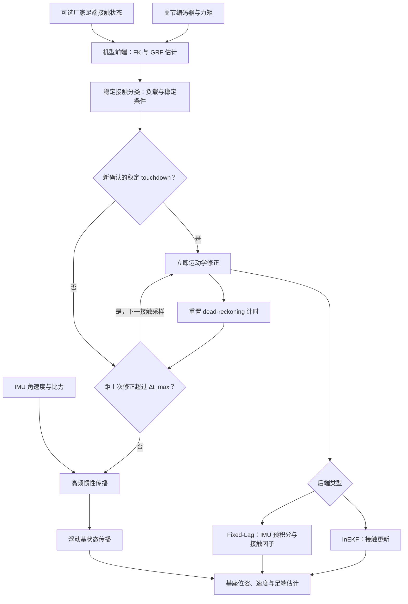
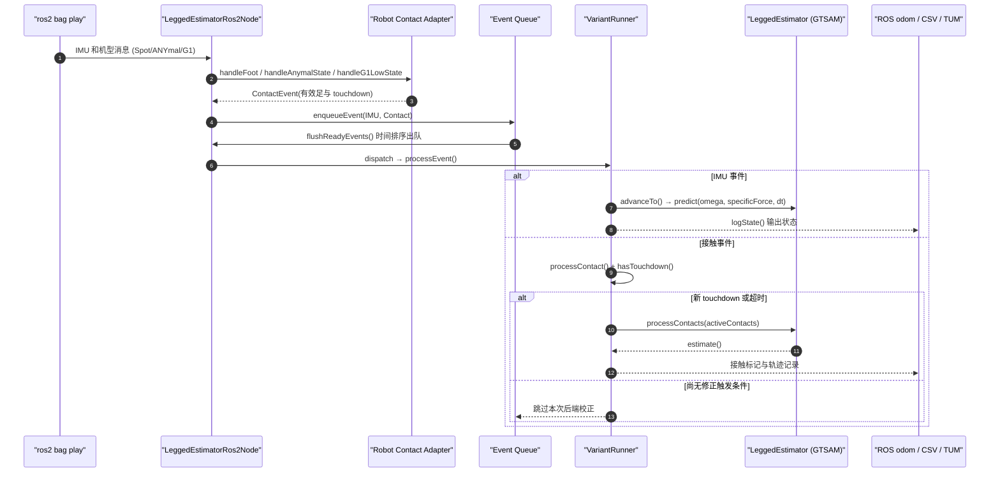

# SG-ODOM：稳定性门控的事件驱动腿式本体里程计 / Event-Driven Proprioceptive State Estimation with Stability-Gated Contact Updates for Legged Robots

**论文身份：** Francesco Iotti, Chiyun Noh, Franco Angelini, Manolo Garabini, Ayoung Kim, Maurice Fallon, Frank Dellaert；arXiv:2611.20710v1（2026-11-16）。[论文全文核对](../../sources/papers/sg-odom-arxiv-2611-20710.md)。

## 一句话定义

**SG-ODOM** 用 IMU 持续传播浮动基状态，将「足端物理触地」与「可作为静止参考的稳定支撑」区分开：稳定支撑被确认时立即进行运动学修正，若长期未出现新触地则由最大 dead-reckoning 间隔触发补充修正。它是一种**修正时机与接触资格机制**，而非新型运动控制策略。

## 英文缩写速查

| 缩写 | 英文全称 | 简要说明 |
|---|---|---|
| SG-ODOM | Stability-Gated Odometry | 稳定性门控的事件驱动本体里程计 |
| IMU | Inertial Measurement Unit | 基座角速度/比力，负责高频惯性传播 |
| GRF | Ground Reaction Force | 足端地面反力；用于判定受力是否稳定 |
| FK | Forward Kinematics | 从关节编码器解算机体系足端位置 |
| InEKF | Invariant Extended Kalman Filter | 李群不变误差扩展卡尔曼滤波 |
| FL | Fixed-Lag Smoother | 固定时间窗因子图平滑器 |
| RPE | Relative Pose Error | 每 1 m 路径段的相对位姿误差 |
| GTSAM | Georgia Tech Smoothing and Mapping | 开源滤波与因子图优化库 |

## 为什么重要

| 字段 | 内容 |
|---|---|
| 机构 | 比萨大学（Università di Pisa）、首尔国立大学（Seoul National University）、牛津大学（University of Oxford）、佐治亚理工学院（Georgia Institute of Technology）；arXiv HTML v1 作者栏可查 |
| 平台 | ANYbotics ANYmal D（GrandTour 7 missions）、Boston Dynamics Spot（GaRLILEO 4 sequences）、Unitree G1（自采 2 sequences） |
| 任务 | 不依赖视觉/激光作为输入的腿式本体里程计；**不是** VIO/LIO、运动策略评测 |
| 指标 | 相邻 **1 m 路径段**平移/旋转 RPE 的 RMSE；m、°；ANYmal 参考只含位置，故只报平移 |

- 接触脚在刚落地的冲击和负载转移期间可能移动，直接作为世界系静止锚点会污染基座估计（§I、IV）。
- 即使接触可靠，同一支撑阶段高频的足端运动学量测也高度相关，反复修正不保证更精确；反过来仅靠 IMU 传播过久会漂移（§I、V-A）。
- 把接触确认和修正定时拆开，使同一前端可比较 InEKF 递推与 Fixed-Lag 优化两种后端（§III）。

## 核心原理

### 流程总览（原文 Fig. 1–3、§III–IV）

上述主流程描述**论文算法机制**；G1 等平台在公开源码中的稳定性分类细节存在不同实现，见「源码运行时序图」及「局限与风险」。

### 状态、稳定接触与更新调度

- **状态：** `X_k=(R_B^N,p_B^N,v_B^N)∈SE₂(3)`；机体系足端 FK 位置 `z_i^B=(R_B^N)^T(f_i^N-p_B^N)+n_i`（Eq.1–2）。InEKF 将当前足端位置纳入扩展状态；FL 每次确认接触建立 episode landmark，并以 IMU 预积分约束事件间基座状态。
- **稳定判据（论文 Eq.6–9）：** 用关节力矩残差与雅可比求足端 GRF，取竖直分量 `F_i(t)`；`s_i(t)=[F_i≥F_on]∧[|F_i(t)-F_i(t-Δt_F)|≤ΔF_max]` 连续满足 `T_on` 才将 `γ_i` 置 1，卸载条件保持 `T_off` 后置 0。判定「可估计」而非尽早判断「物理触地」。
- **事件调度：** 新稳定 touchdown 立即更新；没有新事件时，在 `Δt_max` 到期后的下一次有效接触采样更新。每次更新重置定时；持续评估所有接触消息，不等于定频降采样。
- **后端：** `invariant_ekf` 用左不变误差状态及接触观测滤波；`fixed_lag_combined_bias` 用接触 episode landmark、事件状态、IMU bias 随机游走与固定滞后窗口优化（§III-B）。

### 频率和接触策略消融（Table I–IV）

- `Δt_max` 从 0.01 到 0.30 s 对比；作者选用 **0.10 s** 做后续实验。ANYmal Fixed-Lag 平移 RPE：0.01 s **0.406 m**，0.10 s **0.157 m**，0.30 s **0.418 m**；频繁更新并不保证低误差。
- 同一种后端固定时，稳定接触策略较简单力阈值更优：ANYmal 的 FL **0.157 vs 0.259 m**；Spot **0.185 vs 0.190 m**；G1 **0.109 vs 0.113 m**（Table IV）。三平台提升量级不同。

## 源码运行时序图

**核对的真实运行入口：** 官方 README 的 `ros2 bag play /path/to/bag_sequence` + `ros2 launch gtsam_legged_replay_example sg_odom.launch.xml robot_type:=g1`；对应 `sg_odom/launch/sg_odom.launch.xml` 与 `sg_odom/src/LeggedEstimatorRos2Node.cpp`。

代码实际检查：`VariantRunner::processContact` 中先判 `hasTouchdown(activeContacts)`，否则判断 `estimator.max_dead_reckoning_seconds` 超时，再调 `estimator_->processContacts`；`processImu` 通过 `advanceTo` 调 `predict`。源码路径、ROS 话题、构建命令详见 [官方仓库源码核对](../../sources/repos/sg-odom.md)。

## 实验与评测

| 平台/参考 | 方法与数据集 | 平均平移 RPE_t ↓ | 平均旋转 RPE_r ↓ | 解释 |
|---|---|---:|---:|---|
| ANYmal D · GrandTour 七条 · Leica 位置参考 | SG-ODOM-FL / 原厂 ANYbotics | **0.157 m / 0.208 m** | 无（参考未提供姿态） | 降约 24.5%；七条中五条最佳，HEAP-1 不如原厂 |
| Spot · GaRLILEO 四条 · LiDAR 地图定位或 Vicon | SG-ODOM-FL / Pronto | **0.185 m / 0.226 m** | 0.821° / 0.817° | 平移低约 18%；InEKF 平均旋转 0.814° 更低 |
| Unitree G1 · QUAD + SLOPE · Surfel-LIO 参考 | SG-ODOM-FL / Unitree odometry | **0.109 m / 0.248 m** | **3.859° / 5.940°** | 与独立 LiDAR-IMU 里程计的一致性，非绝对真值 |

**口径：** 均为作者报告的每 **1 m 路径段 RPE RMSE**，不是全轨迹 ATE，也不是成功率、控制环频率或在线单次推理时延。Spot/ANYmal/G1 的参考标准不同，数值不宜简单跨平台排名。

## 结论

**SG-ODOM 的有价值贡献在于「先确认稳定足端、再按事件和最大传播间隔修正」，而非把关节采样率全部送进后端；在作者三平台离线序列上可减少 1 m 相对位姿误差，但仍受接触估计与参考轨迹可靠性约束。**

1. **接触有效性应独立于触地瞬间：** 检查负载建立、冲击残余和接触持续时间，而非只信开关式接触标志。
2. **设置上限而不是盲目提高修正率：** `Δt_max≈0.10 s` 是论文所测步态的实验选择，其他步频/传感器需重新消融，不是通用硬实时定值。
3. **先明确后端代价：** InEKF 适合递推式滤波接口；Fixed-Lag 需要优化窗口与 IMU bias 配置，本文结果不等同于算力/延迟优势。
4. **多平台接口可复用，但前端不能照抄：** Spot/ANYmal 与 G1 的接触传感器、力估计和当前代码稳定性判据并不完全相同。
5. **复现须按参考条件报表：** ANYmal 仅有平移参考，G1 用 Surfel-LIO 伪参考；不要把 G1 的 0.109 m 解释为外部绝对定位误差。
6. **对控制闭环的价值尚需自验：** 论文没有直接证明 WBC/RL 任务成功率或低延迟闭环收益，应在真机额外验证落地。

## 工程实践

| 项目 | 源码落实与工程提示 |
|---|---|
| 开源状态 | [ori-drs/SG-ODOM](https://github.com/ori-drs/SG-ODOM) 已发布 C++/ROS 2 实现（BSD-3-Clause），非占位 |
| ROS 2 环境 | README 测试 Ubuntu 24.04 / Jazzy，GTSAM `develop`（4.3a1）；支持 Docker、`colcon build` |
| 运行 | `ros2 bag play` + `ros2 launch gtsam_legged_replay_example sg_odom.launch.xml robot_type:=spot/anymal/g1` |
| G1 输入 | `/lowstate` 包含 IMU、下肢电机状态 `tau_est`；当前 `UnitreeG1Adapter` 由 `Mode::kFilteredThreshold` 估算接触 |
| ANYmal/Spot | 允许厂家 contact state 或 joint-torque-GRF 模式；GRF 稳定门控是窗口力变化与持续时段判定 |
| 输出 | `/legged_estimator/odom`、`/legged_estimator/path`、足端标记与可选诊断、CSV/TUM |
| 验证 | 先重放录包比对 `RPE_t/RPE_r`、接触误判时段、`Δt_max`、计算占用及控制链时延，再考虑真机集成；本文未提供独立部署时延结论 |

## 与其他工作对比

- [State Estimation](../concepts/state-estimation.md)：从「IMU 预测 + 足端更新」的通用模型推进到「何时接受足端、何时修正」。
- [Contact Estimation](../concepts/contact-estimation.md)：接触概率或力阈值与「估计可用稳定支撑」并非同一目标。
- [KF vs. 优化估计](../comparisons/kalman-filter-vs-optimization-based-estimation.md)：用同一事件调度比较滤波式 InEKF 与优化式 Fixed-Lag，而非简单声称后者普遍更优。

## 局限与风险

- **G1 源码/论文实现差别：** 公开 `StabilityGatedContactClassifier.cpp` 里 ANYmal/Spot 使用 `classifyWindowedDwell`；G1 `UnitreeG1Adapter.cpp` 则使用滤波阈值 `classifyFilteredThreshold` 和滞回，无相同的力变化窗口及 `T_on` 判据。复现论文所有平台的「统一门控」前需核对具体版本/分支。
- **参考轨迹不同：** G1 无外部绝对真值，只能相对 Surfel-LIO；ANYmal 没有姿态真值；Spot LiDAR 定位/Vicon 混用，不能跨机器人直接比较绝对性能。
- **性能依赖调参：** FL bias 随机游走参数按机器人经验选择，未用统一 Allan 方差标定；0.10 s 的结果受步态速度、运动形态与地形影响。
- **数据覆盖有限：** G1 仅两条户外铺装路面与 4° 坡；论文未证明高度动态、不稳定接触、强滑移工况可直接泛化。
- **绝对定位不可观：** 纯本体里程计不提供长期全局位姿/yaw 约束，闭环长程导航仍需外感知或额外锚定。

## 关联页面

- [State Estimation](../concepts/state-estimation.md)
- [Contact Estimation](../concepts/contact-estimation.md)
- [Locomotion](../tasks/locomotion.md)：足式机器人任务上游的状态估计与接触判断。
- [人形行走任务](../tasks/humanoid-locomotion.md)：G1 双足接触与本体里程计，是全身控制的观测链基础。
- [里程计与 LiDAR 融合定位](../methods/lidar-odometry-fusion.md)：本文纯本体相对里程计可作为高频预测源；长期航向/位置漂移需要外感知约束，不能把本方法称为 LIO。
- [KF / Optimization-based Estimation 选型](../comparisons/kalman-filter-vs-optimization-based-estimation.md)
- [Unitree G1](./unitree-g1.md)
- [传统模型控制纵深 Stage 4](../../roadmap/depth-classical-control.md)

## 参考来源

- [arXiv:2611.20710v1 正文 §I–VI 和 Table I–VII 归档](../../sources/papers/sg-odom-arxiv-2611-20710.md)
- [官方 ROS 2 运行入口及分类器源码核对](../../sources/repos/sg-odom.md)

## 推荐继续阅读

- [原论文 HTML v1](https://arxiv.org/html/2611.20710v1)
- [官方 GitHub、README 与源码](https://github.com/ori-drs/SG-ODOM)
- [作者补充视频](https://youtu.be/-583_RyuhqQ)
