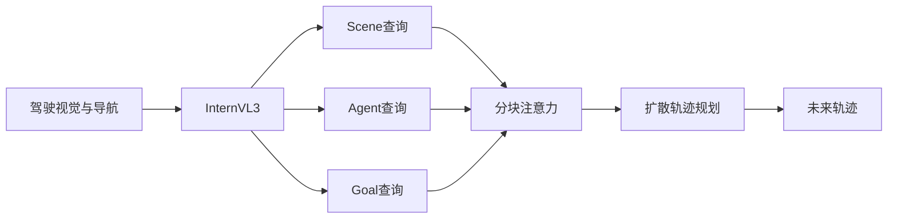
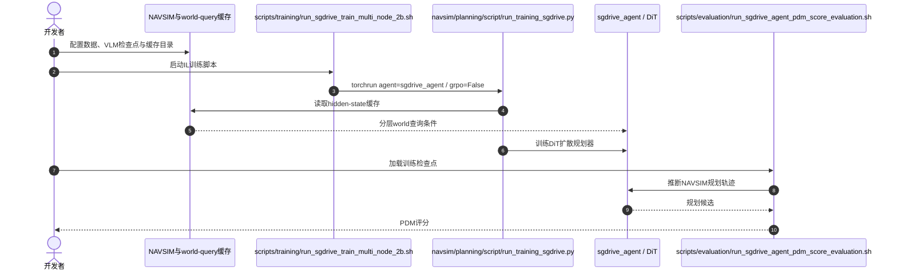

# SGDrive：场景、关键交通参与者和短期目标的分层认知

**英文：** SGDrive: Scene-to-Goal Hierarchical World Cognition for Autonomous Driving

## 一句话定义

在VLM中引入场景/agent/goal分层世界知识查询，通过block-wise attention避免信息泄漏，世界表征作为条件送入DiT扩散规划器，并可进行强化微调。

## 英文缩写速查

| 缩写 | 英文全称 | 简要说明 |
|---|---|---|
| VLM | Vision-Language Model | 场景理解骨干 |
| E2E | End-to-End | 从观测到规划的端到端模型 |
| RL | Reinforcement Learning | 奖励信号驱动的优化 |
| VLA | Vision-Language-Action | 视觉语言动作联合学习 |

## 为什么重要

场景、关键交通参与者和短期目标的分层认知专门针对单纯模仿驾驶轨迹难以解释或处理长尾交互的限制，提供可核查的论文、权重或代码入口。

## 核心原理

在VLM中引入场景/agent/goal分层世界知识查询，通过block-wise attention避免信息泄漏，世界表征作为条件送入DiT扩散规划器，并可进行强化微调。

## 流程总览



此流程根据 [原始论文记录](../../sources/papers/ad_top10_2026_sgdrive.md)，非跨项目通用套图。

## 源码运行时序图



按官方README和 [源码入口记录](../../sources/repos/ad_top10_2026_sgdrive.md) 核对；**未在本次 ingest 执行完整 GPU 推理或训练**。

## 评测与指标

官方NAVSIM v1 navtest报告VLM 85.5、IL 87.4、RL 91.1 PDMS；v2另用EPDMS指标。

## 工程实践

官方仓库：https://github.com/LogosIntelligenceLab/SGDrive

1. ```sh scripts/training/run_sgdrive_train_multi_node_2b.sh```
2. ```sh scripts/training/run_sgdrive_train_multi_node_2b_rl.sh```
3. ```sh scripts/evaluation/run_sgdrive_agent_pdm_score_evaluation.sh```

## 结论

**场景、关键交通参与者和短期目标的分层认知** 是驾驶研究中一条具有独立问题设定的复现路线。

1. 先使用官方公开checkpoint与现有评测脚本建立基线。
2. 明确划分论文提出的完整系统和当前代码实际已开放的部分。
3. 记录数据、版本、硬件与指标，避免不同评测设定的数字错比。

## 与其他工作对比

- **对比 VLM+DiT 及多传感器规划器（NAVSIM v1 navtest，Table 1）：** 在两阶段 SFT 口径下，基于 2B 骨干的 `SGDrive-2B` 取得 **87.4 PDMS**，高于同为 SFT 的 [ReCogDrive](./paper-recogdrive-2506-08052.md)-2B（86.5）、ReCogDrive-8B（86.8）、AutoVLA-3B（80.5）以及纯视觉非 VLM 基线 `Epona`（86.2）、`PARA-Drive`（84.0）、[UniAD](./paper-uniad.md)（83.4）；在相同的 RL 后训练（RFT）协议下，`SGDrive-2B` 达到 **91.1 PDMS**，优于 ReCogDrive-2B（90.8）、ReCogDrive-8B（90.5）、AutoVLA-3B（89.1）与含 LiDAR 基线 `SeerDrive`（88.9）、`WoTE`（88.3）及 [DiffusionDrive](./paper-diffusiondrive.md)（88.1）。
- **对比 NAVSIM v2 扩展指标（Table 2）：** `SGDrive-2B (SFT)` 达到 **86.2 EPDMS**，优于 DiffusionDrive（84.3）、ReCogDrive-8B（83.6）与 ARTEMIS（83.1），无碰撞（NC 98.6）与 TTC（97.9）突出，但可行驶区域合规（DAC 94.3）略低于 ReCogDrive-8B（95.2）与 DiffusionDrive（96.0）。
- **与 ReCogDrive 的结构差异（§4.3 / Table 6）：** ReCogDrive 将未显式分区的 VLM 隐状态送入 DiT；SGDrive 显式结构化为 Scene / Agent / Goal 分层世界查询并配合分块注意力隔离跨类别噪声，定性对比中能更好抑制多交通参与者避让和弯道偏离碰撞，二者均需 1–2 TB 训练缓存。

## 局限与风险

部分权重仍有coming soon标记，需核对HF可得资产；训练缓存需求可达1–2TB；无法由PDMS推导真实道路安全。

真实上路安全和合规均不能由离线分数、仿真结果或开源状态单独证明。

## 关联页面

- [2026 自动驾驶开源项目技术地图](../overview/autonomous-driving-open-source-top10-2026.md)
- [VLA](../methods/vla.md)
- [生成式世界模型](../methods/generative-world-models.md)

## 参考来源

- [论文核对记录](../../sources/papers/ad_top10_2026_sgdrive.md)
- [官方源码入口](../../sources/repos/ad_top10_2026_sgdrive.md)
- [深蓝AI策展原文](../../sources/blogs/wechat_shenlan_ai_autonomous_driving_top10_2026.md)

## 推荐继续阅读

- [原论文](https://arxiv.org/html/2601.05640)
- [官方代码](https://github.com/LogosIntelligenceLab/SGDrive)
