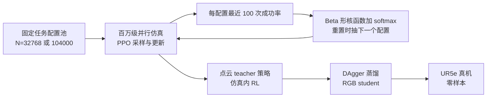

# SGS：把 RL 训练预算投到策略能力前沿

## 一句话定义

**SGS（Success Guided Sampling）是 PPO 外层的一个简单采样器：对固定的任务配置集合，用每个配置最近 H=100 次的成功率，经 Beta 形核函数和 softmax 决定下一个 episode 从哪个配置 reset，让大规模并行仿真的样本集中在「既不太易也不太难」的配置上**（论文 §3.2）。论文题为 [A Balanced Data Diet: Addressing the Exploration Bottleneck in Mega-Scale RL for Robot Control](https://arxiv.org/abs/2610.12465)，CoRL 2026（Austin），作者来自华盛顿大学（UW）与 NVIDIA，项目页 [sgs-rl.github.io](https://sgs-rl.github.io/)。

## 英文缩写速查

| 缩写 | 英文全称 | 简要说明 |
|------|----------|----------|
| SGS | Success Guided Sampling | 按配置成功率自适应采样 reset 配置 |
| PPO | Proximal Policy Optimization | 论文训练所用的 on-policy 算法，更新本身未改 |
| PLR | Prioritized Level Replay | 论文的采样基线，本文用绝对 GAE 作 learnability 分数加 staleness 奖励（§4.3） |
| SFL | Sampling for Learnability | 以 p(1-p) 给关卡排序的相近方法，仅在 locomotion 上对比（§2, Table 1） |
| OmniReset | Emergent dexterity via diverse resets and large-scale RL | 提供 Reaching / Stable Grasp / Near-Goal 三类 reset 的前作，SGS 沿用其 reset 与真机管线（§3.1, 附录 C） |
| NIST ATB | NIST Assembly Task-Board | 论文 UR5e 与 Franka 装配任务来源（§4.2） |
| OSC | Operational-Space Control | UR5e 使用的操作空间控制，Franka 用关节位置控制（§4.2） |
| GAE | Generalized Advantage Estimation | PLR 打分用到 |
| DAgger | Dataset Aggregation | 把点云 teacher 蒸馏成 RGB student 的方法（§4.5） |

## 为什么重要

- **作者的问题陈述：** 模拟器 reset 多样化加大规模并行可以减轻奖励与示范工程，但朴素地把环境数放大到更精密或更动态的任务上并不顺利；均匀采样会把越来越多的样本花在策略已掌握或暂时做不到的配置上，批次里大量学习信号被浪费（摘要，§1）。
- **作者的主张：** SGS 让增加并行环境数带来更密的学习信号而不是收益递减（§3.3）；在最高 2^20（超过一百万）环境上，locomotion 与 nut-and-bolt 装配出现随规模单调改进，而均匀采样、PLR 等「难以受益或崩溃」（§4.3）。
- **我的判断：** 价值在于「采样分配」这一正交于优化器的杠杆，改动小（几行 bookkeeping 加 softmax），且论文把它与 reset 多样性、共享单奖励放在同一套无示范流程里评估；但它不构造配置分布，依赖前置的 reset 多样性（§5）。作者也明说「不主张全新课程原则」，与 SFL 同属强调中等成功率的思路（§2）。

## 核心原理与流程总览

### 问题与配置

目标条件 MDP，任务配置 τ=(s0, g, e)，分别是初始状态、目标、环境配置（§3.1）。

- **locomotion：** 一个配置固定地形类型与几何、机器人起点和目标；13 类地形（斜坡、坑、缺口、楼梯、辐射梁、平衡木、踏脚石，以及五类更难的程序生成地形：迷宫、轮廓地形、四种浮岛变体），**单个策略**跨所有地形从零训练；机器人为 ANYmal-D（§4.1）。配置数 N=104,000：每地形 2 个 seed、10 难度级、20 起点、20 目标（附录 A.1，乘积为本页核算）。
- **manipulation：** 配置包含装配任务、机器人与物体初始状态、插座位姿；目标固定为装配完成位姿；初始状态取自 OmniReset 的 Reaching、Stable Grasp、Near-Goal 三类，预先采集 N=32,768 个碰撞检查过的配置（§3.1, 附录 A.2）。每个操作任务**单独训练一个策略**，locomotion 才是联合训练（附录 A.2）。

### 采样器

1. 训练前固定采样 N 个配置；每配置存最近 H=100 次布尔结果的环形缓冲，均值为成功率 p_i（§3.2, B.2）。
2. 权重 w_i = (p_i+ε)^(κt) (1-p_i+ε)^(κ(1-t))，即 Beta(1+κt, 1+κ(1-t)) 的 mode-concentration 形式，t 为目标成功率、κ 为集中度（式 1）。ε 保证每个配置采样概率非零，以便持续更新其估计。
3. logit ℓ_i = log(w_i+ε)，下一配置从温度 T 的 softmax 中 i.i.d. 抽取（式 2）。
4. 超参：T=2、H=100；locomotion t=0.66、κ=5、ε=1e-8；manipulation t=0.5、κ=1、ε=1e-4（§3.2）。其中 manipulation 的 κ、t 来自 κ∈{1,5,10}、t∈{0.33,0.5,0.66} 的小网格搜索，领先幅度很小（B.2）。

### 训练与部署链路

### 共享奖励（§3.3, 附录 A.3）

每个域一个奖励：主要是回合末的布尔成功项加小的逐步正则项。locomotion 成功 +50、失败 -50，外加功率、姿态、触地速度、非足部接触、前向对齐项；manipulation 成功 λsucc=100，失败（关节速度过大或物体出界）λfail=1，外加动作幅度、动作变化率、臂关节速度惩罚。论文称训练不用示范（§1）。

## 工程实践

- **算力与规模（§4.3）：** 缩放实验 4K/32K/256K/1M 环境、每点 3 个 seed；PPO mini-batch 数固定、batch 随环境数增加；locomotion 5K 次 PPO 迭代约 36 小时，Franka nut-and-bolt 7.5K 次迭代约 128 小时（每 GPU 最多 32,768 / 16,384 个环境，L40S 与 H200）。UR5e nut-and-bolt 训练约 335 小时，因其策略频率 10 Hz（20 个物理步/动作）对比 Franka 25 Hz（8 个物理步/动作）（附录 A.2）。
- **配置密度（B.2）：** locomotion 32K 环境下，配置数 52,000→104,000 成功率 0.38→0.49，208,000 为 0.48，说明多样性有益但到一定程度后平台化。
- **超参敏感性（B.2, Table 3）：** locomotion 32K、两 seed 下各设置成功率 0.39 到 0.53，名义设置 0.49；历史窗口 H=25 最低（0.39）。作者结论是「不太敏感，但小规模搜索有益」。
- **reset 覆盖（B.3, Table 4）：** UR5e rod-in-hole 去掉 Near-Goal reset 后成功率为 0；去掉 Reaching 几乎不变；去掉 Stable Grasp 下降且 3 个 seed 中 1 个崩溃。即 SGS 依赖一个包含近目标配置的 reset 集合。
- **重力课程（§4.2, B.4）：** 主缩放实验用了零重力起步的重力课程，作者后来发现不必要：1M 环境 Franka 单 seed 无课程 0.694±0.040，有课程 0.702±0.039（512 个评估 episode 的 95% CI，不跨 seed）。
- **sim-to-real 管线（§4.5, 附录 C）：** 点云 teacher 蒸馏成 RGB student（侧面与腕部相机，各一个 ResNet-18），用 DAgger，约两天，4 块 L40S 各 480 环境；预留 6.67% 环境做留出评估。夹爪垫摩擦从 OmniReset 的 µ=100 降到 µ=2，因为过高摩擦让不物理的抓取也成功（C.2）；reset 与奖励对物体等价朝向取对称（C.3）；真机上用胶带覆盖抛光亚克力板并用 command strips 固定板子（C.1, C.5）。
- **代码：** 项目页与归档均显示 Code coming soon，无官方仓库，故 frontmatter 未写 `code:`。截至本页更新未发现可核实的仓库。

## 实验结果（论文自述）

| 实验 | 设置 | 结果 | 出处 |
|---|---|---|---|
| 多地形 locomotion，1M 环境 | ANYmal-D，3 seed | SGS 73%，PLR 54% | §4.3, Fig. 5a |
| Franka nut-and-bolt，1M 环境 | 3 seed | SGS 70%，uniform 6%，PLR 5% | §4.3, Fig. 5b |
| UR5e rod-in-hole 缩放 | 32K 环境 | SGS 成功，uniform 与 PLR 为 0；256K 时各方法约 98% | §4.3, §4.4, Fig. 5c |
| locomotion 对比 SFL | 4K / 32K | SFL final 0.255 / 0.051，SGS 0.456 / 0.494（SFL best 0.289 / 0.421） | Table 1 |
| UR5e 六任务，Reaching 分布 | nut-and-bolt 256K 环境，其余 64K | nut-and-bolt：SGS 90.04，uniform 48.83，PLR 59.77；其余五个插入任务 SGS 与 uniform 相近（如 rod-in-hole 95.70 vs 95.90，BNC 84.08 vs 83.40） | 附录 B.5, Table 6 |
| 真机零样本（RGB student） | 约 83 / 42 / 15 分钟连续运行 | nut-and-bolt 37.5%（18/48），first-try 12.5%；rod-in-hole 61%（30/49），28.57%；gear mesh 94%（47/50），76.0% | §4.5, Table 2, C.5 |

项目页另给出各规模的完整曲线数值（如 ANYmal D 在 4K 时 SGS 0.46，其余方法 0.00；Franka 256K 时 SGS 0.10±0.14），这些来自项目页而非 PDF 文字层，见 [项目页归档](../../sources/sites/sgs-rl-github-io.md)。

## 与清单说法的核对

对象：Glen Berseth 的 CoRL 2026 阅读清单（P1，RL Algorithms & Exploration）对本文的一句话摘要：「Success-guided sampling of reset configurations keeps mega-scale parallel RL on the frontier of capability, so returns keep scaling.」清单自述该摘要由 LLM 据摘要起草，排序是作者兴趣模型打分，不是质量评价。

| 清单用语 | 与论文核对 |
|---|---|
| success-guided sampling of reset configurations | 属实。SGS 在每个 episode 结束时按各配置成功率采样下一个 reset 配置（§3.2）。注意它从**预先固定**的配置集合里抽，不生成新配置，生成靠 OmniReset 类方法（§5）。 |
| mega-scale parallel RL | 属实，最高 2^20（超过一百万）环境（摘要，§4.3）；但全部是仿真，且单次训练 36 到 128 小时，UR5e nut-and-bolt 达 335 小时（附录 A.2）。 |
| keeps RL on the frontier of capability | 与作者表述一致（「聚焦策略能力前沿的配置」）。这是作者的机制解释，论文展示了 Fig. 7 的采样质量随训练迁移的定性例子，没有对「前沿」做独立量化检验。 |
| so returns keep scaling | **有限定。** 论文说的是成功率（不是 return）随环境数单调提高，且只在 locomotion 和 Franka nut-and-bolt 两项（§4.3）；在较简单的 UR5e rod-in-hole 上 256K 时各方法都约 98%，附录 B.5 的另五个插入任务上 SGS 与 uniform 持平。作者自己的表述是 SGS 在难任务上优于基线、在简单任务上相当（§1 贡献 2）。 |
| （清单未提）真机 | 清单摘要未涉及。论文有 UR5e 零样本真机，但成功率为 37.5% / 61% / 94%（Table 2），nut-and-bolt 仍低，作者承认 sim-to-real 差距未闭合（§5）。 |
| （清单未提）对比范围 | 清单没提基线：对比对象是 uniform、线性课程（仅 locomotion）、PLR，以及 locomotion 上的 SFL。 |

## 局限

**论文自己承认（§5）：**

1. 成功率估计是在 K 个离散配置上做的（K=32,768 够用），连续或大得多的任务空间需要学习式或层级式打分表示。
2. SGS 只在给定分布上采样，不构造分布，依赖 OmniReset 等 reset 多样性方法提供覆盖；「该开放哪些配置」的闭环是未解决问题。
3. sim-to-real 差距仍在，要达到仿真成功率留待后续。

**我看到的未验证之处（判断，非论文自述）：**

- 主缩放比较只有两项任务（locomotion、Franka nut-and-bolt），各 3 个 seed，Franka nut-and-bolt 的 SGS 置信区间在项目页较宽（1M 时 0.70±0.19）；「随规模单调改进」的普适性未验证。
- UR5e 与 Franka 的 nut-and-bolt 成功率差异被作者归因于控制接口（OSC 对比关节位置控制），但机械臂、夹爪、策略频率也不同，未做控制变量消融（B.5）。
- 重力课程消融只有一个训练 seed（B.4），结论「不必要」证据较弱；主结果仍是带课程跑的。
- 超参敏感性实验是两个 seed 的 32K locomotion（Table 3），manipulation 的 κ、t 仅小网格搜索。
- 真机每任务仅一轮连续评估（48/49/50 次），未报告多板位、多次重复的方差；nut-and-bolt first-try 仅 12.5%。真机评估对板面做了胶带覆盖和固定，条件比开放场景友好（C.1, C.5）。
- 官方代码未公开，独立复现需从论文超参自行实现；与 PLR 的对比实现细节（如用 |GAE| 作分数）是作者选择，PLR 其他设置的调参程度论文未详述。

## 关联页面

- [PPO（近端策略优化）](../methods/ppo.md)：SGS 外层不改动的算法
- [强化学习方法总览](../methods/reinforcement-learning.md)
- [课程学习](../concepts/curriculum-learning.md)：SGS 属自动任务选择，不依赖人工排序的难度
- [域随机化](../concepts/domain-randomization.md)：蒸馏与真机迁移用到的随机化
- [Sim2Real](../concepts/sim2real.md)
- [接触丰富操作](../concepts/contact-rich-manipulation.md)
- [机器人运动](../tasks/locomotion.md)
- [机器人操作](../tasks/manipulation.md)
- [DAgger](../methods/dagger.md) 与 [师生 DAgger 训练](../methods/teacher-student-dagger-training.md)：点云 teacher 到 RGB student 的蒸馏
- [ANYmal](../entities/anymal.md) 与 [Isaac Lab](../entities/isaac-lab.md)
- [Learning to Walk in Minutes（并行 DRL）](../entities/paper-anymal-walk-minutes-parallel-drl.md)：大规模并行 locomotion RL 的前序

## 参考来源

- [arXiv:2610.12465v1 归档与通读记录](../../sources/papers/sgs_arxiv_2610_12465.md)
- [SGS 官方项目页归档](../../sources/sites/sgs-rl-github-io.md)
- 论文：Zhang, Castro, Yin et al., A Balanced Data Diet, CoRL 2026（见 [arXiv abstract](https://arxiv.org/abs/2610.12465)）

## 继续阅读

- OmniReset（Yin et al., arXiv:2603.15789）：SGS 的 reset 分布与真机管线来源（论文参考文献 [12]）
- Prioritized Level Replay（Jiang et al., ICML 2021）与 Sampling for Learnability（Rutherford et al., NeurIPS 2024）：SGS 的两个直接对照
- Preventing learning stagnation in PPO by scaling to 1 million parallel environments（arXiv:2603.06009）：优化器侧处理同一规模问题（论文参考文献 [40]）
