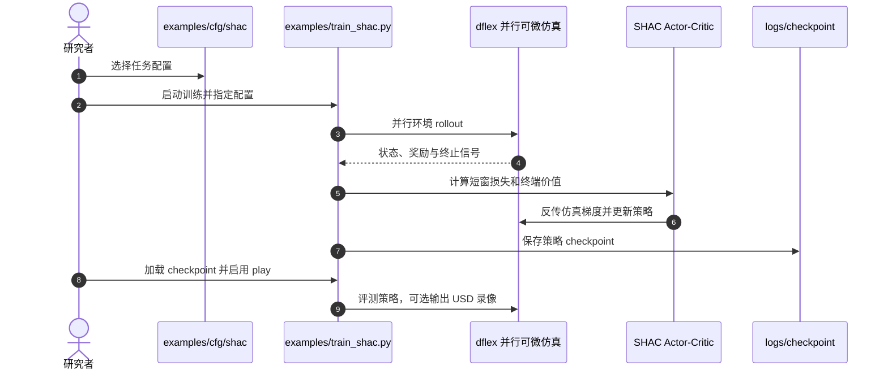

# SHAC：并行可微仿真加速策略学习

**一句话定义：** SHAC（Short-Horizon Actor-Critic）在 GPU 并行可微仿真上反传短视界轨迹梯度，并由 critic 近似窗口外的长期价值。

## 英文缩写速查

| 缩写 | 英文全称 | 简要说明 |
|------|----------|----------|
| SHAC | Short-Horizon Actor-Critic | 将短视界仿真梯度与 critic bootstrap 结合的策略学习方法 |
| AD | Automatic Differentiation | 沿可微仿真计算图对策略参数求导 |
| PPO | Proximal Policy Optimization | 论文的 model-free 对照算法 |
| MTU | Muscle-Tendon Unit | 论文高维人形示例的动作空间来源 |

## 为什么重要

SHAC 展示了在可微仿真可信的条件下，如何将轨迹梯度用于复杂接触控制，并以 actor-critic 结构保留长时域目标，减少纯 model-free 策略梯度的样本需求。

## 方法栈

短视界 rollout 上累积奖励并直接反传；窗口终点的 critic 估计其后的回报。策略用梯度更新，critic 用 bootstrapping 补充截断窗口之外的长期信号。平滑 critic 近似带噪优化目标，截断窗口缓解长反向路径的梯度消失或爆炸。

## 源码运行时序图

官方 NVlabs/DiffRL README 提供训练、checkpoint 回放和多环境入口：

## 实验与评测

论文覆盖经典控制与肌肉驱动运动任务。在 152 维动作的 Humanoid MTU 实验中，作者报告 SHAC 达到 PPO 相同回报约需 35 分钟和 1.7M 仿真步；相对 PPO 报告超过 17 倍墙钟效率与 382 倍样本效率。论文还报告训练约 1.5 小时后策略回报达到 model-free 基线最佳策略的两倍。数字依赖论文任务与实验平台。

## 与其他工作对比

| 方法 | 梯度来源 | 主要取舍 |
|------|----------|----------|
| SHAC | 显式可微仿真器 | 利用仿真轨迹梯度；要求动力学近似与求导稳定 |
| [PPO](../methods/ppo.md) | 采样策略梯度与优势估计 | 不要求仿真器可微；通常需要更多 rollout 样本 |
| [SuperDyno](./paper-superdyno.md) | 学习到的神经动力学 | 模型拟合误差可能影响策略优化 |

## 结论

**SHAC 用短视界可微 rollout 提供直接梯度，并用 critic 补上截断窗口外的长期价值。**

1. 截断窗口是在梯度稳定性与长程信用分配间的折衷。
2. 论文报告高维 Humanoid MTU 上的效率收益，但倍率依赖任务、硬件和对照实现。
3. 并行环境提高吞吐，不会消除接触建模误差或仿真偏差。
4. 学习的动力学代理是另一条路，但需验证预测误差与策略泛化。

## 局限与风险

- 接触事件与不连续动力学可能令梯度不稳定。
- 固定窗口长度需要调参；过短更依赖 critic，过长加重计算和反传困难。
- 论文的肌肉驱动角色控制结果不等同于人形真机部署收益。

## 关联页面

- [可微仿真](../concepts/differentiable-simulation.md)
- [强化学习](../methods/reinforcement-learning.md)
- [PPO](../methods/ppo.md)
- [SuperDyno](./paper-superdyno.md)

## 参考来源

- [SHAC 论文来源归档](../../sources/papers/accelerated_policy_learning_shac_iclr_2022.md)
- [官方项目页归档](../../sources/sites/short-horizon-actor-critic.md)
- [官方实现归档](../../sources/repos/nvlabs-diffrl.md)

## 推荐继续阅读

- [SHAC 官方项目页](https://short-horizon-actor-critic.github.io/)
- [NVlabs/DiffRL](https://github.com/NVlabs/DiffRL)
