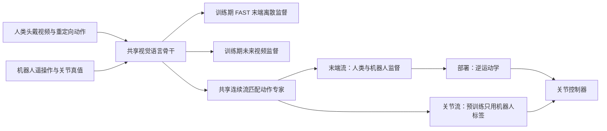

# SHAPE: Discrete Supervision and Parallel Continuous Streams for Learning Dexterous Manipulation from Egocentric Human Data · 第一视角人类数据驱动的双流灵巧操作

## 一句话定义

SHAPE 用人手和机器人动作的共用离散末端 token 训练视觉语言骨干，执行时选连续关节流直控，或选连续末端流经逆运动学落到关节。

## 英文缩写速查

| 缩写 | 英文全称 | 说明 |
|---|---|---|
| VLA | Vision-Language-Action | 接收视觉、指令与可用状态并生成行动 |
| EEF | End Effector | 手腕与指尖等任务空间表示 |
| FAST | Frequency-space Action Sequence Tokenization | 以频域压缩连续动作块，本文用作训练期离散监督 |
| IK | Inverse Kinematics | 把目标手腕与指尖位姿转成可执行关节目标 |
| H2R | Human-to-Robot | 下游任务只用人类示教微调，再部署到真机 |

## 核心信息

| 项目 | 内容 |
|---|---|
| 论文 | arXiv:2611.24585v1，2026-11-18 |
| 机构 | Sharpa Robotics、香港中文大学、上海交通大学–Sharpa 具身智能联合实验室（论文 v1）；项目页另外列中国科学技术大学 |
| 预训练数据 | 2,811 小时、73,077 条可用人类轨迹（320 项任务）；228 小时、10,505 条可用机器人遥操作轨迹（105 项任务）；训练按 1:1 采样 |
| 实机 | 双 7 自由度手臂、双 22 自由度灵巧手；头部与双腕相机 |
| 开放情况 | 有论文、项目页、演示与图表；截至核对日未确认 SHAPE 源码、权重或训练语料公开 |

## 为什么重要

只用人类视频时，末端运动可经重定向成为监督，但同样的关节增量在不同起始姿态会走出不同路径。SHAPE 让同一个 checkpoint 保留两种执行接口，能把这种读出差异与训练数据差异分开对照，而不是给两种动作表示各训练一个不同模型。

## 核心原理

- 训练先将人手估计与重定向，末端流学习当前腕坐标系下的相对腕位姿及指尖偏移。机器数据同时提供相对关节增量，人类预训练不监督关节流；缺失维度遮罩。
- Qwen3-VL-4B 骨干预测归一化 EEF 块的 FAST tokens，直接接收动作梯度；另有子任务文本、未来视频监督。共享约 0.6B 的 flow-matching 专家有独立投影，输出标称 55 维末端或 65 维关节，注意力不读取 FAST tokens 或另一连续流。
- 实机执行只选一个连续流；关节流直送关节控制，末端流通过 IK 解腕与指尖。FAST 和视频头不负责部署控制。

## 实验结果与基线对比

| 口径 | SHAPE | 对照与限制 |
|---|---|---|
| 六项真机，有任务专用遥操作 | 关节流得分 0.80；末端流 0.52 | π0.5 0.63，GR00T N1.7 0.51；两个插拔任务给部分分，不能说 80% 全任务成功 |
| 同一组六项，严格完整做完 | 76/120（63.3%） | π0.5 61/120；GR00T N1.7 51/120。SHAPE 两项连接器最终重新插入各仅 2/20 |
| 三项真机，仅人类任务示教微调 | 末端 21/60（35%），同 checkpoint 关节 0/60 | 人类预训练但无 FAST 7/60（11.7%）；四组下游均停用 FAST。预训练有通用机器人数据，不是零机器人数据训练 |
| RoboCasa GR-1，24 项仿真 | 关节 72.2% | π0.5 64.8%，GR00T N1.7 62.6%；使用 20,802 条 GR-1 遥操作训练轨迹，是微调后的仿真结果 |

## 工程实践

- 复现两条流时固定 checkpoint、初始化姿态、相机遮罩与动作块执行长度。附录实机动作 60 Hz，预测 64 步后执行 50 步（约 0.83 秒）再规划；GR-1 仿真每块执行 12 步。都不是模型推理耗时或驱动器闭环频率。
- 同一批真机验证轨迹，两流右腕开环误差约 11.6/11.5 mm，闭环却差得多。复测时应分别记录腕位姿与指尖误差、抓紧/滑脱、接触后的完成率，不只看末端位置误差。
- 分开统计各动作阶段和严格完成。人类微调关节可用重定向生成的监督，但从机器人 home 姿态回放，其腕端抓取点平均相差 10.3 cm（附录 D 的 Pick Eggplant），不能与真机关节示教互换。

## 局限与风险

结果只验证该平台、重定向和标准控制管线。五个 3D 指尖点不足以唯一确定 22 个手关节，关节解与接触质量可能变化；人类微调的 EEF 失败也多在抓紧不足，不能归纳为末端表示普遍优于关节表示。梯度匹配连续头在 H2R 为 18.3%，离散头 35.0%，论文报分层精确检验 p=0.055，不作为达到 5% 显著性的证据。未确认可运行官方源码，图按论文数据与调用关系整理，未做真机复现。

## 结论

在作者验证的工况中，目标任务已有真机关节示教时优先比较关节直出；只有人类任务示教时，先测试腕局部坐标的末端流，并单独验证抓紧与接触。FAST 的作用是在训练期给共享骨干加直接监督，而不是让机器人部署时执行 token。

## 关联页面

- [视觉语言动作模型](../methods/vla.md) — 区分训练损失、动作生成器和最终控制接口。
- [EgoScale](../methods/egoscale.md) — 对照第一视角预训练与目标机器人对齐的数据配方。
- [机器人动作重定向流程](../methods/robot-motion-retargeting-workflow.md) — 对照手腕目标与关节偏移从不同初始姿态执行时的差别。
- [具身大模型分类学选型闭环](../overview/hub-embodied-foundation-model.md) — 区分离散监督与连续输出。
- [具身大模型评测基准选型闭环](../overview/hub-embodied-eval-benchmark.md) — 分开报告阶段得分、严格完成和跨平台评测。

## 参考来源

- [论文归档：arXiv v1 与附录](../../sources/papers/shape_arxiv_2611_24585.md)
- [官网与开放情况归档](../../sources/sites/shape.md)

## 推荐继续阅读

- [π0.5](./paper-pi05-open-world-vla.md) — 对照同样以离散动作监督与连续动作生成结合的路线。
- [具身数据纵深](../../roadmap/depth-embodied-data.md) — 区分预训练语料、配比、目标域微调与评测标签。
