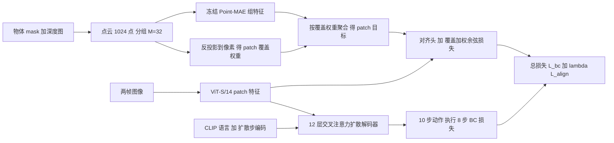

# Shape-teacher alignment（arXiv:2611.08275）

**Aligning Policy Encoders with a Shape Teacher**（[arXiv:2611.08275](https://arxiv.org/abs/2611.08275)，NeurIPS 2026 Embodied Spatial Reasoning Workshop）。

## 一句话定义

训练时用冻结的 Point-MAE 三维形状特征作为对齐目标，监督 2D 扩散策略图像编码器的 patch 特征；部署时教师与深度都不需要，策略结构与输入不变。

## 英文缩写速查

| 缩写 | 英文全称 | 简要说明 |
|------|----------|----------|
| Point-MAE | Masked Autoencoders for Point Cloud Self-supervised Learning | 点云自监督编码器，本文用作冻结的形状教师（第 2 节） |
| REPA | Representation Alignment for Generation | 把扩散模型中间表示对齐到冻结预训练编码器的做法，本文沿用其「加对齐损失」形式（式 5） |
| BC | Behavioral Cloning | 行为克隆，策略的基础训练目标 L_bc |
| ViT/S-14 | Vision Transformer Small, patch 14 | 本文观测编码器，去掉 CLS 保留 patch token |
| DINOv2 | self-DIstillation with NO labels v2 | 语义视觉编码器，本文用作对照教师（第 3.4 节） |
| LIBERO | Lifelong Robot Learning benchmark | 操作基准，本文用 Object 与 Spatial 两个套件 |

## 为什么重要

- 3D 输入的策略更抗视角、位置与遮挡变化，但需要深度相机、标定与处理；纯图像策略部署简单却缺几何信息（第 1 节，作者自述）。
- 本文给出折中：几何只在训练期注入，部署成本不变（第 2 节末）。
- 同一对齐框架换教师会改变表征结构（Point-MAE 偏形状，DINOv2 偏同物体语义，第 3.4 节），把「对齐」当作可选的结构先验而不只是加速技巧。

## 核心原理

1. 对每个物体，用 mask 加深度图得到点云，重采样 1024 点，每 32 点一组，Point-MAE 给每组一个特征（第 2 节）。
2. 点反投影到像素，按落入 patch 的比例 φ(a,p)（式 1）加权，把各组特征聚合成每个 patch 的目标 t_p^j（式 2、3）。
3. 图像编码器 patch 特征经对齐头 h 后与目标做覆盖加权余弦距离（式 4），总损失 L = L_bc + λ L_align（式 5，默认 λ = 3，DINOv2 对照 λ = 1）。
4. 教师冻结且只在训练期使用，所以部署策略无额外推理开销（第 2 节）。

## 流程总览

## 工程实践

- 基线与结构（第 2 节，附录 A）：t-1 与 t 两帧观测，预测 10 步动作执行 8 步；ViT/S-14 编码器；冻结 CLIP 语言；12 层交叉注意力解码器加 2 层条件编码器；输出投影零初始化。
- 训练期额外依赖：物体 mask 与深度图（用于构造点云与反投影）；论文未说明 mask 与深度在 LIBERO 中的具体来源（推测来自仿真，未核实）。
- 超参：λ 有甜点，过大可能变差，从零训练的 LIBERO-Object 尤其明显；作者称还需更多配置与种子（附录 C）。
- 源码开放状态：入库日（2026-11-09）项目页是未填充的模板，GitHub 链接为占位符，论文未承诺开源，故**未核实到代码**；因此本页不含源码运行时序图（不适用：无可核对的实现）。

## 实验与评测

| 项 | 内容（出处） |
|----|--------------|
| 基准 | LIBERO-Object、LIBERO-Spatial；预训练用 LIBERO-90；另造位移数据集与 LIBERO-Occ 遮挡（第 3 节，附录 E） |
| 种子 | 三个（图 3、图 4、表 2 标准差） |
| 相似形状匹配（表 1，Object） | 预训练起点 8.2% 到 35.1%，无关区域 81.6% 到 56.0%；从零 10.7% 到 36.4% |
| 第 100 轮成功率（表 2） | Object 预训练 0.85 到 0.90；Object 从零 0.10 到 0.53；Spatial 预训练 0.71 到 0.82；Spatial 从零 0.20 到 0.62 |
| 收敛加速（第 3.2 节，表 2） | 预训练 Object 4.7 倍、Spatial 5.6 倍；从零 Object 2.3 倍、Spatial 3.9 倍 |
| 鲁棒性（图 4，第 3.3 节） | 遮挡：Object 降幅相近，Spatial 更小；位移：Object 更小，Spatial 差异较小 |
| DINOv2 对照（表 2，λ = 1） | 成功率 0.91 / 0.75 / 0.85 / 0.35；加速 8.6 倍 / 不少于 11.1 倍 / 8.9 倍 / 3.7 倍（顺序：Object 预训练、Object 从零、Spatial 预训练、Spatial 从零） |

## 与其他工作对比

| 对照 | 差异读法 |
|------|----------|
| [Spatial Forcing](../entities/paper-rcl-ref-0f2536c81a1992e3c3b8-spatial-forcing-implicit-spatial-representation.md) | 本文对齐头结构沿用其设计（第 2 节）；本文教师是物体级 3D 形状编码器而非预训练视觉编码器 |
| [DINOv2](../entities/paper-dinov2.md) 教师 | 同一流程换教师，表征更偏同物体语义，且在本文设置下成功率与加速倍数多数更高（表 2） |
| [Diffusion Policy](../entities/paper-diffusion-policy.md) | 本文以其为基线，只改观测编码器与解码器并加训练损失 |

## 结论

**总判：** 在单一架构与单一基准上，形状教师对齐主要买到「更快收敛」和「更结构化的表征」，对鲁棒性的收益并不稳定。

- 真正被验证的指标是收敛速度（2.3 至 5.6 倍）与第 100 轮成功率，预训练起点收益更大（第 3.2 节）。
- 表征层面的证据是 patch 相似性统计与 t-SNE（表 1、图 2），属于相关性证据，不直接证明几何带来了成功率提升。
- 鲁棒性是次要且不一致的收益：四种组合里有的相近有的更好（第 3.3 节）。
- 教师选择不是中性的：DINOv2 在表 2 里数字更强，因此「必须用 3D 教师」本文并未证明（我的判断，依据表 2）。
- 部署读法：推理端零改动，但训练端需要 mask 与深度，数据管线要求更高。
- 在真机、其他架构和别的基准上是否成立，论文没有证据。

## 局限与风险

**论文自述（第 4 节、附录 C）：** 仅单一策略架构与 LIBERO、仅单一 Point-MAE 教师；鲁棒性并非对所有偏移一致提升；λ 结论需要更多配置与种子；真机待验证。

**我的观察（均为判断，非论文结论）：**

- 表 2 中 DINOv2 在四个设置里成功率都不低于 Point-MAE，加速倍数除 Spatial 从零外也更高，且其条目多数未给标准差；与 Point-MAE 的比较用了不同 λ（3 对 1），不是严格同条件对比。
- 表 2 中 Point-MAE 从零训练的两项没有标准差，图 3 说三个种子，表述不完全一致。
- 「加速倍数」的计算口径（达到基线最终成功率所需训练量，推测）正文只用一句话描述，未给公式。
- 位移与遮挡实验的 Object 与 Spatial 套件结论方向不同，样本只有两个套件、三个种子，难以区分偶然与机制。
- 反投影对应关系依赖物体 mask 与深度，论文未讨论 mask 噪声或遮挡下对应错误的影响。
- 代码未核实到（见工程实践）。

## 关联页面

- [扩散策略（方法）](../methods/diffusion-policy.md)
- [模仿学习](../methods/imitation-learning.md)
- [策略的视觉表征](../concepts/visual-representation-for-policy.md)
- [操作任务](../tasks/manipulation.md)
- [LIBERO 基准](../entities/libero-benchmark.md)
- [Diffusion Policy 论文页](../entities/paper-diffusion-policy.md)
- [DINOv2 论文页](../entities/paper-dinov2.md)
- [Spatial Forcing](../entities/paper-rcl-ref-0f2536c81a1992e3c3b8-spatial-forcing-implicit-spatial-representation.md)

## 参考来源

- [论文归档：Aligning Policy Encoders with a Shape Teacher](../../sources/papers/shape-teacher-alignment_arxiv_2611_08275.md)

## 继续阅读

- 论文 PDF：<https://arxiv.org/pdf/2611.08275v1>
- 项目页（入库日仍为模板）：<https://miepjemadelon.github.io/aligningpolicieswithashapeteacher/>
- REPA：Yu et al., Representation alignment for generation（本文第 1 节引用）
- Point-MAE：Pang et al., ECCV 2022（本文第 2 节引用）
