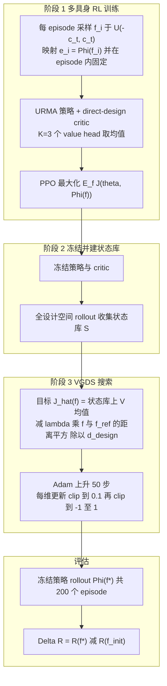

# Shape Your Body：多具身价值梯度机器人共设计

## 一句话定义

**Shape Your Body**（Bohlinger & Peters，TU Darmstadt；[项目页](https://nico-bohlinger.github.io/shape-your-body/)，[arXiv:2606.00702](https://arxiv.org/abs/2606.00702)）：先用 PPO 在大量机器人设计上训练 **embodiment-aware 的 URMA 策略与价值函数**，再**冻结**，把价值函数当作对设计向量可微的 surrogate，用 **Value-Gradient Design Search (VGDS)** 在参考设计周围的软信赖域内做梯度上升，优化固定拓扑下的连续机体 / 控制参数（论文摘要、§3）。

## 英文缩写速查

| 缩写 | 英文全称 | 简要说明 |
|------|----------|----------|
| VGDS | Value-Gradient Design Search | 本文设计搜索：对冻结 critic 的设计向量求梯度并做 Adam 上升（§3.2） |
| URMA | Unified Robot Morphology Architecture | 关节 token + 描述向量 + attention 的多具身策略 / critic 架构（§3.1） |
| PPO | Proximal Policy Optimization | 训练策略与 critic 所用的 on-policy 算法（§3.1） |
| PD | Proportional–Derivative | 关节位置控制器；其增益与动作缩放也在设计空间内（附录 A.1） |
| MJX | MuJoCo XLA | MuJoCo 的 JAX 后端，本文全部实验的仿真环境（§4） |
| GC-PFO | Gradient-Covariance Particle Filter Optimization | 利用梯度协方差的粒子滤波优化，本文最强基线（§2、§4.1） |
| FEACRL | Fast Evolutionary Actor-Critic RL | 用 SAC 的 Q 函数配 PSO 给设计打分的共设计方法（§2） |
| BO / CMA-ES / PSO / CEM / DE / ARS / TuRBO | 贝叶斯优化 / 协方差自适应进化策略 / 粒子群 / 交叉熵 / 差分进化 / 增广随机搜索 / 信赖域贝叶斯优化 | 与 VGDS 共用同一冻结 critic 的无梯度搜索基线（附录 C） |
| CoM | Center of Mass | 质心，属设计参数之一（§3） |

## 为什么重要

- **共设计成本结构不同（作者主张）：** 近期 RL 共设计方法虽在单次运行内共享经验，但换机器人、设计空间或任务仍要重跑整条环（§1）；本文把代价摊到一次多具身训练上，之后每个设计只需搜索。单机器人设置下首次训练约 7–9 h，之后每个额外设计约 1–2 min，批量 critic 推理可进一步缩短（§4.1）。
- **高维连续设计空间：** 单机器人设计空间 Go2 358 维、MIT Humanoid 514 维、Golem 688 维（§4.1）；50 台基座机各自 190–1177 维（附录 Table 2）；摘要称「超过 1100 个连续参数」。
- **价值梯度兼做分析：** 把 $f^\star-f_{\mathrm{ref}}$ 按身体部位 × 参数类型分组，可指出受限的增益、速度限、足几何等（§4.3、附录 H）。
- **与多具身控制线衔接：** 架构和训练分布建立在 URMA 与 50 机极端 embodiment 随机化之上（§3.1、§4；论文引用 [5] [6] [42]）；对比控制侧跨机见 [跨具身策略迁移选型](../queries/cross-embodiment-transfer-strategy.md)。

## 核心原理与流程总览

设计向量 $f\in[-1,1]^{d_{\mathrm{design}}}$，可微映射 $e=\Phi(f)$ 给出物理参数（质量、惯量、质心、几何、关节限、执行器限、阻尼、刚度、armature、摩擦、PD 增益等，§3）。

**关键组件（均为论文自述）：**

- **课程化设计采样：** $f_i\sim U([-c_t,c_t]^{d})$，性能课程系数 $c_t$ 从只采名义设计（$c_t=0$）扩到全空间；评估一律用全空间（§3.1、附录 A.3）。
- **direct-design critic：** 原 URMA critic 中描述向量 $d_j$ 只进 attention 的 key；本文让逐关节编码器 $g_\psi(o_j,d_j)$ 同时吃观测与描述，作者称这「经验上带来更强的设计梯度」（§3.1）。附录 B Table 4 说明它依赖足够大的 value latent：latent=4 时（+6.41）反而不如原 critic（+13.57），latent=32 最好（+17.76），最终取 K=3、latent 32。
- **软信赖域（式 5）：** $\hat J_\lambda(f)=\frac1M\sum_m\bar V(s_m,\Phi(f))-\lambda\frac{\|f-f_{\mathrm{ref}}\|_2^2}{d_{\mathrm{design}}}$；作者初步实验发现无约束最大化会把设计推向边界，critic 预测高而真实性能崩（§3.2）。
- **更新（式 7）：** minibatch（64 个状态）梯度 → Adam（学习率 0.05）→ 每维 clip 到 $\delta_{\max}=0.1$ → clip 到合法盒（附录 C）。
- **对比法同一目标：** BO、CMA-ES、PSO、CEM、DE、ARS、TuRBO、GC-PFO、随机搜索都在同一冻结 critic 与 $\hat J_\lambda$ 上搜索（§3.2、附录 C）。

## 工程实践

- **仿真与任务：** RL-X + MJX，200 Hz 仿真 / 50 Hz 控制，episode 最长 20 s；速度跟踪 locomotion；动作 $q^{target}=q^{nom}+\sigma_{robot}a$，增益与 $\sigma_{robot}$ 属可搜索设计量（附录 A.1）。奖励共 23 项（附录 Table 1）。
- **训练规模（附录 A.5）：** 单机器人 4096 环境 × $1.0\times10^9$ 步；morphology class 集 7680 环境 × $3.7\times10^9$ 步；50 机集 15040 环境 × $3.7\times10^9$ 步，单张 RTX 6000 Ada 约 2.5 天。PPO 超参见附录 Table 3。
- **信赖域系数：** 取 $\lambda=100$，依据是它在 Go2 上最优、其他机接近最优；论文承认逐机调 λ 可取得更好结果（附录 D Table 6：Humanoid 31.20 @λ=200，Golem 17.27 @λ=300）。λ=0 时 Go2 的 ΔR 为 −18.93。
- **合理性检查（附录 H）：** 三个单机实验中没有优化维度超过 $|f_i|>0.9$；每维平均归一化变化 0.027–0.042；17 个部分修改设计上 critic 预测与真实回报的 Spearman ρ=0.40（Humanoid 0.50、Go2 0.60、Golem 0.83）。
- **负面结果（附录 J）：** 硬信赖域投影与软 L2 相当但半径更难调；基于 head 分歧的不确定性信赖域不可靠；多起点、刷新状态库、梯度噪声等无稳定收益；更多迭代可能因过度优化 critic 而变差。
- **代码：** 项目页标注代码「soon」，论文与项目页均未给出具体仓库地址，故 frontmatter 不写 `code:`。
- **交互演示：** 项目页可在浏览器内切换 Reference / Co-Design 并用速度指令驱动本地 URMA 策略（项目页归档，非论文正文）。

### 主要结果（论文数字与出处）

| 设置 | 论文说法 | 出处 |
|------|----------|------|
| 单机器人设计 | 10 个均匀采样的 $f_{\mathrm{init}}$ / 机；VGDS 显著改进，接近或超过名义 $f_{\mathrm{ref}}$；Go2、Humanoid 上与最强基线持平，Golem 上改进最大；GC-PFO 为最强基线 | §4.1，Fig 3 |
| vs RL 共设计 | 与改造为 URMA + PPO 的 Schaff2019 / FEACRL / Transform2Act / BodyGen / Stackelberg PPO 相比终性能持平或略好；RL 基线耗时随初始设计数线性增长 | §4.1，Fig 4，附录 F |
| 留出机 vs 50 机 | 50 机含目标时 Go2、Humanoid 的 VGDS 设计可超过 $f_{\mathrm{ref}}$；Golem 上仅六足训练集更好 | §4.2，Fig 5 |
| 设计分析 | Humanoid：名义关节位与增益、足缩小，仅复制增益使回报 5.8 → 12.5；Golem：动作缩放 −12.2%、P −4.1%、D +4.4%；Go2：后腿关节轴、足几何、前髋 / 小腿速度限；无单一参数组可解释全部提升 | §4.3，附录 H，Fig 12 |
| 部分机型 | 高个人形（如 Fourier GR1 T2）优化后变矮、变宽、更紧凑，作者推测有利稳定并更接近人形训练分布 | §4.3，Fig 2 |

## 与清单说法的核对

清单（Berseth CoRL 2026 阅读清单，P0 Spotlight，第 025 篇；其摘要作者自述由 LLM 据摘要起草）一句话摘要：*Trains one multi-embodiment value function, then uses its gradients as a differentiable surrogate to optimize robot designs without new RL loops.*

| 清单用语 | 核对结果 |
|----------|----------|
| 训练一个多具身价值函数 | 基本成立：每种设置训练一个策略 + critic（K=3 头集成取均值），并非「一个模型通吃所有实验」——单机器人实验分别训三个模型，另有 morphology class 集与 50 机集模型（§4.1–4.2，附录 A.5）。 |
| 梯度作为可微 surrogate 优化设计 | 成立，见式 5–7；但必须配 soft trust region（λ=100）。λ=0 时 Go2 ΔR 为 −18.93，比随机初始设计更差（附录 D）。 |
| 「without new RL loops」 | 对设计阶段成立（搜索期不更新策略权重）；但前提是先做一次大规模多具身 RL：单机器人设置约 7–9 h，50 机模型约 2.5 天单卡（§4.1、附录 A.5）。节省的是「每个新设计」的 RL，不是总 RL。 |
| （清单未提）仿真 / 真机 | 全部为 MJX 仿真，未评估可制造性或真机迁移（§5）。 |
| （清单未提）相对 RL 共设计的优势 | 论文说终性能持平或略好，优势在边际成本；基线是为适配本设置而「大幅改造」的版本，作者称并非原方法的完整复现（附录 F）。 |

## 局限

**论文自述（§5、附录）：**

1. 仅固定拓扑上的连续参数，不能增减关节 / 连杆，因为 URMA 网络没有拓扑梯度。
2. 依赖策略与价值函数的覆盖和精度；信赖域缓解外推，但并非总有足够好的参考设计。
3. 全部实验为较简单的 MuJoCo 仿真，未评估可制造性或真机迁移，需要材料、电子、执行器、制造的额外约束或仿真器。
4. 附录 G：部分大型人形运行「似乎未完全收敛」，改进较小；附录 I：不同起点收敛到相近的机器人专属最优（多样性坍缩）。

**我的观察（非论文结论，标注为推测或未验证）：**

- 对比 RL 共设计的基线都经过大幅改造且论文承认不完全复现原方法，因此「持平或略优」只能说明底层思想层面的比较；未验证原版实现下的差距。
- 搜索基线的超参在「早期版本的扰动起点实验」上调过（附录 C），而 λ 按 Go2 选定（附录 D）；对不同机型的公平性未单独检验。
- 设计质量用的是 critic 驱动的仿真回报，且回报提升不一定对应 x-y 跟踪误差下降（附录 E）；critic 预测与真实回报的相关性在整体上仅为 ρ=0.40（附录 H，基于 17 个设计，样本小）。
- 页面此前写的「边际成本低一个数量级以上」论文正文未给出该倍数，仅给出 1–2 min / 设计与线性增长的对比（Fig 4 第四幅），故此处不作数量级断言（未核实）。

## 关联页面

- [强化学习](../methods/reinforcement-learning.md) — critic 与策略训练语境
- [PPO](../methods/ppo.md) — 本文所用的训练算法
- [域随机化](../concepts/domain-randomization.md) — 多具身训练中的 embodiment 随机化
- [课程学习](../concepts/curriculum-learning.md) — 性能课程系数 $c_t$ 扩展设计支撑
- [Sim2Real](../concepts/sim2real.md) — 论文未覆盖的下一步
- [跨具身策略迁移选型](../queries/cross-embodiment-transfer-strategy.md) — 控制侧跨机 vs 本文设计侧
- [Any2Any](./paper-any2any-cross-embodiment-wbt.md) — 人形 WBT 跨机后训练对照
- [SLowRL / Go2](./paper-slowrl-safe-lora-locomotion-sim2real.md) — 四足真机微调（同为 Go2 平台语境）
- [Transformer Transformer](./paper-transformer-transformer.md) — 运动条件扩散共设计（对照 VGDS）

## 参考来源

- [Shape Your Body 论文归档（全文通读）](../../sources/papers/shape_your_body_arxiv_2606_00702.md)
- [项目页归档](../../sources/sites/shape-your-body-nico-bohlinger.md)
- Bohlinger & Peters, *Shape Your Body: Value Gradients for Multi-Embodiment Robot Design*, arXiv:2606.00702v1, 2026-05-30（Under Review）

## 继续阅读

- [arXiv:2606.00702](https://arxiv.org/abs/2606.00702) — 附录含环境、奖励、50 机表、λ 消融与负面结果
- [URMA — One Policy to Run Them All](https://proceedings.mlr.press/v270/bohlinger25a.html) — 架构与前序多具身 locomotion
- [Multi-Embodiment Locomotion at Scale with Extreme Embodiment Randomization](https://arxiv.org/abs/2509.02815) — 论文引用 [42]，50 机训练设置与课程式随机化
- [交互演示](https://nico-bohlinger.github.io/shape-your-body/) — Reference vs Co-Design
