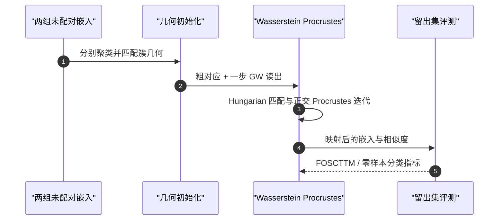

# Shared Geometry as a Rosetta Stone：无配对数据的跨模态对齐

## 一句话定义

**Shared Geometry as a Rosetta Stone** 提出用两组嵌入各自的几何关系，估计一个全局正交映射，让独立训练的不同模态编码器在没有配对训练样本时实现粗粒度对应。

## 英文缩写速查

| 缩写 | 英文全称 | 简要说明 |
|------|----------|----------|
| CKA | Centered Kernel Alignment | 比较两种表示对同一批样本的相似结构 |
| FOSCTTM | Fraction of Samples Closer Than the True Match | 统计比真匹配更近的错误候选比例 |
| GW | Gromov-Wasserstein | 通过集合内部距离结构估计跨空间对应 |
| WP | Wasserstein Procrustes | 在匹配与正交映射更新间迭代的对齐方法 |
| QAP | Quadratic Assignment Problem | 以簇中心关系求匹配的组合优化问题 |

## 为什么重要

传统图文对齐往往依赖大规模配对数据。本工作表明，如果独立训练的视觉与语言表示保留了相似的样本几何结构，就能先建立跨模态的粗对应，为数据稀缺场景下的表示对齐提供一种研究路线。它可作为 VLM/VLA 上游表征对齐的参考，但论文并未验证机器人任务或真机收益。

## 核心原理

方法输出一个全局正交线性映射；它旋转或反射一个嵌入空间以靠近另一个空间，不改变空间内部的角度和距离。流程分三步：

1. **几何初始化：** 两种模态分别聚类，比较簇中心之间的相似结构并求解簇匹配，累积得到粗对应。
2. **匹配读出：** 在粗对应上做一次 Gromov-Wasserstein 优化，再以正交 Procrustes 求初始映射。
3. **迭代细化：** 交替用 Hungarian matching 更新样本匹配，用正交 Procrustes 更新映射。

作者演示的一组设置使用来自 MS COCO 不重叠子集的图像和文本嵌入，由 DINOv2 B/14 和 Qwen3-8B 分别编码。各模型的坐标维度并不共享，方法比较的是两组表示中的几何关系。

## 结果与评测

- 在留出的 MS COCO 验证配对上用 **FOSCTTM** 衡量检索对齐质量：0 表示真匹配始终最近，0.5 是随机水平。
- 在 84 种视觉模型、语言模型和数据集组合中，配对样本上的 **CKA** 对无配对对齐质量变化的线性解释度为 **R²=0.73**（项目页报告 Spearman ρ=-0.90）。CKA 在这里是诊断工具，需要配对样本，不是无监督对齐训练的必需输入。
- 项目页报告在已知配对不超过 20 对时，该方法的 FOSCTTM 比七种配对方法中的最佳方法低 14–28 倍。具体成绩依赖论文中的数据和模型组合。

## 源码运行时序图

实现入口为仓库中的 WassersteinProcrustes.fit(images, captions)；Notebook 和实验脚本另负责准备嵌入、运行基准与绘制结果。

## 工程实践

| 环节 | 使用建议 |
|------|----------|
| 输入 | 准备两组语义范围相近、编码器独立训练的嵌入；无需按样本配对 |
| 诊断 | 若能取得少量配对校准样本，可用 CKA 估计空间结构相似性；不要把诊断集混入无监督训练结果 |
| 评测 | 预留未参与对齐的配对验证集，报告 FOSCTTM，并按数据集与编码器组合拆分结果 |
| 机器人迁移 | 可作为多模态表示对齐的候选方法研究；机器人传感器、动作或本体数据上的效果需独立验证 |

## 局限与风险

- **只保证粗对齐目标：** 几何结构相似不等于逐样本语义对应被完全恢复，结果不能直接当作强图文检索保证。
- **模型组合敏感：** 论文与项目页显示不同视觉、语言模型和数据集组合的效果有差异；长描述文本等设置可能接近随机水平。
- **验证仍需要配对：** CKA 分析和 FOSCTTM 验证使用已知配对样本；“无需配对”指对齐器拟合阶段可不提供配对。
- **非机器人实证：** 论文的主要实验是图文、科学数据、脑成像等跨模态对齐，不提供人形机器人控制或 Sim2Real 验证。

## 与其他工作对比

| 对照方法（论文所列） | 是否需要配对 | 与本工作的差异 |
|----------------------|--------------|----------------|
| vec2vec、mini-vec2vec | 否（对抗式 / 优化式无配对对齐） | 同为无配对设定的直接基线；本工作沿用 mini-vec2vec 的聚类匹配初始化，再以 Wasserstein Procrustes 只估计一个全局正交映射 |
| 线性 / 正交映射、ASIF、Local CKA、SUE、STRUCTURE、SOTAlign | 是（0–1,000 对的少配对设定） | 依赖配对监督；论文报告在极少配对（≤20 对）时本方法 FOSCTTM 显著更低，配对增多后保持竞争力 |
| [CLIP](./paper-clip.md) 式对比预训练 | 是（大规模图文对） | 联合训练两个编码器；本工作冻结独立训练的编码器，只做事后旋转对齐 |
| [正则化 Gromov-Wasserstein 程序学习](./paper-sa-2507-15540-procedure-learning-via-regularized-gromov-wasser.md) | — | 同样利用 GW 在集合内部距离结构上求对应，但用于视频程序步骤对齐而非跨模态嵌入 |

前两行的比较来自论文同一 MS COCO 设定（DINOv2 B/14 + Qwen3-8B）；后两行为路线层面的定性区分，不共享评测口径。

## 结论

该工作证明共享的表示几何可以支撑无配对的**粗粒度**跨模态对齐，但效果由表示空间相似性决定，不能把它解读为零样本恢复所有图文对应。

- 先验证两个编码器对相同语义内容是否形成相似的邻域结构，再考虑无配对对齐。
- 以留出配对集测量 FOSCTTM；将 CKA 当作需要少量配对样本的可行性诊断。
- 迁移到机器人多传感器或 VLA 之前，应建立领域内数据集和真机/仿真评测，不直接外推图文结果。

## 关联页面

- [多模态基础概念](../concepts/multimodality-basics.md)
- [视觉–语言特征融合与语义空间对齐](../concepts/vision-language-feature-fusion.md)
- [视觉骨干](../concepts/vision-backbones.md)

## 参考来源

- [论文来源归档](../../sources/papers/shared_geometry_rosetta_arxiv_2610_09411.md)
- [作者项目页归档](../../sources/sites/shared-geometry-rosetta.md)
- [官方代码仓库归档](../../sources/repos/unpaired-rosetta.md)

## 推荐继续阅读

- [arXiv 论文与 PDF](https://arxiv.org/abs/2610.09411)
- [作者项目页与交互演示](https://dominik-schnaus.github.io/unpaired-rosetta/)
- [作者官方实现](https://github.com/dominik-schnaus/unpaired-rosetta)
