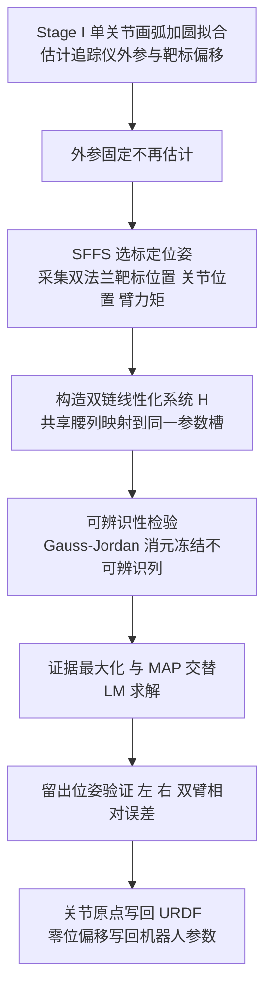

# 共享腰部双链弹性几何标定（arXiv:2611.07560）

**Whole-Body Elasto-Geometrical Calibration of Wheeled Humanoid Robots Using a Shared-Waist Dual-Chain Model**（[arXiv:2611.07560](https://arxiv.org/abs/2611.07560)，v1，2026-11-05，cs.RO）。作者署名机构为 AgiBot（智元机器人），通讯作者 Yi Lu。这是一篇**机器人运动学标定**论文，不涉及强化学习或策略训练。原文归档见 [sources 归档](../../sources/papers/shared-waist-dual-chain-wheeled-humanoid-calibration_arxiv_2611_07560.md)。

## 一句话定义

**轮式人形的两条手臂共用同一个带驱动的腰部，本文把腰部与双臂放进同一个最小二乘问题联合辨识（完整运动学模型 + 由力矩驱动的臂 / 腰柔顺 + 证据最大化的高斯先验），使两臂共用一套腰部模型，并在 AgiBot G2 与 G2max 上把留出位姿平均误差从 11.3–31.1 mm 降到 0.50–1.11 mm。**

## 英文缩写速查

| 缩写 | 英文全称 | 简要说明 |
|------|----------|----------|
| MDH | Modified Denavit–Hartenberg | 修正 DH 参数，描述相邻连杆坐标系变换（式 1） |
| GC / G | Geometric + Compliance / Geometric | 论文的两个变体：带柔顺列 / 仅几何（§III-B） |
| IND | Independent | 每条臂各自带一份腰部参数单独标定，得到两套腰模型（§III-C） |
| SEQ | Sequential | 先左链再固定腰部标右臂（SEQL→R），或反序（§III-C） |
| DUAL | Dual-chain | 本文方法：腰部与两臂在同一问题中辨识 |
| BON | Bonnet et al. | 论文对 TALOS 全身标定方法 [2] 的改编对照 |
| NGU | Nguyen et al. | 论文对单平面接触几何标定方法 [3] 的改编对照 |
| MAP | Maximum A Posteriori | 最大后验估计，高斯先验下等价于带正则的最小二乘 |
| LM | Levenberg–Marquardt | 非线性最小二乘求解器（§III-E） |
| SFFS | Sequential Forward Floating Selection | 标定位姿选取算法，按 O1 可观测性指标选（§IV-A） |
| GKCS | Genie Kinematic Calibration Software | 作者的生产标定软件（§IV-H） |
| URDF | Unified Robot Description Format | 机器人描述文件，标定结果写回其中 |

## 为什么重要

- 轮式人形没有腿，双臂都挂在同一个带驱动的腰上：腰部模型有误差会同时挪动两只手，而腰部一般没有力矩传感器（摘要、§I）。
- 分别标定两条臂会得到两套互不一致的腰部模型，机器人实际只能用一套：论文测得 IND 的两套腰模型末端帧平均相差 0.83–3.03 mm，任选一套给两臂用，另一臂平均误差从 0.45–1.05 mm 升到 1.03–3.21 mm（§IV-C）。
- 对双臂作业（要求两只末端在同一基座坐标系里都准），这决定了双手相对位置精度；论文也给出对量产线的价值：整机标定约 20 min，此前超过 1 h，并已在厂内标定 100 多台 G2 与数十台 G2max（§IV-H，作者自述）。

## 核心原理与方法栈

### 流程总览

### 模型（§II）

| 部分 | 论文做法 |
|------|----------|
| 运动学 | MDH 加三项补充使模型完备：腰基参数 `xwb`（腰部第一轴的另两个自由度）、平行轴的 β 参数、每臂首个坐标系的分支参数 `(γk, bk)`（§II-A） |
| 臂柔顺 | 谐波减速器按线性扭簧，用关节力矩传感器的实测力矩驱动（式 3） |
| 腰柔顺 | 无力矩传感器，用机器人描述文件中的质量模型算重力力矩（负载按质点放在法兰，不辨识质量模型）；分沿轴向的扭转柔顺 `cw` 与垂直轴向的倾斜柔顺 `ct`（式 4） |
| 外参 | 追踪仪到基座变换与靶标偏移共 12 维，在 Stage I 单独估计后固定；论文称若与本体参数联合估计，结果会依赖追踪仪与靶标摆放（§III-A） |

### 双链辨识与可辨识性（§III）

- 把一个位姿下两个靶标的位置残差写成 `Δy = H Δe`，腰部列对两条链映射到同一槽，臂柔顺只进各自链；IND、SEQ 是 `H` 的行列子集，DUAL 用全部行列（式 6，Fig. 3）。
- 腰部信息满足 `F_dual = F_l + F_r`，即两条单链 Schur 补之和（式 8）。作者据此推出双链腰部协方差不大于任一单链；若两链信息成比例，标准差比不小于 1/√2，比值低于它说明两臂贡献了不同的腰部方向（§III-D）。
- 先验按参数组（长度、扭角与 β、关节零位、臂 1–4 轴柔顺、臂 5–7 轴柔顺、腰柔顺、倾斜柔顺）设置零均值高斯，精度与噪声方差用证据最大化更新；`xwb` 取平坦先验（§III-E）。

## 实验与结果（作者自述，均为论文数字）

| 项 | 内容 | 出处 |
|----|------|------|
| 平台 | AgiBot G2（腰 5 转动关节）与 G2max（腰 1 个俯仰关节），双臂各 7 DOF；各测空载与带载（G2 每臂 5 kg，G2max 每臂 10 kg） | §IV-A、Table I |
| 测量 | 光学追踪仪 FreeScan Trak Nova（ISO 10360-8:2013 验收，最大允许误差 ±0.062 mm），每个法兰一个靶标 | §IV-A |
| 数据 | 有效位姿 95 / 95 / 71 / 60，训练 / 验证 70/25、70/25、54/17、46/14 | Table I |
| 总体 | 名义模型 11.3–31.1 mm，DUAL-GC 在 G2 为 0.79–1.11 mm、G2max 为 0.50–0.72 mm | §IV-C |
| 对单链 | 顺序标定中后标的臂在 16 个组合中 15 个不如 DUAL，最多差 0.88 mm；20 个训练位姿时 G2 上 IND-GC 为 5.49 / 6.86 mm，DUAL-GC 为 1.18 / 1.61 mm | §IV-C |
| 对文献方法 | 改编 BON-GC 与 NGU-G，25 个组合均显著更准，低 17–63% | §IV-E |
| 主因 | 去掉腰柔顺误差升 0.12–0.73 mm；给 BON-GC 加腰柔顺后在满训练集 G2 上追平 DUAL-GC | §IV-E、§IV-F、Table V |
| 先验 | 满训练集时作用小，20 个位姿时最小二乘使误差升 0.07–0.86 mm | §IV-F |

### 与周报说法的逐条核对

周报（具身运控lab，来源 eiBI）给出的说法与论文对照如下。

| 周报说法 | 核对结果 |
|----------|----------|
| 机构：智元机器人 | 属实。首页署名 AgiBot，通讯邮箱域名 zhiyuan-robot.com |
| 腰部几何误差与负载形变同时影响双手位置，分别标定两臂得到互不一致的腰部模型 | 与论文一致（摘要、§I、§IV-C）。这里的「负载形变」是腰与臂的关节柔顺，论文既含带载也含空载的重力形变 |
| 联合建模腰部与双臂的几何参数和柔顺性 | 属实（§II、§III） |
| 贝叶斯先验提高弱可观参数的稳定性 | 基本属实但需限定。论文用的是零均值高斯先验加证据最大化（经验贝叶斯），并非整体贝叶斯推断；满训练集时先验对精度影响很小，主要在 20 个左右的少量位姿时作用显著（§IV-F） |
| 留出姿态平均误差由 11.3–31.1 mm 降至 0.50–1.11 mm | 数字与摘要一致。11.3–31.1 mm 是名义模型的误差范围，0.50–1.11 mm 是 DUAL-GC 在 G2 / G2max 四种条件下逐臂的验证集平均误差（Table V）；周报没写明前者含双臂相对误差一列（Table II），后者是逐臂数字 |
| （周报未提及） | 周报略去了论文的另一些主要结论：两阶段外参分离、腰部重力柔顺是增益主因、双链腰部信息为单链 Schur 补之和、对 BON / NGU 改编的对照 |

## 工程实践

- **软件与部署：** GKCS 分 GUI、工作流调度、设备通讯、标定算法、配置部署五层，把标定后的关节原点写入 URDF、零位偏移写入机器人参数，控制器与规划器直接使用（§IV-H，作者自述）。
- **位姿选择：** 用 SFFS 最大化双链 Jacobian 的 O1 可观测性指标，候选位姿须满足关节限位并使两个靶标可见；100 个选定位姿中有干涉的被剔除（§IV-A）。
- **数据清洗：** 靶标丢失的位姿剔除（G2max 为 9 与 12 个）；以 DUAL-GC 残差做稳健离群剔除，仅剔除一个位姿（§IV-A）。
- **复用要点：** 外参先独立估计并固定，再做本体辨识；对没有腰部力矩传感器的机器人，用描述文件里的质量模型算重力力矩来驱动腰柔顺；少量位姿时用证据最大化先验稳住估计。
- **开源状态：** 论文与全文未给代码或项目页链接，截至入库日（2026-11-09）按「未列链接」处理，GKCS 为制造商内部软件。

## 局限与风险

**论文自己承认的（§V、§IV-G）：**

- 每个数据集只做一次训练 / 留出划分，留出位姿仅 14–25 个且与训练同会话；模型组成部分用同会话训练位姿做交叉验证选择；置信区间未做多重比较校正。
- 没有评估同一条件下的重复会话，也没有双臂定位这类任务级测试。
- 腰部载荷来自 CAD 质量模型与点质量负载，倾斜柔顺把关节弯曲与支撑弯曲合并为一项。
- Stage-I 外参的残差会被第一个腰部坐标系和最后的臂坐标系吸收，估到的腰基偏移 `δ0` 在两次会话间不同，不应当作机器人固有属性（§IV-E）。
- 棱柱（直线）腰关节被模型覆盖但未做实验；一种负载下辨识出的柔顺能否预测另一种负载，没有测试（§IV-G）。
- 对 BON、NGU 的对照是改编版：使用本文测量与位姿，不是其原有传感器与姿态选择，所以只能说明模型与辨识差异。
- G2max 轴向腰柔顺带载时比空载大 43%，论文称线性弹簧加质点负载无法解释（§IV-G）。

**读者需要自行注意的（本页判断，不是论文结论）：**

- 只有两台机器人（各一台 G2 与 G2max），且是同一厂商自家平台；论文没有跨机器人个体的泛化数据（推测：量产中不同个体的参数分布可能影响效果，论文未检验）。
- 误差只在追踪仪标定过的静态位姿上、以靶标位置衡量，没有动态或姿态（旋转）精度的评估。
- 「17–63% 更低」来自作者对文献方法的改编，且各方法共用本文的 Stage-I 外参，不等价于对原方法的完整复现。
- 本页未打开参考文献原文，对 [2]、[3] 的描述仅以本文转述为准。

## 关联页面

- [系统辨识](../concepts/system-identification.md)：标定属于参数辨识，本文的可辨识性与证据最大化可对照阅读。
- [手眼标定](../concepts/hand-eye-calibration.md)：同样是外部测量与机器人运动学的联合标定问题。
- [人形闭环惯量标定](../concepts/humanoid-closed-loop-inertia-calibration.md)：同为人形量产环节的标定工作，对象为惯量而非运动学。
- [人形量产工程](../concepts/humanoid-mass-production-engineering.md)：本文的生产部署背景。
- [人形膝关节谐波减速器限制](../concepts/humanoid-knee-harmonic-drive-limits.md)：谐波传动带来的柔顺与精度问题。
- [全身控制](../concepts/whole-body-control.md)：标定后的运动学模型是上层全身控制与规划的输入之一。
- [Sim2Real](../concepts/sim2real.md)：运动学与柔顺的偏差是仿真与实机差距的一类来源。
- [AgiBot World 2026](../entities/agibot-world-2026.md)：同属智元机器人的页面。

## 参考来源

- [原文归档：Whole-Body Elasto-Geometrical Calibration of Wheeled Humanoid Robots Using a Shared-Waist Dual-Chain Model](../../sources/papers/shared-waist-dual-chain-wheeled-humanoid-calibration_arxiv_2611_07560.md)
- 论文：<https://arxiv.org/abs/2611.07560>（PDF：<https://arxiv.org/pdf/2611.07560>）
- 周报转述：具身运控lab「每周前沿论文 manipulation&locomotion」，上文已逐条核对

## 继续阅读

- 论文对照的两项全身标定工作：Bonnet 等，*Practical whole-body elasto-geometric calibration of a humanoid robot: Application to the TALOS robot*（Robot. Auton. Syst., 2023）；Nguyen 等，*Humanoid robot whole-body geometric calibration with embedded sensors and a single plane*（arXiv:2507.16369）。
- 想理解可辨识参数与证据最大化：从 [系统辨识](../concepts/system-identification.md) 入手，再读论文中引用的 Khalil 等的可辨识参数与 MacKay 的 Bayesian interpolation（§III-E，参考文献 [6]、[26]）。
