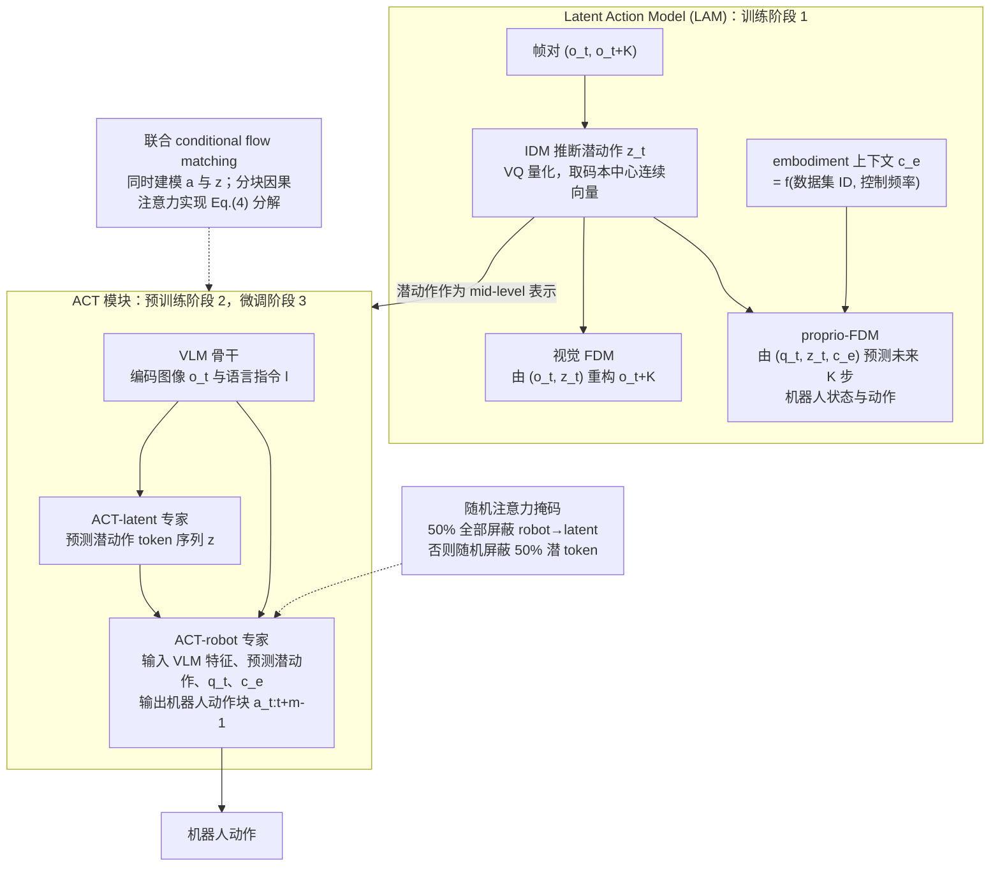

---

type: entity
tags: [paper, world-models, shenlan-survey, open-source, microsoft, tsinghua]
status: complete
updated: 2026-09-15
arxiv: "2507.23682"
venue: —
summary: "ViLLA 框架改进潜在动作与 VLA 整合；零样本潜在动作计划。"
related:
  - ../overview/world-models-15-open-source-technology-map.md
  - ../overview/world-models-route-01-cascade.md
  - ../overview/robot-world-models-training-loop-taxonomy.md
  - ../methods/generative-world-models.md
  - ../concepts/world-action-models.md
sources:
  - ../../sources/papers/shenlan_wm_survey_05_villa-x.md
  - ../../sources/papers/shenlan_world_models_15_reference_catalog.md
  - ../../sources/blogs/wechat_shenlan_world_models_15_open_source_2026.md
---

# villa-X

**villa-X: Enhancing Latent Action Modeling in VLA** 收录于 [深蓝具身智能 · 世界模型 15 开源项目专题](https://mp.weixin.qq.com/s/KZT8sI4n7GvHWyM20wN3gg) **第 05/15** 篇，归类为 **01 级联架构**。

## 一句话定义

ViLLA 框架改进潜在动作与 VLA 整合；零样本潜在动作计划。

## 英文缩写速查

| 缩写 | 英文全称 | 简要说明 |
|------|----------|----------|
| VLA | Vision-Language-Action | 视觉-语言-动作多模态基础策略方向 |

## 为什么重要

- ViLLA 框架改进潜在动作与 VLA 整合；零样本潜在动作计划。
- 属于 [世界模型 15 项目地图](../overview/world-models-15-open-source-technology-map.md) **路线 01**。

## 流程总览

图依据：论文 §3 / Fig.2、Eq.(1)–(5)

## 核心信息

| 字段 | 内容 |
|------|------|
| 编号 | 05/15 |
| 路线 | 01 级联架构 |
| 出处 | — |
| 文内引用 | 58（2026-06-02，策展） |
| arXiv | [2507.23682](https://arxiv.org/abs/2507.23682) |

## 核心机制（归纳）

### 1）策展导读要点

先预测未来视觉/潜特征（视频、RGB-D、法线等），再由独立或轻量动作头解码控制指令；误差在级联各段传递，工程上易拆模块复用。

### 2）策展导读要点

ViLLA 框架改进潜在动作与 VLA 整合；零样本潜在动作计划。

## 结论

**villa-X 属于级联架构中的「潜在动作」分支：先把动作抽象成潜表示再与 VLA 整合，换来的关键能力是零样本潜在动作计划。**

- 级联路线的共性取舍在本页已点明：先预测未来视觉 / 潜特征、再由独立或轻量动作头解码，模块易拆易复用，但误差会在各段传递。
- 本页为 [世界模型 15 项目地图](../overview/world-models-15-open-source-technology-map.md) **路线 01** 的清单索引条目，机制来自策展导读；量化 benchmark、消融与实机指标须回到原文 PDF / 项目页。
- 引用量（58，2026-06-02 策展）与 **控制一致性 / 下游任务增益** 无简单线性关系，复现前需核对 License 与权重。

## 常见误区

1. 开源 WM 项目的引用量与 **控制一致性/下游任务增益** 无简单线性关系；复现前需核对 License 与权重。

## 实验与评测

- 本页在公众号/survey **策展编译**基础上补充机制归纳；**量化 benchmark、消融与实机指标以原文 PDF / 项目页为准**（链接见 [参考来源](#参考来源)）。
- 与同栈姊妹篇对照时，请回到对应 **技术地图 / 42 篇栈 / BFM 地图 / VLN 地图** 总览中的实验段落。

## 与其他页面的关系

- 路线 hub：[world-models-route-01-cascade.md](../overview/world-models-route-01-cascade.md)
- 总地图：[world-models-15-open-source-technology-map.md](../overview/world-models-15-open-source-technology-map.md)
- 原始 source：[shenlan_wm_survey_05_villa-x.md](../../sources/papers/shenlan_wm_survey_05_villa-x.md)

## 参考来源

- [shenlan_wm_survey_05_villa-x.md](../../sources/papers/shenlan_wm_survey_05_villa-x.md)
- [shenlan_world_models_15_reference_catalog.md](../../sources/papers/shenlan_world_models_15_reference_catalog.md)
- [wechat_shenlan_world_models_15_open_source_2026.md](../../sources/blogs/wechat_shenlan_world_models_15_open_source_2026.md)
- [arXiv PDF](https://arxiv.org/pdf/2507.23682)：已通读方法部分（实验与附录以略读为准）：§3 Method（3.1 LAM、3.2 ACT）；§4 实验以略读为准

## 推荐继续阅读

- [arXiv:2507.23682](https://arxiv.org/abs/2507.23682) — 论文全文
- [深蓝具身智能原文](https://mp.weixin.qq.com/s/KZT8sI4n7GvHWyM20wN3gg)
