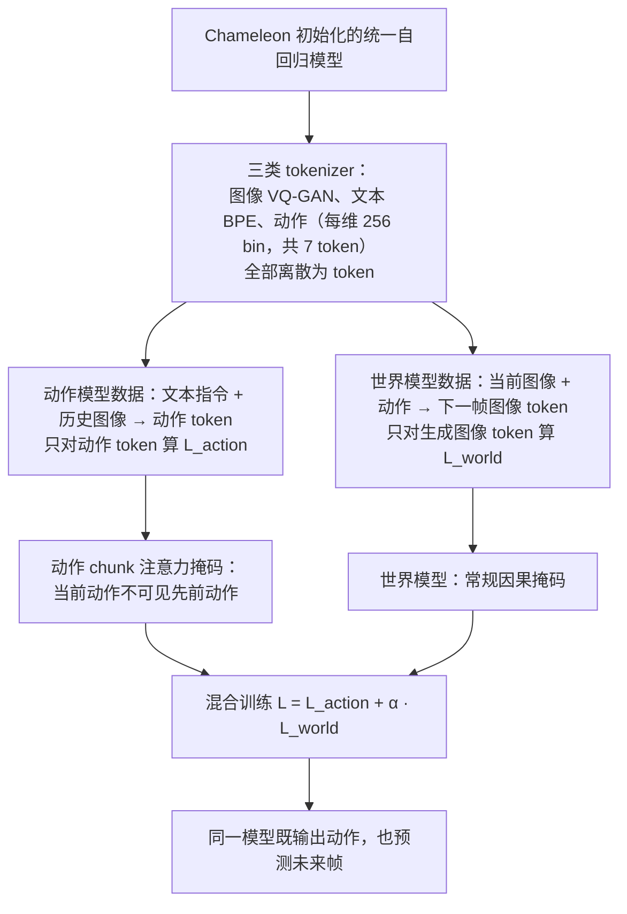

---

type: entity
tags: [paper, world-models, shenlan-survey, open-source, alibaba, zju]
status: complete
updated: 2026-10-06
arxiv: "2506.21539"
venue: —
summary: "VLA 与世界模型单框架双向增强；RynnVLA-002 工程化连续动作与注意力掩码。"
related:
  - ../overview/world-models-15-open-source-technology-map.md
  - ../overview/world-models-route-02-joint.md
  - ../overview/robot-world-models-training-loop-taxonomy.md
  - ../methods/generative-world-models.md
  - ../concepts/world-action-models.md
sources:
  - ../../sources/papers/shenlan_wm_survey_07_worldvla.md
  - ../../sources/papers/shenlan_world_models_15_reference_catalog.md
  - ../../sources/blogs/wechat_shenlan_world_models_15_open_source_2026.md
---

# WorldVLA / RynnVLA-002

**WorldVLA / RynnVLA-002** 收录于 [深蓝具身智能 · 世界模型 15 开源项目专题](https://mp.weixin.qq.com/s/KZT8sI4n7GvHWyM20wN3gg) **第 07/15** 篇，归类为 **02 联合架构**。

## 一句话定义

VLA 与世界模型单框架双向增强；RynnVLA-002 工程化连续动作与注意力掩码。

## 英文缩写速查

| 缩写 | 英文全称 | 简要说明 |
|------|----------|----------|
| VLA | Vision-Language-Action | 视觉-语言-动作多模态基础策略方向 |

## 为什么重要

- VLA 与世界模型单框架双向增强；RynnVLA-002 工程化连续动作与注意力掩码。
- 属于 [世界模型 15 项目地图](../overview/world-models-15-open-source-technology-map.md) **路线 02**。

## 流程总览

图依据：论文 §3.2–3.3 / Fig. 2、Fig. 3、式 (4)。

## 核心信息

| 字段 | 内容 |
|------|------|
| 编号 | 07/15 |
| 路线 | 02 联合架构 |
| 出处 | — |
| 文内引用 | 180（2026-06-02，策展） |
| arXiv | [2506.21539](https://arxiv.org/abs/2506.21539) |

## 核心机制（归纳）

### 1）策展导读要点

未来观测与动作在同一扩散/自回归骨干中联合建模，减少级联误差累积；适合端到端 VLA/操控闭环。

### 2）策展导读要点

VLA 与世界模型单框架双向增强；RynnVLA-002 工程化连续动作与注意力掩码。

## 结论

**WorldVLA 站在级联的对面：把世界模型与 VLA 收进同一骨干做双向增强，用联合建模换掉级联的误差累积。**

- 起作用的机制是 **单框架联合建模**——未来观测与动作在同一扩散/自回归骨干中一起建模，适合端到端 VLA / 操控闭环。
- RynnVLA-002 是它的工程化落点：连续动作与注意力掩码属于「让联合建模真正跑起来」的实现层，而非架构层的新意。
- 本页为 **清单索引策展编译**，量化 benchmark、消融与实机指标以原文 PDF / 项目页为准；复现前核对 License 与权重。

## 常见误区

1. 开源 WM 项目的引用量与 **控制一致性/下游任务增益** 无简单线性关系；复现前需核对 License 与权重。

## 实验与评测

- 本页在公众号/survey **策展编译**基础上补充机制归纳；**量化 benchmark、消融与实机指标以原文 PDF / 项目页为准**（链接见 [参考来源](#参考来源)）。
- 与同栈姊妹篇对照时，请回到对应 **技术地图 / 42 篇栈 / BFM 地图 / VLN 地图** 总览中的实验段落。

## 与其他页面的关系

- 路线 hub：[world-models-route-02-joint.md](../overview/world-models-route-02-joint.md)
- 总地图：[world-models-15-open-source-technology-map.md](../overview/world-models-15-open-source-technology-map.md)
- 原始 source：[shenlan_wm_survey_07_worldvla.md](../../sources/papers/shenlan_wm_survey_07_worldvla.md)

## 参考来源

- [shenlan_wm_survey_07_worldvla.md](../../sources/papers/shenlan_wm_survey_07_worldvla.md)
- [shenlan_world_models_15_reference_catalog.md](../../sources/papers/shenlan_world_models_15_reference_catalog.md)
- [wechat_shenlan_world_models_15_open_source_2026.md](../../sources/blogs/wechat_shenlan_world_models_15_open_source_2026.md)
- [arXiv PDF](https://arxiv.org/pdf/2506.21539)：已通读方法部分（实验与附录以略读为准）：§3 Methods（3.1 问题形式化、3.2 架构、3.3 训练策略与注意力掩码）、Fig. 3

## 推荐继续阅读

- [arXiv:2506.21539](https://arxiv.org/abs/2506.21539) — 论文全文
- [深蓝具身智能原文](https://mp.weixin.qq.com/s/KZT8sI4n7GvHWyM20wN3gg)
