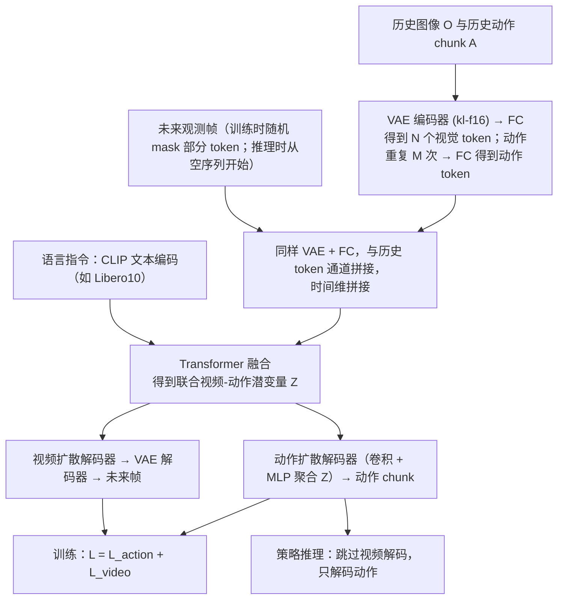

---

type: entity
tags: [paper, world-models, shenlan-survey, open-source, stanford]
status: complete
updated: 2026-10-06
arxiv: "2503.00200"
venue: RSS 2025
summary: "视频生成与实时策略推理同一模型；联合潜表示与解耦解码。"
related:
  - ../overview/world-models-15-open-source-technology-map.md
  - ../overview/world-models-route-02-joint.md
  - ../overview/robot-world-models-training-loop-taxonomy.md
  - ../methods/generative-world-models.md
  - ../concepts/world-action-models.md
sources:
  - ../../sources/papers/shenlan_wm_survey_10_uva.md
  - ../../sources/papers/shenlan_world_models_15_reference_catalog.md
  - ../../sources/blogs/wechat_shenlan_world_models_15_open_source_2026.md
---

# Unified Video Action Model (UVA)

**Unified Video Action Model (UVA)** 收录于 [深蓝具身智能 · 世界模型 15 开源项目专题](https://mp.weixin.qq.com/s/KZT8sI4n7GvHWyM20wN3gg) **第 10/15** 篇，归类为 **02 联合架构**。

## 一句话定义

视频生成与实时策略推理同一模型；联合潜表示与解耦解码。

## 英文缩写速查

| 缩写 | 英文全称 | 简要说明 |
|------|----------|----------|
| UVA | Unified Video Action Model | 统一视频-动作模型 |

## 为什么重要

- 视频生成与实时策略推理同一模型；联合潜表示与解耦解码。
- 属于 [世界模型 15 项目地图](../overview/world-models-15-open-source-technology-map.md) **路线 02**。

## 流程总览

图依据：论文 §III-A 至 §III-C / Fig. 2；§III-D 的多任务 mask 训练未画入。

## 核心信息

| 字段 | 内容 |
|------|------|
| 编号 | 10/15 |
| 路线 | 02 联合架构 |
| 出处 | RSS 2025 |
| 文内引用 | 140（2026-06-02，策展） |
| arXiv | [2503.00200](https://arxiv.org/abs/2503.00200) |

## 核心机制（归纳）

### 1）策展导读要点

未来观测与动作在同一扩散/自回归骨干中联合建模，减少级联误差累积；适合端到端 VLA/操控闭环。

### 2）策展导读要点

视频生成与实时策略推理同一模型；联合潜表示与解耦解码。

## 结论

**UVA 是路线 02 联合架构的代表：不再让视频预测与动作解码各管一段，而是在同一模型里学联合潜表示、再解耦解码，从而同时要生成质量与实时策略推理。**

- 起作用的机制是 **联合潜表示 + 解耦解码**：共享骨干压掉级联误差累积，解耦的解码分支让动作推理不必承担完整视频生成的代价，这才是「实时」得以成立的原因。
- 适用边界是端到端 VLA / 操控闭环；把它单当视频生成模型或单当策略网络评估，都会低估或误判其设计意图。
- 本页为清单索引（RSS 2025，arXiv:2503.00200）：**量化 benchmark 与实机指标以原文 / 项目页为准**，引用量高不等于下游增益大，复现前需核对 License 与权重。

## 常见误区

1. 开源 WM 项目的引用量与 **控制一致性/下游任务增益** 无简单线性关系；复现前需核对 License 与权重。

## 实验与评测

- 本页在公众号/survey **策展编译**基础上补充机制归纳；**量化 benchmark、消融与实机指标以原文 PDF / 项目页为准**（链接见 [参考来源](#参考来源)）。
- 与同栈姊妹篇对照时，请回到对应 **技术地图 / 42 篇栈 / BFM 地图 / VLN 地图** 总览中的实验段落。

## 与其他页面的关系

- 路线 hub：[world-models-route-02-joint.md](../overview/world-models-route-02-joint.md)
- 总地图：[world-models-15-open-source-technology-map.md](../overview/world-models-15-open-source-technology-map.md)
- 原始 source：[shenlan_wm_survey_10_uva.md](../../sources/papers/shenlan_wm_survey_10_uva.md)

## 参考来源

- [shenlan_wm_survey_10_uva.md](../../sources/papers/shenlan_wm_survey_10_uva.md)
- [shenlan_world_models_15_reference_catalog.md](../../sources/papers/shenlan_world_models_15_reference_catalog.md)
- [wechat_shenlan_world_models_15_open_source_2026.md](../../sources/blogs/wechat_shenlan_world_models_15_open_source_2026.md)
- [arXiv PDF](https://arxiv.org/pdf/2503.00200)：已通读方法部分（实验与附录以略读为准）：§III Unified Video Action Model（A 编码历史、B 掩码自编码预测观测、C 解耦视频与动作扩散、D 掩码训练）、Fig. 2

## 推荐继续阅读

- [机器人论文阅读笔记：Unified Video Action Model](https://imchong.github.io/Robot_Learning_Paper_Notebooks/papers/06_Manipulation/Unified_Video_Action_Model/Unified_Video_Action_Model.html)
- [arXiv:2503.00200](https://arxiv.org/abs/2503.00200) — 论文全文
- [深蓝具身智能原文](https://mp.weixin.qq.com/s/KZT8sI4n7GvHWyM20wN3gg)
