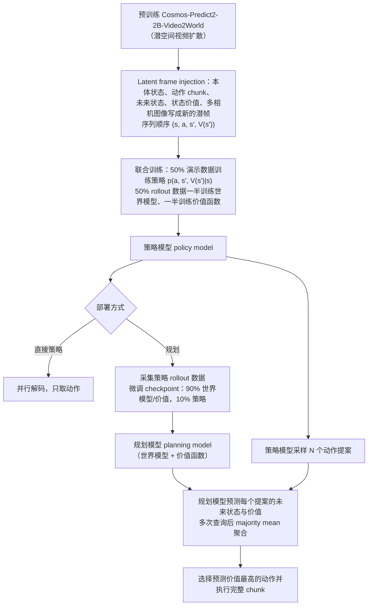
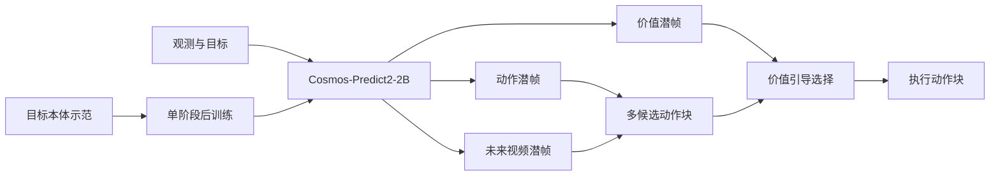

---

type: entity
tags: [paper, world-models, shenlan-survey, open-source, nvidia, stanford]
status: complete
updated: 2026-11-21
arxiv: "2601.16163"
venue: —
summary: "微调 Cosmos-Predict2 视频基础模型实现视觉运动控制与规划。"
related:
  - ../overview/world-models-15-open-source-technology-map.md
  - ../overview/world-models-route-02-joint.md
  - ../overview/robot-world-models-training-loop-taxonomy.md
  - ../methods/generative-world-models.md
  - ../concepts/world-action-models.md
  - ./paper-navwam-goal-conditioned-visual-navigation-wam.md
original:
  - ../../sources/papers/shenlan_wm_survey_11_cosmos-policy.md
sources:
  - ../../sources/papers/shenlan_wm_survey_11_cosmos-policy.md
  - ../../sources/papers/shenlan_world_models_15_reference_catalog.md
  - ../../sources/blogs/wechat_shenlan_world_models_15_open_source_2026.md
---

# Cosmos Policy

**Cosmos Policy** 收录于 [深蓝具身智能 · 世界模型 15 开源项目专题](https://mp.weixin.qq.com/s/KZT8sI4n7GvHWyM20wN3gg) **第 11/15** 篇，归类为 **02 联合架构**。

## 一句话定义

微调 Cosmos-Predict2 视频基础模型实现视觉运动控制与规划。

## 英文缩写速查

| 缩写 | 英文全称 | 简要说明 |
|------|----------|----------|
| WM | World Model | 学习环境动态以供想象/规划的世界模型 |
| VLA | Vision-Language-Action | 视觉-语言-动作端到端策略模型 |
| RGB-D | RGB + Depth | 彩色图与深度图联合感知 |

## 为什么重要

- 微调 Cosmos-Predict2 视频基础模型实现视觉运动控制与规划。
- 属于 [世界模型 15 项目地图](../overview/world-models-15-open-source-technology-map.md) **路线 02**。

## 流程总览

图依据：论文 §4.1–4.3 / Fig. 2。

## 核心信息

| 字段 | 内容 |
|------|------|
| 编号 | 11/15 |
| 路线 | 02 联合架构 |
| 出处 | — |
| 文内引用 | 61（2026-06-02，策展） |
| arXiv | [2601.16163](https://arxiv.org/abs/2601.16163) |

## 核心机制（归纳）

### 1）策展导读要点

未来观测与动作在同一扩散/自回归骨干中联合建模，减少级联误差累积；适合端到端 VLA/操控闭环。

### 2）策展导读要点

微调 Cosmos-Predict2 视频基础模型实现视觉运动控制与规划。

## 结论

**Cosmos Policy 的取舍是「不从零训世界模型」：把 Cosmos-Predict2 这类视频基础模型微调成视觉运动策略，用预训练的视频先验换取控制与规划能力。**

- 真正起作用的机制是 **联合建模**：未来观测与动作放进同一个扩散/自回归骨干，省掉「先预测视频、再反解动作」的中间环节，从而抑制级联误差累积——这也是它被归入[路线 02 联合架构](../overview/world-models-route-02-joint.md)的原因。
- 适用场景是端到端 VLA / 操控闭环；把它当成一个通用视频预测器或独立的规划器使用，都偏离了本页给出的定位。
- 判断价值时不要用热度替代效果：文内引用 61（2026-06-02 策展）只反映关注度，与 **控制一致性 / 下游任务增益** 无简单线性关系。
- 工程落地提醒：本页为清单索引归纳，复现前需核对 License 与权重可得性，量化 benchmark 与实机指标以原文 PDF / 项目页为准（见[参考来源](#参考来源)）。
- 横向定位请回到[世界模型 15 项目地图](../overview/world-models-15-open-source-technology-map.md)，逐页指标不足以支撑跨项目比较。

## 常见误区

1. 开源 WM 项目的引用量与 **控制一致性/下游任务增益** 无简单线性关系；复现前需核对 License 与权重。

## 实验与评测

- 本页在公众号/survey **策展编译**基础上补充机制归纳；**量化 benchmark、消融与实机指标以原文 PDF / 项目页为准**（链接见 [参考来源](#参考来源)）。
- 与同栈姊妹篇对照时，请回到对应 **技术地图 / 42 篇栈 / BFM 地图 / VLN 地图** 总览中的实验段落。

## 关联页面

- 路线 hub：[world-models-route-02-joint.md](../overview/world-models-route-02-joint.md)
- 总地图：[world-models-15-open-source-technology-map.md](../overview/world-models-15-open-source-technology-map.md)
- 原始 source：[shenlan_wm_survey_11_cosmos-policy.md](../../sources/papers/shenlan_wm_survey_11_cosmos-policy.md)

- [视觉–语言–动作模型](../methods/vla.md)：用于理解视觉和语言条件化动作。
- [生成式世界模型](../methods/generative-world-models.md)：用于理解环境状态预测。

## 原文核读：联合动作、未来与价值

[arXiv:2601.16163](https://arxiv.org/html/2601.16163)利用 Cosmos-Predict2-2B，在视频扩散的潜在帧上联合编码 action、future image 与 value；在目标机器人示范上单阶段后训练，测试时可预测多组候选动作并按价值筛选。这与 DreamGen 生成视频再训练 IDM 是不同机制。

## 工程实践

论文/官方项目页报告 LIBERO **98.5%**、RoboCasa **67.1%** 的不同基准平均成功率；RoboCasa 每任务使用 50 条训练示范。测试时规划的采样耗时与高频低层控制并非同一约束。项目页列出论文及实验结果，但尚未核实可复现的单独训练脚本与 checkpoint 配对入口。

## 源码运行时序图

**不适用（源码执行入口未核实）。** 论文表示公开代码，但[官方项目页](https://research.nvidia.com/labs/cosmos-lab/cosmos-policy/)目前未列可直接追溯的 GitHub 源码文件；上面的 Mermaid 仅对应论文算法流程，不冒充运行时源码分析。

## 局限与风险

- 目标本体示范、视频基座及多候选规划带来数据和计算成本，不能把离线 benchmark 直接推断为真机实时性能。
- 缺少已确认的完整源码调用链时，不应宣传为一键复现。

## 与其他工作对比

- **对比微调 VLA 与从零训练扩散策略（LIBERO，Table 1）：** 在四项套件共 6,000 次仿真评测中，Cosmos Policy 直接策略平均成功率 **98.5%**（Long 97.6%），高于微调 VLA 基线 CogVLA（97.4%）、OpenVLA-OFT（97.1%）、[π₀.₅](./paper-pi05-open-world-vla.md)（96.9%）、[UniVLA](./paper-rcl-2505-06111-univla-learning-to-act-anywhere-with-task-centri.md)（95.2%）、[π₀](./paper-pi0.md)（94.2%），以及从零训练的扩散策略 Dita（92.3%）与 Diffusion Policy（72.4%）。
- **对比数据量更高的 VLA 与视频/潜动作策略（RoboCasa 24 任务，Table 2）：** 仅用 **50 条示范/任务** 取得 **67.1%** 平均成功率，高于使用 300–3,000 demos 的 GR00T-N1.5 + HAMLET（66.4%）、FLARE（66.4%）、Video Policy（66.0%）、GR00T-N1.5（64.1%）、π₀（62.5%）、UWM（60.8%，1000 demos）与 GR00T-N1 + [DreamGen](./paper-notebook-dreamgen-unlocking-generalization-in-robot-learn.md)（57.6%，300 demos + 10k 合成），以及同为 50 demos 的 UVA（50.0%）。
- **对比无规划直接策略与无世界模型 Q 值规划（ALOHA，§5.4）：** 在双臂 ALOHA 挑战初始条件下，基于 rollout 微调后的世界模型 `V(s')` 规划器比无规划基础 Cosmos Policy 平均高 **12.5 个百分点**，也高于直接预测 `Q(s, a)` 的无世界模型变体；但代价是模型规划时单次 action chunk 推理耗时升至约 5 秒。与 DreamGen 等先生成视频再另训 IDM 的解耦方案不同，Cosmos Policy 通过 latent frame injection 在单阶段统一建模 `(s, a, s', V(s'))`。

## 参考来源

- [shenlan_wm_survey_11_cosmos-policy.md](../../sources/papers/shenlan_wm_survey_11_cosmos-policy.md)
- [shenlan_world_models_15_reference_catalog.md](../../sources/papers/shenlan_world_models_15_reference_catalog.md)
- [wechat_shenlan_world_models_15_open_source_2026.md](../../sources/blogs/wechat_shenlan_world_models_15_open_source_2026.md)
- [arXiv PDF](https://arxiv.org/pdf/2601.16163)：已通读方法部分（实验与附录以略读为准）：§3 Preliminaries、§4 Cosmos Policy（4.1 Latent Frame Injection、4.2 联合训练、4.3 规划）、Fig. 2

## 推荐继续阅读

- [arXiv:2601.16163](https://arxiv.org/abs/2601.16163) — 论文全文
- [深蓝具身智能原文](https://mp.weixin.qq.com/s/KZT8sI4n7GvHWyM20wN3gg)
