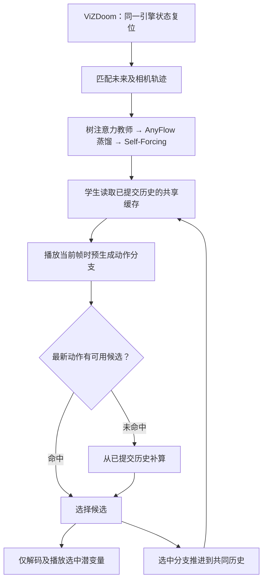
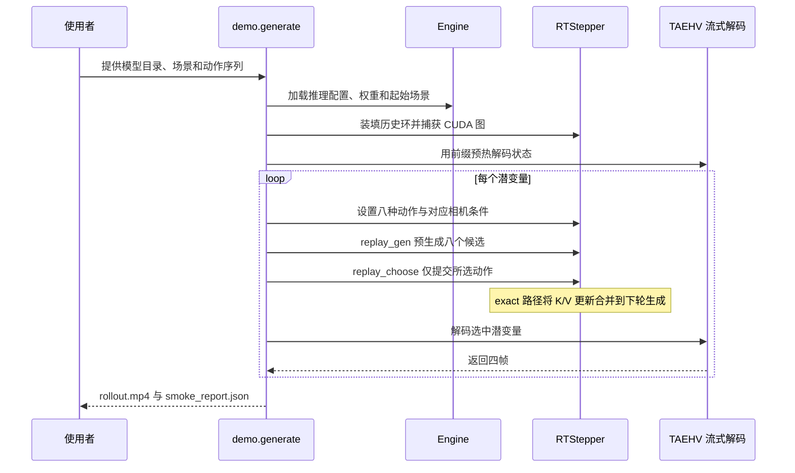

# ShowNow：用细粒度推测式流生成提升世界模型交互响应｜Fine-Grained Speculative Streaming for Responsive World Models

## 一句话定义

ShowNow 在显示上一段视频时，从同一段已提交历史并行预生成若干动作的下一步，仅解码并保存实际选中的视频潜变量。作者 Yiren Song、Guian Fang、Mike Zheng Shou 来自新加坡国立大学 Show Lab。

## 英文缩写速查

| 缩写 | 英文全称 | 含义 |
|---|---|---|
| K/V | Key / Value | 注意力缓存的键和值 |
| FIFO | First In, First Out | 依序展示已生成帧的队列 |
| IDM | Inverse Dynamics Model | 从生成视频潜变量估计实际体现的动作 |
| LPIPS | Learned Perceptual Image Patch Similarity | 感知距离，越低越好 |
| FD | Fréchet Distance | 本文以视频潜变量的通道均值与标准差为特征计算的分布距离 |

## 为什么重要

连续播放达到 16 fps 不代表输入能立刻生效：模型可能在等一个大块生成完，或者已生成的旧动作画面还排在队列中。把生成、选支和显示的时钟分开，才能知道提高帧率是否真的降低交互延迟。

## 核心原理

1. **同状态分叉。** ViZDoom 保存并恢复相同引擎状态，记录共享视频历史及不同动作的后续画面和相机位姿。训练混合持续按键和中途换键；模型实际读取的历史裁剪应与数据集的原始视频长度区分。
2. **历史共享、未来隔离。** 历史 token 不读取任何未来；每个未来只读取公共历史与本分支。树结构复用历史键值，未来时间位置保持与单分支一致。分块注意力用各分区的归一化常数精确合并，不是两段输出等权平均。
3. **教师到单潜变量学生。** SolarWM/Wan2.2 教师用匹配分支流匹配训练；接着 AnyFlow 因果蒸馏、再用 Self-Forcing 细化。5B 发布学生采用三次去噪，历史环形缓存最多 15 个已提交潜变量。一次提交对应四帧（16 fps 时 250 ms）。
4. **最新输入选择分支。** 播放时预计算，接近展示边界按最新输入选支；没有就从当前已提交历史补算。只提交匹配分支，其余不进入共同历史。优化路径将选中分支的干净 K/V 写入并入下一次生成，选中后可立即开始流式解码。

## 流程总览

## 源码运行时序图

按发布版离线示例绘制。它使用脚本动作序列而非实时键盘，生成计时不包含显示调度。

## 实验与评测

| 对照口径 | 作者结果 | 正确读法 |
|---|---|---|
| 表 1，单 H100、ViZDoom、6 个种子 | SolarWM-FT 原生 B3 自动阈值：P50/P90/P99 为 620/983/1385 ms；优化 B1 八分支：208/345/374 ms，15.99 fps | 这是完整部署差别，不能全部归因于预生成 |
| 表 3，同学生、同运行时、同轨迹、16 fps、提前一帧选择 | Reactive 对八分支：重启空帧 1.56% → 0.09%，持续空帧均为 0；P99 373 → 374 ms；GPU 忙碌比例 19% → 80% | 同条件主要收益是重启连续性；尾延迟未见降低 |
| 图 3，固定显示目标，500 对均匀相位换键 | 单分支到八分支的按时率 83.8% → 96.8%，平均提前 9.2 ms | 测的是第一张经新输入条件化的帧能否按时排入展示 |
| 表 2、附录 G | 切换窗口动作识别 0.813 对 0.591；稳定窗口 0.901 对 0.969。20 个留出场景一分钟滚动，部署版平均 FD 11.4、动作识别 0.772；SolarWM-FT 为 3.4、0.912 | 更快体现命令不等于长期画面更准；一分钟比较的噪声种子数也不同 |
| 附录 H，33B | 862 → 232 ms，23.94 fps；八块 B300 测生成与提交，另一路解码按 47 ms/潜变量建模 | 单未来、混合计时；排除传输、客户端网络和实体显示延迟，不是单卡八未来结果 |

## 与其他工作对比

- **对 SolarWM-FT（§4 表 1）**：统一 FastTree 和提前一帧阈值时，B3（每 12 帧决策）到另行训练的 B1（每四帧决策）的中位延迟由 536 到 210 ms；B3 在此阈值下仅 14.50 fps，说明缩短队列本身未必可行。对照只共享部分配置，不是仅改一处代码的消融。
- **对同学生的 Reactive（§4 表 3）**：同样逐潜变量提交，区别是等待输入后才启动生成，还是提前覆盖未来。提前一帧时应优先比较重启空帧；更浅的队列和更慢的生成时也应比较尾部等待，不能只比较默认 P50。
- **对 [Matrix-Game 2.0](./paper-sa-2508-13009-matrix-game-2-0-an-open-source-real-time-and-str.md)**：两者都研究交互视频流。ShowNow 的论证聚焦相同模型下分支准备、队列阈值、显示连续性及动作变化的截止时间；不能拼接不同任务、画质与硬件的帧率作性能排名。

## 工程实践

- 5B 八动作仓库提供训练、推理、评测代码、约 10 GB 的 BF16 EMA 权重及约 304 GB 的分叉数据；快速推理用小型预制场景，不必先下载完整训练集。训练使用的教师/中间学生检查点不在推理包内，33B 不是此发布包的声称范围。
- 从离线 `shownow.demo.generate` 检查是否出片；要测输入响应，使用带固定输入轨迹、显示队列与空帧统计的 `shownow.eval.latency_harness`。浏览器例程使用参考 FastTree，不等同于优化基准。
- 分别记录生成时间、输入到逻辑选支、输入到计划显示、动作真正可辨识的时间，以及重启/持续空帧。只要终点没写清楚，就不能把 208 ms 当作机器人传感器到电机的控制延迟。本次未运行 GPU 或仿真。

## 局限与风险

八个互斥动作和短历史不能替代连续控制的分支覆盖，也不保证重访场景的物体或布局一致。相邻命令可能在一次提交间隔内互相覆盖，动作条件已传入画面也不代表实际动作已经正确出现。作者实验以合成键盘输入和游戏为主，没有真实机器人控制验证。

## 结论

ShowNow 的关键是把准备工作移到播放时段，保留细粒度选择窗口。预算允许时，覆盖更多候选主要减少缺帧和错过截止点；评估时仍需同时衡量尾部延迟、画质和长期一致性。

## 关联页面

- [生成式世界模型](../methods/generative-world-models.md)
- [视频生成工作流](../methods/video-generation-workflow.md) — 生成、解码和播放的端到端分段指标。
- [视频作为仿真](../concepts/video-as-simulation.md)

## 参考来源

- [论文全文与实验口径](../../sources/papers/shownow_arxiv_2611_34693.md)
- [源码、权重与数据开放边界](../../sources/repos/shownow.md)

## 推荐继续阅读

- [ShowNow arXiv v1 全文](https://arxiv.org/html/2611.34693v1)，重点对照表 1 和表 3 的不同比较条件。
- [官方仓库与 5B 权重入口](https://github.com/showlab/ShowNow)，先看离线示例与交互评测各自测量的时间点。
