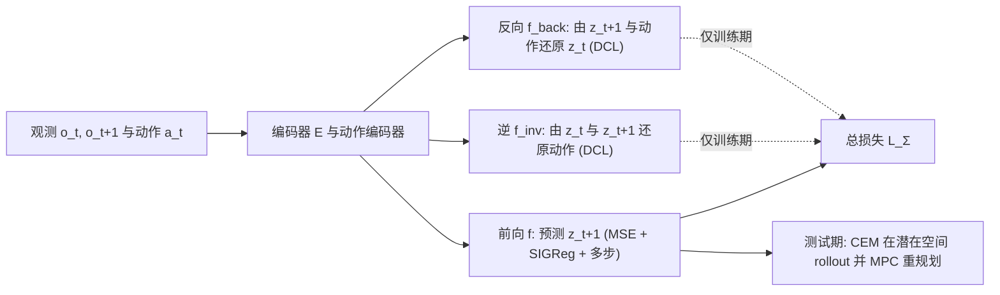

# Σ-LeWM（arXiv:2611.12732）

**Σ-LeWM**（*Σ-LeWM: Learning World Models via S-Information for Robot Control*，[arXiv:2611.12732](https://arxiv.org/abs/2611.12732)；[项目页](https://zuxinrui.github.io/sigma-lewm/)；[代码](https://github.com/zuxinrui/sigma-lewm)）是阿姆斯特丹自由大学（Vrije Universiteit Amsterdam）的 Zu、Przystupa、Yang、Yu、Luck 对 [LeWM](./paper-lewm.md) 的扩展。本页按原文 v1 通读后撰写，章节号均指该版本。

## 一句话定义

> **在无解码器的 LeWM 前向预测损失之外，再加「反向动力学」与「逆动力学」两项对比式辅助损失，只在训练期使用；测试期仍用前向模型做 CEM 规划。**

## 英文缩写速查

| 缩写 | 英文全称 | 简要说明 |
|------|----------|----------|
| LeWM | LeWorldModel | 前作：像素端到端 JEPA 世界模型，MSE + SIGReg |
| SIGReg | Sketched-Isotropic-Gaussian Regularizer | LeWM 防潜在塌缩的正则项 |
| DCL | Decoupled Contrastive Loss | 解耦对比损失，InfoNCE 的变体（第 3.2 节） |
| MI | Mutual Information | 互信息 |
| TC / DTC | Total / Dual Total Correlation | 总相关 / 对偶总相关，二者之和即 S-Information |
| CEM | Cross-Entropy Method | 采样式规划优化器，迭代更新动作分布 |
| MPC | Model-Predictive Control | 模型预测控制：只执行规划出的前几步再重规划 |
| GC-IDM | Goal-Conditioned Inverse Dynamics Model planner | 论文第 5.6 节用的学习式规划器（文献 [20]） |
| OGBench | Offline Goal-conditioned Benchmark | Cube / Scene 任务来源（文献 [28]） |

## 为什么重要

- 解码器-free 世界模型只保证「可预测 + 不塌缩」，论文认为这不保证潜在空间保留与控制相关的结构（第 2 节，作者观点）。
- 该工作给出一个低成本改法：训练期多两项损失，推理成本不变（第 4.1 节、附录 B：四种方法的规划延迟相差在 2% 内）。
- 论文把「更好的潜在」转化为可测的两件事：更长规划视野下更稳、更少 CEM 迭代即可达到同等成功率（第 5.3–5.4 节）。

## 核心原理与流程总览

方法（第 4 节）：编码器得 z_t，动作编码器得 ã_t；前向 f(z_t, ã_t)→z_{t+1} 用 LeWM 损失加多步项；反向 f_back(z_{t+1}, ã_t)→z_t 与逆 f_inv(z_t, z_{t+1})→ã_t 各用 DCL 对齐（式 10–11；反向项实际对齐到 z_t 的额外投影头输出，直接对齐原始 z_t 会变差，见表 1 §行）。总损失 L_Σ = L_forward + 0.1·L_back + 0.05·L_inv（式 9、第 5.1 节）。

理论解读（第 4.3 节，作者自述）：MSE + SIGReg 等价于最大化 I(Z_{t+1}; Z_t, A_t)；DCL 对应另两个互信息的下界；三者之和 = TC + DTC = S-Information（式 17–20）。这是目标函数的信息论解释，论文未给出控制性能与 S-Information 之间的定量关系。

## 工程实践

- 设置（第 5.1 节）：batch 128，DCL 温度 0.1，批内负样本；SIGReg 权重 0.09；CEM 每轮 300 条候选、取 top 30；标准基准默认 h=5、CEM30、frameskip 5。Gear 与 Cube-Stacking 将 λ_sig 设为 0（第 5.5 节）。
- 任务（第 5.5 节）：IsaacSim 中 Gear-Assembly（SRSA 策略采集 10k 轨迹，过滤后约 21k 帧）与 Cube-Stacking（1k 条增广遥操作轨迹，来自 MimicGen）；目标帧取留出集中首个满足成功判据的帧（而非标准基准的固定前瞻目标）。
- 代码（仓库 README，只读未运行）：`slewm train/eval`，核心在 `slewm/objectives/`；README 明说不含数据、检查点（标准四任务的权重在 Hugging Face）；Isaac Lab 任务需自装；部分脚本按特定工作站路径写成。
- 复用提示（推测）：只要已有 LeWM 训练管线，改动是加两个头与两项损失，迁移成本低；但 DCL 依赖批内负样本，批大小可能影响效果，论文未做该消融。

## 与文章说法的核对

文章段落见 claims 文件（公众号《机器人动作块太长，什么时候该重新规划？》第 15 条）。

| 文章说法 | 核对结果 |
|----------|----------|
| 「在前向预测之外加入反向与逆动力学训练信号」 | 属实（第 4.1–4.2 节）；二者是对比式辅助损失，训练期使用。 |
| 「让潜在状态更适合控制」 | 这是作者结论，证据为 Table 1 / 图 3–5 的成功率、图 7 与附录 A 的线性探针、图 8 的 GC-IDM 规划器；不是对所有任务一致成立：TwoRoom、Reacher 与 LeWM 持平，Reacher 上 86.0 对 86.0（第 5.2 节自述「在噪声内」）。 |
| 「规划时仍使用前向模型」 | 属实（第 4.1 节、图 1：辅助头不进推理，规划与 LeWM 相同）。作者把「规划时使用辅助任务」列为未来工作（第 6 节）。 |
| 「结果来自仿真控制基准」 | 属实：Push-T、TwoRoom、Reacher、OGBench-Cube/Scene 与 IsaacSim 的 Gear、Cube-Stacking 均为仿真（第 5.2、5.5 节）。 |
| 「尚不能直接推及真实接触与传感噪声」 | 与论文一致：第 6 节明确真机部署是未来工作；论文没有真机、接触噪声或传感噪声实验。 |

文章段落没有给具体数字，因此没有数字需逐条核对。顺带指出文章标题式概括「保留与动作有关的信息」对应逆动力学项，但附录 A 显示效果有取舍：多步前向项使方块平面位置 R² 从 0.93 降到 0.65，加反向与逆项后回升到 0.846，仍低于 LeWM 的 0.929（表 3、附录 A 文字）。

## 实验要点（带出处）

- 表 1（第 5.2 节）：Σ-LeWM 在 Scene 比 LeWM 高约 23 个点（80.7 vs 57.7），Push-T 高 4.5 点；论文称其余三项与最优方法差异在噪声内。仅多步项的 LeWM 在 Scene 上为 53.6，故 Scene / Cube 的提升来自反向与逆项（作者自述）。
- 长视野（第 5.3 节，图 3）：h=3/5/10/15；Push-T 与 Cube 各视野均优于对比方法，TwoRoom 与 Reacher 在 h=15 时出现增益（图内标注 TwoRoom Δ=+12.0）。
- 规划效率（第 5.4 节，图 4，表 4）：CEM 迭代 8/4/2 对应搜索预算缩减 3.75×/7.5×/15×；Push-T 上 CEM4 已优于 LeWM 的 CEM8 且与 CEM30 相当。
- 仿真机器人（第 5.5 节，图 6）：Gear 严格成功 LeWM 10.9 → 74.9；图中 AC-MTM 65.6、SMWM 64.9 也远高于 LeWM，说明大部分跃升来自「带逆动力学项」本身，Σ-LeWM 比这两者再高约 9–10 点（我的读图归纳）。
- 潜在质量（第 5.6 节、附录 A）：PCA 与线性探针显示块高度 R² 0.978（LeWM 0.958）、末端 xyz 0.997（0.837）；GC-IDM 规划器在 Cube 上 97.6 vs 90.4、Push-T 上 93.6 vs 88.4（图 8，5 种子×50 回合）。

## 局限

论文自己承认的：
- 真机部署与「规划时使用反向 / 逆动力学」均留作未来工作（第 6 节）。
- TwoRoom 被作者说明为低复杂度任务（第 5.2 节），SMWM 在 TwoRoom 有一个训练种子塌缩（表 1 ‡）。
- 一些结果用的是不同评测种子：表 2 与图 9 与表 1 的评测种子不同，数值略有出入（作者在图 9、表 2 文字中说明）。

我看到的未验证之处：
- 表 1 多数列的差距与标准差相当（例如 Push-T 94.5±3.0 vs 90.0±5.7），只有 Scene（和 Cube 对部分基线）的提升明显；仅 3 个训练种子。
- 基线并非严格同训练配方：基线保持原目标且不带多步项，LeWM / Sub-JEPA 的一个种子用作者发布的检查点（第 5.2 节）；Gear / Cube-Stacking 的 λ_sig=0 与标准基准设置不同。
- Gear-Assembly 的数据集经「严格成功」过滤，目标帧取自留出集成功首帧；此目标规格比标准基准的固定前瞻目标更靠近成功状态（推测：这可能放大潜在中任务成功状态是否可分的作用，论文自己也只称其为「一种候选解释」，第 5.5 节）。
- Cube-Stacking 的文字结论缺失，图 6 中柱状误差棒较大，且 Σ-LeWM 与 SMWM 的差距有限（读图所得）。
- 超参只在 Push-T 上做了权重扫描（表 2），未在其他任务上验证；批大小 / 负样本数的影响未测。
- 项目页与 README 引用年份不一致（2026 / 2027），属元数据小疏漏。
- 本页未运行代码、未读仓库源码，复现性未验证。

## 关联页面

- [LeWM（前作，MSE + SIGReg）](./paper-lewm.md)
- [Traj-LeWM](./paper-traj-lewm.md)
- [LeJEPA](./paper-lejepa.md)
- [DINO-WM](./paper-sa-2411-04983-dino-wm-world-models-on-pre-trained-visual-featu.md)
- [LeJEPA 何时学到世界模型](./paper-when-does-lejepa-learn-world-model.md)
- [逆动力学模型](../concepts/inverse-dynamics-model.md)
- [潜在想象](../concepts/latent-imagination.md)
- [生成式世界模型](../methods/generative-world-models.md)
- [基于模型的强化学习](../methods/model-based-rl.md)

## 参考来源

- [sigma-lewm_arxiv_2611_12732.md](../../sources/papers/sigma-lewm_arxiv_2611_12732.md)
- [arXiv:2611.12732](https://arxiv.org/abs/2611.12732)
- [项目页](https://zuxinrui.github.io/sigma-lewm/)
- [代码仓库](https://github.com/zuxinrui/sigma-lewm)

## 继续阅读

- [LeWM 实体页](./paper-lewm.md)：理解被扩展的基线。
- [逆动力学模型](../concepts/inverse-dynamics-model.md)：逆动力学作为辅助任务与规划器的两种用法。
- [arXiv PDF](https://arxiv.org/pdf/2611.12732)
