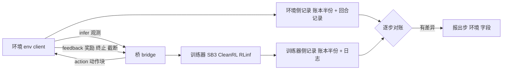

# Detecting Silent Faults at the Environment–Trainer Boundary in Reinforcement Learning（arXiv:2611.08144）

论文（[arXiv:2611.08144](https://arxiv.org/abs/2611.08144)，Zuo Gou、Chenhao Lu，清华大学，v1 2026-11-05）收录于具身智能小站 2026-11-09 更新，小站标题为「训练曲线正常，也可能传错了数据」。本页依据论文全文（含附录）整理，归档见 [sources 笔记](../../sources/papers/silent-faults-env-trainer-boundary_arxiv_2611_08144.md)。

## 一句话定义

**把 RL 里环境与训练器之间的接口做成显式线协议（PlugRL），向它注入「不报错」的故障，量化哪些检查能发现：学习曲线与干净评估基本不行，两侧各记逐步记录并对账（step ledger）可以。**

## 英文缩写速查

| 缩写 / 术语 | 英文全称 | 简要说明 |
|-------------|----------|----------|
| RL | Reinforcement Learning | 强化学习 |
| PPO | Proximal Policy Optimization | 论文所有故障注入实验使用的训练算法（SB3 实现） |
| SB3 | Stable-Baselines3 | 论文主要训练器 |
| Boundary fault | 边界故障 | 环境实际拿到、给出的内容与训练器发出、收到的内容之间的差异（Sec. I） |
| Step ledger | 逐步账本 | 环境侧与训练器侧各记每步观测、动作、返回值，逐步比较 |
| Episode record | 回合记录 | 在环境端记录回合数、长度、回报，用来核对训练器日志 |
| Byte identity | 字节一致 | 同种子同机器下，有无故障的最终权重是否逐位相同 |
| SAME_STEP | Gymnasium 自动重置模式 | 该模式下 Gymnasium 1.3 向量回合统计出错（Sec. IV） |
| PlugRL | 论文提出的环境到训练器协议及实现 | 含规范、检查器和桥（bridge） |

## 为什么重要

- 机器人 RL 环境常在另一进程、另一台机器、另一种语言里运行，甚至机器人经网络接入策略（Sec. I）；这条边界往往没人专门设计。
- 作者自述：过去「策略仍在学习」被当作边界正确的证据，本文检验这一证据（Sec. I）。结果（Sec. III）是：学习曲线和干净评估都看不出多数故障，故障主要改变的是这次运行的记录（权重、被记录的回报），而非最终策略质量。
- 对比较两种方法的实验尤其相关：奖励或日志故障在一组对比中可能被读成方法差异（Sec. III）。
- 作者自己的判断以外的补充（推测）：对 Isaac 系或自写训练循环的用户，同样的对账思路可以迁移，但论文并未在这些栈上验证。

## 核心原理 / 方法栈 / 流程总览

- **协议（Sec. II）：** 服务器先发元数据（版本、动作块长度 H、特性）；之后重复 infer、action、feedback 三类消息（msgpack + NumPy 数组，WebSocket）；以 stop（运行结束）或 resync（立即重连）收尾。规范固定唯一的回合结束约定，结构性错误（形状、键、环境数不符）由桥拒绝并关闭连接；桥是锁步的，因此单机运行可复现。
- **故障注入（Sec. III）：** 对观测、动作、奖励、终止观测做置零、上一步值、下一环境值、float16 取整（动作还有裁剪一半量程）；回合结束可虚构、漏掉、把终止写成截断；跳步并填充；另有 2 种训练器日志故障。剂量为 1 个值、1%、全部值（Pendulum 另有 0.1%、10%）。
- **五类检查（Sec. III、Fig. 4）：** 增益阈值、种子离散度、字节一致、回合记录、逐步账本。只有回合记录与账本跨越边界。
- **结果：** 见下表。

| 检查 | 论文报告（Sec. III） |
|------|----------------------|
| 增益阈值 | 剂量不超过 10% 时在四个环境最多抓到十分之一；全部值出错时 43%、35%、48%、33% |
| 种子离散度 | 无故障种子误报为 0、1、0、0 个（十个）；低于全量剂量最多抓到 21% |
| 字节一致 | 抓到几乎全部；Hopper 漏掉 12 个终止观测故障（训练未读该值） |
| 回合记录 | 抓到全部日志故障与改变奖励、回合结束、步骤的故障；漏观测、动作、终止观测、结束类型、跳步 |
| 逐步账本 | Pendulum、Hopper、Pusher 的 189、207、189 个运行全部发现并定位，无误报；HalfCheetah 未跑 |
| 干净评估 | 两项曲线检查都通过的运行中，Pendulum 255 个里 5 个、其余 473 个里 0 个明显更差 |

## 工程实践

- **作者建议（Sec. VII）：** 不要只凭学习曲线断定边界正确；在环境外包一层保存每步所取所给，并与训练器收发的记录逐步比较；回合记录放在环境端而不是训练器侧；单机上用字节一致证明底层改动（部署位置、传输、延迟、调度、协议版本）不改变权重；报告边界信息（环境在哪跑、如何接入、每步字节与耗时），声明回合结束约定，区分 stop 与 resync，绝不补全缺失步骤。
- **代价（Sec. III、V、VI）：** 账本在 Pendulum 上使训练时间中位数增加 3%（-5% 到 +9%），权重不变；桥每向量步多 0.4–0.6 ms（16 个状态向量）或 2.6–3.0 ms（16 帧）；跨 Wi-Fi 的 184 KiB 相机观测 11.6 ms；协商 reuse-feedback-obs 后 588 KiB 往返由 49.8 ms 降到 27.1 ms。
- **实际案例（Sec. IV、Table I）：** Gymnasium 1.3 的 SAME_STEP 向量回合统计丢首个奖励并少计 1 步长度（1.4 修复）；CleanRL 日志循环在 Gymnasium 1.3 上不记录或报 TypeError（Appendix G）。多智能体库的案例是作者引用他人 issue 或 PR，并非自己复现。
- **作者自述与本页判断分开：** 以上为论文内容。本页判断：如果你已用 [Gymnasium](gymnasium.md) 向量环境加 [Stable-Baselines3](stable-baselines3.md)，最低成本动作是升级到修复版本并核对回合计数，这一点由 Table VI 的计数直接支持；其余落地方式未被论文验证。

## 局限

**论文自己承认（Sec. IX）：**
- 故障由作者选定；只在四个仿真、状态输入、稠密奖励环境、单一训练器（SB3 PPO）、三个种子上做；稀疏奖励、长时域、回放缓冲、图像、真机上「曲线漏掉的故障不伤策略」未必成立。
- 账本需要能包装环境，看不到环境内部的错误；真机只能包到自身客户端为止。
- 账本在运行后比对（Hopper 每次 150 MB），逐步在线校验摘要留作未来工作。
- 规范与 C++ 客户端同一批人写；不研究环境在等动作时仍在运动的真机。

**本页观察到的未验证之处：**
- 干净评估的结论只显示最终回报没明显变差；论文也承认 Pendulum 上 5 个运行低于 3 个标准差，但 13 个无故障种子无法与罕见坏种子区分（Sec. III）。
- 账本「必然发现」是因为故障定义本身就是两侧记录的差异（作者在 Sec. I 说明），所以 100% 更像设计上的保证，真正未知的是真实系统中遗漏的故障类型。
- 逐字段「发现率」表（Fig. 6）来自三个种子，样本很小；PlugRL 仓库的协议与日志未能核实。
- 跨机器场景只在 Pendulum 上做了账本实验（Sec. III）。

## 关联页面

- [PPO](../methods/ppo.md)：实验里被注入故障的训练算法
- [强化学习](../methods/reinforcement-learning.md)
- [奖励设计](../concepts/reward-design.md)：奖励故障改变被记录的回报
- [RL Runner](../concepts/rl-runner.md)
- [Sim2Real](../concepts/sim2real.md)：环境搬到远端或真机时同样面对边界问题
- [Gymnasium](../entities/gymnasium.md)：Sec. IV 中 SAME_STEP 统计问题的出处
- [Stable-Baselines3](../entities/stable-baselines3.md)
- [CleanRL](../entities/cleanrl.md)
- [RLinf-VLA](../entities/paper-rlinf-vla.md)：RLinf 是论文接入的训练器之一（本页不含对 RLinf-VLA 的评价）

## 参考来源

- [论文归档](../../sources/papers/silent-faults-env-trainer-boundary_arxiv_2611_08144.md)
- [arXiv:2611.08144](https://arxiv.org/abs/2611.08144)
- 资源入口 [PlugRL](https://github.com/PlugRL)（论文给出，本次未能访问，未核实）

## 推荐继续阅读

- [arXiv PDF v1](https://arxiv.org/pdf/2611.08144v1)
- [Sim2Real 部署条件](../queries/rl-sim2real-deployment-conditions.md)
