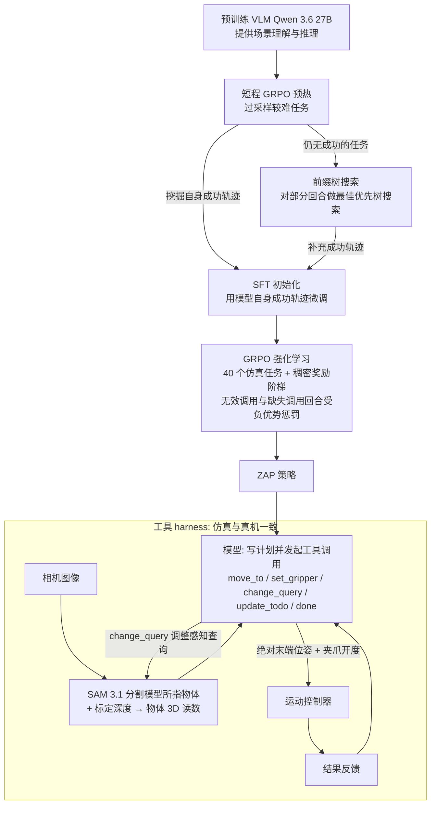

# Sim-Trained Compositional Agent（arXiv:2610.35817）

**Sim-Trained Compositional Agent**（*Pretraining Knows What, Simulation Teaches How: Compositional Generalization in a Sim-Trained Robot Agent*，[arXiv:2610.35817](https://arxiv.org/abs/2610.35817)，[项目页](https://zero-real.github.io/)）来自 [具身智能小站 2026-10-28 盘点](../../sources/blogs/wechat_embodied_station_59_papers_human_video_to_robot_experience_2026-10-28.md)，属「VLA 与策略后训练」组。

## 一句话定义

**先用预训练模型提供理解与推理，再通过仿真监督微调和强化学习学习工具控制。**

## 英文缩写速查

| 缩写 | 英文全称 | 简要说明 |
|------|----------|----------|
| Sim-Trained Compositional Agent | Pretraining Knows What, Simulation Teaches How: Compositional Generalization in a Sim-Trained Robot Agent | 本文方法 / 基准的简称 |

## 为什么重要

- 用仿真教会视觉语言模型执行动作。作者报告真实任务迁移与新目标组合能力，结论依赖其工具接口、任务集和评测预算。
- 开源结论：**项目页未列 GitHub**（步骤 2.5，2026-10-28）。项目页 HTTP 200，未见 GitHub 链接或 coming soon 字样。
- 同期同组工作见 [潜在动作、免渲染事件仿真与机器人评测：具身智能小站 10-28 期 59 篇阅读坐标](../overview/embodied-station-2026-10-28-59-papers-technology-map.md)。

## 流程总览

图依据：论文 §3.1 / Fig.2、§3.2、§3.3。

## 核心机制

| 项 | 内容 |
|----|------|
| **arXiv** | [2610.35817](https://arxiv.org/abs/2610.35817) |
| **开源** | **项目页未列 GitHub** |
| **要点** | 先用预训练模型提供理解与推理，再通过仿真监督微调和强化学习学习工具控制。 |
| **文内指标** | 公众号转述：作者报告真实任务迁移与新目标组合能力，结论依赖其工具接口、任务集和评测预算。 |

## 源码运行时序图

**不适用（项目页未列 GitHub）** — 项目页 HTTP 200，未见 GitHub 链接或 coming soon 字样。 不编造运行脚本；代码公开后再补。

## 实验与评测

- 公众号转述：作者报告真实任务迁移与新目标组合能力，结论依赖其工具接口、任务集和评测预算。
- **读法：** 本页为索引级摘要，依据公众号转述的官方摘要与仓库信息整理；逐项数字与 baseline 以原文 PDF 为准。

## 与其他工作对比

- 横向索引见 [潜在动作、免渲染事件仿真与机器人评测：具身智能小站 10-28 期 59 篇阅读坐标](../overview/embodied-station-2026-10-28-59-papers-technology-map.md)；同 arXiv 不重复造页。

## 结论

**用仿真教会视觉语言模型执行动作：作者报告真实任务迁移与新目标组合能力，结论依赖其工具接口、任务集和评测预算。**

1. 开源边界：**项目页未列 GitHub** — 项目页 HTTP 200，未见 GitHub 链接或 coming soon 字样。
2. 核心机制：先用预训练模型提供理解与推理，再通过仿真监督微调和强化学习学习工具控制。
3. 复现与选型前核对任务协议、硬件与基准口径，勿直接横比公众号摘录数字。

## 关联页面

- [vla](../methods/vla.md)
- [imitation-learning](../methods/imitation-learning.md)
- [reinforcement-learning](../methods/reinforcement-learning.md)
- [embodied-station-2026-10-28-59-papers-technology-map](../overview/embodied-station-2026-10-28-59-papers-technology-map.md)

## 参考来源

- [sim_trained_compositional_agent_arxiv_2610_35817.md](../../sources/papers/sim_trained_compositional_agent_arxiv_2610_35817.md)
- [wechat_embodied_station_59_papers_human_video_to_robot_experience_2026-10-28.md](../../sources/blogs/wechat_embodied_station_59_papers_human_video_to_robot_experience_2026-10-28.md)
- [arXiv:2610.35817](https://arxiv.org/abs/2610.35817)
- [arXiv PDF](https://arxiv.org/pdf/2610.35817)：已通读方法部分（实验与附录以略读为准）：§1 引言、§3.1 仿真与真机统一接口、§3.2 仿真中学习运动（GRPO 与稠密奖励）、§3.3 模型初始化（自身成功轨迹 SFT 与前缀树搜索）、Fig.2；§4 起实验与附录略读

## 推荐继续阅读

- [arXiv PDF](https://arxiv.org/pdf/2610.35817)
- [项目页](https://zero-real.github.io/)
