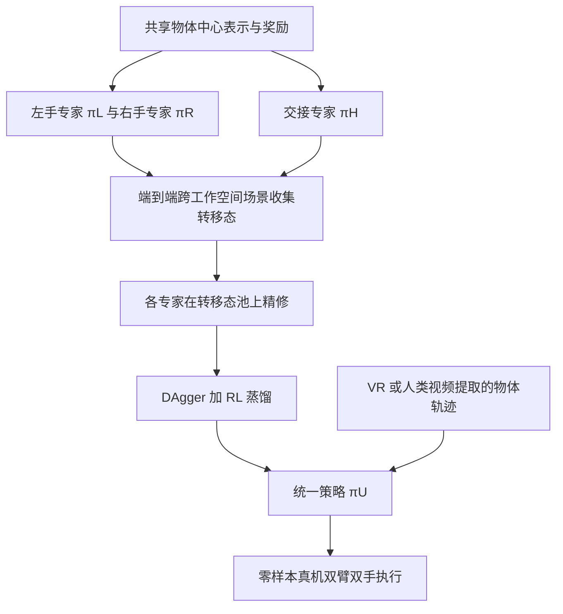

# SimDuoReal（arXiv:2611.10410）

**SimDuoReal**（*SimDuoReal: Object-Centric Bimanual Policy for Emergent Dexterity*，[arXiv:2611.10410](https://arxiv.org/abs/2611.10410)，v1 2026-11-07）来自 Amazon FAR（合作机构 UCSD、University of Chicago、CMU、Stanford，见论文首页）。本页依据论文全文写成，核对范围见 [来源归档](../../sources/papers/simduoreal_arxiv_2611_10410.md)。

## 一句话定义

**一个以物体 6-DoF 位姿目标为唯一任务接口的双臂双灵巧手策略：先在仿真里用同一物体中心奖励、仅改变目标采样分布训练三个专家，再蒸馏成单一策略，零样本迁移到真机做条码扫描、插销、清扫、烹饪。**

## 英文缩写速查

| 缩写 | 英文全称 | 简要说明 |
|------|----------|----------|
| DAgger | Dataset Aggregation | 学生策略自己 rollout，由教师在访问到的状态上给标签，见 [DAgger](../methods/dagger.md) |
| RL | Reinforcement Learning | 强化学习；本文蒸馏阶段同时加策略梯度损失 |
| EPO | Evolutionary Policy Optimization | 论文训练各专家用的算法（引自其参考文献 [26]），本页未展开 |
| SR | Success Rate | 成功率 |
| 6-DoF | 6 Degrees of Freedom | 物体位置加姿态，即 SE(3) 位姿 |
| VR | Virtual Reality | 真机实验中用 Meta Quest 3 移动虚拟物体来给目标 |
| FLS | Fixed Lag Smoothing | 多视角位姿融合所用的固定滞后平滑 |

## 为什么重要

- 双手灵巧操作通常要为"哪只手动、何时交接"写任务专用奖励或技能序列；论文主张只描述物体该怎样运动，协调由训练出来（作者自述，Sec. I）。
- 双手场景下，目标够得着时单手搬运总是可行，位姿误差本身分不出交接与单手搬运；论文的做法是让目标落在另一只手的工作空间，使交接成为唯一可达策略（Sec. II）。
- 同一个策略换任务只换物体目标轨迹，不换奖励、不微调（Sec. IV-A）。

## 核心机制

**1. 专家与目标采样（Sec. III-B）。** 定义左、右工作空间（中间有重叠区）。单臂专家 πL、πR 的物体起始于桌面、目标在本臂工作空间内，动作 29 维；交接专家 πH 起始于一只手（给出者）握着物体，目标先从给出者空间移到接收者空间（排除重叠区），动作 58 维；专家训练时 Nshift = Ndst = 1。目标完成要求接收手接触目标区域且给出手释放；掉落或违反工作空间约束则终止。

**2. 统一表示与奖励（Sec. III-B.2，附录 VI-A）。** 在 GraspXL 基础上扩展到双手的手-物体位移特征，另加两手关键点间位移。奖励为位姿进展、目标区域接触、非目标方分离、目标完成、关节速度惩罚、双臂过近的安全缩放；进展类项只奖励"新的最小距离改进"，避免静止或振荡刷分。位姿误差取物体坐标系多个关键点的最大距离。

**3. RL 细节（Sec. III-B.3）。** 用 EPO，非对称 critic（critic 额外拿仿真特权状态）；沿用 SimToolReal 的两段式基元物体、成功容差课程与域随机化（动力学、观测噪声、外力/力矩扰动）。

**4. 蒸馏（Sec. III-C）。** 三类场景：跨工作空间专家场景、端到端跨工作空间场景、并发操作场景，抽样概率 0.4、0.4、0.2；教师路由规则（目标在同一工作空间用 πL/πR，需跨空间用 πH）只在训练时用，不暴露给学生。先在端到端场景收集专家交接处的状态池精修后继专家，再做 DAgger 加 RL，二者损失权重沿用其参考文献 [27] 的调度。

**5. 部署（Sec. III-D）。** 目标来自 Meta Quest 3（60 Hz）或用 FoundationPose 从 RGB-D 人类示范抽取的路标序列；策略 60 Hz 运行。

## 工程实践

- 硬件：两台 Franka Research 3（见 [Franka Research 3](../entities/franka-research-3.md)）加 22 自由度 Sharpa Wave 手；三台标定的 ZED RGB-D 相机（Sec. IV-A）。
- 感知：物体网格用 AR Code（iPhone）或 SAM3D 得到，SAM 2 分割出 S+ / S− 区域；多视角 FoundationPose 加 Cutie 跟踪，深度一致性过滤，失败跟踪器用其他视角重启，再在 SE(3) 位姿图上做 FLS 融合。
- 复现：项目页入库日标注 Code 与交互 Demo "Coming soon"，无 GitHub 链接；奖励系数、课程与网络结构等超参论文未给出（见下）。

## 实验与评测

| 项 | 结果（出处） |
|----|--------------|
| 真机条码扫描 / 插销 / 清扫 / 烹饪 | 15/20、15/20、16/20、15/20；合计 61/80，76.25%（Table I，Sec. IV-B） |
| 仿真条码扫描（3072 环境，每个 7 路标，未见基元物体） | 完整策略 SR 85.0%、进度 90.8%、用时 8.6±3.9 s（Table II） |
| 教师去掉交接专家 | SR 60.4%、进度 79.6%（Table II，Sec. IV-C.2） |
| 去掉转移态精修（仅链式三专家） | SR 79.4%；加精修后教师 84.3%（Sec. IV-C.2, IV-C.3） |
| 学生去掉专家场景 / 去掉 RL 损失 | 68.3% / 81.6%（Table II，Sec. IV-C.4） |
| 分开训练专家 vs 端到端从头训练 | 论文称端到端更难（Fig. 6，三个种子）；本页未读出曲线数值 |

## 与其他工作对比

- 单臂版本 [SimToolReal](../entities/simtoolreal.md)：随机生成工具类物体、随机 6-DoF 目标、零样本迁移到真实工具；SimDuoReal 在其基础上扩展到双手与交接（论文 Sec. I、II）。
- 对比其他双手 RL 与模仿方法：论文称它们靠任务奖励或每任务示范来指定谁动手、何时交接（Sec. II）；论文未在同一基准上与这些方法做数值对比，仅有自身消融（推测：因此"相对其他双手方法更好"并无直接实验支撑）。

## 结论

**SimDuoReal 只用物体 6-DoF 位姿目标作任务接口，靠目标采样分布诱导出单手搬运与交接，再蒸馏成单一双手策略零样本上真机。**

1. 三个专家共用同一物体中心奖励，只改目标采样分布；教师去掉交接专家后 SR 仅 60.4%，完整策略为 85.0%（Table II）。
2. 转移态精修把链式三专家从 79.4% 提到 84.3%，说明专家衔接处的状态分布是关键（Sec. IV-C.2, IV-C.3）。
3. 蒸馏时专家场景与 RL 损失都不可省：去掉后学生分别为 68.3% / 81.6%（Table II）。
4. 真机四项任务合计 61/80，换任务只换物体目标轨迹，不换奖励、不微调（Table I，Sec. IV-A）。
5. 缺真机基线与跨任务消融，超参与代码未公开，"涌现"更宜读作环境设计诱导。

## 局限

论文自己承认（结论段）：
- 需要准确的物体网格与多视角位姿跟踪；
- 6-DoF 目标接口不直接表达力或时序相关行为；
- 目标轨迹由外部（VR 或人类视频）提供，并非自主生成。

阅读时看到的未验证之处（作者之外的判断）：
- 真机每任务仅 20 次，且各任务实验对象与初始化的细节只在正文概述；没有给出置信区间或失败原因统计。
- 仿真消融只在条码扫描一个基准上做，规则轨迹为线性插值；其他任务的消融未给。
- 真机对比基线缺失：未见真机上与无交接策略或其他双手方法的对照（本页读到的范围内）。
- 奖励系数、课程参数、网络结构、训练规模等未在论文中找到；代码未发布，复现需等待。
- 论文称行为"涌现"；其涌现与训练场景设计（工作空间划分、交接目标采样）紧密相关，更准确的读法是"由环境设计诱导"（我的判断，非作者原话）。

## 关联页面

- [SimToolReal](../entities/simtoolreal.md)
- [DAgger](../methods/dagger.md)
- [多专家蒸馏](../methods/multi-expert-distillation.md)
- [强化学习](../methods/reinforcement-learning.md)
- [Sim2Real](../concepts/sim2real.md)
- [域随机化](../concepts/domain-randomization.md)
- [奖励设计](../concepts/reward-design.md)
- [Franka Research 3](../entities/franka-research-3.md)
- [Genesis 交接论文](../entities/paper-genesis-handover.md)
- [Object-centric dexterous manipulation from human motion data](../entities/paper-notebook-object-centric-dexterous-manipulation-from-human.md)

## 参考来源

- [simduoreal_arxiv_2611_10410.md](../../sources/papers/simduoreal_arxiv_2611_10410.md)
- [arXiv:2611.10410](https://arxiv.org/abs/2611.10410)
- [项目页](https://simduoreal.github.io/)

## 推荐继续阅读

- [arXiv PDF](https://arxiv.org/pdf/2611.10410v1)
- [DAgger 原始论文页](../entities/paper-ross-dagger.md)
- [Learning dexterous in-hand manipulation（OpenAI）](../entities/paper-pai-1808-00177-learningdexterousinhandmanipulat.md)
