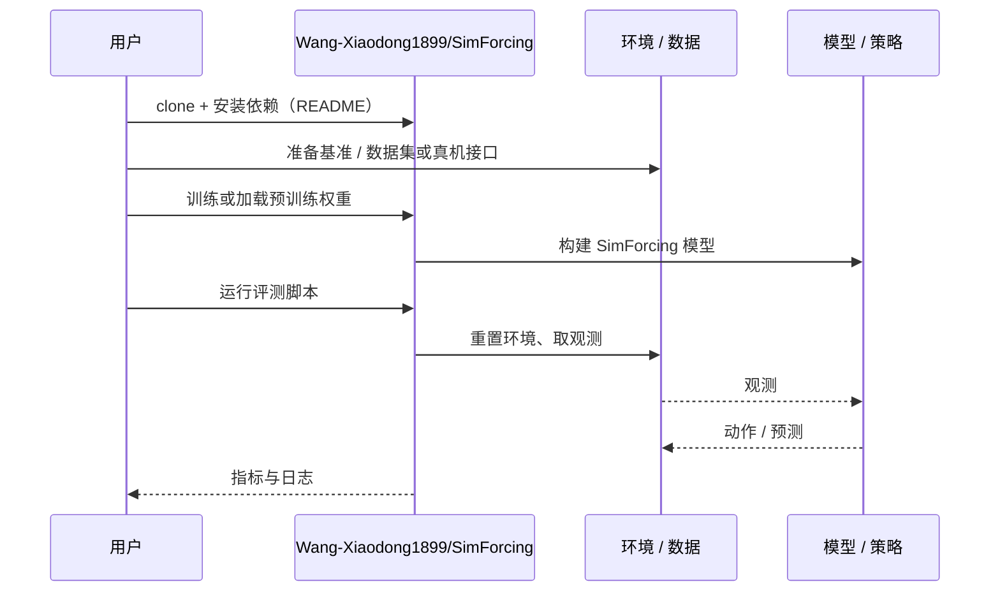

# SimForcing（arXiv:2610.06598）

**SimForcing**（*SimForcing: Distilling Simulation Motion Priors into Real-Domain Robot World Models*，[arXiv:2610.06598](https://arxiv.org/abs/2610.06598)，[代码](https://github.com/Wang-Xiaodong1899/SimForcing)）来自 [具身智能小站 2026-10-13 盘点](../../sources/blogs/wechat_embodied_station_34_papers_mulligan_2026-10-13.md)，属「世界模型与仿真」组。

## 一句话定义

**对齐潜空间时间变化，把仿真运动先验传给真实域世界模型，并控制仿真条件引导强度。**

## 英文缩写速查

| 缩写 | 英文全称 | 简要说明 |
|------|----------|----------|
| WM | World Model | 世界模型 |
| Sim2Real | Simulation to Real | 仿真到真实 |
| KD | Knowledge Distillation | 知识蒸馏 |

## 为什么重要

- 真实域视频模型缺运动先验，仿真可补。
- 开源结论：**已开源**（步骤 2.5，2026-10-14）。仓库可达。
- 同期同组工作见 [失败导向采集与可组合世界动作模型：具身智能小站 10-13 期 34 篇阅读坐标](../overview/embodied-station-2026-10-13-34-papers-technology-map.md)。

## 核心机制

| 项 | 内容 |
|----|------|
| **arXiv** | [2610.06598](https://arxiv.org/abs/2610.06598) |
| **开源** | **已开源** |
| **要点** | 区分视频预测质量与下游策略收益。 |
| **文内指标** | 以原文为准。 |

## 源码运行时序图

以下为按仓库入口（`Wang-Xiaodong1899/SimForcing`）推断的通用运行链路；入库日仅核实仓库可达，未逐文件阅读，具体脚本名以 README 为准。

## 实验与评测

- 以原文为准。
- **读法：** 本页为索引级摘要，依据公众号转述的官方摘要与仓库信息整理；逐项数字与 baseline 以原文 PDF 为准。

## 与其他工作对比

- 横向索引见 [失败导向采集与可组合世界动作模型：具身智能小站 10-13 期 34 篇阅读坐标](../overview/embodied-station-2026-10-13-34-papers-technology-map.md)；同 arXiv 不重复造页。

## 结论

**仿真→真实世界模型的蒸馏应只传运动先验，不传外观。**

1. 开源边界：**已开源** — 仓库可达。
2. 核心机制：区分视频预测质量与下游策略收益。
3. 复现与选型前核对任务协议、硬件与基准口径，勿直接横比公众号摘录数字。

## 关联页面

- [generative-world-models](../methods/generative-world-models.md)
- [sim2real](../concepts/sim2real.md)
- [world-action-models](../concepts/world-action-models.md)
- [embodied-station-2026-10-13-34-papers-technology-map](../overview/embodied-station-2026-10-13-34-papers-technology-map.md)

## 参考来源

- [simforcing_simulation_motion_priors_arxiv_2610_06598.md](../../sources/papers/simforcing_simulation_motion_priors_arxiv_2610_06598.md)
- [wechat_embodied_station_34_papers_mulligan_2026-10-13.md](../../sources/blogs/wechat_embodied_station_34_papers_mulligan_2026-10-13.md)
- [arXiv:2610.06598](https://arxiv.org/abs/2610.06598)

## 推荐继续阅读

- [arXiv PDF](https://arxiv.org/pdf/2610.06598)
- [https://github.com/Wang-Xiaodong1899/SimForcing](https://github.com/Wang-Xiaodong1899/SimForcing)
