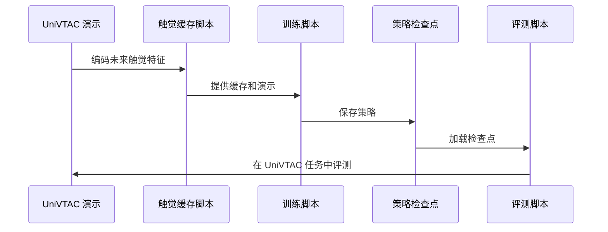

# SimpleTouch：用触觉专家扩展 VLA

## 一句话定义

SimpleTouch 在预训练 π₀.₅ 上加入触觉专家，通过任务演示中的动作监督和未来触觉预测学习接触丰富操作。

## 英文缩写速查

| 缩写 | 英文全称 | 简要说明 |
|------|----------|----------|
| VLA | Vision-Language-Action | 视觉、语言与动作策略 |
| VT | Visuo-Tactile | 视觉与触觉联合 |
| FTP | Fine-Tuned Policy | 论文比较的微调策略 |
| GPU | Graphics Processing Unit | 模型训练和仿真所用计算设备 |

## 核心机制

- 冻结预训练触觉编码器，保留其全部 token，让触觉专家利用接触信息。
- 用任务示范进行单阶段训练：动作监督与多时域未来触觉潜变量预测共同约束表示。
- 不另加触觉策略预训练或单独的视触觉对齐阶段；但依赖已有的预训练 VLA 和触觉表征。

## 源码运行时序图

具体入口见[代码归档](../../sources/repos/simpletouch.md)：先计算归一化统计和缓存，再训练或用官方检查点评测。

## 实验结果

| 设置 | SimpleTouch | 比较方法 |
|------|-------------|----------|
| UniVTAC 六任务，每任务 50 条示范 | 平均成功率 77.5% | FTP-π₀.₅ 45.2%；FTP-1 66.7% |
| 四项真机任务 | 平均成功率 71.3% | 比 FTP-1 高 8.8 个百分点 |

上述结果为论文所报告的特定任务和实验条件，不能直接推广为所有触觉操作的结论。

## 结论

在所测试任务中，已有预训练表征加任务示范足以训练有效触觉策略。

1. 接入触觉时，可先评估冻结编码器加触觉专家的单阶段方案。
2. 未来触觉预测提供动作监督以外的辅助训练信号。
3. 复现比较时应保持每任务示范量和评测条件一致。
4. 不应将省去触觉策略预训练理解为不需要预训练触觉编码器。

## 工程实践与局限

代码公开，README 列出训练和仿真评测流程及检查点地址；项目页和权重页面本次访问失败，下载状态未独立验证。训练示例默认 8 GPU，仿真评测依赖 Isaac Sim 和 UniVTAC 等组件。真机结论仅覆盖论文报告的四项任务。

## 关联页面

- [视触觉融合](../concepts/visuo-tactile-fusion.md)
- [接触丰富操作](../concepts/contact-rich-manipulation.md)
- [OmniTacTune](./paper-omnitactune-tactile-residual-adaptation.md)：以真机强化学习训练触觉残差，与本文示范训练路线互补。

## 推荐继续阅读

- [论文](https://arxiv.org/abs/2610.02784)
- [官方代码](https://github.com/ccyydd/SimpleTouch)

## 参考来源

- [论文归档](../../sources/papers/simpletouch_arxiv_2610_02784.md)
- [项目页归档](../../sources/sites/simpletouch.md)
- [代码归档](../../sources/repos/simpletouch.md)
