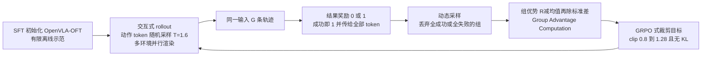

# SimpleVLA-RL（arXiv:2509.09674）

**SimpleVLA-RL**（*SimpleVLA-RL: Scaling VLA Training via Reinforcement Learning*，[arXiv:2509.09674](https://arxiv.org/abs/2509.09674)，v1 提交于 **2025-09-11**，技术报告版首日期 2025-09-12）：清华大学、上海 AI Lab 等团队。论文脚注称代码 **2025 年 5 月**已公开。归档见 [sources/papers/simplevla-rl_arxiv_2509_09674.md](../../sources/papers/simplevla-rl_arxiv_2509_09674.md)。

## 一句话定义

**基于 veRL 的 VLA 在线强化学习框架：对同一输入多次采样轨迹，用 0/1 任务结果奖励和组内相对优势（GRPO 类，无价值网络、无 KL）更新 VLA 策略，作用在 SFT 之后的 OpenVLA-OFT 上。**（论文 §3、§3.4）

## 英文缩写速查

| 缩写 | 英文全称 | 简要说明 |
|------|----------|----------|
| VLA | Vision-Language-Action | 视觉–语言–动作策略 |
| RL | Reinforcement Learning | 强化学习 |
| SFT | Supervised Fine-Tuning | 监督微调，此处指用示范轨迹模仿 |
| GRPO | Group Relative Policy Optimization | 组相对策略优化，用组内奖励归一化代替价值函数（论文 §2.3） |
| PPO | Proximal Policy Optimization | 近端策略优化，GRPO 沿用其裁剪思想（论文 §2.3） |
| veRL | Volcano Engine Reinforcement Learning for LLMs | 论文所基于的 LLM 强化学习框架（§1） |
| DAPO | Decoupled Clip and Dynamic sAmpling Policy Optimization | 论文引用其 clip-higher、动态采样、去 KL 的做法（§3.3、§3.4）；全称为本页补注 |
| OFT | Optimized Fine-Tuning（OpenVLA-OFT） | 论文所用骨干；全称为本页补注，论文未展开 |
| SR | Success Rate | 成功率 |
| LIBERO | Lifelong Robot Learning benchmark | 仿真操作基准（§4.1） |

## 为什么重要

- **作者的出发点（§1）：** SFT 扩展依赖昂贵稀缺的真人遥操作轨迹，且分布偏移下泛化差；借鉴 DeepSeek-R1 的结果奖励在线 RL，只用成功 / 失败信号。
- **作者的主张（§4–§6）：** 在强 SFT 之上仍有提升；示范极少时 RL 可补回大部分差距；仿真 RL 可迁移到真机；RL 能发现示范里没有的动作模式（pushcut）。
- **本页判断：** 这是「VLA + 结果奖励 + 组相对优势」这条路线较早的开源基线之一（作者自称最早的系统性探索之一，§7.2，属自述）；后续平台如 [RLinf-VLA](paper-rlinf-vla.md) 在论文中被作为同期工作提及（§7.2），可对照阅读。

## 核心机制

对应论文图 2（SFT 的有限离线轨迹 vs. rollout → 轨迹 → 奖励 → 组优势计算）。

**方法要点（均为论文所述，节号见括号）：**

- **交互式 rollout（§3.1、式 4–5、清单 1）：** 动作为长度 k 的动作块，机器人执行后再取新观测；选动作 token 输出的 VLA，以便随机采样和算概率；用进程池并行环境。
- **结果奖励（§3.2、式 9）：** 轨迹成功为 1，失败为 0，均匀分给该轨迹所有动作 token，不设过程奖励。
- **探索增强（§3.3）：** 动态采样（式 10）、clip 上界 1.2→1.28、温度 1.0→1.6。
- **目标（§3.4、式 11–12）：** GRPO，优势 Â_i = (R_i − mean)/std，按 DAPO 去掉 KL（因此不需参考模型）。
- **超参（§4.1）：** 8×A800 80GB，lr 5e-6，batch 64，每输入采样 8 条，mini-batch 128，ε 为 0.2 / 0.28，动作块 LIBERO 8 与 RoboTwin 25；评测贪心采样，每个基准测 3 次。

### 算法取舍：用的是 GRPO，不是 PPO

- 论文明确采用 **GRPO**（§2.3、§3、§3.4），无价值网络（critic-free），优势由组内奖励归一化得到；裁剪沿用 PPO 的 ratio 裁剪思想。
- 论文**没有做 PPO 与 GRPO 的对照实验**，也没有「PPO 优于 GRPO」或相反的结论。论文对 PPO 的提及只有：token 式动作输出「与 PPO 类 RL 算法最兼容」（§3.1）；相关工作中说 PPO 常用于 RLHF，GRPO 用规则奖励（§7.1）；VLA-RL 是应用 PPO 的另一工作（§7.2）；RIPT-VLA 用 RLOO（§7.2）。
- 取舍理由（论文给出的）：去掉价值函数与 KL 减少显存与训练开销，并避免 KL 限制探索（§3.4）；GRPO 在全成败组上优势为零会梯度消失，故配动态采样（§3.3）。
- **推测（本页）：** 选 GRPO 与结果奖励配合 R1 路线、避免训练价值网络有关；论文没有就此做实验验证。
- 方法对照见 [GRPO](../methods/grpo.md)、[PPO](../methods/ppo.md)。

## 实验与评测

| 设置 | 结果（论文） | 出处 |
|------|--------------|------|
| LIBERO 四套件，全量示范 SFT 后 RL | 平均 91.0 → 99.1；Long 86.5 → 98.5 | 表 2、§4.2 |
| RoboTwin 1.0 四任务 | 平均 39.8 → 70.4 | 表 3 |
| RoboTwin 2.0 十二任务 | 平均 38.3 → 68.8（π0 49.2，RDT 33.3） | 表 4、§4.2 |
| 每任务 1 条示范 SFT 后 RL（LIBERO） | 平均 48.9 → 96.9；Long 17.3 → 91.7 | 表 5、§5.1 |
| 未见任务泛化（LIBERO Goal / Object / Spatial） | SFT 多退化至 0%，RL 多数提升 | §5.2、图 4 |
| 真机（双 AgileX Piper，四任务，每任务 50 次） | 平均 17.5% → 38.5%（RDT 23.5%），仅用仿真数据 | §5.3、表 6 |
| 失败模式：0 / 100 / 1000 条 SFT 起点 | 0 条时 RL 无效；平均 7.3→25.4，28.2→50.4 | §6.2、表 7 |

- **pushcut（§6.1、图 5）：** RoboTwin 2.0 的 move can pot、place a2b left/right 中，示范都是抓取-移动-放置，RL 后策略改为直接推送；作者的解释是抓与推在成功时奖励相同，故不受过程约束。
- **探索增强消融（图 3）：** 三项改动在 LIBERO-Long 上均有提升曲线；引言称带来 10–15% 的一致提升。

## 年份核对（与综述文章说法对照）

- 论文是 **2025 年**工作：arXiv v1 为 2025-09-11，技术报告日期 2025-09-12，代码 2025-05 公开（脚注 3）。**不是 2026 年论文。**
- 若文章配文称「2026 年的 VLA 强化学习流程」并配 SimpleVLA-RL 的流程图，年份与该图出处不符：该图是论文 **图 2**（Overview of SimpleVLA-RL，左 SFT 有限离线轨迹，右 rollout、轨迹、奖励、Group Advantage Computation），论文中图 4 是 LIBERO 泛化分析曲线。可改为「2025 年起的 VLA 强化学习流程（以 SimpleVLA-RL 为例）」，或另举 2026 年工作。
- 文章若说 PPO 优于 GRPO 并以此图佐证，与论文不符：该图所代表的方法用的是 GRPO 类组优势，论文未比较两者。

## 工程实践

- **复现门槛（§4.1）：** 8×A800 80GB 全参数训练；骨干并非官方 OpenVLA-OFT 检查点，而是改为单视角输入、LLaMA2 输出头 + 交叉熵 token 动作的变体，需自行从头 SFT。
- **起点要求（§6.2）：** 起始成功率为零则无正样本，纯结果奖励无信号；用 1 条 / 100 条 / 1000 条示范 SFT 提供非零起点。
- **仿真依赖：** 训练需要可并行、可自动判成败的仿真环境（LIBERO、RoboTwin）；真机结果来自纯仿真训练 + sim2real（§5.3），参见 [sim2real](../concepts/sim2real.md)。
- **奖励设计：** 全程二值结果奖励，细节见 [奖励设计](../concepts/reward-design.md)。

## 与其他工作对比

| 对照 | 差异读法 |
|------|----------|
| [RLinf-VLA](paper-rlinf-vla.md) | 论文 §7.2 把 RLinf 列为同期框架（统一渲染、推理、训练）；本页只依据 SimpleVLA-RL 论文的描述，二者数值未做同口径对比 |
| [OpenVLA](paper-openvla.md) | SimpleVLA-RL 的骨干来自 OpenVLA-OFT（基于 OpenVLA），且做了结构改动（§4.1） |
| VLA-RL（PPO）/ RIPT-VLA（RLOO） | 论文仅在 §7.2 文字提及，无实验对比 |
| 模仿学习（[SFT 路线](../methods/imitation-learning.md)） | 论文的对照基线为 SFT，同数据量下 RL 后更高（表 2、表 5） |

## 局限

**论文自己承认或其结果显示的：**

- RL 依赖足够好的初始策略：0 条轨迹 SFT 时完全失败；初始成功率过低时增益很小（§6.2、表 7）。
- 只用结果奖励，初始无成功样本时没有学习信号（§6.2）。
- 论文未设独立的局限章节。

**本页看到的未验证之处：**

- 真机只有四任务、双臂单一平台，每任务 50 次试验，没有方差或多种子（§5.3）；其中任务列表在正文与表 6 不一致（见归档）。
- 骨干是改动后的 OpenVLA-OFT（§4.1），结论是否适用于扩散 / 回归式动作头，论文未测（§3.1 只说 token 式最兼容）。
- 评测基准多为同分布仿真；泛化实验每套件仅 1 个未见任务（§5.2）。
- 数字小不一致：引言 17.1% 与表 5 的 17.3%；Stack Bowls 正文 32% 与表 6 的 38.0%。
- 各探索增强的贡献来自 LIBERO-Long 的单条曲线（图 3），未见多种子。
- 论文无 PPO 对照，故「GRPO 优于或不如 PPO」不能由此论文得出。

## 关联页面

- [GRPO](../methods/grpo.md)
- [PPO](../methods/ppo.md)
- [VLA（Vision-Language-Action）](../methods/vla.md)
- [强化学习](../methods/reinforcement-learning.md)
- [模仿学习](../methods/imitation-learning.md)
- [奖励设计](../concepts/reward-design.md)
- [Sim2Real](../concepts/sim2real.md)
- [RLinf-VLA](paper-rlinf-vla.md)
- [OpenVLA](paper-openvla.md)
- [LIBERO 基准](libero-benchmark.md)
- [RoboTwin](robotwin.md)

## 参考来源

- [simplevla-rl_arxiv_2509_09674.md](../../sources/papers/simplevla-rl_arxiv_2509_09674.md)
- [arXiv:2509.09674](https://arxiv.org/abs/2509.09674)
- [PRIME-RL/SimpleVLA-RL](https://github.com/PRIME-RL/SimpleVLA-RL)

## 推荐继续阅读

- [GRPO 方法页](../methods/grpo.md)
- [RLinf-VLA](paper-rlinf-vla.md)
- [arXiv PDF](https://arxiv.org/pdf/2509.09674)
