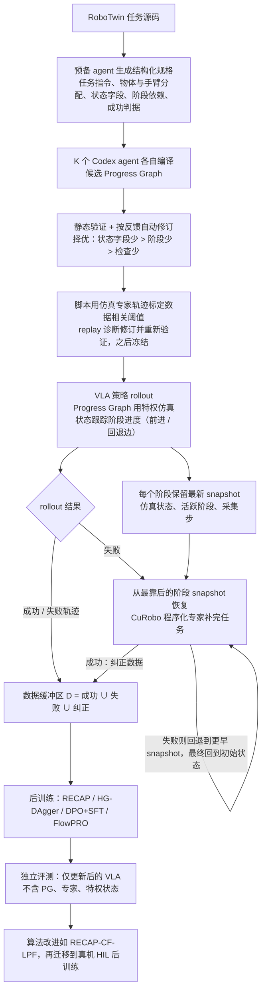

# SimPT：面向干预式 VLA 后训练的自动化仿真框架

**SimPT**（*SimPT: An Automated Simulation Framework for Intervention-Based VLA Post-Training*，[arXiv:2610.29161](https://arxiv.org/abs/2610.29161)）收录于 senlanke「具身运控lab」10-19–10-23 前沿论文动态（Manipulation）。本页依据**周报条目 + arXiv 摘要页**整理，流程图依据论文方法部分（见参考来源），未逐页核对实验数字；指标与结论以论文为准。

## 一句话定义

**SimPT：面向干预式 VLA 后训练的自动化仿真框架——SimPT 将干预式后训练流程引入自动化仿真环境，研究通过仿真中的执行、干预与策略更新降低后训练的数据采集成本。**

## 英文缩写速查

| 缩写 | 英文全称 | 简要说明 |
|------|----------|----------|
| RL | Reinforcement Learning | 强化学习 |
| VLA | Vision-Language-Action | 视觉–语言–动作模型 |

## 为什么重要

- 周报所述待解决的问题：VLA 在部署过程中需要通过失败纠正提高性能，但真实机器人上的人工干预数据采集成本较高。

## 流程总览

图依据：论文 §III-A 至 §III-D / Fig.1 / Fig.2 / §IV-A

## 核心机制

| 项 | 内容 |
|----|------|
| **arXiv** | [2610.29161](https://arxiv.org/abs/2610.29161) · [PDF](https://arxiv.org/pdf/2610.29161) |
| **作者（arXiv）** | Caicheng Wang, Zipeng Ye, Zhexuan Zhou, Zilong Huang, Xi Zhang, Yuchen Xie |
| **机构（周报所述，未逐条核实）** | 待核实（作者：Caicheng Wang、Zipeng Ye、Yuchen Xie 等）。 |
| **arXiv 评论栏** | 11 pages, 6 figures |
| **开源** | arXiv 摘要页与评论未见代码或项目页链接（仅核对 arXiv 摘要页，不代表未发布）（2026-10-26） |
| **周报所述创新点** | SimPT 将干预式后训练流程引入自动化仿真环境，研究通过仿真中的执行、干预与策略更新降低后训练的数据采集成本。 |

### arXiv 摘要节选（英文原文）

> Human-in-the-loop (HIL) post-training improves vision-language-action (VLA) policies through expert corrections, but costly human supervision and repeated real-robot evaluation limit algorithm exploration and development. We introduce SimPT (Simulation-based Post-Training), a simulation framework that automates intervention-based VLA post-training by integrating policy rollouts, corrective data collection, policy training, and standalone evaluation.

## 源码运行时序图

**不适用**：arXiv 摘要页与评论未见代码或项目页链接（仅核对 arXiv 摘要页，不代表未发布），无可对齐的官方代码流程。

## 实验与评测

- 周报与摘要给出的数字/场景已写入上表「创新点」与摘要节选；其余实验细节、基线与成功率定义请回到论文正文。
- 读法：先对齐任务设定、传感器与成功定义（仿真/真机），再解读 headline 数字，勿跨论文直接比较。

## 与其他工作对比

| 维度 | 读法 |
|------|------|
| **同周对照** | 见 [Manipulation周报技术地图](../overview/senlanke-weekly-2026-10-19-23-manipulation-technology-map.md)，按方向浏览同期论文 |
| **开源状态** | arXiv 摘要页与评论未见代码或项目页链接（仅核对 arXiv 摘要页，不代表未发布） |

## 结论

**SimPT：面向干预式 VLA 后训练的自动化仿真框架。**

1. 本页是入库级摘要，复现前请核对论文正文、附录与代码仓库。
2. 指标须连同实验条件解读。
3. 关注 arXiv 版本更新与代码发布。

## 关联页面

- [senlanke-weekly-2026-10-19-23-manipulation-technology-map](../overview/senlanke-weekly-2026-10-19-23-manipulation-technology-map.md)
- [manipulation](../tasks/manipulation.md)
- [vla](../methods/vla.md)

## 参考来源

- [simpt-intervention-based-vla-post-training_arxiv_2610_29161.md](../../sources/papers/simpt-intervention-based-vla-post-training_arxiv_2610_29161.md)
- [wechat_senlanke_weekly_manipulation_2026-10-19_23.md](../../sources/blogs/wechat_senlanke_weekly_manipulation_2026-10-19_23.md)
- [arXiv:2610.29161](https://arxiv.org/abs/2610.29161)
- [arXiv PDF](https://arxiv.org/pdf/2610.29161)：已通读方法部分（实验与附录以略读为准）：§III-A 至 §III-D、§IV-A 实验设置（§IV-B 起结果与真机部分未读）

## 推荐继续阅读

- [arXiv PDF](https://arxiv.org/pdf/2610.29161)
