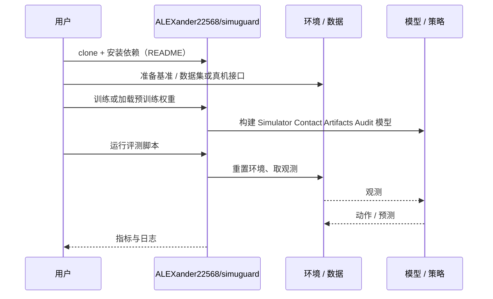

# Simulator Contact Artifacts Audit（arXiv:2610.41857）

**Simulator Contact Artifacts Audit**（*When the Simulator Fails, Not the Policy:Auditing Contact Artifactsin Simulated Robot Benchmarks*，[arXiv:2610.41857](https://arxiv.org/abs/2610.41857)，[代码](https://github.com/ALEXander22568/simuguard)）来自 [具身智能小站 2026-11-03 盘点](../../sources/blogs/wechat_embodied_station_49_papers_sacq_action_aware_quantization_2026-11-03.md)，属「评测、数据与基准」组。

## 一句话定义

**SimuGuard 记录物理步状态并重放异常，通过单参数干预定位接触碰撞错误。**

## 英文缩写速查

| 缩写 | 英文全称 | 简要说明 |
|------|----------|----------|
| Simulator Contact Artifacts Audit | When the Simulator Fails, Not the Policy:Auditing Contact Artifactsin Simulated Robot Benchmarks | 本文方法 / 基准的简称 |

## 为什么重要

- 失败可能来自仿真接触伪影。它提醒评测者先检查仿真器造成的物体弹飞，再把全部失败归因于策略。
- 开源结论：**已开源**（步骤 2.5，2026-11-03）。仓库可达（git ls-remote）。
- 同期同组工作见 [动作感知量化、失败定位与可验证自主：具身智能小站 11-03 期 49 篇阅读坐标](../overview/embodied-station-2026-11-03-49-papers-technology-map.md)。

## 核心机制

| 项 | 内容 |
|----|------|
| **arXiv** | [2610.41857](https://arxiv.org/abs/2610.41857) |
| **开源** | **已开源** |
| **要点** | SimuGuard 记录物理步状态并重放异常，通过单参数干预定位接触碰撞错误。 |
| **文内指标** | 公众号转述：它提醒评测者先检查仿真器造成的物体弹飞，再把全部失败归因于策略。 |

## 源码运行时序图

以下为按仓库入口（`ALEXander22568/simuguard`）推断的通用运行链路；入库日仅核实仓库可达，未逐文件阅读，具体脚本名以 README 为准。

## 实验与评测

- 公众号转述：它提醒评测者先检查仿真器造成的物体弹飞，再把全部失败归因于策略。
- **读法：** 本页为索引级摘要，依据公众号转述的官方摘要与仓库信息整理；逐项数字与 baseline 以原文 PDF 为准。

## 与其他工作对比

- 横向索引见 [动作感知量化、失败定位与可验证自主：具身智能小站 11-03 期 49 篇阅读坐标](../overview/embodied-station-2026-11-03-49-papers-technology-map.md)；同 arXiv 不重复造页。

## 结论

**失败可能来自仿真接触伪影：它提醒评测者先检查仿真器造成的物体弹飞，再把全部失败归因于策略。**

1. 开源边界：**已开源** — 仓库可达（git ls-remote）。
2. 核心机制：SimuGuard 记录物理步状态并重放异常，通过单参数干预定位接触碰撞错误。
3. 复现与选型前核对任务协议、硬件与基准口径，勿直接横比公众号摘录数字。

## 关联页面

- [simulation-evaluation-infrastructure](../concepts/simulation-evaluation-infrastructure.md)
- [vla](../methods/vla.md)
- [manipulation](../tasks/manipulation.md)
- [sim2real](../concepts/sim2real.md)
- [embodied-station-2026-11-03-49-papers-technology-map](../overview/embodied-station-2026-11-03-49-papers-technology-map.md)

## 参考来源

- [simulator_contact_artifacts_audit_arxiv_2610_41857.md](../../sources/papers/simulator_contact_artifacts_audit_arxiv_2610_41857.md)
- [wechat_embodied_station_49_papers_sacq_action_aware_quantization_2026-11-03.md](../../sources/blogs/wechat_embodied_station_49_papers_sacq_action_aware_quantization_2026-11-03.md)
- [arXiv:2610.41857](https://arxiv.org/abs/2610.41857)

## 推荐继续阅读

- [arXiv PDF](https://arxiv.org/pdf/2610.41857)
- [https://github.com/ALEXander22568/simuguard](https://github.com/ALEXander22568/simuguard)
