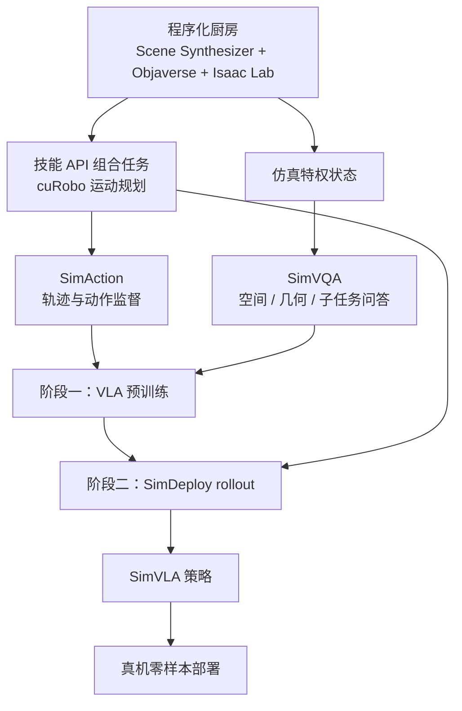
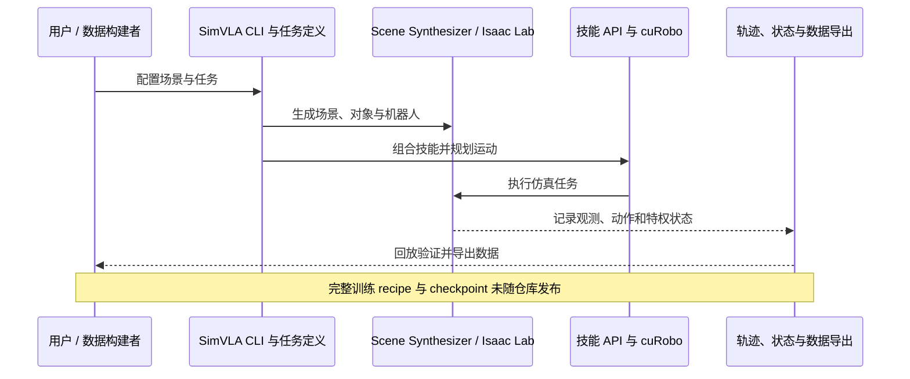

# SimVLA：从仿真到真实家庭的移动操作 VLA

**SimVLA**（Zero-Shot Sim-to-Real VLA Learning for Mobile Manipulation）提出完全依靠仿真监督训练移动操作视觉-语言-动作策略，并直接部署到真实家庭环境。论文作者为 Kyoungin Baik（延世大学）和 Youngwoon Lee（首尔大学），2026-10-08 发布于 arXiv。

## 英文缩写速查

| 缩写 | 英文全称 | 简要说明 |
|---|---|---|
| VLA | Vision-Language-Action | 视觉、语言与机器人动作联合建模策略 |
| SimAction | Simulated Action Data | 仿真生成的动作轨迹监督 |
| SimVQA | Simulated Visual Question Answering | 从仿真状态生成空间、几何和子任务问答监督 |
| SimDeploy | Simulated Deployment | 用仿真策略 rollout 形成后训练监督 |
| OOD | Out of Distribution | 测试环境/视觉分布超出训练分布 |
| EEF | End-Effector | 末端执行器 |

## 方法流程

第一阶段用 **SimAction + SimVQA** 联合预训练：轨迹提供视觉到动作映射，仿真器特权状态转成空间、几何、物体关系与子任务理解等 VQA 信号。第二阶段用 **SimAction + SimDeploy** 后训练：当前策略在仿真中 rollout，由冻结的 PPO controller/技能执行器提供监督，以改善长程移动操作表现。

论文报告 **200k 条轨迹（约 2,778 小时）**，覆盖 **35 个任务、100 个程序化房屋场景**。任务由 22 个长程任务与 13 个原子技能组成，含抓放、倒液体、柜门开合、导航、搜索、清洁等家务操作。策略以 PaliGemma 3B 为视觉语言底座，使用 flow-matching 生成动作；输出为双臂末端与底盘速度组成的 23 维动作。

## 真机评测与结果

项目展示 Anubis 移动操作机器人在 mock kitchen、pantry 与真实家庭的零样本测试，并展示 AI Worker、RB-Y1 等仿真/演示 embodiment。论文的测试分为训练分布内 mock-kitchen、位置/视觉偏移，以及 pantry、真实 home 等环境。

论文报告跨场景平均任务进度 **54.4%**。在作者所测设置中，SimVLA 超过每项任务用 50 条真机示范微调的 π0.5 对照；该对照在 mock-kitchen ID 为 67.8%，在 pantry 与真实 home 分别为 21.3% 和 29.0%。这些是特定任务/场景结果，不代表普遍胜过真机训练策略。SimVLA 自身不使用真机示范训练，测试为 zero-shot transfer。

## 代码与复现边界

官方仓库提供程序化场景、技能/任务、SimAction 轨迹生成、SimVQA 数据与回放/评测等工作流；项目页链接数据和资产。完整仿真依赖 Isaac Sim、Isaac Lab、cuRobo 及外部机器人/场景资产，安装不是轻量纯 Python 环境。

**论文方法与当前仓库可复现范围需区分：**仓库未提供完整训练 recipe、SimDeploy policy-training adapter 或训练 checkpoint。可复用其仿真、任务、数据生成和部分评测基础设施，但不能仅凭此仓库端到端复现论文学习结果。

## 局限与解读

- 研究集中于厨房及相邻环境中的刚性物体操作，不能外推为广泛家庭任务已解决。
- 真机 embodiment 有限，技能 API 由人工定义；这不等同于自动学会任意底层控制接口。
- 论文没有系统分离不同 domain randomization 因素的独立贡献。
- 54.4% 是特定测试设置的平均任务进度，不是普遍成功率；与真机示范基线的场景分布也需一并考虑。
- 上游项目与仓库持续更新，运行方式、资产与数据版本以官方页面为准。

## 源码运行时序图

下图表示官方仓库可见的仿真/数据操作路径；未把论文中未发布的学习步骤写成可执行命令。

## 关联导航

- [VLA 方法页](../methods/vla.md)
- [Manipulation 任务页](../tasks/manipulation.md)
- [Loco-Manipulation](../tasks/loco-manipulation.md)
- [论文来源摘录](../../sources/papers/simvla_arxiv_2610_11248.md)
- [项目主页归档](../../sources/sites/simvla-project.md)
- [代码仓库归档](../../sources/repos/simvla.md)

## 参考来源

- [arXiv 论文（2610.11248）](https://arxiv.org/abs/2610.11248) — 摘要、方法、评测与局限。
- [官方项目主页](https://kyounginbaik.github.io/simvla/) — 场景、任务、真机演示与数据入口。
- [官方 GitHub 仓库](https://github.com/kyounginbaik/SimVLA) — 安装、仿真与数据工作流及复现边界。
