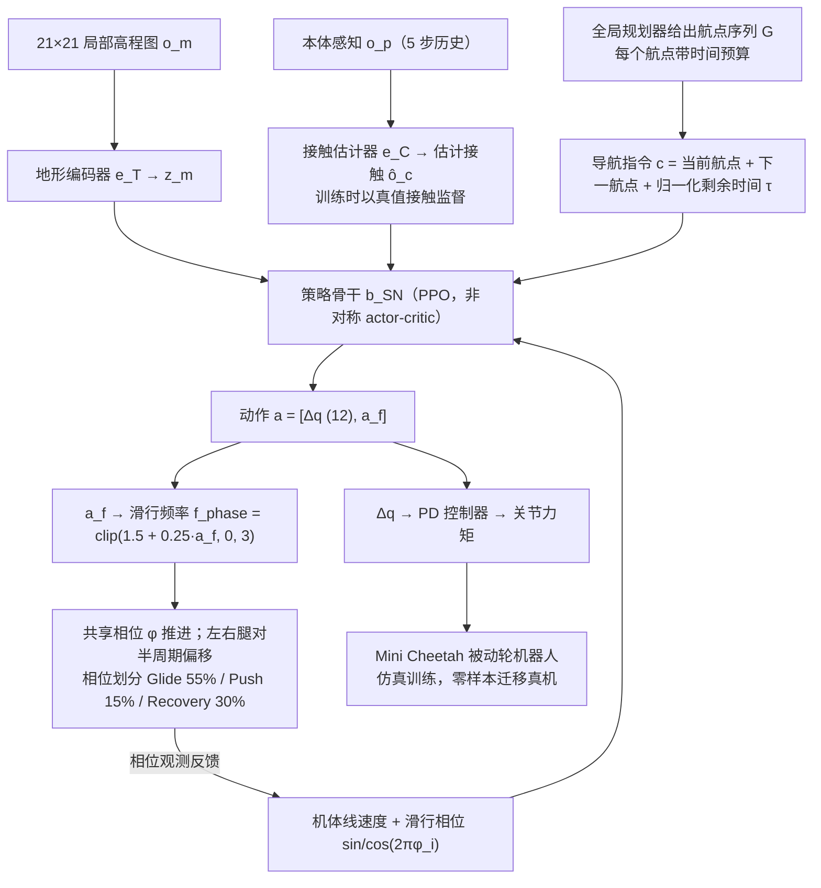

# SkateNav：通过自适应滑行学习被动轮四足机器人的高能效导航

**SkateNav**（*SkateNav: Learning Energy-Efficient Navigation through Adaptive Skating on Passive-Wheel Quadrupedal Robots*，[arXiv:2610.25962](https://arxiv.org/abs/2610.25962)）收录于 senlanke「具身运控lab」10-19–10-23 前沿论文动态（人形/四足）。本页依据**周报条目 + arXiv 摘要页**整理，未逐页核对正文 PDF；指标与结论以论文为准。

## 一句话定义

**SkateNav：通过自适应滑行学习被动轮四足机器人的高能效导航——把导航改写为带时间预算的到达目标任务，使策略联合决定转向、蹬地和滑行时长；通过可逐控制周期调频的滑行动作循环适应环境，并零样本迁移到带被动轮的 Mini Cheetah。**

## 英文缩写速查

| 缩写 | 英文全称 | 简要说明 |
|------|----------|----------|
| RL | Reinforcement Learning | 强化学习 |
| WBC | Whole-Body Control | 全身控制 |

## 为什么重要

- 周报所述待解决的问题：速度跟踪奖励会抑制滑行动作固有的速度起伏，使被动轮机器人频繁蹬地而无法充分利用惯性。

## 流程总览

图依据：论文 §V-B–F、Fig.3 / Fig.5 / Fig.6。

## 核心机制

| 项 | 内容 |
|----|------|
| **arXiv** | [2610.25962](https://arxiv.org/abs/2610.25962) · [PDF](https://arxiv.org/pdf/2610.25962) |
| **作者（arXiv）** | Jeil Jeong, Taeyun Kim, Sangjin Kim, Jinyoung Choi, Sung-Eui Yoon |
| **机构（周报所述，未逐条核实）** | NAVER LABS、韩国科学技术院 |
| **arXiv 评论栏** | 8 pages, 12 figures, 3 tables. Project page: this https URL |
| **开源** | arXiv 摘要页/评论给出项目页或外链（https://ktw1404.github.io/SkateNav/）；未发现代码仓库链接（2026-10-26） |
| **周报所述创新点** | 把导航改写为带时间预算的到达目标任务，使策略联合决定转向、蹬地和滑行时长；通过可逐控制周期调频的滑行动作循环适应环境，并零样本迁移到带被动轮的 Mini Cheetah。 |

### arXiv 摘要节选（英文原文）

> Passive-wheel quadrupedal robots offer energy-efficient locomotion through leg-driven propulsion and momentum-driven gliding. However, navigation requires coordinating steering with intermittent propulsion and adapting push-glide timing to task demands.

## 源码运行时序图

**不适用**：arXiv 摘要页/评论给出项目页或外链（https://ktw1404.github.io/SkateNav/）；未发现代码仓库链接，无可对齐的官方代码流程。

## 实验与评测

- 周报与摘要给出的数字/场景已写入上表「创新点」与摘要节选；其余实验细节、基线与成功率定义请回到论文正文。
- 读法：先对齐任务设定、传感器与成功定义（仿真/真机），再解读 headline 数字，勿跨论文直接比较。

## 与其他工作对比

| 维度 | 读法 |
|------|------|
| **同周对照** | 见 [人形/四足周报技术地图](../overview/senlanke-weekly-2026-10-19-23-humanoid-quadruped-technology-map.md)，按方向浏览同期论文 |
| **开源状态** | arXiv 摘要页/评论给出项目页或外链（https://ktw1404.github.io/SkateNav/）；未发现代码仓库链接 |

## 结论

**SkateNav：通过自适应滑行学习被动轮四足机器人的高能效导航。**

1. 本页是入库级摘要，复现前请核对论文正文、附录与代码仓库。
2. 指标须连同实验条件解读。
3. 关注 arXiv 版本更新与代码发布。

## 关联页面

- [senlanke-weekly-2026-10-19-23-humanoid-quadruped-technology-map](../overview/senlanke-weekly-2026-10-19-23-humanoid-quadruped-technology-map.md)
- [locomotion](../tasks/locomotion.md)

## 参考来源

- [skatenav-passive-wheel-quadruped-skating_arxiv_2610_25962.md](../../sources/papers/skatenav-passive-wheel-quadruped-skating_arxiv_2610_25962.md)
- [wechat_senlanke_weekly_humanoid_quadruped_2026-10-19_23.md](../../sources/blogs/wechat_senlanke_weekly_humanoid_quadruped_2026-10-19_23.md)
- [arXiv:2610.25962](https://arxiv.org/abs/2610.25962)
- [arXiv PDF](https://arxiv.org/pdf/2610.25962)：已通读全文：任务与学习目标（§V-B/C）、自适应滑行周期（§V-D）、策略架构与实现（§V-E/F）

## 推荐继续阅读

- [arXiv PDF](https://arxiv.org/pdf/2610.25962)
