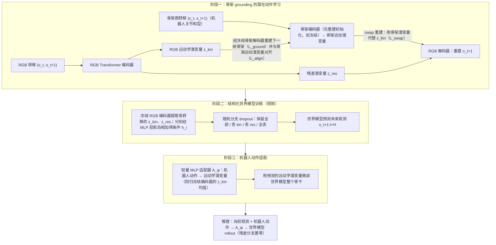

# Skeleton Latent Action：面向机器人世界模型的骨架约束潜在动作模型

**Skeleton Latent Action**（*Skeleton-Grounded Latent Action Model for Robot World Models*，[arXiv:2610.31474](https://arxiv.org/abs/2610.31474)）收录于 senlanke「具身运控lab」10-19–10-23 前沿论文动态（Manipulation）。本页依据**周报条目 + arXiv 摘要页**整理，流程图依据论文方法部分（见参考来源），未逐页核对实验数字；指标与结论以论文为准。

## 一句话定义

**Skeleton Latent Action：面向机器人世界模型的骨架约束潜在动作模型——将机器人骨架信息引入潜在动作学习，利用运动结构为世界模型提供更明确的动作表示。**

## 英文缩写速查

| 缩写 | 英文全称 | 简要说明 |
|------|----------|----------|
| WAM | World Action Model | 世界–动作联合建模 |
| VLA | Vision-Language-Action | 视觉–语言–动作模型 |

## 为什么重要

- 周报所述待解决的问题：从视频学习潜在动作时，模型需要将视觉变化与机器人实际运动联系起来。缺少运动结构约束的潜在动作表示，可能难以表达机器人本体的运动规律。

## 流程总览

图依据：论文 §3 / §3.1 / §3.2 / Fig.1–2、Eq.2–14。

## 核心机制

| 项 | 内容 |
|----|------|
| **arXiv** | [2610.31474](https://arxiv.org/abs/2610.31474) · [PDF](https://arxiv.org/pdf/2610.31474) |
| **作者（arXiv）** | Qi Lv, Jiayi Lin, Yuxin Jiang, Jianzong Wang, Xiang Deng, Mike Shou Zheng |
| **机构（周报所述，未逐条核实）** | 待核实（作者：Qi Lv、Jiayi Lin、Jianzong Wang、Mike Shou Zheng 等）。 |
| **arXiv 评论栏** | Project Page: this https URL |
| **开源** | arXiv 摘要页/评论给出项目页或外链（https://aopolin-lv.github.io/SkeLAM/）；未发现代码仓库链接（2026-10-26） |
| **周报所述创新点** | 将机器人骨架信息引入潜在动作学习，利用运动结构为世界模型提供更明确的动作表示。 |

### arXiv 摘要节选（英文原文）

> Robot world models simulate how environments evolve in response to robot actions. Latent action models enable learning dynamics from videos by encoding visual transitions as proxy actions.

## 源码运行时序图

**不适用**：arXiv 摘要页/评论给出项目页或外链（https://aopolin-lv.github.io/SkeLAM/）；未发现代码仓库链接，无可对齐的官方代码流程。

## 实验与评测

- 周报与摘要给出的数字/场景已写入上表「创新点」与摘要节选；其余实验细节、基线与成功率定义请回到论文正文。
- 读法：先对齐任务设定、传感器与成功定义（仿真/真机），再解读 headline 数字，勿跨论文直接比较。

## 与其他工作对比

| 维度 | 读法 |
|------|------|
| **同周对照** | 见 [Manipulation周报技术地图](../overview/senlanke-weekly-2026-10-19-23-manipulation-technology-map.md)，按方向浏览同期论文 |
| **开源状态** | arXiv 摘要页/评论给出项目页或外链（https://aopolin-lv.github.io/SkeLAM/）；未发现代码仓库链接 |

## 结论

**Skeleton Latent Action：面向机器人世界模型的骨架约束潜在动作模型。**

1. 本页是入库级摘要，复现前请核对论文正文、附录与代码仓库。
2. 指标须连同实验条件解读。
3. 关注 arXiv 版本更新与代码发布。

## 关联页面

- [senlanke-weekly-2026-10-19-23-manipulation-technology-map](../overview/senlanke-weekly-2026-10-19-23-manipulation-technology-map.md)
- [manipulation](../tasks/manipulation.md)
- [vla](../methods/vla.md)

## 参考来源

- [skeleton-grounded-latent-action-model_arxiv_2610_31474.md](../../sources/papers/skeleton-grounded-latent-action-model_arxiv_2610_31474.md)
- [wechat_senlanke_weekly_manipulation_2026-10-19_23.md](../../sources/blogs/wechat_senlanke_weekly_manipulation_2026-10-19_23.md)
- [arXiv:2610.31474](https://arxiv.org/abs/2610.31474)
- [arXiv PDF](https://arxiv.org/pdf/2610.31474)：已通读方法部分（实验与附录以略读为准）：§3 Methodology（§3.1、§3.2）

## 推荐继续阅读

- [arXiv PDF](https://arxiv.org/pdf/2610.31474)
