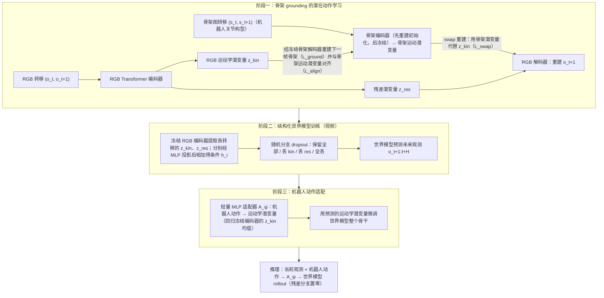

# Skeleton Latent Action：面向机器人世界模型的骨架约束潜在动作模型

**Skeleton Latent Action**（*Skeleton-Grounded Latent Action Model for Robot World Models*，[arXiv:2610.31474](https://arxiv.org/abs/2610.31474)）收录于 senlanke「具身运控lab」10-19–10-23 前沿论文动态（Manipulation）。本页依据论文方法、实验表及项目页整理；论文全文和附录尚未完成通读，待补核。

## 一句话定义

**Skeleton Latent Action：面向机器人世界模型的骨架约束潜在动作模型——将机器人骨架信息引入潜在动作学习，利用运动结构为世界模型提供更明确的动作表示。**

## 英文缩写速查

| 缩写 | 英文全称 | 简要说明 |
|------|----------|----------|
| LAM | Latent Action Model | 潜在动作模型 |
| ADE | Average Displacement Error | 平均位移误差 |
| LPIPS | Learned Perceptual Image Patch Similarity | 感知图像距离 |
| VLA | Vision-Language-Action | 视觉–语言–动作模型 |

## 为什么重要

- 周报所述待解决的问题：从视频学习潜在动作时，模型需要将视觉变化与机器人实际运动联系起来。缺少运动结构约束的潜在动作表示，可能难以表达机器人本体的运动规律。

## 流程总览

图依据：论文 §3 / §3.1 / §3.2 / Fig.1–2、Eq.2–14。

## 核心机制

| 项 | 内容 |
|----|------|
| **arXiv** | [2610.31474](https://arxiv.org/abs/2610.31474) · [PDF](https://arxiv.org/pdf/2610.31474) |
| **作者（arXiv）** | Qi Lv, Jiayi Lin, Yuxin Jiang, Jianzong Wang, Xiang Deng, Mike Shou Zheng |
| **机构（周报所述，未逐条核实）** | 待核实（作者：Qi Lv、Jiayi Lin、Jianzong Wang、Mike Shou Zheng 等）。 |
| **arXiv 评论栏** | Project Page: this https URL |
| **开源** | 截至 2026-11-06 项目页未列官方代码或权重下载链接；采用 DROID、AgiBot 等数据，项目页未提供本项目数据下载。 |
| **周报所述创新点** | 将机器人骨架信息引入潜在动作学习，利用运动结构为世界模型提供更明确的动作表示。 |

### arXiv 摘要节选（英文原文）

> Robot world models simulate how environments evolve in response to robot actions. Latent action models enable learning dynamics from videos by encoding visual transitions as proxy actions.

## 源码运行时序图

**不适用**：截至 2026-11-06 项目页未列可运行的官方实现，无可核实的源码运行入口。

## 实验与评测

- DROID：400 个片段，每个输入 1 帧并预测 12 帧，分辨率 480 × 640；末端轨迹 ADE 为二维像素位移误差。DreamDojo 与 SkeLAM 的 ADE 分别为 51.11 与 41.15 像素，LPIPS 分别为 0.1473 与 0.1310；方向 F1 则低于 Ctrl-World 和 OSCAR。
- 消融：完整模型 ADE 为 41.15，去除骨架监督为 64.59，去除跨模态交换为 66.74；去除骨架监督同时移除 grounding、alignment 和 swap，不能把差异完全归因于单项损失。
- AgiBot 结果并非全面改善：相对 DreamDojo，SkeLAM 的 SSIM 较高，但 LPIPS 和 ADE 较差。不同方法的有效轨迹覆盖率不同，应结合附录表格阅读。
- 人到机器人迁移通过人类视频编码所得潜变量条件化生成，绕过动作适配器；是定性视频展示，不能证明真机任务完成。
- 策略评估采用记录动作开环重放：7 个策略、15 次 session、105 条配对轨迹，真实成功仅 9 条；策略级 Spearman 0.5347，成功召回率 33.33%，样本有限且未验证闭环。

## 与其他工作对比

| 维度 | 读法 |
|------|------|
| **同周对照** | 见 [Manipulation周报技术地图](../overview/senlanke-weekly-2026-10-19-23-manipulation-technology-map.md)，按方向浏览同期论文 |
| **开源状态** | arXiv 摘要页/评论给出项目页或外链（https://aopolin-lv.github.io/SkeLAM/）；未发现代码仓库链接 |

## 结论

**Skeleton Latent Action：面向机器人世界模型的骨架约束潜在动作模型。**

1. 骨架监督有助于将视觉变化中的机器人运动与其他动态分开；线性探针支持运动特化，但不能证明完全解耦。
2. DROID 的收益不能直接推广到 AgiBot 或真机闭环任务。
3. 推理使用当前 RGB 与机器人动作，残差条件置零；训练期间的骨架监督不意味着推理需要骨架输入。

## 关联页面

- [senlanke-weekly-2026-10-19-23-manipulation-technology-map](../overview/senlanke-weekly-2026-10-19-23-manipulation-technology-map.md)
- [manipulation](../tasks/manipulation.md)
- [vla](../methods/vla.md)

## 参考来源

- [SkeLAM 官方项目页归档](../../sources/sites/skelam.md)

- [skeleton-grounded-latent-action-model_arxiv_2610_31474.md](../../sources/papers/skeleton-grounded-latent-action-model_arxiv_2610_31474.md)
- [wechat_senlanke_weekly_manipulation_2026-10-19_23.md](../../sources/blogs/wechat_senlanke_weekly_manipulation_2026-10-19_23.md)
- [arXiv:2610.31474](https://arxiv.org/abs/2610.31474)
- [arXiv PDF](https://arxiv.org/pdf/2610.31474)：已通读方法部分（实验与附录以略读为准）：§3 Methodology（§3.1、§3.2）

## 推荐继续阅读

- [arXiv PDF](https://arxiv.org/pdf/2610.31474)
