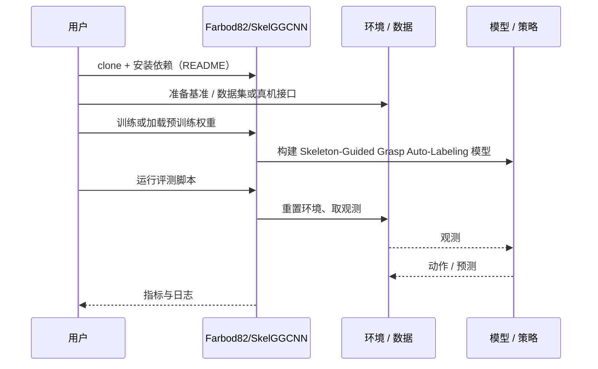

# Skeleton-Guided Grasp Auto-Labeling（arXiv:2610.38443）

**Skeleton-Guided Grasp Auto-Labeling**（*Skeleton-Guided Geometry-Aware Auto-Labeling for Robotic Grasping: From 4-DoF Learning to 6-DoF Execution*，[arXiv:2610.38443](https://arxiv.org/abs/2610.38443)，[代码](https://github.com/Farbod82/SkelGGCNN)）来自 [具身智能小站 2026-10-30 盘点](../../sources/blogs/wechat_embodied_station_28_papers_event2reward_progress_rewards_2026-10-30.md)，属「灵巧操作与抓取」组。

## 一句话定义

**通过直骨架产生两指抓取标签，训练轻量抓取网络，并扩展到点云上的六自由度标注。**

## 英文缩写速查

| 缩写 | 英文全称 | 简要说明 |
|------|----------|----------|
| Skeleton-Guided Grasp Auto-Labeling | Skeleton-Guided Geometry-Aware Auto-Labeling for Robotic Grasping: From 4-DoF Learning to 6-DoF Execution | 本文方法 / 基准的简称 |

## 为什么重要

- 用几何骨架减少抓取标签的人力成本。数据集准确率、抓取精度与真机成功率衡量不同能力，阅读时需分别比较。
- 开源结论：**已开源**（步骤 2.5，2026-10-30）。仓库可达（git ls-remote）。
- 同期同组工作见 [进度奖励、接触监督与规划验证：具身智能小站 10-30 期 28 篇阅读坐标](../overview/embodied-station-2026-10-30-28-papers-technology-map.md)。

## 核心机制

| 项 | 内容 |
|----|------|
| **arXiv** | [2610.38443](https://arxiv.org/abs/2610.38443) |
| **开源** | **已开源** |
| **要点** | 通过直骨架产生两指抓取标签，训练轻量抓取网络，并扩展到点云上的六自由度标注。 |
| **文内指标** | 公众号转述：数据集准确率、抓取精度与真机成功率衡量不同能力，阅读时需分别比较。 |

## 源码运行时序图

以下为按仓库入口（`Farbod82/SkelGGCNN`）推断的通用运行链路；入库日仅核实仓库可达，未逐文件阅读，具体脚本名以 README 为准。

## 实验与评测

- 公众号转述：数据集准确率、抓取精度与真机成功率衡量不同能力，阅读时需分别比较。
- **读法：** 本页为索引级摘要，依据公众号转述的官方摘要与仓库信息整理；逐项数字与 baseline 以原文 PDF 为准。

## 与其他工作对比

- 横向索引见 [进度奖励、接触监督与规划验证：具身智能小站 10-30 期 28 篇阅读坐标](../overview/embodied-station-2026-10-30-28-papers-technology-map.md)；同 arXiv 不重复造页。

## 结论

**用几何骨架减少抓取标签的人力成本：数据集准确率、抓取精度与真机成功率衡量不同能力，阅读时需分别比较。**

1. 开源边界：**已开源** — 仓库可达（git ls-remote）。
2. 核心机制：通过直骨架产生两指抓取标签，训练轻量抓取网络，并扩展到点云上的六自由度标注。
3. 复现与选型前核对任务协议、硬件与基准口径，勿直接横比公众号摘录数字。

## 关联页面

- [manipulation](../tasks/manipulation.md)
- [dexterous-kinematics](../concepts/dexterous-kinematics.md)
- [contact-rich-manipulation](../concepts/contact-rich-manipulation.md)
- [embodied-station-2026-10-30-28-papers-technology-map](../overview/embodied-station-2026-10-30-28-papers-technology-map.md)

## 参考来源

- [skeleton_guided_grasp_auto_labeling_arxiv_2610_38443.md](../../sources/papers/skeleton_guided_grasp_auto_labeling_arxiv_2610_38443.md)
- [wechat_embodied_station_28_papers_event2reward_progress_rewards_2026-10-30.md](../../sources/blogs/wechat_embodied_station_28_papers_event2reward_progress_rewards_2026-10-30.md)
- [arXiv:2610.38443](https://arxiv.org/abs/2610.38443)

## 推荐继续阅读

- [arXiv PDF](https://arxiv.org/pdf/2610.38443)
- [https://github.com/Farbod82/SkelGGCNN](https://github.com/Farbod82/SkelGGCNN)
