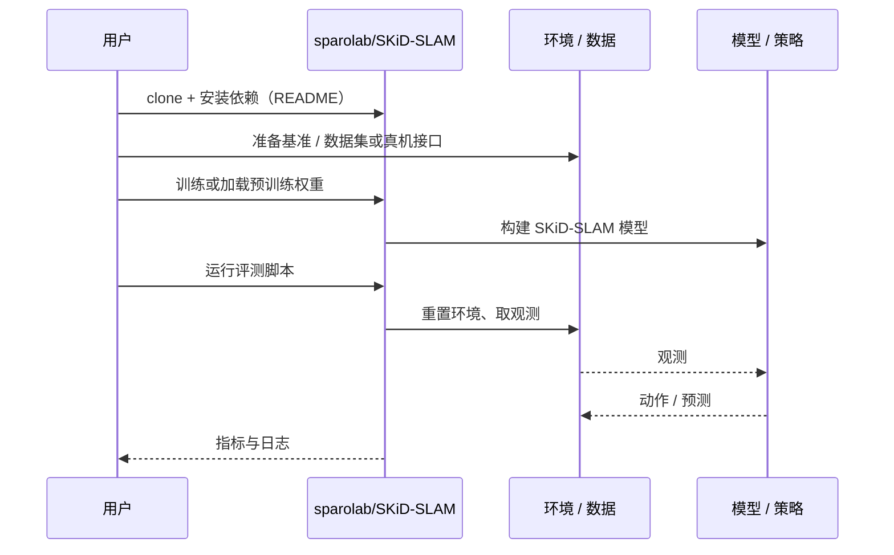

# SKiD-SLAM（arXiv:2610.38141）

**SKiD-SLAM**（*SKiD-SLAM: Resource-Aware Distributed Multi-Robot LiDAR SLAM for Planetary Missions with Field Deployments at Analog Sites*，[arXiv:2610.38141](https://arxiv.org/abs/2610.38141)，[项目页](https://sparolab.github.io/research/skid_slam/)，[代码](https://github.com/sparolab/SKiD-SLAM)）来自 [具身智能小站 2026-10-30 盘点](../../sources/blogs/wechat_embodied_station_28_papers_event2reward_progress_rewards_2026-10-30.md)，属「多机器人协作与人机交互」组。

## 一句话定义

**SKiD-SLAM 按行星任务的通信与计算预算组合地点识别、配准和分布式融合模块，并在熔岩洞与模拟行星地表部署；现场证据来自各自同构的机器人团队。**

## 英文缩写速查

| 缩写 | 英文全称 | 简要说明 |
|------|----------|----------|
| SKiD-SLAM | SKiD-SLAM: Resource-Aware Distributed Multi-Robot LiDAR SLAM for Planetary Missions with Field Deployments at Analog Sites | 本文方法 / 基准的简称 |

## 为什么重要

- 通信受限时，让多机器人持续合图。
- 开源结论：**已开源**（步骤 2.5，2026-10-30）。仓库可达（git ls-remote）。项目页 HTTP 200。
- 同期同组工作见 [进度奖励、接触监督与规划验证：具身智能小站 10-30 期 28 篇阅读坐标](../overview/embodied-station-2026-10-30-28-papers-technology-map.md)。

## 核心机制

| 项 | 内容 |
|----|------|
| **arXiv** | [2610.38141](https://arxiv.org/abs/2610.38141) |
| **开源** | **已开源** |
| **要点** | SKiD-SLAM 按行星任务的通信与计算预算组合地点识别、配准和分布式融合模块，并在熔岩洞与模拟行星地表部署；现场证据来自各自同构的机器人团队。 |
| **文内指标** | 公众号未给具体数字，本页不引用。 |

## 源码运行时序图

以下为按仓库入口（`sparolab/SKiD-SLAM`）推断的通用运行链路；入库日仅核实仓库可达，未逐文件阅读，具体脚本名以 README 为准。

## 实验与评测

- 公众号未给具体数字，本页不引用。
- **读法：** 本页为索引级摘要，依据公众号转述的官方摘要与仓库信息整理；逐项数字与 baseline 以原文 PDF 为准。

## 与其他工作对比

- 横向索引见 [进度奖励、接触监督与规划验证：具身智能小站 10-30 期 28 篇阅读坐标](../overview/embodied-station-2026-10-30-28-papers-technology-map.md)；同 arXiv 不重复造页。

## 结论

**通信受限时，让多机器人持续合图：SKiD-SLAM 按行星任务的通信与计算预算组合地点识别、配准和分布式融合模块，并在熔岩洞与模拟行星地表部署；现场证据来自各自同构的机器人团队。**

1. 开源边界：**已开源** — 仓库可达（git ls-remote）。项目页 HTTP 200。
2. 核心机制：SKiD-SLAM 按行星任务的通信与计算预算组合地点识别、配准和分布式融合模块，并在熔岩洞与模拟行星地表部署；现场证据来自各自同构的机器人团队。
3. 复现与选型前核对任务协议、硬件与基准口径，勿直接横比公众号摘录数字。

## 关联页面

- [locomotion](../tasks/locomotion.md)
- [vision-language-navigation](../tasks/vision-language-navigation.md)
- [llm-robotics-control-interfaces](../concepts/llm-robotics-control-interfaces.md)
- [embodied-station-2026-10-30-28-papers-technology-map](../overview/embodied-station-2026-10-30-28-papers-technology-map.md)

## 参考来源

- [skid_slam_arxiv_2610_38141.md](../../sources/papers/skid_slam_arxiv_2610_38141.md)
- [wechat_embodied_station_28_papers_event2reward_progress_rewards_2026-10-30.md](../../sources/blogs/wechat_embodied_station_28_papers_event2reward_progress_rewards_2026-10-30.md)
- [arXiv:2610.38141](https://arxiv.org/abs/2610.38141)

## 推荐继续阅读

- [arXiv PDF](https://arxiv.org/pdf/2610.38141)
- [项目页](https://sparolab.github.io/research/skid_slam/)
- [https://github.com/sparolab/SKiD-SLAM](https://github.com/sparolab/SKiD-SLAM)
