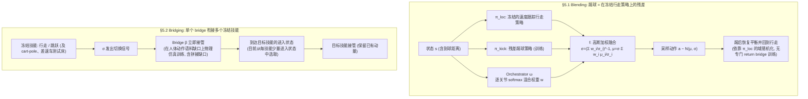

# 腿式 RL 技能组合（arXiv:2609.14647）

**腿式 RL 技能组合**（*Skill Composition for Legged Robot Reinforcement Learning*，[arXiv:2609.14647](https://arxiv.org/abs/2609.14647)）来自 [senlanke 具身运控lab 周更盘点](../../sources/blogs/wechat_senlanke_weekly_humanoid_quadruped_2026-09-14_18.md)（2026-09-14–18）。

## 一句话定义

**区分连续加权「混合」与过渡控制器「桥接」；冻结已有专家；踢球残差叠加与走–跳过渡初步实验。**

## 英文缩写速查

| 缩写 | 英文全称 | 简要说明 |
|------|----------|----------|
| RL | Reinforcement Learning | 强化学习 |
| MoE | Mixture of Experts | 专家混合 |
| WBC | Whole-Body Control | 全身控制 |

## 为什么重要

- 多技能腿式系统需明确组合语义；混用 blend/bridge 会导致复现困难。

## 流程总览

图依据：论文 §5.1、§5.2 / Fig. 1（Fig. 1 的四阶段划分图中细节未据此绘制）。

## 核心机制

| 项 | 内容 |
|----|------|
| **arXiv** | [2609.14647](https://arxiv.org/abs/2609.14647) |
| **开源** | **待发布**（步骤 2.5，2026-09-20） |
| **方法摘要** | Mixing vs bridging taxonomy; frozen experts; preliminary kick residual + walk–jump transition. |

## 源码运行时序图

**不适用**（截至 2026-09-20 未发布可运行官方代码或待核实）。

## 实验与评测

- Preliminary experiments（研究立场 + 初步结果，非完整统一算法）。
- 读法：先对齐任务设定、传感器与成功定义，再解读 headline 数字。

## 与其他工作对比

| 维度 | 读法 |
|------|------|
| **同周对照** | 见对应 [周更盘点](../../sources/blogs/wechat_senlanke_weekly_humanoid_quadruped_2026-09-14_18.md) 映射表，勿跨任务直接比 SR |
| **开源状态** | **待发布** — 部署前以项目页/arXiv 为准 |

## 结论

**本文提供腿式 RL 技能组合的概念框架，工程落地仍待更完整算法与基准。**

1. 开源：**待发布**；勿凭公众号摘要臆断可复现性。
2. 指标须连同实验条件解读（仿真/真机、平台、成功阈值）。
3. 关注 arXiv 版本更新与代码发布。

## 关联页面

- [reinforcement-learning](../methods/reinforcement-learning.md)
- [residual-policy-learning](../methods/residual-policy-learning.md)
- [locomotion](../tasks/locomotion.md)

## 参考来源

- [skill-composition-legged-rl_arxiv_2609_14647.md](../../sources/papers/skill-composition-legged-rl_arxiv_2609_14647.md)
- [wechat_senlanke_weekly_humanoid_quadruped_2026-09-14_18.md](../../sources/blogs/wechat_senlanke_weekly_humanoid_quadruped_2026-09-14_18.md)
- [arXiv:2609.14647](https://arxiv.org/abs/2609.14647)
- [arXiv PDF](https://arxiv.org/pdf/2609.14647)：已通读方法部分（实验与附录以略读为准）：§2 问题定义（含 2.1 两种组合方式）、§5 First Results（5.1 Blending、5.2 Bridging）；§1 引言已读；§3 相关工作、§4 开放问题未读

## 推荐继续阅读

- [arXiv PDF](https://arxiv.org/pdf/2609.14647)
