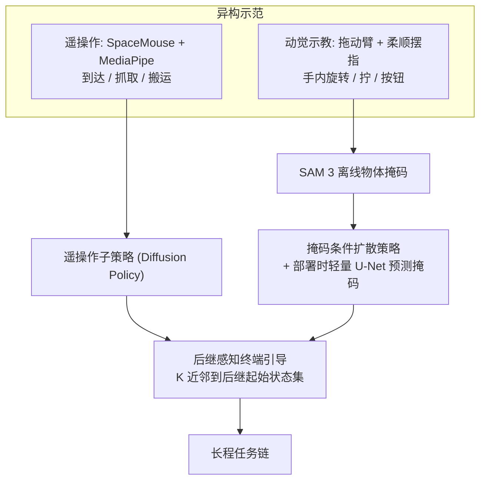

# SkillWeave

**SkillWeave**（arXiv:2610.12046，CMU / Keio / UC Berkeley / Bosch 等，作者含 Jeffrey Ichnowski、Jonathan Francis 等）把长程灵巧操作拆为子技能，按交互类型选择示范方式：粗略到达和搬运用遥操作，接触密集的灵巧动作用动觉示教；再用**物体掩码条件扩散策略**处理动觉画面里的示教者，用**后继感知终端引导**让前驱策略的终点落进后继策略见过的起始状态。

## 英文缩写速查

| 缩写 | 英文全称 | 简要说明 |
|------|----------|----------|
| DP | Diffusion Policy | 以扩散去噪生成动作块的模仿学习策略 |
| LEAP Hand | Low-cost Efficient Accessible Positionable Hand | 16-DoF 灵巧手，本文末端执行器 |
| SAM 3 | Segment Anything Model 3 | 离线生成物体掩码的分割模型 |
| S / S* / C | 端到端成功率 / 子任务成功率之积 / 组合效率 C=S/S* | C 越接近 1 表示交接几乎不额外损失 |
| KineDex | 基于动觉示教的灵巧操作框架 | 本文基线，通过分割手并修补图像消除视觉差异 |

## 为什么重要

- **示范方式与交互区间匹配：** 遥操作做不好手内旋转（10%）、拧螺母（5%）、按钮开盖（0%），动觉示教在这些任务上给出了可学习数据，掩码条件策略把它们提到 70% / 75% / 50%。
- **不改子策略也能交接：** 终端引导只在前驱策略自己的动作提案里挑，不需要过渡示范或过渡策略，也不动后继策略。
- **用一个可量化指标看交接：** 组合效率 C 把“子技能不行”与“交接不行”拆开。

## 流程总览

## 核心原理（方法）

### 1）平台与数据
7-DoF xArm7 + 16-DoF LEAP Hand，第三视角 RGB 相机和掌心腕部相机。每个子任务 100 条示范；记录 30 Hz 图像与本体感知（6D 末端位姿、7D 臂关节、16D 手关节），物体位置随机化。遥操作：6-DoF SpaceMouse 控臂，MediaPipe 跟踪手并以关节角映射重定向；动觉：臂进入拖动模式，操作者在柔顺控制下直接摆手指。

### 2）物体掩码条件扩散策略
每相机 ResNet-18 编码，1D U-Net 去噪动作块，本体感知与视觉特征拼接；用物体掩码池化出查询向量做注意力池化（物体不可见时用均值特征）。损失 L = L_DP + lambda * L_attn，注意力图由归一化物体掩码监督（lambda 原文未报告）。训练掩码来自 SAM 3 离线分割，部署时每视角用轻量 U-Net 预测掩码，因此无需在线分割或图像修补。

### 3）后继感知终端引导
每个引导步在前驱策略下采样 L 个动作块，用候选的预测终点到后继起始状态集（后继 N 条示范的前 H_s 个状态，腕位姿/臂关节/手关节归一化）的 K 近邻平均距离 d(s) 打分，执行得分最低者；d < epsilon 或超过最大引导步数时停止。L、K、N、H_s、epsilon 与最大步数原文未报告。

### 4）三个真机任务
Cube Reorientation（遥操作取放 + 动觉手内旋转，至少 90 度）、Nut Removal & Storage（遥操作取螺母 -> 动觉拧下 -> 遥操作放入容器）、Kettle Preparation（遥操作抓壶 -> 动觉按钮开盖 -> 遥操作放壶）。

## 源码运行时序图

不适用：项目页的代码入口标注 “Coming Soon”，截至 2026-10-12 无仓库、无数据集，不存在可对齐的目录与脚本。

## 工程实践

- 要复现需自行搭建 xArm7 + LEAP 平台、SpaceMouse/MediaPipe 遥操作和拖动示教流程，并重新选定终端引导超参。
- 动觉示教数据必须有物体掩码（SAM 3 离线生成）；物体被遮挡时依赖均值特征退化，需额外检查。
- **开源状态：** 项目页（skillweave-authors.github.io）为匿名 “Under review” 页面，代码 Coming Soon，数据集未列；摘要写“视频与代码在项目页”与页面实际不一致，按“待发布”处理。

## 实验与评测

每项 20 次试验，物体配置随机。

| 子任务 | 遥操作 | 原始动觉 | KineDex | 掩码动觉 |
|------|------|------|------|------|
| 手内旋转 | 10% | 30% | 0% | 70% |
| 拧螺母 | 5% | 0% | 60% | 75% |
| 按钮开盖 | 0% | 0% | 0% | 50% |

遥操作臂级子任务平均 64%，掩码动觉灵巧子任务平均 65%。

| 任务 | 无终端引导 S / S* / C | SkillWeave S / S* / C |
|------|------|------|
| Cube Reorientation | 10% / 49% / 20% | 45% / 49% / 92% |
| Nut Removal & Storage | 0% / 19% / 0% | 15% / 19% / 79% |
| Kettle Preparation | 5% / 22% / 23% | 20% / 22% / 91% |
| 平均 | 5% / 30% / 14% | **27% / 30% / 87%** |

纯遥操作、原始动觉、KineDex 的端到端均为 0%。原文表 II(b) 与正文/表 III 对“有/无引导”标注互换，此处取正文与表 III。

## 结论

**SkillWeave 的实证主张是“示范方式要按交互区间匹配、交接要朝后继策略见过的状态引导”，在三个真机任务上把端到端从 0% 提到 27%，其中交接引导贡献最大（5% -> 27%）。**

1. **看 C 而不是只看 S：** 引导把组合效率从 14% 拉到 87%，端到端 27% 的上限其实由子技能成功率乘积 S*=30% 决定。
2. **灵巧子技能是短板：** 要继续提高端到端，需要提高 50%-75% 的灵巧子技能成功率。
3. **掩码条件替代图像修补：** 避免在线分割和修补，但需要可靠的部署时掩码预测。
4. **引导是推理期算子：** 不改策略，可套到别的技能库，但依赖后继起始状态集的覆盖。
5. **证据面窄：** 三任务、单机器人、每项 20 次试验，不要外推。

## 与其他工作对比

| 对照 | 差异读法 |
|------|----------|
| KineDex | 靠分割手并修补图像消除示教者；SkillWeave 改为条件化物体掩码，不修图 |
| [OSS Detect-Restore-Resume](./paper-oss-detect-restore-resume.md) | 同为解决技能衔接，OSS 在衔接后恢复场景，SkillWeave 在衔接前把前驱终点引向后继支撑集 |
| [ManiUnit](./paper-maniunit.md) | ManiUnit 提供技能级数据与基准；SkillWeave 提供异构示范如何合成长程链 |
| [Diffusion Policy](../methods/diffusion-policy.md) | SkillWeave 的子策略基础，增加掩码注意力监督 |

## 局限与风险

- 作者自述：需自动化任务分解和模态选择、减少对显式物体掩码的依赖、扩展到更大技能库与新物体。
- 终端引导的关键超参与 lambda 未披露；无代码，难以复现；端到端绝对值 27% 仍低。
- 该工作发表于 IROS 2026 workshop，未见同行评审版本。

## 关联页面

- [Manipulation 周报汇总（10.5-10.9）](../overview/frontier-manipulation-2026-10-05-10-09.md)
- [操作任务总览](../tasks/manipulation.md)
- [模仿学习](../methods/imitation-learning.md)
- [Diffusion Policy](../methods/diffusion-policy.md)

## 参考来源

- [SkillWeave 论文归档](../../sources/papers/skillweave_arxiv_2610_12046.md)
- [SkillWeave 项目页归档](../../sources/sites/skillweave-project.md)
- [Manipulation 周报来源](../../sources/blogs/frontier_manipulation_2026_10_05_10_09.md)
- 论文：<https://arxiv.org/abs/2610.12046>

## 推荐继续阅读

- [SkillWeave 项目页](http://skillweave-authors.github.io)
- [arXiv HTML 全文](https://arxiv.org/html/2610.12046v1)
