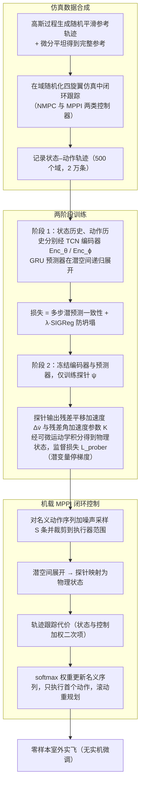

# SkyJEPA（四旋翼长时域世界模型）

**SkyJEPA** 用 JEPA 式潜动力学预测四旋翼的长时域状态，并用物理启发探针把潜变量映射为可解释状态，再用采样型最优控制在嵌入式硬件上做高频闭环控制。

## 英文缩写速查

| 缩写 | 英文全称 | 简要说明 |
|------|----------|----------|
| JEPA | Joint-Embedding Predictive Architecture | 本文潜动力学的架构基础 |
| WM | World Model | 预测四旋翼未来状态的内部模型 |
| MLP | Multi-Layer Perceptron | 文中作为对照的普通解码器 |
| sim-to-real | Simulation to Real | 仿真训练后直接迁移到实机 |

## 为什么重要

多数 JEPA 工作停在离线推演；本工作把世界模型预测直接用于高频闭环控制，并在真实室外空域验证，是 JEPA 走向真实控制的一个具体样例。

## 流程总览

图依据：论文 §IV-A 至 §IV-E（Fig. 2、Fig. 3）与 §V-B/C/D 的数据与训练设定；Fig. 2 各框的名称仅按图注与正文对应，未核对图中箭头细节。

## 核心信息

- 作者：Pratyaksh Rao、Wancong Zhang、Randall Balestriero、Yann LeCun、Giuseppe Loianno（arXiv 页）
- 机构：arXiv 页未显示；文章称为伯克利、纽约大学、布朗大学联合发布（来自文章转述，未核对）
- 代码 / 项目页：arXiv 页未提供

## 核心原理（方法栈）

1. **潜动力学**：JEPA 式潜态预测，减少自回归误差累积。
2. **物理启发探针**：把冻结潜变量映射为位置、姿态等可解释状态；基础运动由物理方程保证，网络只拟合空气阻力、电机延迟等残余非线性。
3. **采样最优控制**：在嵌入式硬件上实时求解。
4. **数据**：仿真流水线自动生成轨迹，用于域随机化训练。

## 实验与评测

- 文章转述消融：60 步推演位置误差，普通 MLP 解码器为 5.56 m，替换为物理探针后为 1.43 m；姿态误差由 40.2° 降至 4.71°。
- 文章转述：训练数据为 500 套仿真域、2 万条轨迹；室外 60×70 m 空域真实试飞，未做实机微调，平均跟踪误差比自回归基线低 30%–50%。
- 以上数字来自文章转述，未在论文原表中核对。

## 工程实践

- 训练数据完全在仿真生成，降低实机数据采集风险。
- 探针的存在使模型可解释，便于调试哪一部分误差来自物理模型、哪一部分来自残差网络。

## 局限与风险

- 无官方代码，结果难以独立复现。
- 证据集中在四旋翼单一平台；向其他机器人迁移需要重新设计探针。
- 「零样本」指无实机微调，但仿真域设计本身依赖人工选择（推测）。

## 与其他工作对比

| 维度 | SkyJEPA | [LpWM](./paper-lpwm.md) |
|------|---------|--------------------------|
| 任务 | 无人机高频闭环 | 稀疏潜变量规划（仿真） |
| 实机验证 | 有（室外） | 未见 |

## 结论

**把 JEPA 潜动力学与物理先验结合，是让世界模型进入高频实机控制的一条可行路径，但目前证据来自单平台且无代码。**

1. **物理先验降低误差** — 探针替换带来的数量级误差下降（文章转述）是方法的核心证据。
2. **仿真训练** — 2 万条仿真轨迹加域随机化，支持零样本实飞（文章转述）。
3. **可复现性** — 无代码，需等待论文正式版或开源。
4. **读法** — 更适合作为「世界模型 + 物理先验」的设计参考。

## 关联页面

- [LpWM](./paper-lpwm.md) — 同为 JEPA 潜空间世界模型，但面向仿真规划
- [LeWorldModel](./paper-lewm.md) — 端到端像素 JEPA 世界模型的对照
- [Model-Based RL](../methods/model-based-rl.md) — 基于世界模型的控制通用框架

## 参考来源

- [SkyJEPA 论文归档](../../sources/papers/skyjepa_arxiv_2606_23444.md)
- [深蓝具身智能文章归档](../../sources/blogs/wechat_deepblue_lecun_jepa_11_papers_2026-10-20.md)
- [arXiv PDF](https://arxiv.org/pdf/2606.23444)：已通读方法部分（实验与附录以略读为准）：§I 引言、§III 背景、§IV 方法（A–E）、§V 实现细节、§VI 实验开头（VI-A 起部分）

## 推荐继续阅读

- [arXiv:2606.23444](https://arxiv.org/pdf/2606.23444)
