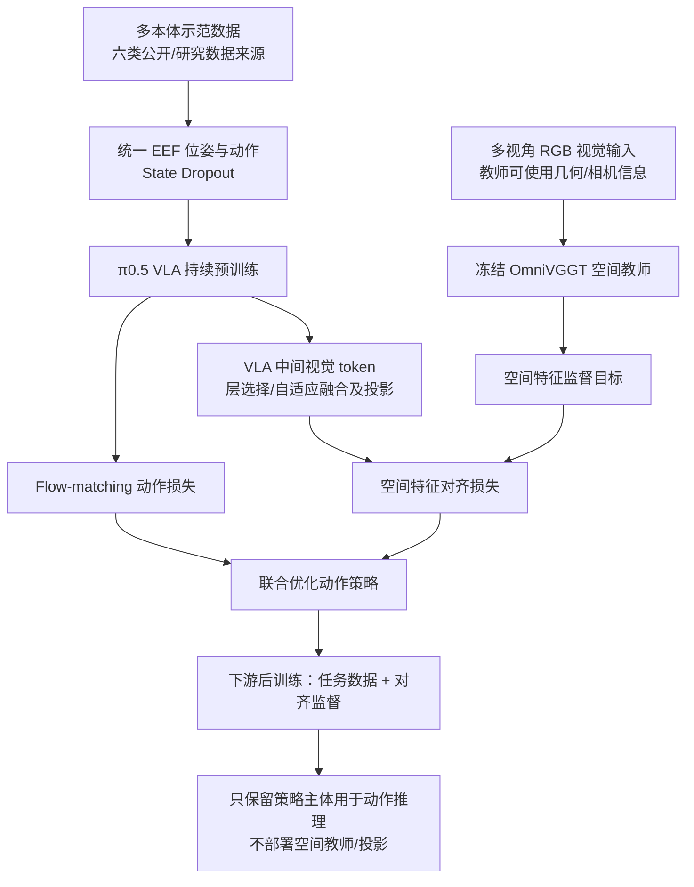
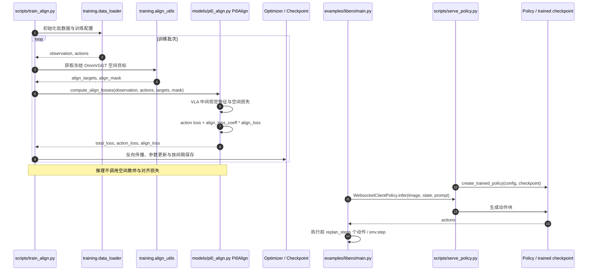

# SLA: Scaling Spatial-Language-Action Model via Continual Pre-training / 通过持续预训练扩展空间-语言-动作模型

## 一句话定义

**SLA** 是在 [π0.5](./paper-pi05-open-world-vla.md) 视觉-语言-动作策略上引入跨本体持续预训练与**仅训练期存在**的三维空间特征监督，让动作策略学习更可迁移的空间表示，而不在常规部署阶段增加空间教师推理分支的研究。

## 英文缩写速查

| 缩写 | 英文全称 | 简要说明 |
|---|---|---|
| SLA | Spatial-Language-Action | 本文空间-语言-动作持续预训练框架 |
| VLA | Vision-Language-Action | 以视觉、语言、机器人状态生成动作的策略 |
| VLM | Vision-Language Model | 为 VLA 提供视觉/语言 token 表示的基础模型 |
| EEF | End-Effector | 各机器人末端位姿与动作表征的对齐接口 |
| SO(3) | Special Orthogonal Group in Three Dimensions | 表达 3D 旋转的数学空间 |
| RGB | Red, Green, Blue | 视觉输入；空间教师还可利用其他几何线索 |

## 为什么重要

- **空间泛化不等于识别语义。** 仅靠机器人动作监督，策略可能依赖纹理、摆放和本体状态的训练分布。SLA 在连续动作训练中显式加入来自三维教师的特征监督。
- **把规模与几何监督放进同一条训练线。** 六来源多本体数据先做统一动作表征，再持续训练 π0.5；下游任务继续训练时保留对齐目标，研究空间先验能否在新任务迁移。
- **部署成本更可控。** OmniVGGT 及其对齐投影在训练期使用，常规动作推理只调用策略本身。但 RoboDojo-Real 的基准特定历史帧记忆设置另有输入成本，不能笼统理解为所有实验零新增计算量。

## 核心信息

| 字段 | 内容 |
|---|---|
| 论文 | [arXiv:2611.08373](https://arxiv.org/abs/2611.08373)，2026-11-05，v1 |
| 作者 | Fuhao Li 等 |
| 机构 | 香港科技大学（广州）、OLA Dimensions、北京智源人工智能研究院、清华大学等（以论文署名为准） |
| 基座 | π0.5；flow matching 动作生成 |
| 空间教师 | OmniVGGT，冻结；训练期使用 |
| 公开实现 | [OpenHelix-Team/Spatial-Forcing 的 SLA 子目录](https://github.com/OpenHelix-Team/Spatial-Forcing/tree/master/SLA) |
| 状态 | **部分开源**：LIBERO-Plus / RoboTwin 训练与评测、部分预训练/后训练权重公开；完整持续预训练原始数据和 RoboDojo-Real 复现仍有 TODO |
| 项目主页 | [官方页（arXiv 链接）](https://sla-team.github.io/omnisf_projectpage/)；[作者第二入口](https://embodiedsla.github.io/)，2026-11-08 已核对两处正文一致 |

## 官方项目页与 Hugging Face 资源（2026-11-08）

已实际读取 [官方项目主页](https://sla-team.github.io/omnisf_projectpage/) 和 [作者另一入口](https://embodiedsla.github.io/)；两页均展示相同的 SLA 方法、数据表和指标。Hugging Face 的 [论文索引页](https://huggingface.co/papers/2611.08373) 不应误当成另一篇独立论文。

[作者的 SLA Collection](https://huggingface.co/collections/haofuly/sla-collection) 当前有四项公开资源，按**下载用途**区分：

| 资源 | 内容与使用阶段 |
|---|---|
| [SLA_base](https://huggingface.co/haofuly/SLA_base) | 持续预训练后的模型基座，作为下游训练初始化 |
| [SLA_training_component](https://huggingface.co/haofuly/SLA_training_component) | OmniVGGT / DINOv2 等辅助训练组件；不是独立动作策略 |
| [SLA_benchmark_ckpts](https://huggingface.co/haofuly/SLA_benchmark_ckpts) | 已后训练的基准 checkpoint，用于对照公开评测入口 |
| [SLA_real_world_demo](https://huggingface.co/datasets/haofuly/SLA_real_world_demo) | 真机示范数据资源，**不是**六来源完整持续预训练语料 |

官方 [SLA/README 的 TODO](https://github.com/OpenHelix-Team/Spatial-Forcing/blob/master/SLA/README.md) 同时将「continual pre-training corpus」代码工作项列为完成、将「continual pre-training data」列为未开放；这两项不能混淆。HF 的模型/数据资源页面可访问，但**本次没有下载权重、核验模型文件完整性或运行 benchmark**。

### 训练和评测口径补充

论文 §4.2 报告持续预训练采用 48× NVIDIA H100、约 110 小时、36k optimizer steps（effective global batch 4,608）；这是**作者实验成本**，不能由四个 Hugging Face 资源反推可复现该阶段。论文中 LIBERO-Plus 的 87.4% 由 10,030 次评测 rollout 按扰动维度加权；RoboTwin 72.3% 是 50 任务的 Clean2Random；RoboDojo-Real 33.9% 是三种本体上任务成功率均值。不同评测协议不能直接混排。

## 核心原理

### 1. 异构机器人数据与状态去依赖

SLA 在 π0.5 上继续预训练。对不同机器人数据按统一末端坐标约定整理位姿/动作，旋转处理使用 SO(3) 相对姿态等几何操作；以 State Dropout 随机屏蔽机器人状态，避免策略完全依赖本体量而忽视图像空间证据。论文列出 InternData-A1、AgiBotWorld-Beta、RoboCasa365、RoboCOIN、DROID、MolmoAct 六来源。**原始来源合计**约 171.39 万段、14,330 小时，不是最终实际消耗的全部训练小时。

### 2. 空间特征对齐

冻结的 OmniVGGT 读取视觉输入，产生用于训练监督的空间目标特征；VLA 从指定/融合的视觉中间层抽取图像 token，经投影与空间目标对齐。论文讨论**自适应层门控/融合**以减轻只看固定单层的局限。两支损失共同优化策略：

\[
\mathcal{L}_{\mathrm{total}}=\mathcal{L}_{\mathrm{action}}+\alpha\mathcal{L}_{\mathrm{spatial}}.
\]

其中动作损失针对 flow-matching 速度目标，空间损失约束视觉 token 的空间表示；教师参数不参与策略更新。论文给出不同阶段/门控消融，不能把图中的对齐模块误认为单独的部署感知栈。

### 3. 预训练 → 后训练 → 推理

论文表明**持续预训练与下游后训练都施加空间监督**的 RoboTwin Clean2Random 效果最好。常规部署端仅保留训练后的 π0.5 策略执行动作，不需现场运行 OmniVGGT；这与真机评测可能额外使用历史帧记忆并不矛盾。

## 流程总览



图是对论文方法的数据/监督流概括，非部署时将 OmniVGGT 放进机器人控制回路。

## 源码运行时序图

对照官方 [SLA/README](https://github.com/OpenHelix-Team/Spatial-Forcing/blob/master/SLA/README.md)、[train_align.py](https://github.com/OpenHelix-Team/Spatial-Forcing/blob/master/SLA/scripts/train_align.py)、[pi0_align.py](https://github.com/OpenHelix-Team/Spatial-Forcing/blob/master/SLA/src/openpi/models/pi0_align.py)、[serve_policy.py](https://github.com/OpenHelix-Team/Spatial-Forcing/blob/master/SLA/scripts/serve_policy.py) 与 [LIBERO 客户端](https://github.com/OpenHelix-Team/Spatial-Forcing/blob/master/SLA/examples/libero/main.py)；下图仅刻画源码已核实的入口与调用关系。



**代码与论文需区分：** 公开示例 [pretrain.py](https://github.com/OpenHelix-Team/Spatial-Forcing/blob/master/SLA/src/openpi/external_config/pretrain.py) 和 [train_libero_plus.py](https://github.com/OpenHelix-Team/Spatial-Forcing/blob/master/SLA/src/openpi/external_config/train_libero_plus.py) 明示 vla_adapt_layers_align=False、vla_layers_align=12；因此 README 示例采用固定层设置，不能直接视为论文自适应门控实验的默认复现配置。

## 工程实践

1. 按 [SLA/README](https://github.com/OpenHelix-Team/Spatial-Forcing/blob/master/SLA/README.md) 的 uv 安装说明准备环境及 LIBERO-Plus 数据；从[官方 Collection](https://huggingface.co/collections/haofuly/sla-collection) 获取 SLA_base、SLA_training_component，评测可另取 SLA_benchmark_ckpts。**这里只做源码与文档核对，未执行下载、训练或评测。**
2. 计算动作/状态统计：```uv run scripts/compute_norm_stats.py --config-name train_libero_plus```（这里为单行命令示意）。
3. 对齐训练入口：```uv run --no-sync scripts/train_align.py train_libero_plus --exp-name=experiments```；内部模型通过 Pi0Align.compute_align_losses 联合动作与视觉空间约束。模型配置与 checkpoint 路径以官方 README 实际说明为准。
4. 推理服务用 scripts/serve_policy.py 的 policy:checkpoint 模式加载训练权重，examples/libero/main.py 通过 WebSocket 请求动作块，执行前 replan_steps 步后再次规划。
5. 复现时记录：Clean2Random / Clean2Clean 的任务与回合数、环境资源、推理历史帧、层融合开关、State Dropout 比例、校准信息是否给教师、是否使用对应下游权重。

## 实验与评测

以下为**作者论文报告**，并非本站独立复现；成功率跨基准、数据预算和任务定义不能直接排序。

| 基准 / 设置 | SLA | 对照与读法 |
|---|---:|---|
| LIBERO-Plus | 87.4% | π0.5 84.4%；Spatial Forcing 85.1% |
| RoboTwin 2.0 Clean2Random | 72.3% | π0.5 46.0%；Spatial Forcing 62.6% |
| RoboTwin 2.0 Clean2Clean | 86.0% | 两设置平均 79.2% |
| RoboCasa-Panda | 68.4% | Spatial Forcing 67.6%，须对齐示范规模 |
| RoboDojo-Real | 33.9% | π0.5 12.8%；该设置有额外历史帧记忆 |
| 自建八组真实部署条件（均值） | 83.8% | π0.5 59.8%，提升 24.0 个百分点 |

**RoboTwin Clean2Random 消融：** 两阶段对齐 72.3%，仅持续预训练对齐 63.2%，仅后训练对齐 57.1%，均不对齐 48.2%。State Dropout 25% 为此研究报告的重要消融设置；勿将同一数值外推到其他机器人与数据规模。

## 结论

**SLA 的核心意义是把空间教师约束融入 VLA 的持续训练，而不是在运行时额外挂一个三维感知模型。**

1. **先核对基座。** 论文是在 π0.5 上持续训练，比较时需统一基座权重与数据预算。
2. **空间对齐应同时看两个阶段。** 仅在下游后训练增加一个空间损失不能代替完整方案。
3. **层融合设置要显式记录。** 论文自适应门控与公开 config 的固定第 12 层不是同一实验条件。
4. **真机增益与算力成本分账。** 不部署教师并不排除基准特定的历史帧/记忆设计。
5. **公开代码仍有缺口。** 部分原始训练数据与 RoboDojo-Real 官方复现尚待补齐，公开权重不等于从零完全可复现。

## 与其他工作对比

| 工作 | 空间能力注入位置 | 迁移与工程取舍 |
|---|---|---|
| [π0.5](./paper-pi05-open-world-vla.md) | 通用异构数据 + VLA/动作专家 | 基座与分层动作框架；SLA 在此基础上继续训练 |
| [Spatial Forcing](./paper-rcl-ref-0f2536c81a1992e3c3b8-spatial-forcing-implicit-spatial-representation.md) | 空间表示对齐 | 本文沿空间对齐线扩展持续预训练及跨任务评测 |
| **SLA** | 多数据源持续预训练 + 教师特征对齐 + 继续后训练 | 训练成本更高，常规推理移除空间分支；需要核对数据与层门控配置 |

## 局限与风险

- **评测不是普适保证。** RoboTwin、LIBERO-Plus、RoboCasa 与真机任务的示范数据、初始状态、评测指标不同；论文报告数字不等于在其他本体上的保证成功率。
- **源码与实验存在配置边界。** 官方公开示例采用固定层设置；不宜据此声称已验证自适应门控对全部基准的增益。
- **开源不完整。** README 尚将“持续预训练数据”和 RoboDojo-Real 的 post-train/eval 列为待办，且部分大规模训练资源要求高。
- **项目页已核验，但不是独立复现。** 已读取 [官方主页](https://sla-team.github.io/omnisf_projectpage/) 与 [作者另一入口](https://embodiedsla.github.io/)，并核对到相同指标；项目展示和 HF 权重可访问不代表完整语料、RoboDojo-Real 脚本已开放。
- **部署输入依设置而异。** 论文在 RoboDojo-Real 评测借助历史帧记忆；即便空间教师不进推理，这部分输入及缓存成本仍需单独核算。

## 关联页面

- [π0.5：开放世界泛化 VLA](./paper-pi05-open-world-vla.md)
- [Spatial Forcing（前作）](./paper-rcl-ref-0f2536c81a1992e3c3b8-spatial-forcing-implicit-spatial-representation.md)
- [VLA 方法概览](../methods/vla.md)
- [VLA 与基础策略知识链](../overview/hub-vla.md)

## 参考来源

- [SLA 原始论文通读归档](../../sources/papers/sla_spatial_language_action_arxiv_2611_08373.md)
- [官方项目主页链接核查与开源状态](../../sources/sites/sla_spatial_language_action.md)
- [官方源码入口与模块核对](../../sources/repos/sla_openhelix.md)
- [论文原文 HTML v1](https://arxiv.org/html/2611.08373v1)
- [OpenHelix 官方实现](https://github.com/OpenHelix-Team/Spatial-Forcing/tree/master/SLA)
- [SLA 官方项目页（已核验）](https://sla-team.github.io/omnisf_projectpage/)
- [SLA Hugging Face 论文页](https://huggingface.co/papers/2611.08373)
- [SLA 作者模型/数据合集](https://huggingface.co/collections/haofuly/sla-collection)

## 推荐继续阅读

- [arXiv PDF：SLA（v1）](https://arxiv.org/pdf/2611.08373)
- [SLA/README：训练、评估与公开权重](https://github.com/OpenHelix-Team/Spatial-Forcing/blob/master/SLA/README.md)
- [π0.5 原始论文](https://arxiv.org/abs/2504.16054)
