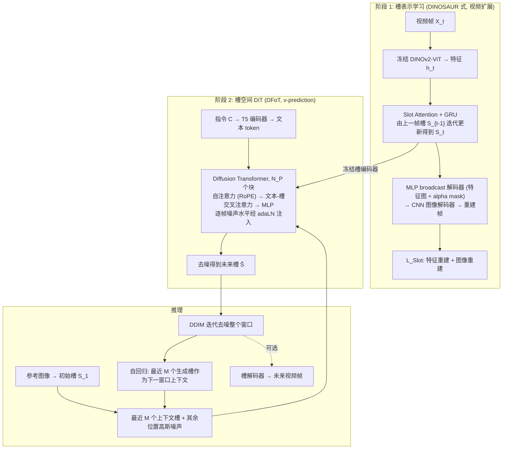

# SlotDiT（arXiv:2609.17414）

**SlotDiT**（*SlotDiT: Object-Centric Representations for Diffusion Transformers*，[arXiv:2609.17414](https://arxiv.org/abs/2609.17414)，[项目页](https://slot-dit.github.io/)）来自 [具身智能小站 12 篇盘点](../../sources/blogs/wechat_embodied_station_12_papers_vla_deploy_2026-09-16.md)。

## 一句话定义

**把场景分解为对象级 slots，在统一 DiT 下比较 slot、VAE 与语义对齐表示的机器人视频预测。**

## 英文缩写速查

| 缩写 | 英文全称 | 简要说明 |
|------|----------|----------|
| SlotDiT | Slot-based Diffusion Transformer | 本文对象级 DiT |
| DiT | Diffusion Transformer | 扩散 Transformer |
| VAE | Variational Autoencoder | 变分自编码器 latent |
| WM | World Model | 环境前向预测模型 |

## 为什么重要

- 像素或 VAE latent 对「哪个物体发生了什么」缺少显式结构；为表示选型提供清晰切口。
- 开源结论：**待发布**（步骤 2.5，2026-09-16）。
- 与 [12 篇技术地图](../overview/vla-deploy-12-papers-technology-map.md) 中同类工作可横向对照。

## 流程总览

图依据：论文 §3.1–3.3 / Fig. 1、Fig. 2

## 核心机制

| 项 | 内容 |
|----|------|
| **arXiv** | [2609.17414](https://arxiv.org/abs/2609.17414) |
| **开源** | **待发布** |
| **要点** | 对象级 slot 分解 + DiT 视频预测；对照 VAE latent 与语义对齐表征。 |
| **文内指标** | 以项目页与原文为准；入库日项目页未列官方 GitHub。 |

## 源码运行时序图

**不适用（待发布）** — 截至 2026-09-16 项目页未列可运行官方仓库。

## 实验与评测

- 以项目页与原文为准；入库日项目页未列官方 GitHub。
- **读法：** 清单摘要；逐项对照与 baseline 以原文 PDF 为准。

## 与其他工作对比

- 横向索引见 [12 篇技术地图](../overview/vla-deploy-12-papers-technology-map.md)。

## 结论

**SlotDiT 把对象级结构引入 DiT 视频预测，适合先读表示层设计再决定是否跟代码。**

1. 开源边界：**待发布** — 以项目页实际链接为准（入库日 2026-09-16）。
2. 核心机制：对象级 slot 分解 + DiT 视频预测；对照 VAE latent 与语义对齐表征。…
3. 部署前核对任务协议与硬件条件，勿直接横比公众号摘录数字。

## 关联页面

- [generative-world-models](../methods/generative-world-models.md)
- [world-action-models](../concepts/world-action-models.md)
- [manipulation](../tasks/manipulation.md)
- [paper-dido-wam](./paper-dido-wam.md)

## 参考来源

- [slotdit_arxiv_2609_17414.md](../../sources/papers/slotdit_arxiv_2609_17414.md)
- [wechat_embodied_station_12_papers_vla_deploy_2026-09-16.md](../../sources/blogs/wechat_embodied_station_12_papers_vla_deploy_2026-09-16.md)
- [arXiv:2609.17414](https://arxiv.org/abs/2609.17414)
- [arXiv PDF](https://arxiv.org/pdf/2609.17414)：已通读方法部分（实验与附录以略读为准）：§3 方法（3.1 槽表示学习、3.2 槽空间文本条件 DiT、3.3 训练与推理）；实验与附录未读

## 推荐继续阅读

- [arXiv PDF](https://arxiv.org/pdf/2609.17414)
- [项目页](https://slot-dit.github.io/)

