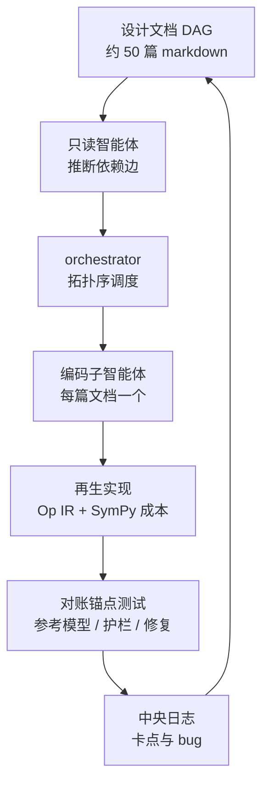
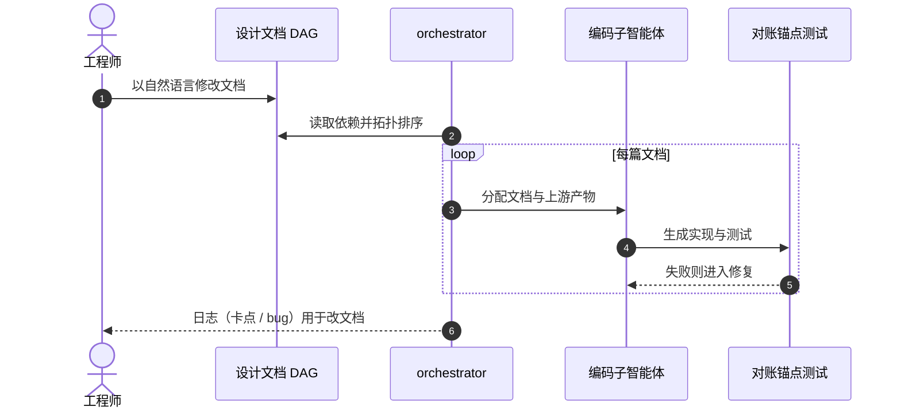

# SMART：设计文档即源码的 ML 性能建模工具

**SMART**（论文 *Design Docs Are All You Need: An AI-native Machine-Learning Performance Tool*，[arXiv:2609.05364](https://arxiv.org/abs/2609.05364)）由 Google / Google DeepMind / MIT / Stanford 作者提出：把性能建模库的“真源”从代码换成自然语言设计文档图，实现每次由编码智能体重新生成。

## 一句话定义

**仓库主分支只存设计文档（约 50 篇、约 9,000 行规格说明），人只改文档，实现是可丢弃、可重生的构建产物。**

## 英文缩写速查

| 缩写 | 英文全称 | 简要说明 |
|------|----------|----------|
| SMART | （论文给出的库名，symbolic ML performance modeling） | 本文的符号化 ML 性能建模库 |
| IR | Intermediate Representation | 递归定义的算子（Op）中间表示 |
| DAG | Directed Acyclic Graph | 设计文档之间的依赖图，按拓扑序再生 |
| RRT | Resource Reservation Table | 资源预约表，供模调度模式排程 |
| TPU | Tensor Processing Unit | 被建模的目标硬件（含 MXU / VMEM / ICI 叶子算子） |
| DSL | Domain-Specific Language | 嵌入 Python 的追踪式构建 DSL |

## 为什么重要

- **维护模型换位：** 性能模型的抽象随每代硬件与模型失效；论文主张“重生成比打补丁便宜”，把长期资产从代码转为文档。
- **给出可操作的文档写法：** 工作示例当上下文演示、数字文档结尾加对账锚点，这套约定可迁移到其他“智能体生成代码”的工程。
- **证据有限：** 目前仅有一个库、作者自测，别当成通用结论。

## 方法栈 / 流程总览

## 方法

- **文档图：** 每篇文档自包含，边由智能体推断；顺序例如“硬件拓扑与数值 → 集合通信成本 → 模型目录”。
- **文档风格：** 逐步工作示例充当 in-context 演示；含数字的文档以“对账锚点”收尾（小预设 + 精确期望输出，由生成的测试强制）。
- **再生：** 全量重建用 Claude Code；基础文档可路由到更强模型；校验含参考模型对账、参数护栏、单元测试与修复步骤；失败位置回写日志，指导人改文档。
- **算子 IR：** 递归 Op = 符号输入输出 + SymPy 成本（计算/访存/通信）+ RRT + 参数（InnerLoop / GraphParams / LeafParams）；叶子为 TPU 形态（MXU 矩阵块、VMEM 加载、ICI all-gather）。构建 DSL 用 `@smart_loop`（归约循环）与 `@smart_map_loop`（并行 map），集合通信由分片标注推断。
- **两种模式：** 快速分析（闭式汇总 + 屋顶线式重叠变换，适合扫上千设计点）；慢速模调度（Rau 1994 的 modulo scheduling 对 RRT 排程，initiation interval 逐层汇总）。成本保持符号，每个设计点只绑定一次数值。

## 实验与评测

- 再生实现“复现到舍入精度”地对上手工审计的参考模型，包含 DeepSeek-V3 在 TPU pod 切片上的服务；**原文页未给误差数值**。
- 全新重建约 **1.5–3 小时**，API 费用约 **100 美元**（约占高档订阅周额度 20%）。
- **原文未报告：** token 数、代码行数、逐文档错误率、与其他性能建模工具或人工维护方案的对比。

## 源码运行时序图

不适用：截至 2026-10-12，arXiv 摘要页与 HTML 页均未给出代码仓库或项目页，也没有公开设计文档，无法对齐真实目录。以下仅为论文描述的**概念时序**（非仓库代码）：

## 工程实践

- 想借鉴时，先在小库上试“文档为源”：为每个模块写带逐步示例的文档，并附一个精确期望输出的对账用例。
- 把智能体卡点日志当成文档质量指标，而不是直接改代码。
- 预算参考：论文量级为一次重建数小时、百美元级 API；自研库请自行测。

## 与机器人学习的关系

无直接关系；可借鉴的是“规格文档 + 对账测试 + 再生”的工作流，用于机器人仿真/评测工具链的可重生维护（推测，论文未涉及）。

## 结论

**论文提出并初步验证了“设计文档为持久资产、代码由智能体再生”的工程范式，但证据只来自单一库与作者自测。**

1. 把易过时的实现层当构建产物，把长期知识写成文档。
2. 文档用工作示例做演示，比纯描述性规格更利于智能体生成。
3. 含数值的模块必须有对账锚点测试，否则“再生”无法判定对错。
4. 依赖图让再生可并行、可局部重跑。
5. 记录子智能体卡点，反向优化文档。
6. 采用前先自测成本与误差，原文没有给出误差数字。

## 局限与风险

- 单库、无对照，“舍入精度”没有量化误差。
- 依赖商用编码智能体与订阅额度，外部无法复现。
- **开源状态：** 截至 2026-10-12 未发现代码或设计文档公开（摘要页与 HTML 页均无链接），不是已开源项目。
- 未读到独立 limitations 章节。

## 与其他工作对比

| 对照 | 差异读法 |
|------|----------|
| [智能体编码软件基础](../concepts/agentic-coding-software-fundamentals.md) | 本文把“规格驱动”推到极端：代码不入主分支 |
| [递归自我改进](../concepts/recursive-self-improvement.md) | 人仍编辑文档，智能体只再生实现，不是自改进闭环 |
| [AI 智能体评测](../concepts/ai-agent-evaluation.md) | 本文用参考模型对账充当验收，而非通用基准 |

## 关联页面

- [WaytoAGI 本周顶级 AI 论文技术地图](../overview/waytoagi-top-ai-papers-2026-09-07-09-13-technology-map.md)
- [智能体编码软件基础](../concepts/agentic-coding-software-fundamentals.md)
- [递归自我改进](../concepts/recursive-self-improvement.md)
- [AI 智能体评测](../concepts/ai-agent-evaluation.md)

## 参考来源

- [waytoagi_feishu_top_ai_papers_2026-09-07-09-13.md](../../sources/blogs/waytoagi_feishu_top_ai_papers_2026-09-07-09-13.md) — 周报线索
- [smart_design_docs_arxiv_2609_05364.md](../../sources/papers/smart_design_docs_arxiv_2609_05364.md) — 论文归档
- [arXiv:2609.05364](https://arxiv.org/abs/2609.05364)

## 推荐继续阅读

- [arXiv HTML 全文](https://arxiv.org/html/2609.05364v1)
- [DAIR Academy 论文页（周报线索）](https://academy.dair.ai/papers/design-docs-are-all-you-need-an-ai-native-machine-learning-performance-tool-2609.05364)
