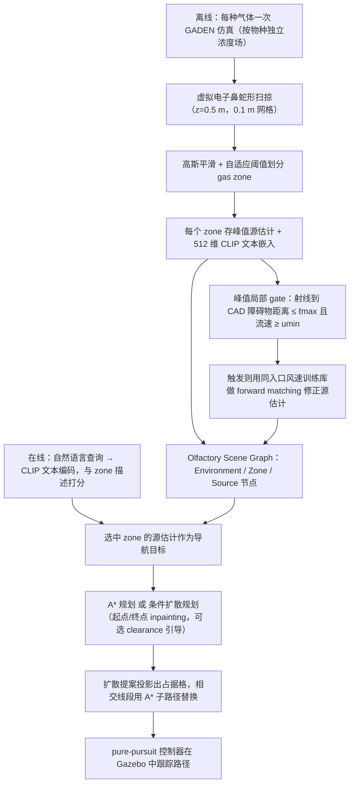

# SmellDiffusion（arXiv:2609.20624）

**SmellDiffusion**（*SmellDiffusion: Diffusion-Based Quadruped Navigation with Olfactory Scene Graphs*，[arXiv:2609.20624](https://arxiv.org/abs/2609.20624)）来自 [senlanke 具身运控lab 周更盘点](../../sources/blogs/wechat_senlanke_weekly_humanoid_quadruped_2026-09-14_18.md)（2026-09-14–18）。

## 一句话定义

**开放词汇嗅觉场景图保存气体类别与源估计；几何门控修正浓度峰值；扩散模型生成四足导航轨迹。**

## 英文缩写速查

| 缩写 | 英文全称 | 简要说明 |
|------|----------|----------|
| SLAM | Simultaneous Localization and Mapping | 同步定位与建图 |
| RL | Reinforcement Learning | 强化学习 |
| BEV | Bird's-Eye View | 鸟瞰视图 |

## 为什么重要

- 搜救/巡检等需非视觉化学源定位；嗅觉图 + 扩散规划是新传感模态组合。

## 流程总览

图依据：论文 §III-A / §III-B / §III-C、§IV-C、Fig. 2。

## 核心机制

| 项 | 内容 |
|----|------|
| **arXiv** | [2609.20624](https://arxiv.org/abs/2609.20624) |
| **开源** | **待发布**（步骤 2.5，2026-09-20） |
| **方法摘要** | Olfactory scene graph + gated peak correction + diffusion trajectory generation. |

## 源码运行时序图

**不适用**（截至 2026-09-20 未发布可运行官方代码或待核实）。

## 实验与评测

- 四足导航任务（以 PDF 为准）。
- 读法：先对齐任务设定、传感器与成功定义，再解读 headline 数字。

## 与其他工作对比

| 维度 | 读法 |
|------|------|
| **同周对照** | 见对应 [周更盘点](../../sources/blogs/wechat_senlanke_weekly_humanoid_quadruped_2026-09-14_18.md) 映射表，勿跨任务直接比 SR |
| **开源状态** | **待发布** — 部署前以项目页/arXiv 为准 |

## 结论

**SmellDiffusion 把嗅觉场景图接入腿式扩散导航，拓展感知模态边界。**

1. 开源：**待发布**；勿凭公众号摘要臆断可复现性。
2. 指标须连同实验条件解读（仿真/真机、平台、成功阈值）。
3. 关注 arXiv 版本更新与代码发布。

## 关联页面

- [locomotion](../tasks/locomotion.md)
- [generative-world-models](../methods/generative-world-models.md)

## 参考来源

- [smelldiffusion_arxiv_2609_20624.md](../../sources/papers/smelldiffusion_arxiv_2609_20624.md)
- [wechat_senlanke_weekly_humanoid_quadruped_2026-09-14_18.md](../../sources/blogs/wechat_senlanke_weekly_humanoid_quadruped_2026-09-14_18.md)
- [arXiv:2609.20624](https://arxiv.org/abs/2609.20624)
- [arXiv PDF](https://arxiv.org/pdf/2609.20624)：已通读方法部分（实验与附录以略读为准）：§III-A/B/C 方法、§IV-A~D 源估计与 peak-local gate；§V 起仅略读

## 推荐继续阅读

- [arXiv PDF](https://arxiv.org/pdf/2609.20624)
