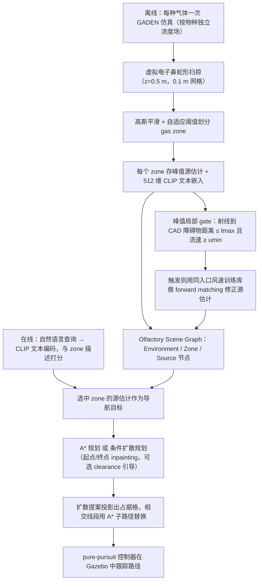

# SmellDiffusion / 基于嗅觉场景图的扩散式四足导航

基于 arXiv:2609.20624v2（2026-09-18），本次通读 §I–IX、图表与参考文献，升级既有节点。

## 一句话定义

**开放词汇嗅觉场景图保存气体类别与源估计；几何门控修正浓度峰值；扩散模型生成四足导航轨迹。**

## 英文缩写速查

| 缩写 | 英文全称 | 简要说明 |
|------|----------|----------|
| CFD | Computational Fluid Dynamics | 计算流体力学；提供流场 |
| CLIP | Contrastive Language–Image Pre-training | 此处仅用文本编码器匹配气体描述 |
| NNN | Nearest Neighbor Normalization | 候选相关的检索偏差修正 |

## 为什么重要

- 搜救/巡检等需非视觉化学源定位；嗅觉图 + 扩散规划是新传感模态组合。

## 流程总览

图依据：论文 §III-A / §III-B / §III-C、§IV-C、Fig. 2。

## 核心机制

| 项 | 内容 |
|---|---|
| 机构 | 斯科尔科沃科学技术学院（Skoltech） |
| 表征 | 每种气体独立 GADEN 场；0.5 m 高度虚拟扫掠，0.1 m 网格；场景图保存物种、峰值估计和文本嵌入 |
| 源修正 | 在观测峰值处读取 CFD 流向，沿流向到 CAD 障碍物距离 ≤1 m 且流速 ≥0.35 m/s 时触发匹配；从同入口风速的训练库检索最近峰值并返回源位置，平局取均值 |
| 扩散 | 32 个二维航点、64 次去噪；起终点每步覆盖；浓度、辅助气体通道和占据图作为条件 |
| 两种策略 | v1 为池化地图条件的 MLP；v3 在航点采样地图特征并用时序卷积。规划对照用 v1，引导消融用 v3，不能当作同架构对照 |

## 实验与评测

### 源定位与语义

- 424 个去重源位置–风速配置，220 训练 / 204 评估，源位置不跨分割。评估中 10 个峰值偏移超过 0.5 m；门控触发 14 次，9 真阳性、5 假阳性、1 漏检。
- 门控后偏移子集误差 1.468→0.592 m；全体 0.205→0.180 m。对所有样本直接匹配反而使全体均值升至 0.356 m。
- 集成查询 7/9；独立新查询中裸名称、丰富描述均为 3/10，NNN 后 5/10。给所有候选减同一个 air 相似度不能改变排序。
- 保留物种的消融支持气体身份的重要性，但未对照平坦的物种–位置字典，不能证明图结构必需。

### 规划对照（论文 Table IV）

相同地图与目标、12 组起终点，四种方法均 12/12 成功；下表为均值。暴露量是归一化浓度的路径平均值，衡量寻羽流偏好，并非吸入剂量。

| 规划器 | 暴露量 | 最小间隙 m | 路径 m | 耗时 ms |
|---|---:|---:|---:|---:|
| 普通 A* | 0.0302 | 0.442 | 5.76 | 15.2 |
| 气体引导 A* | 0.0455 | 0.446 | 5.78 | 72.3 |
| 引导扩散单次 | 0.0313 | 0.589 | 8.00 | 41.7 |
| 引导扩散十选一 | 0.0476 | 0.547 | 9.71 | 407.7 |

- 单线程 CPU 计时只含规划计算，不含地图准备、共同质量检查、部分回退及机器人执行；十选一是十次顺序采样。
- v3 在两个曾用于引导调参的场景、各 10 个配对随机种子下比较 scale 0/5；拥挤场景待 A* 修复段比例 24.84%→5.81%。这是修复工作量消融。
- Gazebo 氯气/乙醇/甲烷各两种规划器，共 6 次执行。机器人到真实源均值 A* 0.39 m、扩散 0.31 m；每条件仅一次，不能据此认定统计显著优势。

## 结论

贡献在气体身份保持、选择性源修正和可引导的路线采样，证据范围是仿真。

1. 源修正先判断峰值是否可能偏移，避免全量匹配伤害原本准确的估计。
2. 复现规划先用普通 A* 作速度和路径长度基线；十选一扩散提高暴露量，也增加延迟与路程。
3. 单独报告定位、目标投影、路径跟踪误差；0.30 m 停止容差只约束跟踪项。
4. 将新查询泛化作为独立验证项，不能用描述开发集 8/9 代表新查询能力。
5. 真机前需补混合气体识别、在线风场估计、定位不确定性和动态羽流验证。

## 源码运行时序图

**不适用**：截至 2026-11-07，已读 arXiv 摘要页与 v2 全文未列可访问的官方项目/代码入口。外部线索所指 `FaithOgunwoye/Olfsg` 经 GitHub API 与浏览器核查均为 404，无法确认公开实现及运行入口；不据此断言作者未发布任何代码，也不绘制未经核验的源码时序图。

## 工程实践

- 离线建图完成后才执行在线查询与导航；机器人行走时主动采样尚属后续集成。
- 扩散输出仍需投影到自由空间并用 A* 替换碰撞线段；纯追踪控制器使用 Gazebo 真值位姿。
- 论文 §VIII 描述了 revision artifact、固定随机种子、输入哈希和检查器；已读原文未给可获取的 artifact 地址，尚不能独立复跑。大规模训练数组未包含在该 artifact 的描述范围内。

## 局限与风险

- 全部实验为仿真，尚无物理四足验证；固定高度扫掠与浮升/下沉气体不匹配，物种独立仿真通道绕过真实混合气体辨识。
- 门控依赖 CFD 流场，且同入口风速训练库的峰值坐标可能对应多个源；几何解释拟合使用真实源信息，不是可部署门控本身。
- 评估集在本次修订之前已被观察过；额外三个房间 620 配置仅 5 次偏移，跨场景结论有限。
- 已知静态地图上的路径生成不等于动态避障；多次采样和 A* 修复代价需计入部署预算。

## 关联页面

- [locomotion](../tasks/locomotion.md)
- [generative-world-models](../methods/generative-world-models.md)

## 参考来源

- [smelldiffusion_arxiv_2609_20624.md](../../sources/papers/smelldiffusion_arxiv_2609_20624.md)
- [wechat_senlanke_weekly_humanoid_quadruped_2026-09-14_18.md](../../sources/blogs/wechat_senlanke_weekly_humanoid_quadruped_2026-09-14_18.md)
- [arXiv:2609.20624](https://arxiv.org/abs/2609.20624)
- [arXiv PDF](https://arxiv.org/pdf/2609.20624)：v2 全文已通读（§I–IX、图表与参考文献）

## 推荐继续阅读

- [arXiv PDF](https://arxiv.org/pdf/2609.20624)
