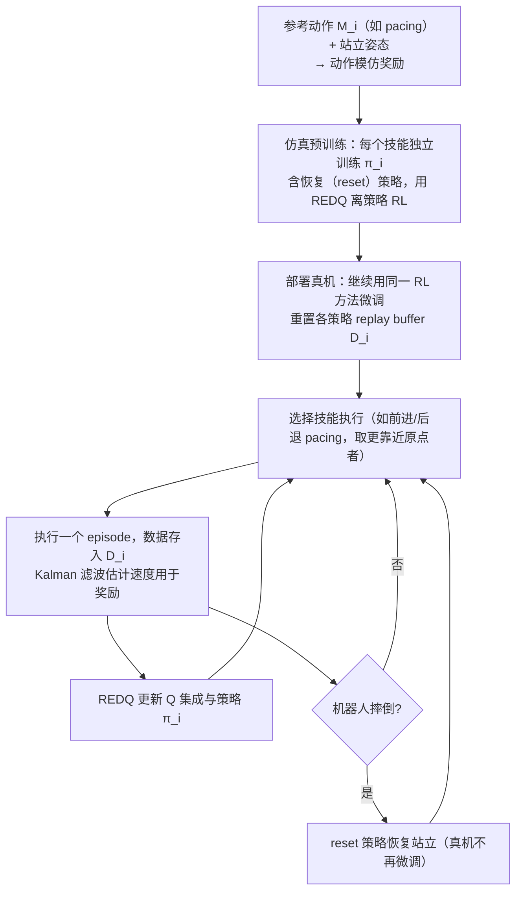

# Legged robots that keep on learning: fine-tuning locomotion policies in the real world

**Legged robots that keep on learning: fine-tuning locomotion policies in the real world**（[arXiv:2110.05457](https://arxiv.org/abs/2110.05457)）收录于 [自由度FreeDof · Sim2Real 四条路线梳理](../../sources/blogs/wechat_freedof_sim2real_four_routes_dr_to_residual_2026-08-23.md) 参考文献 **[36/44]**，归类 **残差学习**。

## 一句话定义

真机持续微调 locomotion 策略，机器人可在真实世界中自行恢复与学习。

## 英文缩写速查

| 缩写 | 英文全称 | 简要说明 |
|------|----------|----------|
| RL | Reinforcement Learning | 强化学习 |
| Sim2Real | Simulation to Real | 仿真到真机 |
| ICRA | International Conference on Robotics and Automation | 机器人旗舰会 |

## 为什么重要

- 文内硬件在线微调代表；高动态平台仍受摔机与重置成本限制。
- 在 [44 篇技术地图](../overview/freedof-sim2real-44-papers-technology-map.md) 与 [四条路线对比](../comparisons/sim2real-four-routes-identifiability.md) 中作为 **残差学习** 节点。
- 开源结论：**待核实**（步骤 2.5，2026-09-20）。

## 流程总览

图依据：论文 §III（Fig. 3、Algorithm 1 / 2）、§IV-B / C。

## 核心机制

| 项 | 内容 |
|----|------|
| **出处** | ICRA 2022 |
| **文内章节** | 残差学习 |
| **要点** | 仿真预训练 + 安全约束下的真机 policy fine-tuning。 |
| **开源** | **待核实** |

## 源码运行时序图

**不适用（待核实）** — 截至 2026-09-20 以项目页/论文 Code availability 为准；入库未核验可运行入口。

## 实验与评测

- **本页为索引级节点**（FreeDof 44 篇梳理 [36/44]）：正文固化文内角色与机制要点，**未转存原文实验表**。
- **回原文须核对的证据**：本页要点是「仿真预训练 + 安全约束下的真机 policy fine-tuning」，对应证据是真机 fine-tune 的样本量、安全干预次数与性能提升曲线三者一起看。
- **读法：** 先对齐平台、任务、指标定义与成功阈值，再读任何数字；勿从公众号摘录外推。

## 与其他工作对比

| 维度 | 读法 |
|------|------|
| **文内路线** | 归类 **残差学习**；同路线其他节点见 [44 篇技术地图](../overview/freedof-sim2real-44-papers-technology-map.md) 与 [四条路线对比](../comparisons/sim2real-four-routes-identifiability.md) |
| **横比口径** | 真机样本效率数字与机型、场地与安全约束强绑定；不报干预次数的样本效率不可比。 |
| **开源状态** | **待核实** — 部署 / 复现前以项目页或原文 Code availability 为准 |

## 结论

**真机 RL 微调可行但昂贵；常见折中是少量安全校准。**

1. 文内角色：残差学习 路线上的参考节点，非重复 arXiv 页面。
2. 机制要点：仿真预训练 + 安全约束下的真机 policy fine-tuning。…
3. 部署/复现前请对照原文与项目页，勿直接外推公众号数字。

## 关联页面

- [Sim2Real 四条路线（可辨识性）](../comparisons/sim2real-four-routes-identifiability.md)
- [44 篇技术地图](../overview/freedof-sim2real-44-papers-technology-map.md)
- [Sim2Real](../concepts/sim2real.md)

## 参考来源

- [freedof_sim2real_36_smith-legged-robots-keep-learning.md](../../sources/papers/freedof_sim2real_36_smith-legged-robots-keep-learning.md)
- [wechat_freedof_sim2real_four_routes_dr_to_residual_2026-08-23.md](../../sources/blogs/wechat_freedof_sim2real_four_routes_dr_to_residual_2026-08-23.md)
- [freedof_sim2real_44_catalog.md](../../sources/papers/freedof_sim2real_44_catalog.md)
- [arXiv PDF](https://arxiv.org/pdf/2110.05457)：已通读方法部分（实验与附录以略读为准）：§III 真机微调系统、§IV 系统设计（状态动作、奖励、reset 控制器）、Fig. 3、Algorithm 1 / 2

## 推荐继续阅读

- [arXiv PDF](https://arxiv.org/pdf/2110.05457)
- [44 篇 Sim2Real 技术地图](../overview/freedof-sim2real-44-papers-technology-map.md)
