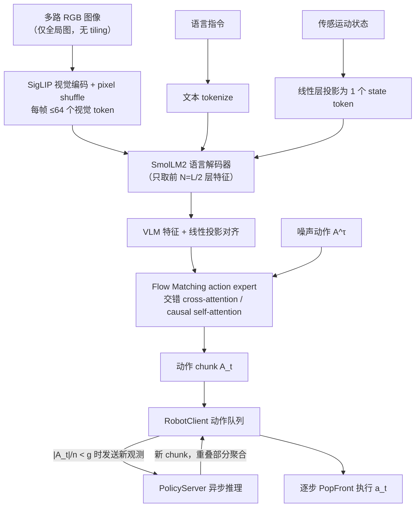
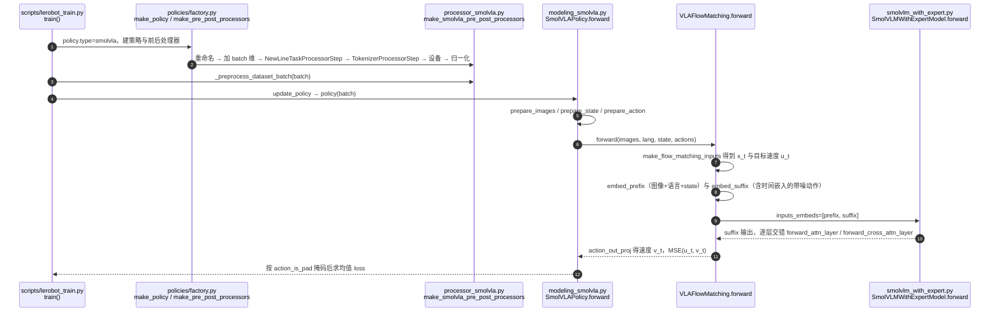
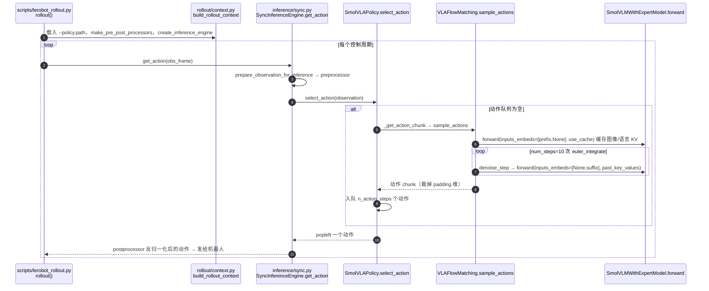

# SmolVLA

**SmolVLA**（[arXiv:2506.01844](https://arxiv.org/abs/2506.01844)，[GitHub](https://github.com/huggingface/lerobot)）是 [Khushi 的 VLA 演进长文](https://x.com/starlitmatcha/status/2116918927913804223) 中单独成节介绍的模型之一。本页依据 arXiv 摘要页与该长文；技术细节以论文正文为准。

## 一句话定义

**SmolVLA 是小而高效、由社区数据驱动的 VLA：可在单 GPU 上训练、在消费级 GPU 甚至 CPU 上部署，并用解耦感知/动作预测与执行的异步推理栈提高控制频率。**

## 英文缩写速查

| 缩写 | 英文全称 | 简要说明 |
|------|----------|----------|
| VLA | Vision-Language-Action | 视觉–语言–动作模型 |
| VLM | Vision-Language Model | 视觉语言模型 |
| SigLIP | Sigmoid Loss for Language-Image Pre-training | 图文匹配视觉编码器 |

## 为什么重要

- 在长文的演进线里属于「轻量、可微调的 flow-matching 路线」。
- 摘要要点：论文摘要称：SmolVLA 是 small、efficient、community-driven 的 VLA，大幅降低训练与推理成本且保持有竞争力的性能；设计为可单 GPU 训练、消费级 GPU 或 CPU 部署；引入异步推理栈，使感知与动作预测与动作执行解耦，配合 chunked 动作生成获得更高控制率；性能可比 10 倍大的 VLA；并开源全部代码、预训练模型与训练数据。

## 流程总览

图依据：论文 §3.1 模型结构、§3.3 异步推理（Algorithm 1 / Fig.2）。

## 长文的讲法（作者表述）

文章把它作为「真正能拿来微调」的轻量选项：约 450M 参数（约为 OpenVLA 的 1/16），真实世界基础模型在不足 3 万条社区共享数据 episode 上预训练；基于 SmolVLM2（SigLIP 图像编码器 + SmolLM2 语言模型），与 π0 一样用 flow matching 输出连续动作 chunk；只用 VLM 语言解码器的前一半层、每图压缩为 64 个视觉 token；异步推理在执行当前 chunk 时就请求下一个 chunk，文章称吞吐大约翻倍、等待减少，代价是排队的动作基于更早的观测。

## 核对

- **arXiv：** [2506.01844](https://arxiv.org/abs/2506.01844)（提交 2025-06-02），作者：Shukor, Aubakirova, Capuano, Kooijmans, Palma, Zouitine 等（arXiv 摘要页前 6 位）
- 论文摘要与文章一致的部分：小型、社区数据、异步推理、flow matching 之外的「10 倍更大 VLA 可比」；文章里的 450M、前一半层、64 token、「吞吐翻倍」等具体数字来自文章，未在摘要中核对。lerobot 仓库 README 的 VLA 模型列表含 SmolVLA（文档 policy_smolvla_README），仓库 git ls-remote 可达。
- 论文 §4.3 正文核对：主模型 450M 参数（其中动作专家约 100M），只用 VLM 内 LLM 的前 16 层，动作 chunk n=50，flow matching 推理固定 10 步；预训练冻结 VLM、只训动作专家。§4.6 实测异步推理把 Pick-Place 平均完成时间从 13.75 s 降到 9.7 s（论文称约快 30%），60 s 定时内完成 19 次 vs 9 次——文章的「吞吐大约翻倍」对应的是后一个定时计数口径。

## 评测

以下数字均来自论文 §4.5–4.6（Table 2–5、Fig.5），成功率单位 %：

| 设置 | SmolVLA (0.45B) | 主要对照 | 备注 |
|------|-----------------|----------|------|
| LIBERO 平均（Spatial/Object/Goal/Long） | 87.3 | π0 (3.3B，机器人数据预训练) 86.0；OpenVLA (7B) 76.5 | SmolVLA 不做机器人数据预训练，仅 VLM 初始化 |
| Meta-World 平均（Easy→Very Hard） | 57.3 | π0 (3.5B) 47.9；TinyVLA 31.6 | 2.25B 版本达 68.24 |
| 真机 SO-100 三任务平均（多任务训练） | 78.3 | π0 (3.5B) 61.7；ACT（单任务）48.3 | Pick-Place / Stacking / Sorting = 75 / 90 / 70 |
| 真机 SO-101 Pick-Place-Lego（单任务，ID / OOD） | 90 / 50 | ACT 70 / 40 | SO-101 数据未参与预训练 |
| 社区数据预训练消融（SO-100 平均） | 78.3（有预训练） | 51.7（无预训练，多任务）；40（无预训练，单任务） | Table 5 |
| 同步 vs 异步推理（SO-100 平均成功率） | 异步 73.3 | 同步 78.3 | 成功率相近，异步完成时间约快 30% |

- **消融（LIBERO，Table 6–13）：** 交错 cross/self-attention（85.5）优于单用 CA（79.0）或 SA（74.5）；动作 token 间因果注意力优于双向；flow matching（80.25）优于 L1 回归（75.25）；状态喂给 VLM（prefix）优于喂给动作专家；chunk 大小 10–50 较均衡，每 1–10 步刷新观测明显好于整段执行完再刷新。
- **评测口径注意：** 真机成功率是**子任务分段计分**（如 Pick-Place 抓到 0.5、放入 0.5），仿真才是二值成功；π0 真机是在目标数据上微调、ACT 是逐任务从零训练，三者训练口径不同。

## 与其他工作对比

| 维度 | SmolVLA（本页） | [π0](./paper-pi0.md) | [OpenVLA](./paper-openvla.md) | [ACT](./paper-act.md) |
|------|-----------------|------|---------|-----|
| 参数量 | 0.45B（动作专家约 0.1B） | 3.3B | 7B | 约 80M |
| 动作生成 | flow matching 连续 chunk | flow matching 连续 chunk | 离散动作 token 自回归 | CVAE 回归 chunk |
| 预训练数据 | 约 23k 条社区 SO-100 轨迹（单一本体） | 约 1 万小时跨本体数据 | 约 100 万条轨迹（OXE） | 无（逐任务从零训） |
| 部署门槛 | 单 GPU 训练，消费级 GPU / CPU 推理 | 需较大显存 | 需较大显存 | 轻量 |
| 推理栈 | 内置异步推理（观测/预测与执行解耦） | 同步 | 同步 | 同步 |

- **与 π0 的关系最近：** 同为「VLM + flow matching 动作专家」，SmolVLA 的取舍是砍 VLM 深度、压视觉 token、冻结骨干；论文称相对 π0 训练快约 40%、显存省 6 倍，但 LIBERO 上只与机器人预训练版 π0 打平，并未全面超越。
- **与 ACT 的分工：** ACT 是单任务小模型基线；SmolVLA 证明了在同样低成本硬件（SO-100/101）上，语言条件多任务 VLA 已可以超过单任务 ACT。
- **异步推理不绑定模型：** 论文 §5 明确它与模型无关，任何输出动作 chunk 的策略（包括 [action chunking](../methods/action-chunking.md) 系）都能套用。

## 源码运行时序图

以下依据 LeRobot 固定提交 `9e5ee9859480e425a97a6836bb3fee479539beb5` 的 `src/lerobot/policies/smolvla/`，节点均为该提交里真实存在的文件/类/函数（本次已通读 `modeling_smolvla.py`、`smolvlm_with_expert.py`、`processor_smolvla.py`、`configuration_smolvla.py` 与 `inference/sync.py`）。

### 训练（`lerobot-train`）

### 推理（`lerobot-rollout`，同步引擎）

## LeRobot 实现要点

- **入口与权重：** `policy.type=smolvla`；预训练权重 [`lerobot/smolvla_base`](https://hf.co/lerobot/smolvla_base)（LeRobot 文档 `docs/source/smolvla.mdx` 称其为 450M 模型）；`configuration_smolvla.py` 默认 VLM 为 `HuggingFaceTB/SmolVLM2-500M-Video-Instruct`。
- **默认超参（读自 `configuration_smolvla.py`）：** `chunk_size=50`、`n_action_steps=50`、`num_steps=10`（flow matching 去噪步）、`num_vlm_layers=16`、`self_attn_every_n_layers=2`、`expert_width_multiplier=0.75`、`max_state_dim=max_action_dim=32`、输入图 resize-with-pad 到 512×512、`freeze_vision_encoder=True`、`train_expert_only=True`。与论文 §3.1 的「只取前 16 层、n=50、10 步」一致；`0.75` 的专家宽度倍率论文中的取值本页未核实。
- **交错注意力在代码里的样子：** `SmolVLMWithExpertModel.forward` 中，`layer_idx % self_attn_every_n_layers == 0` 的层走 `forward_attn_layer`（自注意力），其余走 `forward_cross_attn_layer`（专家对 VLM KV 做交叉注意力）；填充 KV cache 的那次前向全部走自注意力。
- **推理加速：** `sample_actions` 先对 prefix（图像+语言+state）跑一次并缓存 KV，再用 `euler_integrate` 反复只算 suffix；`select_action` 用 `_queues[ACTION]` 队列逐步弹出。
- **⚠ 与上文流程图/论文异步栈的版本差异：** 论文 §3.3 与本页「流程总览」里的 `RobotClient / PolicyServer` 是论文/旧版 `lerobot.async_inference` 的叫法；在上述固定提交里该目录已不存在，`docs/source/remote_inference.mdx` 明确写「`lerobot[async]` extra 与 `lerobot.async_inference` 已被 `lerobot[remote]`、`lerobot-policy-server`、`lerobot-rollout --inference.type=remote` 取代，旧的 chunk 阈值与聚合权重不可直接沿用」。因此异步推理现在对应 `src/lerobot/remote_inference/`（`RemoteClient`、`PolicyServer`）与 `inference/rtc.py`，不是论文里的同名类。
- **限制：** 默认冻结视觉编码器、只训动作专家，微调时相机键需用 `--rename_map` 对齐 `camera1/2/3`（见 `docs/source/smolvla.mdx`）；RTC 路径下不支持 `select_action`（代码里 `assert not self._rtc_enabled()`），须走 `predict_action_chunk`。
- **LeRobot 侧未复现论文数字：** 本页评测表全部来自论文；LeRobot 仓库未提供与之对应的复现表（SmolVLA 的 docs 未列 LIBERO 成功率）。

## 结论

**SmolVLA 把「flow-matching VLA」压到 0.45B、单本体社区数据也能训出可用策略，是低成本硬件上可复现的 VLA 基线，而不是大模型的替代品。**

- 0.45B 参数在 LIBERO（87.3）与 SO-100 真机（78.3）上与 3B 级 π0 打平或更好
- 社区数据预训练是关键：真机平均从 51.7 提到 78.3
- 异步推理成功率相近、完成时间约快 30%，且与模型无关、可迁移
- 局限（论文 §5.1）：预训练只有 SO-100 单一本体、约 23k 轨迹；主要验证短时程任务；VLM 骨干偏 OCR/文档预训练，未必最适合机器人

## 关联页面

- [vla](../methods/vla.md)
- [action-chunking](../methods/action-chunking.md)
- [flow-matching-embodied-policy](../concepts/flow-matching-embodied-policy.md)
- [lerobot](../entities/lerobot.md)
- [paper-ros2smolvla](../entities/paper-ros2smolvla.md)
- [paper-smolvla-onnx-libero](../entities/paper-smolvla-onnx-libero.md)
- [paper-mamba-smolvla-expert](../entities/paper-mamba-smolvla-expert.md)
- [paper-pi0](../entities/paper-pi0.md)
- [paper-openvla](../entities/paper-openvla.md)
- [vla-history-rt1-to-molmoact-technology-map](../overview/vla-history-rt1-to-molmoact-technology-map.md)

## 参考来源

- [smolvla_arxiv_2506_01844.md](../../sources/papers/smolvla_arxiv_2506_01844.md)
- [x_starlitmatcha_vla_history_rt1_to_molmoact2_2026-11-01.md](../../sources/blogs/x_starlitmatcha_vla_history_rt1_to_molmoact2_2026-11-01.md)
- [lerobot 仓库归档](../../sources/repos/lerobot.md)：固定提交 `9e5ee98…` 的 `policies/smolvla/` 源码与 `docs/source/smolvla.mdx`、`remote_inference.mdx`
- [arXiv:2506.01844](https://arxiv.org/abs/2506.01844)
- [arXiv PDF](https://arxiv.org/pdf/2506.01844)：已通读方法部分与实验：§3.1 模型结构、§3.2 预训练数据、§3.3 异步推理、§4 实验（Table 2–13、Fig.5）、§5.1 局限
