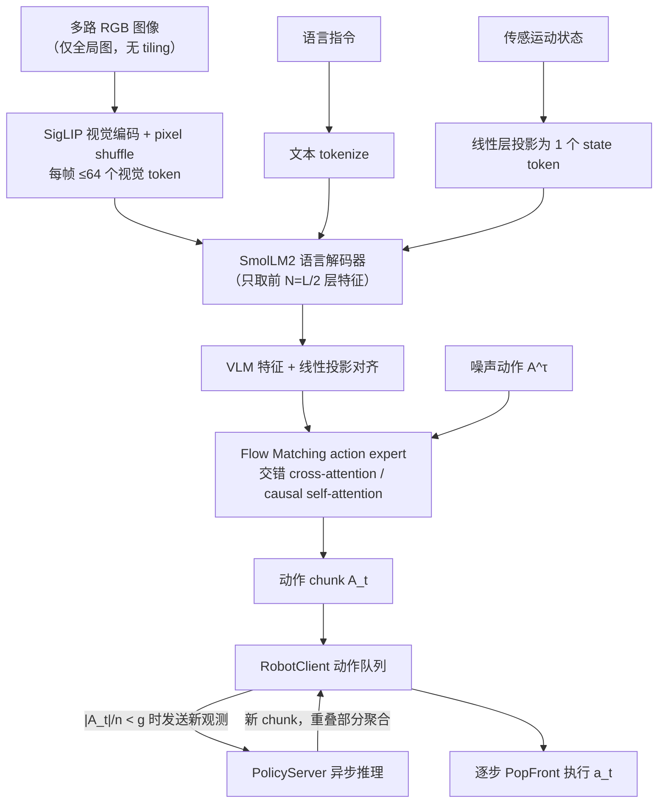

# SmolVLA

**SmolVLA**（[arXiv:2506.01844](https://arxiv.org/abs/2506.01844)，[GitHub](https://github.com/huggingface/lerobot)）是 [Khushi 的 VLA 演进长文](https://x.com/starlitmatcha/status/2116918927913804223) 中单独成节介绍的模型之一。本页依据 arXiv 摘要页与该长文；技术细节以论文正文为准。

## 一句话定义

**SmolVLA 是小而高效、由社区数据驱动的 VLA：可在单 GPU 上训练、在消费级 GPU 甚至 CPU 上部署，并用解耦感知/动作预测与执行的异步推理栈提高控制频率。**

## 英文缩写速查

| 缩写 | 英文全称 | 简要说明 |
|------|----------|----------|
| VLA | Vision-Language-Action | 视觉–语言–动作模型 |
| VLM | Vision-Language Model | 视觉语言模型 |
| SigLIP | Sigmoid Loss for Language-Image Pre-training | 图文匹配视觉编码器 |

## 为什么重要

- 在长文的演进线里属于「轻量、可微调的 flow-matching 路线」。
- 摘要要点：论文摘要称：SmolVLA 是 small、efficient、community-driven 的 VLA，大幅降低训练与推理成本且保持有竞争力的性能；设计为可单 GPU 训练、消费级 GPU 或 CPU 部署；引入异步推理栈，使感知与动作预测与动作执行解耦，配合 chunked 动作生成获得更高控制率；性能可比 10 倍大的 VLA；并开源全部代码、预训练模型与训练数据。

## 流程总览

图依据：论文 §3.1 模型结构、§3.3 异步推理（Algorithm 1 / Fig.2）。

## 长文的讲法（作者表述）

文章把它作为「真正能拿来微调」的轻量选项：约 450M 参数（约为 OpenVLA 的 1/16），真实世界基础模型在不足 3 万条社区共享数据 episode 上预训练；基于 SmolVLM2（SigLIP 图像编码器 + SmolLM2 语言模型），与 π0 一样用 flow matching 输出连续动作 chunk；只用 VLM 语言解码器的前一半层、每图压缩为 64 个视觉 token；异步推理在执行当前 chunk 时就请求下一个 chunk，文章称吞吐大约翻倍、等待减少，代价是排队的动作基于更早的观测。

## 核对

- **arXiv：** [2506.01844](https://arxiv.org/abs/2506.01844)（提交 2025-06-02），作者：Shukor, Aubakirova, Capuano, Kooijmans, Palma, Zouitine 等（arXiv 摘要页前 6 位）
- 论文摘要与文章一致的部分：小型、社区数据、异步推理、flow matching 之外的「10 倍更大 VLA 可比」；文章里的 450M、前一半层、64 token、「吞吐翻倍」等具体数字来自文章，未在摘要中核对。lerobot 仓库 README 的 VLA 模型列表含 SmolVLA（文档 policy_smolvla_README），仓库 git ls-remote 可达。

## 关联页面

- [vla](../methods/vla.md)
- [action-chunking](../methods/action-chunking.md)
- [flow-matching-embodied-policy](../concepts/flow-matching-embodied-policy.md)
- [lerobot](../entities/lerobot.md)
- [paper-ros2smolvla](../entities/paper-ros2smolvla.md)
- [paper-smolvla-onnx-libero](../entities/paper-smolvla-onnx-libero.md)
- [paper-mamba-smolvla-expert](../entities/paper-mamba-smolvla-expert.md)
- [paper-pi0](../entities/paper-pi0.md)
- [paper-openvla](../entities/paper-openvla.md)
- [vla-history-rt1-to-molmoact-technology-map](../overview/vla-history-rt1-to-molmoact-technology-map.md)

## 参考来源

- [smolvla_arxiv_2506_01844.md](../../sources/papers/smolvla_arxiv_2506_01844.md)
- [x_starlitmatcha_vla_history_rt1_to_molmoact2_2026-11-01.md](../../sources/blogs/x_starlitmatcha_vla_history_rt1_to_molmoact2_2026-11-01.md)
- [arXiv:2506.01844](https://arxiv.org/abs/2506.01844)
- [arXiv PDF](https://arxiv.org/pdf/2506.01844)：已通读方法部分（实验与附录以略读为准）：§3.1 模型结构、§3.2 预训练数据、§3.3 异步推理
