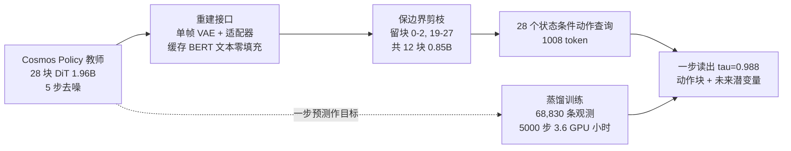
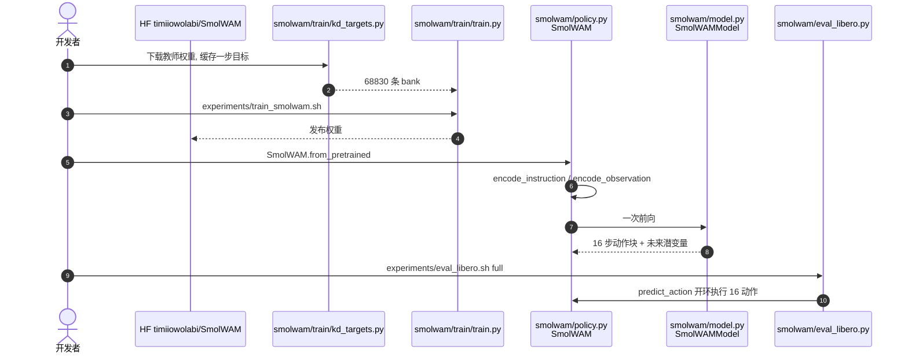

---

type: entity
tags: [paper, world-action-model, distillation, edge-deployment, libero, cosmos-policy, flow-matching, manipulation, ml-collective]
status: complete
updated: 2026-10-12
arxiv: "2610.13740"
project_id: smolwam
project: https://smolwam.vercel.app/
code: https://github.com/iitimii/SmolWAM
venue: "NeurIPS 2026 Workshop on Robot Learning with World Models · arXiv"
related:
  - ../overview/embodied-station-34-papers-spatial-grounding-technology-map.md
  - ../concepts/world-action-models.md
  - ../methods/generative-world-models.md
  - ../tasks/manipulation.md
  - ./paper-shenlan-wm-11-cosmos-policy.md
  - ./libero-benchmark.md
  - ./paper-agile-wam.md
  - ./paper-smolvla-onnx-libero.md
sources:
  - ../../sources/blogs/wechat_embodied_station_34_papers_spatial_grounding_2026-10-12.md
  - ../../sources/papers/smolwam_arxiv_2610_13740.md
  - ../../sources/sites/smolwam-vercel-app.md
  - ../../sources/repos/smolwam.md
summary: "SmolWAM（arXiv:2610.13740，ML Collective）：保留 Cosmos Policy 预训练主干，单帧编码、缓存文本、保边界剪到 12/28 块并一步流读出，0.88B 参数、57 ms、LIBERO 95.5%（教师 98.2%）；仅仿真无真机，长时域受剪枝影响更大；代码与权重已开源。"
---

# SmolWAM：把世界-动作模型压到边缘设备

**SmolWAM**（*A Latent World-Action Model for Robotic Manipulation on Edge Devices*，[arXiv:2610.13740](https://arxiv.org/abs/2610.13740)，[项目页](https://smolwam.vercel.app/)，[代码](https://github.com/iitimii/SmolWAM)）由 **ML Collective**（Timi Owolabi 等）提出：以 NVIDIA 的 Cosmos Policy（1.96B）为教师，保留其预训练主干并重建推理接口，得到 0.88B 的学生模型，一次前向同时给出 16 步动作块与未来潜变量。

## 一句话定义

**通过单帧视觉编码、缓存 BERT 文本、保边界深度剪枝和一步流读出，把视频扩散式 WAM 蒸馏成 57 ms 的边缘可用模型，同时保留受监督的未来潜变量“世界头”。**

## 英文缩写速查

| 缩写 | 英文全称 | 简要说明 |
|------|----------|----------|
| WAM | World Action Model | 同时预测动作与未来观测的模型 |
| DiT | Diffusion Transformer | 教师与学生的主干 |
| VAE | Variational Autoencoder | Wan2.1 视频 VAE，学生只做单帧编码 |
| LIBERO | Lifelong Robot Learning Benchmark | 评测基准：Spatial/Object/Goal/Long 四套件 |
| KD | Knowledge Distillation | 以教师一步预测作训练目标 |
| LA | Latent Action | 变体 SmolWAM-LA 引入的潜动作 token |

## 为什么重要

- **WAM 的成本门槛：** 教师每个动作块 624 ms、42.6 TFLOP、7.55 GiB；SmolWAM 为 57 ms、2.30 TFLOP、2.36 GiB。
- **不丢掉世界预测：** 高效策略多半去掉世界模型；SmolWAM 保留受监督的未来潜变量，只是推理时不解码。
- **训练便宜：** 3.6 GPU 小时（1×A100），适合小团队复现。
- **含有价值的负面结果：** 论文报告多项失败（见下），对做剪枝/蒸馏的人有直接参考价值。

## 方法栈 / 流程总览

## 方法

- **单帧视觉潜变量：** 每路相机只用 Wan2.1 编码器（54M）编一次，0.5M 适配器映射到片段模式；无适配器时教师动作 L1 由 0.0089 升到 0.038，有适配器回到 0.0092。
- **缓存文本 + 零填充：** BERT-base 特征投影后零填充到 512 位以保留注意力 sink；截断到 32/128 位会使教师闭环 0/5，解析恢复 softmax 质量后 5/5。
- **保边界深度剪枝：** 按 block influence 保留块 0–2 与 19–27（12/28 块）；去掉块 1、26 或 27 全败，同时去掉 12–15 四个近恒等块也全败，效应不可叠加。
- **状态条件动作查询：** 零初始化 MLP 把状态加到 28 个动作查询，总上下文 1,008 token（教师 1,764）。
- **一步读出：** τmax≈0.988、固定噪声；未来潜变量作为世界头，训练时监督、推理不解码。
- **训练：** Cosmos Policy 发布的 1,700 条成功示范每 4 步抽样得 68,830 观测；L1 对示范与教师目标，外加 0.1 权重状态/价值项；前 1,000 步用教师布局再切紧凑布局；AdamW，batch 32，bf16。

## 源码运行时序图

官方仓库 [iitimii/SmolWAM](https://github.com/iitimii/SmolWAM)（归档 [sources/repos/smolwam.md](../../sources/repos/smolwam.md)）：

- **最短复现路径：** `pip` 安装 → `examples/quickstart.py` → `experiments/eval_libero.sh smoke`；README 预期完整协议 382/400（95.5%），推理成本用 `experiments/bench.sh`。

## 工程实践

| 项 | 建议 |
|----|------|
| 先跑 | `examples/quickstart.py` 与 smoke 评测，再跑 full |
| 硬件 | A100-40GB 上的数字；README 另给 Apple M2 Pro（mps）单回合约 0.9 s/查询 |
| 反应性 | 16 动作块开环；教师 8 步后重查询在筛选集 0 回合成功，不能靠高频重查补偿 |
| 量化 | INT8 存储 1.64→0.85 GiB，但延迟未降且为 bf16 模拟 |
| 开源状态 | **已开源**：Apache-2.0 代码、HF 权重、论文 PDF、复现脚本；评测教师需上游 cosmos-policy |

## 实验与评测

- **LIBERO 完整协议（400 回合）：** SmolWAM 95.5%（Spatial 99.0、Object 100.0、Goal 94.0、Long 89.0），教师 98.2%（97.0/100.0/99.0/97.0），约为教师的 97%。
- **成本：** 0.88B vs 1.96B；2.30 vs 42.6 TFLOP；57 vs 624 ms；2.36 vs 7.55 GiB；57 ms 中 Transformer 37、VAE 13、预处理 7。
- **基线与变体（筛选集）：** 教师单步单帧 126 ms 无损；8 块 0.60B 83.3%；INT8 91.7%；SmolWAM-LA 53.3%；剪枝+LoRA 蒸馏完整 87.5%（较早 L4 管线）。
- **世界头：** 前瞻 16 步潜变量 L1 0.101 vs 复制当前帧 0.133；光流端点误差 1.43 vs 1.63 px；LPIPS 0.128 vs 0.115，说明捕捉运动而非纹理。
- **负面结果：** 对世界头做奖励加权微调使成功率塌到 5.0–16.7%。
- **可比性：** 教师完整成绩与 LoRA 基线来自 L4 管线，SmolWAM 延迟在 A100，需谨慎跨硬件比较；6 项计划消融未做。

## 结论

**强预训练 WAM 能承受大幅接口与深度改动，前提是逐项蒸馏而非零样本直接剪；代价主要落在长时域任务。**

1. **接口先于剪枝** — 单帧编码+适配器、文本缓存可几乎无损。
2. **保留首尾块** — 边界块去掉即失败，中间近恒等块也不能成组去除。
3. **世界头可留** — 低成本保留运动预测，但不改善外观。
4. **别用无动作锚的辅助目标训主干** — 奖励加权微调导致崩塌。
5. **上真机前先验证长时域** — Long 套件掉到 89.0%，且未做真机。

## 局限与风险

- 仅 LIBERO 仿真，未做 RoboCasa 与真机。
- 缩减深度对 LIBERO-Long 伤害更大，失败多停在第二个子目标。
- 离线验证 L1 约为教师的 10 倍，不是闭环成功的好代理。
- 块开环限制反应性；INT8 与端侧实测未完成。

## 与其他工作对比

| 对照 | 差异读法 |
|------|----------|
| [Cosmos Policy（深蓝解读）](./paper-shenlan-wm-11-cosmos-policy.md) | 教师；SmolWAM 为其蒸馏学生 |
| [Agile-WAM](./paper-agile-wam.md) | 同为高效 WAM 路线 |
| [SmolVLA ONNX LIBERO](./paper-smolvla-onnx-libero.md) | 高效 VLA 无世界模型，对照取舍 |
| [LIBERO 基准](./libero-benchmark.md) | 评测基准 |

## 关联页面

- [34 篇空间落地技术地图（汇总页）](../overview/embodied-station-34-papers-spatial-grounding-technology-map.md)
- [世界-动作模型](../concepts/world-action-models.md)
- [生成式世界模型](../methods/generative-world-models.md)
- [Cosmos Policy 解读](./paper-shenlan-wm-11-cosmos-policy.md)
- [LIBERO 基准](./libero-benchmark.md)

## 参考来源

- [具身智能小站 34 篇周报](../../sources/blogs/wechat_embodied_station_34_papers_spatial_grounding_2026-10-12.md) — 线索来源
- [smolwam_arxiv_2610_13740.md](../../sources/papers/smolwam_arxiv_2610_13740.md) — 论文摘录
- [smolwam-vercel-app.md](../../sources/sites/smolwam-vercel-app.md) — 项目页核查
- [smolwam.md](../../sources/repos/smolwam.md) — 仓库归档
- [arXiv:2610.13740](https://arxiv.org/abs/2610.13740)

## 推荐继续阅读

- [SmolWAM 项目页](https://smolwam.vercel.app/)
- [SmolWAM GitHub](https://github.com/iitimii/SmolWAM)
- [SmolWAM 权重](https://huggingface.co/timiiowolabi/SmolWAM)
- [Cosmos Policy 仓库](https://github.com/NVlabs/cosmos-policy)
