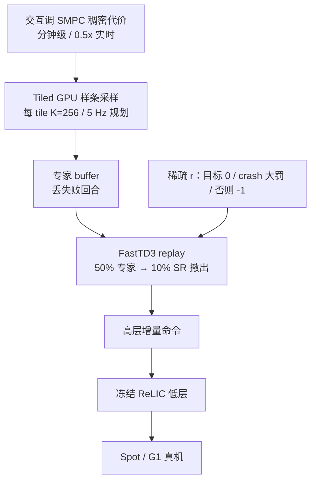

# SMPC-to-RL：稀疏奖励全身 Loco-Manipulation

**SMPC-to-RL**（*Learning Loco-Manipulation From SMPC Demonstrations With Sparse Offline-to-Online RL*，[arXiv:2608.12063](https://arxiv.org/abs/2608.12063)，CoRL 2026，[项目页](https://pages.rai-inst.com/smpc2rl/)）由 **RAI Institute / 慕尼黑工业大学 / 苏黎世联邦理工**（Schuck / Sorokin / Manni / Ta / Schoellig / Hutter / Le Cleac'h / Brüdigam）提出：把 **采样 MPC 只放在仿真里当专家数据机**，再用 **纯稀疏任务奖励** 做 offline-to-online 离策略 RL。高层策略接冻结的 **ReLIC** 低层全身稳定，在带臂 **Spot** 与 **Unitree G1** 上部署推、扶、滚等接触任务。本页依据 v2 全文通读（见 [来源归档](../../sources/papers/smpc2rl_arxiv_2608_12063.md) 的核对范围）。

## 一句话定义

**别手调稠密奖励：用分钟级可调的仿真 SMPC 解决探索，让 FastTD3 只优化「到没到、摔没摔」。**（作者自述：SMPC 仍用稠密代价，只是可交互调，见 §3.3。）

## 英文缩写速查

| 缩写 | 英文全称 | 简要说明 |
|------|----------|----------|
| SMPC | Sampling-based Model Predictive Control | 本文的仿真专家：样条采样轨迹 + warm-start，不部署到真机 |
| FastTD3 | Fast Twin Delayed DDPG | 大规模并行 off-policy 配方；本文改 replay 混合与有界 critic |
| ReLIC | RAI 低层全身机动控制器（引文 [4]） | 冻结的低层策略，跟踪基座速度与臂关节并保平衡 |
| O2O | Offline-to-Online RL | 先用专家转移垫 critic，成功率过 10% 后撤出转纯在线 |
| IQL | Implicit Q-Learning | 表 2 的离线 RL 基线 |
| DP | Diffusion Policy | 表 2 的模仿学习基线 |
| G1 | Unitree G1 Humanoid | 双足真机平台；本文任务为推箱 |
| Spot | Boston Dynamics Spot | 带臂四足；reach / 推箱 / 扶胎 / 滚胎 |

## 为什么重要

- **奖励 shaping 才是 loco-manip 的墙（作者论点，§1）：** 带臂四足滚重胎必须边踩边推，改一项稠密项就要再训一轮。SMPC 在单张 RTX 5090 上约 **0.5× 实时**（§3.3），代价可以交互改；附录 C 称每任务调参 <1 小时。
- **和同实验室 [Sumo](../methods/sumo.md) 方向相反：** Sumo 是部署期 **MPC-over-RL**（在线 CEM）；本文把 SMPC **离线教书**，上真机的是神经网络 + 冻结低层。
- **稀疏目标让仿真策略比教师更快：** 任务时长一致短于 SMPC，部分任务改进 **>50%**，时长标准差降 **11–45%**（§4 Q1，图 5）。这是仿真统计，真机未对比速度。
- **开源边界：** 项目页（2026-11-12 重核）仍无本文代码，只链接 [judo](../../sources/repos/judo.md)，那是通用采样 MPC 工具箱，不是本管线。

## 核心原理与流程总览

### 管线

| 模块 | 作用（出处） |
|------|--------------|
| **高层 \(a_{\mathrm{high}}\)** | 增量 \([\Delta v_{\mathrm{cmd}},\Delta q_{\mathrm{cmd}}^{\mathrm{arm}},\Delta h_{\mathrm{cmd}},\Delta p_{\mathrm{cmd}}]\)；Spot 不命令身高/俯仰（§3.1） |
| **低层 ReLIC** | 冻结；出 \(q_{\mathrm{target}}=[q_{\mathrm{legs}},q_{\mathrm{arm}}]\)，腿保平衡、臂跟命令（§3.1） |
| **稀疏 \(r\)** | 到目标 0；crash \(-2/(1-\gamma)\)（\(\gamma=0.99\)）；否则 \(-1\)；实现再乘 0.01（式 1、表 3） |
| **Replay 混合** | 训练初期 replay 中 50% 为专家转移；成功率过 \(\eta=0.1\) 后撤出（§3.2、表 3） |
| **有界 critic** | 末层 `tanh` 后仿射到理论 min/max（最好 0，最差 \(-2/(1-\gamma)\)）（附录 B.1） |
| **SMPC 采数** | 样条控制点 + tiled GPU；约 100 万样本/小时；最难任务约 400 万样本 / 4 GPU 小时（§3.3、图 6） |

稀疏奖励的尺度：无穷地给 \(-1\) 的折现和是 \(-1/(1-\gamma)\)，crash 罚两倍，使智能体宁可耗着也不摔（§3.2）。

### 流程总览

数据采集与部署共用同一分层接口，所以专家和 RL 可以换同一套低层（§3.1）。

### SMPC 专家怎么采（附录 C，表 4，算法 1）

类似 predictive sampling [23]：随机采样 + 上一次 elite 的 time-shift warm-start，论文称不需要 MPPI。动作用 \(N_c=10\) 个样条控制点插到地平线 \(T=50\)（50 Hz），每次只提交 \(N_e=10\) 步，即 5 Hz 规划、50 Hz 动作块。每 tile 把 checkpoint 状态广播到 \(K=256\) 条并行 rollout，按折扣 SMPC 代价选 elite，再把 committed 步（带稀疏奖励标签）写入专家 buffer，失败回合丢弃。所以稠密代价只活在仿真教师里，RL 始终只见稀疏 \(r\)。

### 源码运行时序图

**不适用**（截至 2026-11-12）：项目页与论文未提供训练/部署仓；[judo](../../sources/repos/judo.md) 不能复现本文 tiled 采数 + FastTD3 + ReLIC 栈。

## 工程实践

| 项 | 论文设定 / 建议 |
|----|----------------|
| **SMPC 调参** | 从距离目标 + 摔倒惩罚起步，再加夹爪-物体奖励、躯干/腿触碰惩罚、动作平滑；滑块实时调；每回合观察 box push 10.1 s、tire roll 14.5 s（附录 C） |
| **单模态很重要** | 多模态 SMPC（踢/肩推/踩胎）让 Spot 滚胎策略完全学不起来，要靠更严的接触惩罚把行为收成单模态（§4 Q4，图 8） |
| **数据量** | 导航数据很少即可；滚胎约 4M 样本（§4 Q2，图 6）。附录 C 的分任务采数耗时 reach 1:39h、box 2:41h、upright 3:28h、tire roll 3:15h、G1 10:06h |
| **撤出时机** | 10% 成功率后停灌专家；保留过久几乎所有任务（reach 除外）变差，阈值 ≥50% 时 upright 与 roll 在步数上限内不收敛（附录 A，图 11） |
| **专家比例** | 默认 50%；滚胎低于 50% 无法收敛，更高比例在撤出后仍更稳（作者假设，附录 A，图 9） |
| **动作** | 用增量而不是绝对目标，才能在动作空间限加速度与速度（§3.2） |
| **训练配方** | buffer \(2^{24}\)、batch 8192、每步 8 次梯度；RL 训练 20–90 分钟（RTX 5090）；G1 动作正则 \(8\times10^{-4}\)、critic lr \(5\times10^{-4}\)（附录 B） |
| **Sim2Real** | 物体质量/尺寸/摩擦随机；actor 噪声观测、critic 精确观测（附录 B） |
| **真机** | Spot 机外推理 + WiFi；G1 机载；OptiTrack + 本体传感。箱 0.5 m 立方 1.2 kg，胎半径 0.33 m / 宽 0.34 m / **14.3 kg**（附录 D） |

## 实验与评测

| 设定 | 论文结果（出处） |
|------|------------------|
| 五任务仿真 | 近 100% SR，5 seed 方差小；**无专家数据则学不到任何东西**（图 4） |
| Spot 真机（十次运行） | reach 10/10、box push 9/10、tire upright 10/10、tire roll 8/10（§4 表 1）；G1 论文只说可部署，未给成功率 |
| 相对 SMPC 教师 | 任务时长一致更短；部分 >50%；时长标准差 −11–45%；教师统计用 4M 样本数据集，策略用 50k 无噪声仿真回合（图 5） |
| 基线（仿真，表 2） | FastTD3 稠密代价 / IQL / DP：box push 0.00 / 0.03 / 0.10，tire upright 0.00 / 0.01 / 0.01，tire roll 0.02 / 0.04 / 0.01；本文 0.99 / 1.00 / 0.98；reach 全部 1.00 |
| 数据量 | 简单任务不敏感；最难任务约 4M 才收敛（图 6） |
| 数据质量 | 采样环境 64/128/256：多数任务稳，滚胎掉点（图 7） |
| 有界 critic | critic lr 提到 \(8\times10^{-4}\) 时，无界 critic 出现尖峰掉点，有界更稳（图 10） |

## 与清单说法的对比核对

清单（Glen Berseth 的 CoRL 2026 阅读清单 P0 第 010 条，据摘要由 LLM 起草）：*Sampling-based MPC in simulation generates offline data so off-policy RL can learn loco-manipulation from sparse rewards without shaping.* 排序是清单作者用自身兴趣模型打分得来，不是论文质量评价。

| 清单说法 | 论文核对 |
|----------|----------|
| SMPC 在仿真里生成离线数据 | **相符**：SMPC 完全在仿真里跑，不上真机（摘要、§3.3） |
| off-policy RL 从稀疏奖励学 loco-manipulation | **基本相符，需加限定**：RL 阶段只用稀疏奖励，但并非从零学。无 SMPC 数据时「什么也学不到」（图 4），训练初期 50% replay 是专家数据，成功率过 10% 后撤出（§3.2） |
| 「无需 shaping」 | **限定**：作者自己承认 SMPC 仍要调稠密代价，只是可交互、分钟级、无需训练（§3.3），并非免调参；论文所称「tuning-free」指 RL 训练阶段 |
| 摘要未提 | 学的是**高层**策略，低层 ReLIC 全身控制器是预先训练并冻结的（§3.1）；这是「稀疏奖励可行」的重要前提 |
| 摘要未提 | 论文有真机：Spot 四任务 10 次运行 10/10、9/10、10/10、8/10（表 1），G1 未量化；超过教师的结论来自仿真时长（图 5） |

## 结论

SMPC-to-RL 把可交互规划专家转成高效策略，收益主要在既有数据分布附近，不能解释为全局最优。

- 先验证 SMPC 专家覆盖、离线热启动与在线 FastTD3 的接口。
- 把仿真任务时长与真机成功率分开汇报，不能由仿真更快推断真机更快。
- 新物体或户外部署需补做感知与低层适配，并明确项目视频和 judo 不等于官方可运行实现。

## 局限与风险

**作者自述（§6）：**
- 最优性是局部的，策略绑在 SMPC 数据分布附近，不期望发现根本不同的全局策略；超参（网络尺寸、学习率）影响结果。
- 低层冻结，难适应任务级物理扰动；作者建议后期在线阶段解冻。
- 真机部署依赖状态信息（OptiTrack 等），户外 / 非结构化需视觉训练或蒸馏。

**阅读时看到的未验证之处（本页判断）：**
- 真机成功率只有 Spot 的 10 次运行，样本小；G1 无量化，失败原因未分析。
- 「超过教师」比较的是仿真任务时长，教师统计（4M 样本）与策略统计（50k 回合）口径不同，作者归因于教师并行环境数有限，没有在真机比速度。
- 多个结论是作者假设而非检验过的机制（如数据量的 critic 覆盖解释、更高专家比例更稳的原因）。
- 只覆盖 Spot 与 G1 的箱 / 轮胎任务，换物体或接触构型的泛化论文没有测。
- **无官方实现**，不能把项目页视频或 judo 安装当成可部署包。

## 关联页面

- [Loco-Manipulation](../tasks/loco-manipulation.md) — 任务主线；本文是稀疏 RL × SMPC 数据机
- [Sumo](../methods/sumo.md) — RAI 反向层级对照
- [MPC vs RL](../comparisons/mpc-vs-rl.md) — 混合架构选型
- [Online vs Offline RL](../comparisons/online-vs-offline-rl.md) — O2O 混合轴
- [15 分钟人形行走（FastTD3）](./paper-notebook-learning-sim-to-real-humanoid-locomotion-in-15-m.md) — off-policy 配方
- [MPC-RL](./paper-mpc-rl-humanoid-locomotion-manipulation.md) — 训练期 MPC 指导的另一条轴
- [Unitree G1](./unitree-g1.md) — 双足真机
- [mjlab](./mjlab.md) — 训练与采数共用的 GPU 仿真栈
- [Sim2Real](../concepts/sim2real.md) — DR 与非对称 critic
- [奖励设计](../concepts/reward-design.md) — 稠密 shaping 与稀疏奖励的对照
- [Model Predictive Control](../methods/model-predictive-control.md) — SMPC 作为专家而非部署控制器
- [MPPI](../methods/mppi.md) — 论文称不需要的更复杂采样 MPC
- [TD3](../methods/td3.md) — FastTD3 的基础算法
- [Diffusion Policy](../methods/diffusion-policy.md) — 表 2 的模仿基线
- [世界模型执行 10 篇技术地图](../overview/world-model-exec-10-papers-technology-map.md) — 同批策展

## 参考来源

- [smpc2rl_arxiv_2608_12063.md](../../sources/papers/smpc2rl_arxiv_2608_12063.md)
- [项目页归档](../../sources/sites/rai-inst-smpc2rl.md)
- [judo 对照仓](../../sources/repos/judo.md) — **不是**本文官方实现
- [具身智能小站 10 篇盘点（2026-08-19）](../../sources/blogs/wechat_embodied_station_world_model_exec_10_papers_2026-08-19.md)
- Schuck et al. — <https://arxiv.org/abs/2608.12063>
- 项目页 — <https://pages.rai-inst.com/smpc2rl/>

## 继续阅读

- 项目页视频与方法叙事 — <https://pages.rai-inst.com/smpc2rl/>
- Sumo（同实验室 MPC-over-RL）— <https://rai-institute.github.io/sumo/>
- judo 采样 MPC 工具箱（**不是**本文官方仓）— <https://github.com/rai-opensource/judo>
- Seo et al., *FastTD3* — <https://arxiv.org/abs/2505.22642>
- Ball et al., *Efficient Online Reinforcement Learning with Offline Data* — 论文引文 [10]
- Seo et al., *Learning Sim-to-Real Humanoid Locomotion in 15 Minutes* — <https://arxiv.org/abs/2512.01996>
