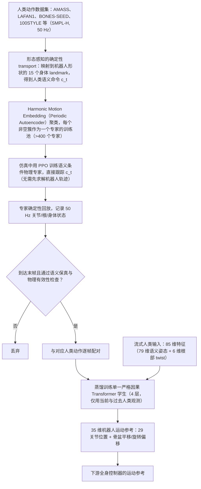

# SMR：从人体动作语义学习流式人形动作重定向

**SMR**（*SMR: Learning Streaming Motion Retargeting for Humanoids from Human Semantic*，[arXiv:2610.29169](https://arxiv.org/abs/2610.29169)）收录于 senlanke「具身运控lab」10-19–10-23 前沿论文动态（人形/四足）。本页依据**周报条目 + arXiv 摘要页**整理，流程图依据论文方法部分（见参考来源），未逐页核对实验数字；指标与结论以论文为准。

## 一句话定义

**SMR：从人体动作语义学习流式人形动作重定向——先训练物理专家跟踪机器人感知的任务空间语义目标，再将专家实际执行轨迹蒸馏到严格因果 Transformer；部署时只使用当前和历史人体观测生成动作参考。**

## 英文缩写速查

| 缩写 | 英文全称 | 简要说明 |
|------|----------|----------|
| RL | Reinforcement Learning | 强化学习 |
| WBC | Whole-Body Control | 全身控制 |

## 为什么重要

- 周报所述待解决的问题：几何重定向不保证动力学可执行，而双向全序列网络无法用于实时流式输入。

## 流程总览

图依据：论文 §3.1–§3.3 / Fig.1、Table 2。

## 核心机制

| 项 | 内容 |
|----|------|
| **arXiv** | [2610.29169](https://arxiv.org/abs/2610.29169) · [PDF](https://arxiv.org/pdf/2610.29169) |
| **作者（arXiv）** | Chun Gu, Juntong Zhang, Jingyu Li, Li Zhang |
| **机构（周报所述，未逐条核实）** | 复旦大学、上海创智学院、Logos Robotics Group |
| **arXiv 评论栏** | 17 pages, 6 figures. Project page: this https URL |
| **开源** | arXiv 摘要页/评论给出项目页或外链（https://logosintelligencelab.github.io/SMR/）；未发现代码仓库链接（2026-10-26） |
| **周报所述创新点** | 先训练物理专家跟踪机器人感知的任务空间语义目标，再将专家实际执行轨迹蒸馏到严格因果 Transformer；部署时只使用当前和历史人体观测生成动作参考。 |

### arXiv 摘要节选（英文原文）

> Kinematic pipelines prescribe a robot trajectory through geometric matching, without establishing whether it can be executed under the robot's dynamics. Prior physics-supervised neural methods train bidirectional full-sequence models on physics-refined kinematic trajectories, remaining tied to prescribed kinematic solutions and requiring noncausal context.

## 源码运行时序图

**不适用**：arXiv 摘要页/评论给出项目页或外链（https://logosintelligencelab.github.io/SMR/）；未发现代码仓库链接，无可对齐的官方代码流程。

## 实验与评测

- 周报与摘要给出的数字/场景已写入上表「创新点」与摘要节选；其余实验细节、基线与成功率定义请回到论文正文。
- 读法：先对齐任务设定、传感器与成功定义（仿真/真机），再解读 headline 数字，勿跨论文直接比较。

## 与其他工作对比

| 维度 | 读法 |
|------|------|
| **同周对照** | 见 [人形/四足周报技术地图](../overview/senlanke-weekly-2026-10-19-23-humanoid-quadruped-technology-map.md)，按方向浏览同期论文 |
| **开源状态** | arXiv 摘要页/评论给出项目页或外链（https://logosintelligencelab.github.io/SMR/）；未发现代码仓库链接 |

## 结论

**SMR：从人体动作语义学习流式人形动作重定向。**

1. 本页是入库级摘要，复现前请核对论文正文、附录与代码仓库。
2. 指标须连同实验条件解读。
3. 关注 arXiv 版本更新与代码发布。

## 关联页面

- [senlanke-weekly-2026-10-19-23-humanoid-quadruped-technology-map](../overview/senlanke-weekly-2026-10-19-23-humanoid-quadruped-technology-map.md)
- [humanoid-locomotion](../tasks/humanoid-locomotion.md)
- [reinforcement-learning](../methods/reinforcement-learning.md)

## 参考来源

- [smr-streaming-motion-retargeting_arxiv_2610_29169.md](../../sources/papers/smr-streaming-motion-retargeting_arxiv_2610_29169.md)
- [wechat_senlanke_weekly_humanoid_quadruped_2026-10-19_23.md](../../sources/blogs/wechat_senlanke_weekly_humanoid_quadruped_2026-10-19_23.md)
- [arXiv:2610.29169](https://arxiv.org/abs/2610.29169)
- [arXiv PDF](https://arxiv.org/pdf/2610.29169)：已通读方法部分（实验与附录以略读为准）：§3.1–§3.3（含 Fig.1、Table 2）

## 推荐继续阅读

- [arXiv PDF](https://arxiv.org/pdf/2610.29169)
