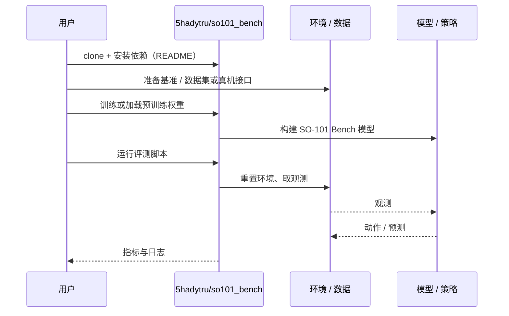

# SO-101 Bench（arXiv:2610.36420）

**SO-101 Bench**（*SO-101 Bench: Accessible Spatial Manipulation*，[arXiv:2610.36420](https://arxiv.org/abs/2610.36420)，[项目页](https://so101-bench.github.io/)，[代码](https://github.com/5hadytru/so101_bench)）来自 [具身智能小站 2026-10-28 盘点](../../sources/blogs/wechat_embodied_station_59_papers_human_video_to_robot_experience_2026-10-28.md)，属「评测与基准」组。

## 一句话定义

**为 SO-101 建立数字孪生与语言条件空间操作基准，区分见过对象、未见实例和未见类别。**

## 英文缩写速查

| 缩写 | 英文全称 | 简要说明 |
|------|----------|----------|
| SO-101 Bench | SO-101 Bench: Accessible Spatial Manipulation | 本文方法 / 基准的简称 |

## 为什么重要

- 让低成本机械臂也有空间评测。部分策略的仿真与真机排序一致，但仿真仍高估成功率，不能直接替代实测。
- 开源结论：**已开源**（步骤 2.5，2026-10-28）。仓库可达（git ls-remote）。项目页 HTTP 200。
- 同期同组工作见 [潜在动作、免渲染事件仿真与机器人评测：具身智能小站 10-28 期 59 篇阅读坐标](../overview/embodied-station-2026-10-28-59-papers-technology-map.md)。

## 核心机制

| 项 | 内容 |
|----|------|
| **arXiv** | [2610.36420](https://arxiv.org/abs/2610.36420) |
| **开源** | **已开源** |
| **要点** | 为 SO-101 建立数字孪生与语言条件空间操作基准，区分见过对象、未见实例和未见类别。 |
| **文内指标** | 公众号转述：部分策略的仿真与真机排序一致，但仿真仍高估成功率，不能直接替代实测。 |

## 源码运行时序图

以下为按仓库入口（`5hadytru/so101_bench`）推断的通用运行链路；入库日仅核实仓库可达，未逐文件阅读，具体脚本名以 README 为准。

## 实验与评测

- 公众号转述：部分策略的仿真与真机排序一致，但仿真仍高估成功率，不能直接替代实测。
- **读法：** 本页为索引级摘要，依据公众号转述的官方摘要与仓库信息整理；逐项数字与 baseline 以原文 PDF 为准。

## 与其他工作对比

- 横向索引见 [潜在动作、免渲染事件仿真与机器人评测：具身智能小站 10-28 期 59 篇阅读坐标](../overview/embodied-station-2026-10-28-59-papers-technology-map.md)；同 arXiv 不重复造页。

## 结论

**让低成本机械臂也有空间评测：部分策略的仿真与真机排序一致，但仿真仍高估成功率，不能直接替代实测。**

1. 开源边界：**已开源** — 仓库可达（git ls-remote）。项目页 HTTP 200。
2. 核心机制：为 SO-101 建立数字孪生与语言条件空间操作基准，区分见过对象、未见实例和未见类别。
3. 复现与选型前核对任务协议、硬件与基准口径，勿直接横比公众号摘录数字。

## 关联页面

- [具身大模型评测基准选型闭环](../queries/embodied-eval-benchmark-selection-loop.md) — 本页可归入其 ③ 策略任务成功率评测层，并借数字孪生触及 ④ sim↔real 校准：区分见过对象/未见实例/未见类别
- [simulation-evaluation-infrastructure](../concepts/simulation-evaluation-infrastructure.md)
- [vla](../methods/vla.md)
- [manipulation](../tasks/manipulation.md)
- [embodied-station-2026-10-28-59-papers-technology-map](../overview/embodied-station-2026-10-28-59-papers-technology-map.md)

## 参考来源

- [so_101_bench_arxiv_2610_36420.md](../../sources/papers/so_101_bench_arxiv_2610_36420.md)
- [wechat_embodied_station_59_papers_human_video_to_robot_experience_2026-10-28.md](../../sources/blogs/wechat_embodied_station_59_papers_human_video_to_robot_experience_2026-10-28.md)
- [arXiv:2610.36420](https://arxiv.org/abs/2610.36420)

## 推荐继续阅读

- [arXiv PDF](https://arxiv.org/pdf/2610.36420)
- [项目页](https://so101-bench.github.io/)
- [https://github.com/5hadytru/so101_bench](https://github.com/5hadytru/so101_bench)
