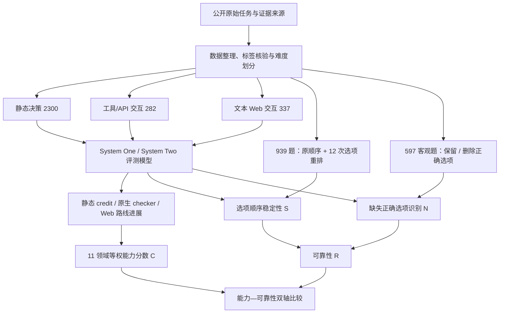
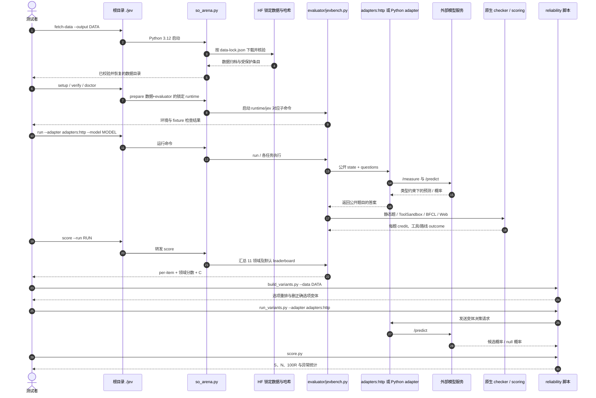

# SO-Arena：System One 模型能力谱系与决策可靠性评测 / Benchmarking the Capability Spectrum and Reliability of System One Models

## 一句话定义

**SO-Arena** 是针对快速、单次前向的结构化决策模型（System One Models）的多领域 benchmark：既检验模型在分类、推理、工具调用与文本 Web 交互中的**任务能力 C**，又单独测**选项重排稳定性 S**、**正确答案缺失识别 N**和综合**可靠性 R**。论文为 [arXiv:2611.15777v1](https://arxiv.org/abs/2611.15777)，并非机器人真机运控基准。

## 英文缩写速查

| 缩写 | 英文全称 | 简要说明 |
|---|---|---|
| S1 | System One | 单次快速结构化决策模型，常输出候选概率 |
| S2 | System Two | 偏显式推理的对照模型 |
| C | Capability | 11 个领域等权汇总的能力分数 |
| S | Option-order Stability | 不改变候选内容，只重排位置时的决策稳定性 |
| N | Null Discrimination | 正确答案从候选中移除时识别“无正确答案”的能力 |
| R | Reliability | S、N 的组合可靠性指标 |
| AUC | Area Under the ROC Curve | 区分有答案/无答案的排序分数 |
| BFCL | Berkeley Function Calling Leaderboard | 部分工具调用评测场景来源 |
| API | Application Programming Interface | 工具与模型服务调用接口 |

## 为什么重要

- **能力强不一定可靠：** 作者报告能力最强的 System One 模型在可靠性排名中只到第七；单一准确率会掩盖对选项位置和缺失答案的敏感性。
- **比纯静态选择题更接近决策链：** 纳入真实模拟器中的工具交互 episode，以及有步骤目标的文本 Web 路线，而非只评孤立分类。
- **对智能体工程有用：** 适用于有限候选路由、任务完成验证、风险筛查、证据判定等模型选型；与 [AI Agent 评测](../concepts/ai-agent-evaluation.md) 的终态验证和回归套件互补。
- **谨慎迁移到机器人：** 部分上游数据源涉及机器人任务，但本论文没有证明策略上真机时可达到对应安全性、控制带宽或 Sim2Real 鲁棒性。

## 核心信息

| 项目 | 已核对信息 |
|---|---|
| 英文标题 | SO-Arena: Benchmarking the Capability Spectrum and Reliability of System One Models |
| 中文标题 | SO-Arena：System One 模型能力谱系与决策可靠性评测 |
| 作者 | Lichen Li、Ziping Dong、Sicheng Feng、Qi Li、Xinchao Wang |
| 论文 | arXiv:2611.15777v1，2026-11-11 |
| 范围 | 2,919 个自然任务、11 领域、5 类能力；21 个受测模型 |
| 任务组成 | 2,300 个静态题 + 282 工具/API episode + 337 文本 Web 任务 |
| 榜单口径 | 1,232 个难度较高的默认 panel 任务；各域先求平均，再对 11 域等权 |
| 可靠性口径 | 939 题 × 13 种选项顺序；1,052 缺答案测试候选（597 个客观域题用于 N） |
| 代码 | [holdrain/SO-Arena](https://github.com/holdrain/SO-Arena)：启动器、evaluator、reliability、latency |
| 数据 | [SO-Arena/SO-Arena（Hugging Face Dataset）](https://huggingface.co/datasets/SO-Arena/SO-Arena) |
| 官方项目页 | [SO-Arena](https://lichenlillc.github.io/SO-Arena/) |
| 开放情况 | 评测代码已发布，数据集可获取但含第三方许可与受保护条目；模型服务另行准备 |

## 核心机制

### 1. 五类能力与独立的评估环境

- **语义理解**：情感/情绪、任务意图与路由。
- **知识和推理**：常识、数学、科学推理、代码理解。
- **安全与政策遵循**：给定场景下的安全判断。
- **证据评价**：检索重排、任务完成验证。
- **Agent 任务完成**：工具/API 执行和文本化 Web 交互。

静态题按 accuracy、Jaccard 或相邻等级 partial credit 评估；工具任务调用原生 checker；文本 Web 的 Easy 按判断准确度，Medium/Hard 按参考路线的进展评分。这些不是同一类型的“答对一道题”。

### 2. 能力分数 C：先按领域聚合，再等权

默认 leaderboard 用 1,232 个任务：数学选 Hard + Very Hard、其他分级域选最高难度、未分级域选全部。**先对每个领域的任务 credit 求平均，再对 11 个领域等权平均**。因为领域题量不同，不能直接对所有 1,232 题做整体平均。

### 3. 决策可靠性：位置扰动与正确答案缺失

- **S（重排稳定性）：** 对 939 个选择题保留原版，再做 12 次有控制的选项重排；按**选项内容**而非字母位置还原预测。A 为重排后与原决定一致比例，随机一致基线 p_e 为每题 1/K 的平均值；S=(A-p_e)/(1-p_e)。稳定并不保证答案正确。
- **N（空答案识别）：** 原题与删除正确选项的变体成对出现；计算模型判断“无正确选项”的概率对两种输入的区分能力，在 597 个客观域题上计算 N=2×AUC-1。N 与普通开放式拒答准确率不同。
- **R（综合可靠性）：** 当 S 与 N 都大于 0，R=√(S×N)，否则 R=0；论文展示为 100R。S、N 和 C **不可混为一个准确率**。
- 源码将拒绝、错误请求保留为显式状态，并按协议处理；可靠性测试对概率输出有格式与归一化要求。

## 流程总览

以上图的分支表示**独立评估协议**，不是把可靠性分数直接作为任务正确率的损失或训练目标。

## 源码运行时序图

下图依据公开 `jev`、`so_arena.py`、`evaluator/jevbench.py`、`evaluator/MODEL_ADAPTER.md`、`reliability/build_variants.py` / `run_variants.py` / `score.py` 的实际调用入口归纳；尚未在本机跑通 GPU 测评。

**入口与校验：** 根目录 `./jev` 是 shell wrapper，实际先由 `so_arena.py` 验证 data-lock.json 和 code-files.json 的 SHA-256 再拼装 runtime；`evaluator/jevbench.py` 实施任务与分数统计；`reliability/` 为**独立**的变体评测流程。模型仅接收公开请求，私有参考答案与 checker 状态留在评测器。

## 实验与评测（作者报告，arXiv v1）

| 对照维度 | 原文结果与正确读法 |
|---|---|
| 总规模 | 2,919 任务 / 11 域 / 5 能力家族；21 个评测模型 |
| 默认能力榜 | 高难 1,232 任务、11 域等权；不是全部 2,919 任务平均 |
| 能力—可靠性错位 | 能力最优的 System One 在可靠性榜列第七，证明两者不能视作同一指标 |
| 可靠性模型 | 18 个 System One；JevAny-27B 可靠性最高，但能力不位于榜首 |
| 语义与推理 | 语义判断中 System One 可接近部分 System Two；数学与科学等多步推导更依赖推理能力 |
| 延迟 | 作者在单 H100、batch=1 测到开源 System One 模型平均每题小于 0.3 秒；非通用设备 latency 保证 |
| 数据依赖 | tool episodes 是原生模拟器任务；Web 的 route progress 与静态 accuracy 不可直接等价 |

**边界：** 上述为论文和官方仓库公开报告，没有独立复现、统计置信区间重算或机器人真机实验。

## 对比：SO-Arena 与其他验证框架

| 工作 | 被评对象与任务环境 | 主要质量信号 | 与 SO-Arena 的边界 |
|---|---|---|---|
| **SO-Arena（本文）** | 通用 System One 结构化决策：静态题、工具沙盒、文本 Web | 11 域等权能力 C + 选项顺序稳定性 S + 无正确选项识别 N | 关注候选式决策和协议内任务表现；不证明机器人闭环控制安全 |
| [RoboArena](../methods/roboarena.md) | 跨实验室真实机器人操作策略的双盲配对测试 | 真机 rollout、任务偏好、部分进度、任务感知策略排名 | 真机具身泛化优于仅靠有限候选静态题；但没有以 SO-Arena 的 S/N 定义衡量模型 |
| [Coding Agent 验证闭环](../methods/coding-agent-verification-loops.md) | Coding Agent 对实际软件系统的修改和交付 | E2E、属性测试、差分测试及独立审查 | 验证的是软件产物与行为证据，不是 System One 候选选择的概率稳定性 |

**工程读法：** SO-Arena 的决策扰动测试可作为智能体路由器/任务验证器的**模块级回归补充**，但在要执行真实代码或机器人动作时，仍需另做环境终态、异常恢复及安全约束验证；这里的组合建议是知识库工程迁移，并非 SO-Arena 论文已验证的联合系统。

## 结论

**SO-Arena 的核心贡献不是再造单一排行榜，而是将“是否会做”与“同一个决策是否稳、能否知道候选里没有正确答案”拆成可独立诊断的测试。**

1. **模型选型先看任务域：** 报出 C 的 11 个域和难度层，避免让任务数多的域暗中主导评分。
2. **可靠性至少看 S 与 N：** 一个只会始终选某位置、或永不承认无正确答案的模型，可能有貌似不错的静态得分。
3. **概率必须真实：** 连接模型时遵守 adapter 协议，不要把 hard label 伪造为置信度；否则 N 的 AUC 没有可信解释。
4. **区分模拟器与业务环境：** BFCL/ToolSandbox、文本 Web 的终态定义与真实机器人安全要求不同。
5. **保留锁定版本与数据边界：** 使用 data-lock.json、哈希和固定模型修订；不能将受保护基准答案泄漏到模型输入或训练语料。
6. **生产场景单独跑回归：** 本论文是能力分布和扰动诊断，仍需按真实路由、误报成本、时延和失败处置要求设计部署 eval。

## 工程实践与开源状态

- **公开代码：** [holdrain/SO-Arena](https://github.com/holdrain/SO-Arena) 提供 evaluator、reliability、latency 和 adapter 协议。适用 Linux x86-64 / Python 3.12；模型服务另行部署。
- **公开数据：** [SO-Arena/SO-Arena](https://huggingface.co/datasets/SO-Arena/SO-Arena)。部分源数据的第三方使用许可不同于代码 MIT 许可证；必须读数据 LICENSE/THIRD_PARTY_NOTICES。
- **运行顺序：** 获取锁定数据 → `./jev verify` / `setup` / `doctor` → 按模型 adapter 运行 `./jev run` → `./jev score`；可靠性另执行 `reliability/build_variants.py`、`run_variants.py`、`score.py`。
- **核验细节：** [论文归档](../../sources/papers/so_arena_arxiv_2611_15777.md)、[项目主页归档](../../sources/sites/so-arena.md)、[官方源码归档](../../sources/repos/so-arena.md) 分开记录。
- **可复现性声明：** 本次阅读了源码执行入口但未实际下载全部基准数据、安装环境、运行评估器或复现模型结果。

## 局限与风险

- **非机器人运控测评：** 系统级实时控制、碰撞、安全约束、真机分布迁移不在其指标覆盖范围。不能把 S/N/R 直接当实机控制器认证。
- **S 的解释范围：** 选项顺序稳定性并不直接度量预测正确性或概率校准。
- **N 的解释范围：** 只在客观域的 597 道题上计算，不能自动外推到安全拒答、所有模态和任意开放式问答。
- **测评格式限制：** 文本化 Web 和可枚举工具选项受协议约束，不能直接代表开放互联网任务的全部难度。
- **供应链与泄漏：** 评测器使用受保护条目与恢复流程；参考答案、checker 和参考路线不能输入给被测模型；使用第三方材料前需核对许可。
- **版本敏感：** 项目站点后续增补模型与论文 v1 的 21 模型结果应分开记录。

## 关联页面

- [具身大模型评测基准选型闭环](../queries/embodied-eval-benchmark-selection-loop.md) — SO-Arena 的结构化决策稳定性与缺失答案识别可作为评测维度的对照，但不覆盖具身策略的真机成功率、接触安全或 sim-to-real gap

- [AI Agent 评测](../concepts/ai-agent-evaluation.md) — 通用 agent harness、能力测评、终态与回归
- [RoboArena 真机策略评测](../methods/roboarena.md) — 面向真实机器人策略的双盲配对评价，不与通用结构化决策得分混用
- [Coding Agent 验证闭环](../methods/coding-agent-verification-loops.md) — 真实软件交付的 E2E、属性与差分测试，为结构化决策能力评测提供外部验收参照
- [TypeSafe Jev](./typesafe-jev.md) — System One 结构化概率模型/服务，不等于 SO-Arena 评测器
- [Laya](./laya.md) — 开源 System One 模型的对照入口
- [Karpo Decision](./karpo-decision.md) — 结构化候选概率接口的工程实现

## 参考来源

- [SO-Arena arXiv:2611.15777v1 论文归档](../../sources/papers/so_arena_arxiv_2611_15777.md)
- [SO-Arena 官方项目主页归档](../../sources/sites/so-arena.md)
- [SO-Arena 官方代码与运行入口归档](../../sources/repos/so-arena.md)
- [arXiv v1](https://arxiv.org/html/2611.15777v1)
- [官方代码](https://github.com/holdrain/SO-Arena)
- [官方数据集](https://huggingface.co/datasets/SO-Arena/SO-Arena)

## 推荐继续阅读

- [官方可运行评测器及 README](https://github.com/holdrain/SO-Arena/tree/main/evaluator)
- [可靠性指标复现实验说明](https://github.com/holdrain/SO-Arena/tree/main/reliability)
- [SO-Arena 项目主页](https://lichenlillc.github.io/SO-Arena/)
