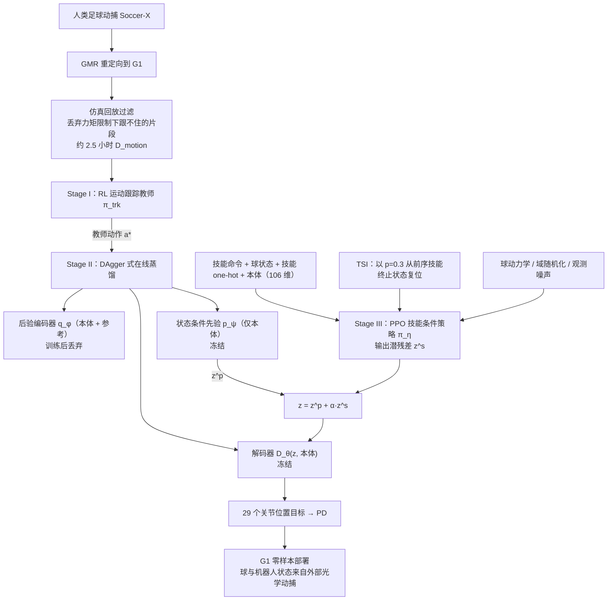
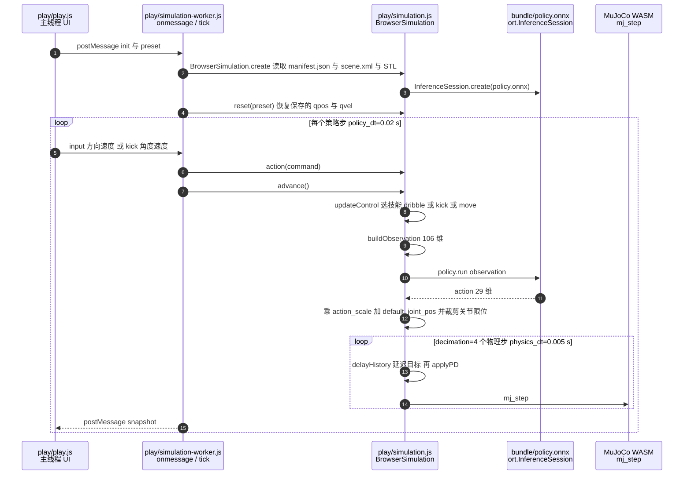

# SoccerBot：潜在运动先验的统一人形足球

**SoccerBot**（*Playing Soccer Like Humans Do: Learning Versatile and Agile Humanoid Soccer via Latent Motion Priors*，[arXiv:2611.06564v1](https://arxiv.org/abs/2611.06564)，[项目页](https://soccerbot-humanoid.github.io/)，CoRL 2026）。本页依据 2026-11-04 提交的 v1（截至 2026-11-06 核对，arXiv 无 v2）PDF 14 页全文与附录 A–C 撰写。

作者：Haoyu Shao、Yunshen Wang、Jingze Zhang、Shaohang Zhu、Yong-Lu Li、Tianzhu Zhang、Baoxiong Jia（通讯）、Siyuan Huang（通讯）；机构：中国科学技术大学、BIGAI 通用人工智能国家重点实验室、上海交通大学、北京大学。

## 一句话定义

**SoccerBot 先把人类足球动捕蒸馏成一个冻结的"状态条件潜运动先验"，再让一个带技能 one-hot 的 PPO 策略只在先验周围输出潜空间残差，用同一个策略统一完成移动、带球、停球和踢球，并零样本迁移到 Unitree G1。**

## 英文缩写速查

| 缩写 | 英文全称 | 简要说明 |
|------|----------|----------|
| TSI | Transition State Initialization | 用"前序技能无失败结束时的终止状态"初始化下一技能的回合，训练技能切换 |
| PULSE | Physics-based Universal motion Latent SpacE | 论文借鉴的"跟踪教师蒸馏为 VAE 式潜动作空间"框架（库内：[pulse-physics](./pulse-physics.md)） |
| AMP / ASE | Adversarial Motion Priors / Adversarial Skill Embeddings | 对抗式运动先验基线 |
| LATENT | 网球人形技能学习（Latent Action Barrier 基线） | 论文引用 [3]，库内：[paper-notebook-latent](./paper-notebook-latent.md) |
| GMR | General Motion Retargeting | 把人类动捕重定向到 G1（库内：[retargeting matters](./paper-hrl-stack-01-retargeting_matters.md)） |
| DAgger | Dataset Aggregation | 在线蒸馏用的学生状态 + 教师动作缓冲（库内：[dagger](../methods/dagger.md)） |
| SR / VE / DE | Success Rate / Velocity Error / Direction Error | 评测指标，见实验节 |
| MMD² | squared Maximum Mean Discrepancy | 策略 rollout 与人类参考运动特征的分布距离（Train ref. / Post-train ref.） |
| ResT / StopT / DistErr | Response Time / Stop Time / Distance Error | 带球换向响应时间、停球稳定时间、停球位移 |

## 为什么重要

- 论文指出（§1）两条缺口：已有人形足球要么只覆盖少数技能（定向踢球、带球、纯行走），要么用多个独立训练控制器；"人类运动先验 + 多技能足球"此前只在仿真角色上出现（PhysicsFC 等），或完全不用运动先验导致动作不自然。SoccerBot 声称（作者表述）是首个在真机上同时具备完整技能集与类人运动质量的人形足球系统。
- 它的工程取舍很清楚：不用对抗式奖励，而是把"自然度"放进一个冻结解码器里，任务策略只能在先验邻域内探索；技能切换不靠状态机，而靠统一的技能 one-hot + TSI 训练。
- 对库内读者：这是 [SkillX](./paper-skillx-humanoid-soccer.md)（技能专属 AMP）之外的另一条"统一多技能"路线——潜空间残差而非对抗奖励。

## 核心方法 / 机制

三阶段（论文 §3、Fig. 2）：

**Stage I：运动跟踪教师（§3.1）**
- 数据来源：人类足球动作取自 **Soccer-X [26]**（论文参考文献 [26] 为 SMGDiff，ICCV 2025），用 **GMR [27]** 重定向到 G1。
- 过滤：预训练跟踪器在仿真里回放每段序列，**在硬件力矩限制下跟不住的片段被丢弃**，得到**约 2.5 小时**的参考运动 D_motion（论文 §3.1，项目页同口径）。过滤前的原始规模本文未给出。
- 教师 π_trk：输入本体观测 + 仿真特权量（如基座线速度）+ 参考，输出关节位置目标，PD 跟踪；奖励为位姿/速度模仿 + 平衡与控制正则。

**Stage II：潜运动先验蒸馏（§3.2，式 (1)）**
- 学生含后验编码器 q_φ(z | 本体, 参考)、**仅看本体的状态条件先验 p_ψ(z | 本体)**、解码器 D_θ(z, 本体)，均为对角高斯。
- 训练用 DAgger 式在线缓冲；损失 = 动作重建 MSE + β_KL·KL(q‖p) + β_sm·‖μ_φ,t − μ_φ,t−1‖²（后验均值时间平滑）。
- 蒸馏后**丢弃后验，冻结 p_ψ 与 D_θ**。

**Stage III：技能条件残差策略（§3.3，式 (2)(3)）**
- 观测（附录 Table A.1）：命令 3 + 球位置 3 + 球速度 3 + 技能 one-hot 4 + 基座角速度 3 + 投影重力 3 + 相对关节位置 29 + 相对关节速度 29 + 上一动作 29 = **策略 106 维**；critic 另加基座线速度共 109 维。移动技能时球观测置零，四个技能共用同一接口。
- 动作：冻结先验给出 z^p = μ_ψ(本体)，策略采样残差 z^s，**z = z^p + α·z^s**，解码 a = D_θ(z, 本体)。PPO 的似然比、熵、KL 都只在潜空间计算（不是 29 维关节空间）；σ_η 为可学习的与状态无关的标准差；残差均值有边界惩罚 L_bound（式 (3)）。
- 多技能训练：每回合采样一个技能；**奖励按技能路由**（附录式 (A.2)：只开启当前技能项 + 共享正则项）。带球采样低速目标球速，踢球采样高速目标球速并配合可击球初始状态，停球发射地面来球。
- **TSI（§3.3.2、附录 C.1）**：每个技能维护 256 个"无失败结束"的终止状态循环缓冲，复位时以 p_TSI = 0.3 从前序技能缓冲取初始状态（前序关系：带球可接停球；踢球可接停球/带球；移动可接带球/踢球；停球可接带球）。
- 并行规模：Isaac Lab / Isaac Sim，8192 个并行环境（附录 C）。

**鲁棒性（§3.4、附录 Table A.3）**：球角阻尼 c_a ∈ [0.3, 0.6]、球恢复系数 [0.45, 0.85]、球质量 [0.38, 0.45] kg、机器人/球摩擦、躯干质心、默认关节偏置、执行器延迟 {0, 5, 10} ms、外力推扰；观测噪声（球位置 ±0.02 m、球速度 ±0.1 m/s 等，Table A.1）。真机球状态来自外部光学动捕（§4）。

## 流程总览

## 实验与评测

设置（§4.1）：Isaac Lab G1，每个方法每个技能 2,500 个随机化回合；基线为 PPO（无人类运动）、AMP、ASE、LATENT（学习的潜动作空间 + Latent Action Barrier）；消融为 w/o prior（去掉状态条件先验、直接预测任务潜变量）与 w/o TSI。

**Table 1（仿真主结果，数字取自原文表）**

| 方法 | 踢球 SR | 带球 SR | 带球 ResT (s) | 停球 SR | 停球 StopT (s) | 移动 SR | Train ref. ↓ | Post-train ref. ↓ |
|------|--------|--------|--------------|--------|----------------|---------|--------------|-------------------|
| PPO | 93.96 | 0.00 | 5.00 | 94.64 | 0.87 | 99.96 | 0.328 | 0.575 |
| AMP | 87.48 | 46.36 | 4.09 | 23.08 | 5.49 | 99.96 | 0.170 | 0.308 |
| ASE | 0.00 | 0.00 | 5.00 | 49.24 | 3.46 | 58.60 | 0.292 | 0.409 |
| LATENT | 91.00 | 85.24 | 1.92 | 85.92 | 1.53 | 100.00 | 0.231 | 0.603 |
| **Ours** | **97.04** | **89.88** | **1.36** | 83.08 | 1.43 | 100.00 | 0.226 | 0.554 |
| w/o prior | 94.40 | 89.48 | 1.38 | 94.00 | 0.97 | 100.00 | 0.234 | 0.582 |
| w/o TSI | 95.80 | 87.76 | 1.48 | 98.12 | 0.72 | 100.00 | 0.252 | 0.587 |

要点（§4.1）：Ours 的踢球与带球 SR 最高、移动全部完成；**停球 SR 83.08% 低于 PPO、w/o prior、w/o TSI**，论文解释为 Ours 倾向伸腿拦快球导致球反弹超出位移门限；运动自然度上 AMP 最接近人类参考，但 AMP 只停住 23.08% 的传球、带球 46.36%；"能完成四个技能的方法里 Ours 最接近两套参考"。

**Table 2（§4.2，终止状态技能切换 SR %，Ours / w/o TSI）**

| 从 \ 到 | 带球 | 踢球 | 移动 | 停球 |
|---|---|---|---|---|
| 带球 | 94.0 / 90.0 | 87.5 / 78.0 | 93.0 / 91.5 | 53.0 / 71.0 |
| 踢球 | – | – | 99.5 / 97.5 | 86.5 / 96.5 |
| 移动 | 78.5 / 71.5 | – | 92.5 / 91.5 | 58.5 / 68.5 |
| 停球 | 87.5 / 85.0 | 96.5 / 92.0 | 99.0 / 100.0 | 79.5 / 95.5 |

非停球目标 9 格中 8 格 TSI 更高（最大：带球→踢球 87.5 vs 78.0）；**停球目标四格均是 w/o TSI 更高**。

**Table 3（§4.3，踢球 SR %，指令速度固定 8.0 m/s，每设置 1000 个确定性仿真回合）**

| 方法 | Near | Mid | Incoming | WideYaw |
|---|---|---|---|---|
| w/o prior | 97.4 | 76.5 | 92.4 | 88.2 |
| w/o TSI | 95.3 | 34.3 | 60.4 | 73.7 |
| Ours（仿真） | 98.6 | 87.0 | 72.9 | 83.9 |
| Ours（真机） | 95.0 | 85.0 | 70.0 | 80.0 |

注意：对 w/o prior，**Incoming（92.4）与 WideYaw（88.2）反而高于完整方法**；"完整方法比 w/o TSI 在四个条件上提升 3.3–52.7 个百分点"成立。真机踢球只评方向准确性，真机相对仿真平均下降约 3.1 个百分点（§4.3）。

**真机与 sim-to-real（§4.5，Table 4）**：G1 零样本，球与机器人由外部光学动捕跟踪并转换到机身坐标系；四个技能各 **20 次试验**（移动/带球变指令速度与朝向，停球变来球速度，踢球变目标球速与朝向）；对照是"同族仿真策略"。

| 指标 | 仿真 | 真机 |
|---|---|---|
| 踢球 VelErr / DirErr | 8.12% / 4.09° | 47.38% / 10.41° |
| 带球 VelErr / DirErr / ResT | 8.55% / 3.77° / 1.21 s | 30.17% / 16.49° / 2.37 s |
| 停球 StopT / DistErr | 0.78 s / 0.31 m | 1.84 s / 1.07 m |
| 移动 VelErr / DirErr | 19.14% / 5.85° | 21.53% / 13.74° |

球动力学辨识（§4.5）：20 次被动落球得恢复系数 e = 0.654（落在随机化范围 [0.45, 0.85] 内）；自由滚动有效减速度 0.100 m/s²，仿真在角阻尼范围内的平均减速度为 0.097–0.167 m/s²。作者归因：硬件上出球速度偏大，因为仿真球是刚体而真球会变形（作者表述，未做变形球验证）。

**潜空间分析（§4.4，Fig. 3，t-SNE）**：z_prior 中四个技能大体重叠；z_task 出现技能分离；最终 z 保留先验的共同支撑并形成各技能区域；移动与带球相近，踢球与停球更特化。

## 结论

**SoccerBot 用"冻结潜先验 + 潜空间残差 + TSI"把四种足球技能装进一个策略，仿真里在踢球/带球上领先，但真机数字显示的是"能执行、精度有明显折损"，且依赖外部动捕。**

- 真正有区分度的指标是 Table 1 的踢球/带球 SR 与 Table 2 的切换 SR；停球反而是完整方法相对消融更弱的一项
- 先验的收益主要体现在运动自然度（w/o prior 的 MMD² 均值升至 0.234/0.582）而不是 SR，w/o prior 在 Table 3 的 Incoming/WideYaw 甚至更高——"先验必然提升任务成功率"不能从本文推出
- TSI 的收益集中在非规范起始（Table 2、Table 3），对停球目标反向
- 真机：移动速度最接近（19.14% → 21.53%），踢球出球速度偏差最大（8.12% → 47.38%），方向保持较好（4.09° → 10.41°）
- 部署读法：必须有动捕场地；试验规模仅每技能 20 次，没有跨场地/草地/对手的结果

## 局限

原文自述（§6）：
1. sim-to-real 差距因技能而异；踢球出球超速、带球与停球连续误差最大，可能部分源于刚体球接触模型；
2. 依赖外部动捕做状态估计，只能在带仪器的室内部署；
3. 技能集仅四种基础行为；
4. 只做单机器人，未涉及多智能体与比赛级决策。

核对补充：
- 真机只给了 G1 一种机型的 20 次/技能，Table 4 没有置信区间；Table 3 真机踢球的"成功"仅看方向（§4.3）。
- Table 4 的"仿真"一行（如踢球 VelErr 8.12%、移动 VelErr 19.14%）与 Table 1 的同类数字（7.26%、4.95%）不一致；论文说 Table 4 比较的是"sibling simulation policy"，评测协议与 Table 1 不同，二者不应直接拼接（推测：来自不同的指令分布）。
- 训练超参（PPO 学习率、α、β_KL 等具体数值、训练时长与 GPU 数）正文与附录均未给出，无法复现数值（已通读全文与附录核实）。
- 论文称"首个"是作者表述，库内 [SkillX](./paper-skillx-humanoid-soccer.md)（2609.06718）同样是统一多技能真机足球，两者口径不同（见对比节）。

## 源码运行时序图

**训练代码不适用**：截至 2026-11-06，项目页与其 GitHub Pages 仓库不含训练/蒸馏/部署代码（见 [sources/repos](../../sources/repos/soccerbot-latent-motion-priors.md)）。

项目页提供的是**浏览器内 playground**（`play/`，MuJoCo WASM + ONNX Runtime Web，静态阅读、未运行）。以下时序依据仓库 `soccerbot-humanoid.github.io` 提交 `7cb1106` 的 `play/simulation-worker.js`、`play/simulation.js`、`play/bundle/manifest.json`，节点均为真实文件/方法。它展示的是一个已导出策略（`policy.onnx`，观测 106 维，与论文 Table A.1 一致）如何被推理与驱动，不是论文训练管线。

关键点：页面只做 dribble / kick / move（站立恢复）三种技能切换，没有停球；动作用"策略输出 × action_scale + 默认关节角"直接映射为关节目标，JS 中没有潜变量解码环节（ONNX 内部结构未能解析，因本环境没有 onnx 包，只能推测导出时已折叠）。`manifest.json` 记录的检查点名含 `noPrior_noLAB`，说明 playground 里的策略很可能不是论文完整版（带先验）的权重；两者关系论文与页面均未说明（推测，未核实）。

## 与相关工作对比

库内未发现同一篇的重复节点（arXiv 2611.06564、"SoccerBot"、"soccerbot-latent" 全库检索均无命中）。与库内人形足球节点的区别：

| 工作 | 运动先验 / 数据 | 技能范围 | 真机条件 | 与 SoccerBot 的区别 |
|------|----------------|----------|----------|---------------------|
| [SkillX](./paper-skillx-humanoid-soccer.md)（2609.06718） | 技能专属 AMP + critic | 统一多技能 | Noetix E1，MoCap / 机载视觉 | 对抗式先验 vs. SoccerBot 的冻结潜先验 + 残差；机型不同 |
| [PAiD / Learning Soccer Skills](./paper-notebook-learning-soccer-skills-for-humanoid-robots.md)（2602.05310） | 人类踢球 MoCap 三阶段 | 踢球为主（静球/滚球拦截） | G1 | 单一技能链，已开源 TeleHuman/HumanoidSoccer |
| [RoboNaldo](./paper-robonaldo-humanoid-soccer-shooting.md)（2606.11092） | 单条人类踢球参考做 scaffold | 射门 | G1 户外 | 一条参考的课程 RL，非多技能 |
| [Joga](./paper-joga-humanoid-soccer.md) | 主动视觉 + 技能衔接 | 带球/接球/传球/射门 | G1，主动视觉（2-DoF 颈部相机） | 感知端到端；SoccerBot 用外部动捕 |
| [Locomotion-Grounded](./paper-locomotion-grounded-humanoid-soccer.md)（2609.38852） | 通用行走策略起步 | 多方向踢球 + 切换 | — | 逐步加技能，不走潜先验 |
| [sa-2512-12437](./paper-sa-2512-12437-sim2real-reinforcement-learning-for-soccer-skill.md) | 目录条目（收录式节点） | 踢球 sim2real | — | 不同论文，仅为目录条目 |
| [SoccerDiffusion](./paper-notebook-soccerdiffusion-toward-learning-end-to-end-human.md)（2504.20808） | RoboCup 比赛录像，扩散模仿 | 端到端关节轨迹 | 小型人形 | 模仿学习而非 RL；SoccerBot 引为 [25] |
| [LATENT](./paper-notebook-latent.md)（2603.12686） | 不完美人类网球数据 + 潜动作空间 | 网球 | G1 | 本文把 LATENT 当基线并沿用其潜先验思路扩到多技能 |

同名提醒：本文项目页组织名为 `soccerbot-humanoid`；库内无其他以 SoccerBot 命名的节点，未核查库外同名项目。

## 关联页面

- [人形足球任务页](../tasks/humanoid-soccer.md)
- [Unitree G1](./unitree-g1.md)
- [Isaac Lab](./isaac-lab.md)
- [PULSE](./pulse-physics.md)
- [LATENT（网球）](./paper-notebook-latent.md)
- [GMR 论文](./paper-hrl-stack-01-retargeting_matters.md)
- [DAgger](../methods/dagger.md)
- [AMP 奖励](../methods/amp-reward.md)
- [域随机化](../concepts/domain-randomization.md)
- [Sim2Real](../concepts/sim2real.md)

## 参考来源

- [论文归档](../../sources/papers/soccerbot-latent-motion-priors_arxiv_2611_06564.md)：arXiv:2611.06564v1 全文 14 页（含附录 A–C，Table A.1–A.3）
- [项目页归档](../../sources/sites/soccerbot-latent-motion-priors.md)
- [项目页仓库归档](../../sources/repos/soccerbot-latent-motion-priors.md)
- [arXiv 摘要页](https://arxiv.org/abs/2611.06564)
- [PDF](https://arxiv.org/pdf/2611.06564)

## 推荐继续阅读

- PULSE（arXiv:2310.04582）：潜动作空间蒸馏框架的出处
- SMGDiff（arXiv:2411.16216）：Soccer-X 数据的来源论文；其摘要称数据集超过 108 万帧（按 30 fps 约 10 小时是推测，帧率未核实），SoccerBot 过滤后保留约 2.5 小时
- GMR（arXiv:2510.02252）：重定向工具
- [SkillX](./paper-skillx-humanoid-soccer.md)：同期统一多技能的 AMP 路线
