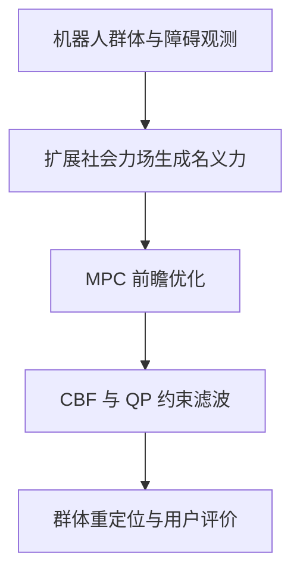

# 扩展社会力、MPC 与 CBF 的人形群体重定位（Can I Join You? Extended Social Force Based Model with Predictive Control and Barrier Functions for Humanoid Group Repositioning Amidst Obstacles）

**机构：** 西蒙菲莎大学（Simon Fraser University）  
**论文：** [arXiv:2611.14853](https://arxiv.org/abs/2611.14853)

## 一句话定义

**ESFFM 加入障碍排斥、群心牵引、成员间排斥与速度衰减；MPC 生成前瞻加速度；CBF 对机器人间距、障碍边界、速度和加速度建立约束，由 QP 选择最接近名义值的安全加速度。**

## 英文缩写速查

| 缩写 | 英文全称 | 简要说明 |
|---|---|---|
| SFFM | Social Force Field Model | 社交力场 |
| ESFFM | Extended Social Force Field Model | 增广社交力 |
| MPC | Model Predictive Control | 预测规划 |
| CBF | Control Barrier Function | 屏障安全约束 |
| QP | Quadratic Programming | 安全滤波器 |

## 为什么重要

社交机器人在人群加入、离开或穿过时要保持社交队形与障碍安全；纯社会力模型会在狭窄空间震荡碰撞。

## 核心原理

ESFFM 加入障碍排斥、群心牵引、成员间排斥与速度衰减；MPC 生成前瞻加速度；CBF 对机器人间距、障碍边界、速度和加速度建立约束，由 QP 选择最接近名义值的安全加速度。

### 流程总览

以下根据论文方法整理，箭头表示控制/数据流向。

## 实验与评测

8 组环境/群体条件中，带 CBF 的两个控制器在 7/8 条件未检测碰撞，ESFFM+MPC 为 5/8，原始 SFFM 为 1/8。40 人视频用户研究对若干拥挤布局更偏好组合控制；每配置在每条件的客观消融仅有一段预录外部轨迹。

## 与其他工作对比

ESFFM 加入障碍排斥、群心牵引、成员间排斥与速度衰减；MPC 生成前瞻加速度；CBF 对机器人间距、障碍边界、速度和加速度建立约束，由 QP 选择最接近名义值的安全加速度。 与传统同方向方法的主要区别见以上控制接口及研究动机；跨论文统计结果不具有相同测试协议。

## 结论

**扩展社会力、MPC 与 CBF 的人形群体重定位 的实际价值在于明确研究对象与实验边界，而非脱离原文场景比较单个成功率。**

1. 7/8 无碰撞是场景统计，不是全局安全定理。
2. 外部人员行为不能默认符合过滤器动力学约束。
3. 自然度、碰撞率与个人空间是不同目标。

## 工程实践

实际验证时先检查任务接口与坐标系，再按论文试验复现主指标；记录 SFFM / ESFFM / MPC 相关状态、控制采样与异常回退路径，不能以论文中的概念图代替可执行模块证明。

**源码开放状态：** 本次核对的论文未发现可核实的作者算法运行入口，不臆测代码接口。

## 源码运行时序图

**不适用**：尚无可确认的官方完整算法运行入口；以上主干流程是论文方法图，不是虚构源码调用。

## 局限与风险

外部遥控参与者不受群体 CBF 约束，无法证明整个交互安全；个人空间违规率与几何碰撞并不同步；研究主要为视频/群体对照。

## 关联页面

- [whole body control](../concepts/whole-body-control.md)
- [safe control](../../roadmap/depth-safe-control.md)
- [humanoid swarm performance](../../roadmap/depth-humanoid-swarm-performance.md)
- [11.09–11.13 29 篇总览](../overview/humanoid-quadruped-2026-11-09-13-29-papers.md)

- [模型预测控制](../methods/model-predictive-control.md)：了解滚动时域决策。
- [轨迹优化](../methods/trajectory-optimization.md)：对照运动约束与轨迹求解。

## 参考来源

- [arXiv v1 原文核对归档](../../sources/papers/social-force-mpc-cbf-group_arxiv_2611_14853.md)
- [arXiv v1 HTML 全文](https://arxiv.org/html/2611.14853v1)

## 推荐继续阅读

- [论文 PDF](https://arxiv.org/pdf/2611.14853v1)
