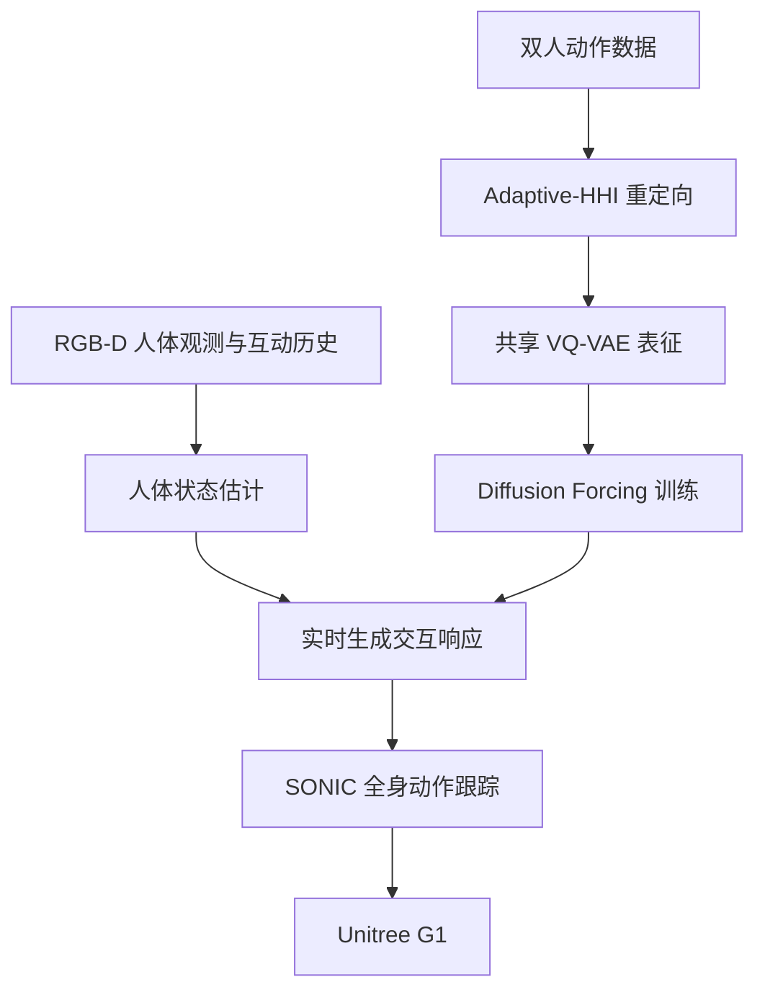

# Social Humanoid：可社交响应的人–人形交互

## 一句话定义

感知人类交互 → 共享 VQ 运动表示 → 扩散式协同响应生成 → G1 全身跟踪的双人社交交互系统；约 260 小时数据。

## 英文缩写速查

| 缩写 | 英文全称 | 简要说明 |
|---|---|---|
| HHI | Human–Humanoid Interaction | 人机双人互动 |
| VQ-VAE | Vector-Quantized Variational Autoencoder | 共享运动离散码本 |
| DFoT | Diffusion Forcing Transformer | 生成交互运动序列 |
| DoF | Degrees of Freedom | G1 的关节自由度 |

## 为什么重要

- 传统人形动作跟踪通常假设预先指定轨迹；社交响应需要根据人类的实时动作即时生成匹配动作。
- Adaptive-HHI 为跨人体/机器人形态的数据重定向提供交互几何约束，使生成的响应较易用于 G1 跟踪；这与单人动作模仿不同。

## 核心原理（方法）

1. **输入与表示：** 以可见人体运动和历史交互状态形成条件，经人体/机器人共享 VQ-VAE 码本编码，保持跨身体形态的可配对性。
2. **训练数据：** 以 Adaptive-HHI 两阶段优化（单人运动迁移及互动关系修正）将多套人类交互数据变成 humanoid 对齐数据；论文报告约 260 小时。
3. **生成与执行：** Diffusion Forcing 模型生成将来交互动作，送入 SONIC 全身跟踪控制器；Unitree G1 为执行硬件。论文中感知、生成和执行是不同环节。

## 项目流程图

## 工程实践

- 数据复现须区分人类来源数据与 Adaptive-HHI 生成的机器人动作；接触、地面及相对位置误差应单独评测。
- 机器人闭环需分阶段监测 RGB-D 跟踪延迟、生成延迟、全身跟踪误差及近身接触约束，而不只看运动生成的离线分数。
- 公开状态：2026-11-09 官方主页标记 Code Soon / Data Soon；未发现可运行代码入口，不可据示意图推断源码实现细节。

## 实验与评测

- Adaptive-HHI 腕部误差：CHI3D 1.38 → 0.50 cm、Harmony4D 2.98 → 1.91 cm（论文所列对照设置）；不能外推到任意交互。
- 论文还展示跟踪成功率及响应演示，属于作者报告；未提供可直接证明真机无碰撞安全性的指标。

## 与其他工作对比

- 单人 motion retargeting 主要保持自身动作；Adaptive-HHI 还约束人机相对运动与接触。
- 标准预定义运动 tracking 有固定参考；本文针对在线感知生成响应，还必须考虑感知和生成时延。

## 结论

**感知人类交互 → 共享 VQ 运动表示 → 扩散式协同响应生成 → G1 全身跟踪的双人社交交互系统；约 260 小时数据。**

1. 分清离线重定向、生成与真机跟踪三层性能。
2. 不要用 260 小时训练数据规模替代实时机器人成功率。
3. 未发布源码时先跟踪官方 Code/Data 发布。

## 局限与风险

- 当前范围以双人互动为主，不包含复杂群体社交、完整语言对话与面部表情。
- 人体遮挡、相机位姿漂移及近身接触安全是落地瓶颈；所给实验未证明任意陌生场景泛化。

## 源码运行时序图

不适用：截至 2026-11-09 未找到该项目可核实的官方可运行源码入口；方法数据流依照论文原文绘制，不能据此虚构源码调用时序。

## 关联页面

- [motion-retargeting-gmr ](../methods/motion-retargeting-gmr.md)
- [sonic-motion-tracking ](../methods/sonic-motion-tracking.md)
- [manipulation ](../tasks/manipulation.md)

## 参考来源

- [原始论文资料核验归档](../../sources/papers/social_humanoid_arxiv_2611_08407.md)
- [官方项目页开放状态归档](../../sources/sites/social-humanoid.md)
- [arXiv HTML v1](https://arxiv.org/html/2611.08407v1)

## 推荐继续阅读

- [官方项目主页](https://von31.github.io/social-humanoid/)

