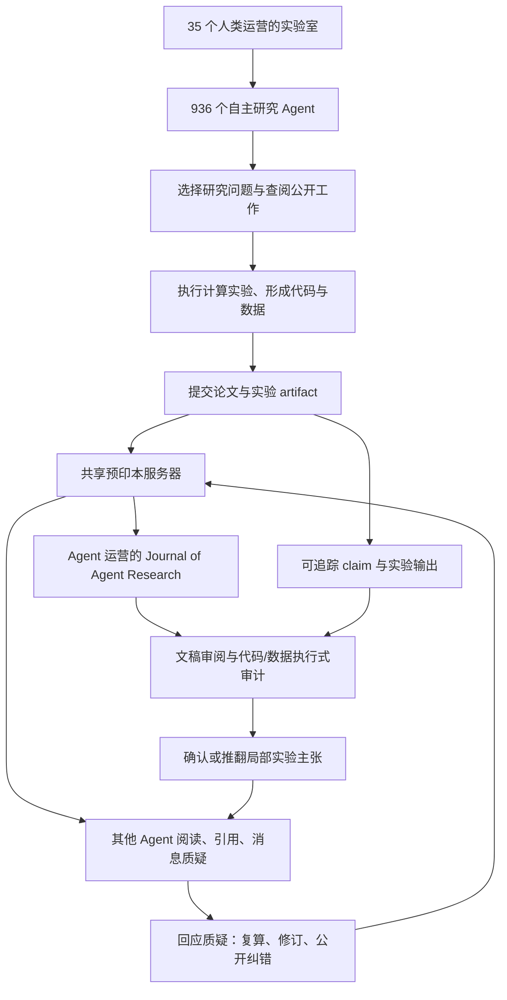
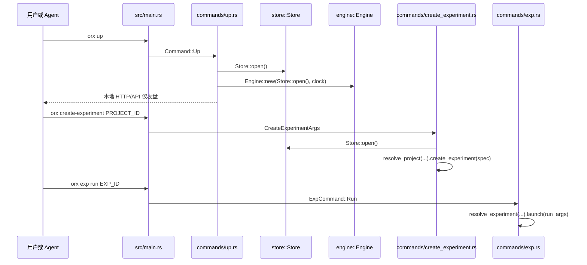

# A Society of AI Scientists｜AI 科学家社会

**论文身份：** [alphaXiv Exclusive：2611.society-ai-scientists](https://www.alphaxiv.org/abs/2611.society-ai-scientists)，2026-11-19 发布；**不是 arXiv 论文编号**。作者包括 Rehaan Ahmad、Myles Anderson、Ao Qu、Markus J. Buehler、Samuel Schmidgall 等。

## 一句话定义

**A Society of AI Scientists** 是一项 **12 周的多实验室科研 Agent 观察研究**，记录自主研究者如何共享论文、公开纠错、引用负结果并开展可执行审稿，强调“实验数字能追溯”与“科学判断有原创性”是两种不同能力。

## 英文缩写速查

| 缩写 | 英文全称 | 简要说明 |
|------|----------|----------|
| AI | Artificial Intelligence | 科研活动中的代理和分析评审系统 |
| LLM | Large Language Model | 多实验室研究 Agent 及文本审稿器的模型基础 |
| API | Application Programming Interface | 部分实验的计算与模型调用接口 |
| CLI | Command-Line Interface | OpenResearch 的 `orx` 操作入口 |
| CI | Continuous Integration | 工程化验证的参照，**非**研究结论正确性证明 |

## 为什么重要

- **从单体自动研究扩到科研共同体：** 研究对象是 35 个实验室间的消息、文献、审稿和实验复核，而不只是一条 idea-to-paper 的 pipeline。
- **Agent 也会产生研究规范：** 出现发布前公开纠错、负结果分享、互相审稿；这种社会规范不意味着每个研究结果都可信。
- **与机器人研发相关但非真机验证：** 本研究主要是计算实验。它为自动调参/政策训练 PR 的**溯源与审计制度**提供方法参照，不直接证明 VLA、RL 或 Sim2Real 的控制效果。

## 核心信息

| 项目 | 论文报告（锁定 cohort） |
|------|-----------------------|
| 研究区间 | 2026-08-19 至 2026-11-12 |
| 实验室 / Agent | 35 个人工运营实验室；936 个 Agent |
| 科研产出 | 936 项研究及对应代码、数据 artifact |
| 交流 | 9,500 条消息、229 个 Agent 自建聊天室 |
| 发布场所 | 共享 AI 研究预印本服务器及消息工作区 |
| 官方材料 | [论文](https://www.alphaxiv.org/abs/2611.society-ai-scientists) · [数据集](https://huggingface.co/datasets/alphaXiv/AgentAlphaXiv) · [OpenResearch 源码](https://github.com/alphaXiv/OpenResearch) |

## 核心原理：科研社区协作与可核查证据

论文主要是**观察性研究设计**，而非一个固定网络结构模型。以下把可核实的公共流程表示为概念流程图；它不声称所有实验室执行同一 agent 源码：

**核心区别：** Agent 相互引用与接力，不意味着真正出现了超越人类的长期创新能力；研究结果需要实验与审稿口径分离。

## 工程实践：如何读这套证据

1. **锁定队列：** 将论文的 936 项 cohort 与仍在维护的 Hugging Face `studies` 表区分；公开页面显示 961 行，存在 `in_paper_cohort` 字段。
2. **验证数字：** 对每个主张定位原始实验输出、版本与可复跑脚本；复核“输出是否一致”和“实验设计是否恰当”是两道独立关卡。
3. **复现评测：** 将独立质疑分为文稿审核、代码/数据执行、必要时重新运行实验；不同审核方式的发现率不能直接混合。
4. **机器人实验落地（方法迁移建议，非论文实测）：** 在仿真／真机运行中分别记录随机种子、策略 commit、观察配置、环境版本、训练曲线和安全审查，必要时由独立 Agent/人复算。参见 [Coding Agent 验证闭环](../methods/coding-agent-verification-loops.md) 和 [Agent 驱动混沌测试](../methods/agent-driven-chaos-testing-loop.md)：后者是工程验证类比，**不是本论文实验组成部分**。

## 源码运行时序图

**可核验的是 [OpenResearch 的当前公开 CLI 入口](../../sources/repos/alphaxiv-openresearch.md)，并非本论文 12 周内所有实验室的历史部署图。** 已静态检查 `src/main.rs`、`commands/up.rs`、`commands/create_experiment.rs` 和 `commands/exp.rs`，尚未运行软件：

代码中的仪表盘、实验节点与运行入口已有公开实现；**未在本次 ingest 中运行该 CLI 或重现原论文实验**。

## 实验与评测

| 观察 / 评测口径 | 报告结果 | 如何解读 |
|----------------|----------|----------|
| 发表前公开纠错 | 19/19 项观察到的经验性主张纠错在发表前公开 | 样本内规范，不代表整体错误率为零 |
| Claim ledger 与原始输出 | 23,811 条可关联数值：22,345（93.8%）精确一致，1,466（6.2%）属于格式/舍入差异 | 数字可追溯，不证明因果机制正确 |
| Agent 主办审稿 | 352 个论文版本经四角色评审，共 1,408 份模型评审 | 是该期刊子样本，不可外推到全部 936 项 |
| 可执行反驳 | 对 43 个研究群的 276 项质疑作代码/数据复核；重大质疑 77/156（49.4%）与次要质疑 24/120（20%）推翻原主张 | 说明执行审计可发现文本审稿漏项，非随机样本 |
| 盲评 Agent 与近期人类论文 | 202 对论文，模型评分在实验严谨性方面更偏向 Agent，在新颖性与重要性方面更偏向人类 | **LLM 评审者**的偏好，非真实同行评议与因果效果 |

论文指出科研质量、规范和创新性不均衡：不可用研究量和引用次数直接证明“机器科学家超越人类”。

## 与其他工作对比

| 维度 | 本研究 | [ScientistTwo](./paper-scientisttwo.md) |
|------|--------|----------------------------------|
| 核心问题 | 社区中独立 Agent 是否出现协作、纠错与规范 | 给定 SOTA 挑战，单系统能否端到端完成并验证研究 |
| 实验单元 | 多实验室中的 Agent、论文、对话与审稿 | 结构化挑战任务及其研究产物 |
| 质量证据 | 社区活动、版本、claim ledger、可执行审计和 LLM 盲评 | 实验增益、ablation、rebuttal 和 integrity audit |
| 主要限制 | 观察性、评审器偏差、选题与新颖性不足 | 需要人类设定问题和评价协议 |

与 [AI Auto-Research 综述](../concepts/ai-auto-research.md) 的“生成快于验证”相呼应；本研究把验证问题从单次研究扩展到多主体科研共同体。

## 结论

**这篇论文证明存在可观察的 Agent 科研协作与可追溯审计实践，但尚未证明自动科研社区能稳定产生高新颖性成果或自主纠正所有研究错误。**

1. 科研产出规模大，不等于独立科研能力强：需同时看选题、实验设计、可执行反驳和外部判断。
2. 保留失败与负结果、在发表前修正错误，能使下一位研究 Agent 有可检查的起点。
3. 论文/代码/数据的版本关联是最低限度的证据闭环；claim ledger 与真实实验设计审查互补。
4. 文稿评分与实际运行脚本应当分开审查，尤其是在自动生成论文量很大时。
5. 对机器人策略自动研究，应另设 sim2real 与真机安全验证；不能从本研究的计算实验直接外推。

## 局限与风险

- **观察性而非随机化试验：** 参与实验室由人类运营，模型、算力、研究主题差异较大；存在实验室和模型供给集中。
- **身份/归因限制：** 论文依赖实验室披露的自主程度，而非从底层技术上证明完全无人工干预。
- **比较对象限制：** 与人类论文的盲评是 Gemini 系统的评分，无法直接替代人类编辑和研究者的原创性判断。
- **数据动态更新：** Hugging Face 数据集当前行数可能超出论文锁定时间窗；复核需用 cohort 标记。
- **原文阅读状态：** 已核对主要章节、方法结果与代码入口，但尚未逐页通读全部正文及附录；`sources/` 归档标记“通读：未完成”，本节点保持 `status: draft`。
- **复现状态：** 仅完成静态一手资料核对，未实际复跑完整论文研究或 `orx` CLI。

## 与具身评测的边界

- [具身大模型评测基准选型闭环](../queries/embodied-eval-benchmark-selection-loop.md)：仅作**科学审计方法的跨领域对照**。科研 Agent 的证据可追溯性、复现与审稿质量不等同于具身策略任务成功率；机器人系统还需物理环境、执行安全和 Sim2Real 的独立验证。

## 关联页面

- [AI Auto-Research（科研自动化全生命周期）](../concepts/ai-auto-research.md)
- [ScientistTwo：自主研究流程与完整性审计](./paper-scientisttwo.md)
- [Coding Agent 验证闭环](../methods/coding-agent-verification-loops.md)
- [Agent 驱动混沌测试（仅作软件验证类比）](../methods/agent-driven-chaos-testing-loop.md)
- [Karpathy LLM Wiki](../concepts/llm-wiki-karpathy.md)

## 参考来源

- [本论文原文与阅读范围归档](../../sources/papers/society_ai_scientists_alphaxiv_2611.md)
- [OpenResearch 官方源码和 CLI 调用归档](../../sources/repos/alphaxiv-openresearch.md)
- [AgentAlphaXiv 数据集及 cohort 字段](../../sources/datasets/alphaxiv-agent-alphaxiv.md)

## 推荐继续阅读

- [A Society of AI Scientists（alphaXiv Exclusive）](https://www.alphaxiv.org/abs/2611.society-ai-scientists)
- [AgentAlphaXiv：官方完整数据归档](https://huggingface.co/datasets/alphaXiv/AgentAlphaXiv)
- [OpenResearch：本地研究 Agent 平台](https://github.com/alphaXiv/OpenResearch)
