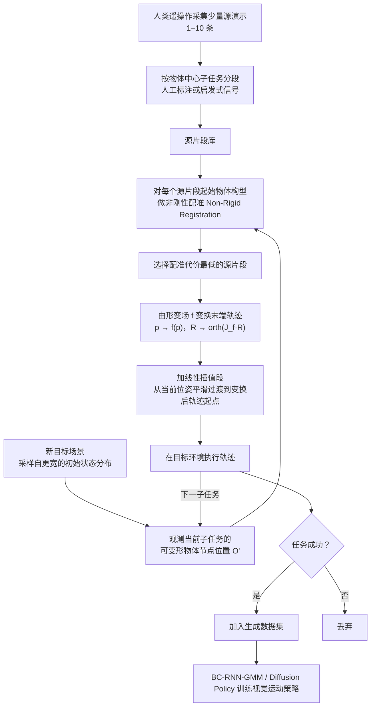

# SoftMimicGen

**SoftMimicGen**（ICRA 2026，NVIDIA 等）是一套面向**可变形物体操作（deformable object manipulation）**的自动化示范数据生成系统。

## 一句话定义

少量人类遥操作示范驱动的可变形物体操作数据自动生成系统。

## 英文缩写速查

| 缩写 | 英文 | 含义 |
|---|---|---|
| IL | Imitation Learning | 模仿学习 |
| DOF | Degrees of Freedom | 自由度 |
| PSM | Patient Side Manipulator | 手术机器人操作臂 |

## 为什么重要

可变形物体状态与接触动力学复杂，人工收集大规模示范成本高；自动数据扩增有助于降低数据采集成本。

## 流程总览

图依据：论文 §IV-A–C / Fig.2（SoftMimicGen 系统流程）、§V-A（策略训练）。

## 方法：核心流程

1. **Record**：通过遥操作录制少量人类示范。
2. **Annotate**：标记示范中的子任务边界。
3. **Generate**：在仿真环境中自动生成更多示范轨迹，供模仿学习策略训练。

覆盖毛巾折叠、绳索操作、毛绒玩具抓放、软组织操作及穿线等任务，支持 Franka、YAM、GR1T2 与 PSM 等机器人。

## 评测

论文展示多种软体物体操作任务及机器人平台。具体成功率、数据量和消融实验应以[论文原文](https://arxiv.org/abs/2603.25725)为准，本文不推测未核实数字。

## 对比：与相关工作

- **MimicGen**：从人类示范自动生成操作数据，主要针对刚体任务。
- **SoftMimicGen**：扩展到可变形物体及高保真软体仿真。
- **HumanoidMimicGen**：聚焦双足人形移动操作的数据生成；不是 SoftMimicGen 的别名。

## 结论

SoftMimicGen 将少量遥操作示范扩增为可变形物体操作训练数据；实际迁移效果取决于任务与仿真保真度。

## 关联页面

- [模仿学习](../methods/imitation-learning.md)
- [HumanoidMimicGen](./paper-humanoidmimicgen.md)

## 参考来源

- 论文：https://arxiv.org/abs/2603.25725
- 项目页及视频：https://softmimicgen.github.io/
- 开源代码：https://github.com/NVlabs/SoftMimicGen
- [来源归档](../../sources/papers/softmimicgen_arxiv_2603_25725.md)
- [arXiv PDF](https://arxiv.org/pdf/2603.25725)：已通读方法部分（实验与附录以略读为准）：§III 预备知识、§IV-A–C 方法、§V-A 实验设定开头
